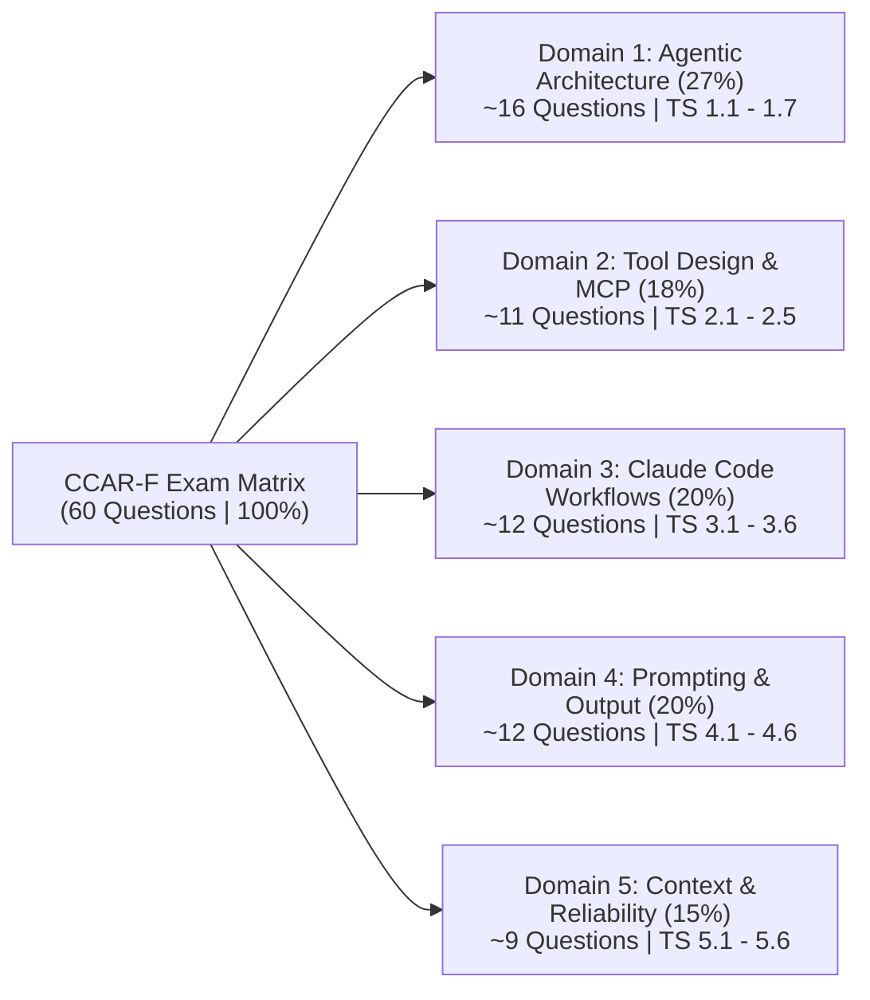
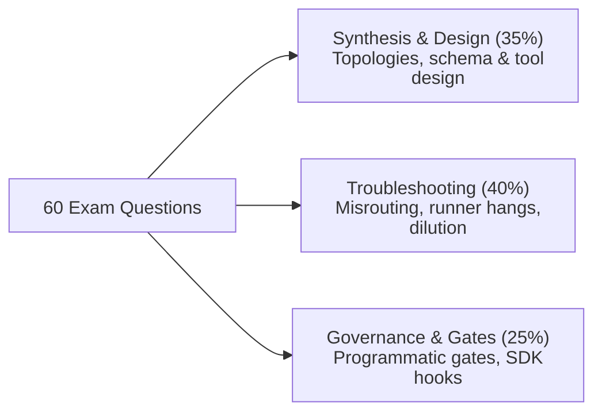

# Claude Certified Architect – Foundations (CCAR-F) Exam Blueprint

**Official Syllabus & Architectural Curriculum Specification**  
*Credential*: Claude Certified Architect – Foundations | *Passing Score*: 720 / 1000 (Scaled Score)  
*Format*: 60 Scenario-Based Questions | 120 Minutes (2.0 min/q) | 4 of 6 Production Scenarios Selected

---

## 📋 1. Exam Specifications & Candidate Profile

| Specification | Details | Architectural Relevance |
| :--- | :--- | :--- |
| **Credential** | Claude Certified Architect – Foundations (CCAR-F) | Validates systems design and architectural trade-off judgment for Claude |
| **Number of Questions** | 60 Multiple-Choice Questions | 1 correct answer, 3 plausible distractors; no unscored items |
| **Time Allowed** | 120 minutes | **2.0 minutes per question** pacing benchmark |
| **Passing Score** | **720 / 1000** (Scaled Score) | Scaled across forms to normalize difficulty variations |
| **Exam Structure** | **4 scenarios drawn from a bank of 6** | Questions are anchored directly to real customer production contexts |
| **Delivery & Cost** | Online Proctored or Test Center ($125 USD) | Pearson VUE platform; every question requires an answer before advancing |
| **Recertification** | 12-month validity period | Ensures architect currency with rapid Claude SDK and MCP releases |

### 🎯 Candidate Competencies
The exam targets Solution Architects, Lead Engineers, and AI Systems Architects with 6+ months of production experience who can:
1. Design resilient agentic control loops and multi-agent topologies using the **Claude Agent SDK**.
2. Engineer robust **Model Context Protocol (MCP)** tool/resource interfaces with structured error contracts.
3. Configure enterprise **Claude Code** workflows (`CLAUDE.md`, path-scoped rules, skills, CI/CD automation).
4. Enforce deterministic structured output via `tool_use`, JSON schemas, and validation-retry loops.
5. Protect context budgets, mitigate lost-in-the-middle degradation, and calibrate human-in-the-loop review.

---

## ⚖️ 2. Domain Weightings & Question Distribution

| Domain | Focus Area | Exam Weight | Approximate Items | Practice & Conceptual References |
| :---: | :--- | :---: | :---: | :--- |
| **Domain 1** | **Agentic Architecture & Orchestration** | **27%** | **~16 questions** | [Domain 1 Guide](domain1/README.md) · [Deep Dive Concepts](domain1/KEY_CONCEPTS.md) |
| **Domain 2** | **Tool Design & MCP Integration** | **18%** | **~11 questions** | [Domain 2 Guide](domain2/README.md) · [Deep Dive Concepts](domain2/KEY_CONCEPTS.md) |
| **Domain 3** | **Claude Code Configuration & Workflows** | **20%** | **~12 questions** | [Domain 3 Guide](domain3/README.md) · [Deep Dive Concepts](domain3/KEY_CONCEPTS.md) |
| **Domain 4** | **Prompt Engineering & Structured Output** | **20%** | **~12 questions** | [Domain 4 Guide](domain4/README.md) · [Deep Dive Concepts](domain4/KEY_CONCEPTS.md) |
| **Domain 5** | **Context Management & Reliability** | **15%** | **~9 questions** | [Domain 5 Guide](domain5/README.md) · [Deep Dive Concepts](domain5/KEY_CONCEPTS.md) |
| **Total** | **All 5 Domains (27 Task Statements)** | **100%** | **60 questions** | [Interactive Progress Checklist](PROGRESS.md) |

---

## 🚫 3. Official Scope Demarcation

| In-Scope Architectures (Focus Area) | Out-of-Scope Topics (Do Not Study) |
| :--- | :--- |
| • Agentic loops: `stop_reason` control (`tool_use` vs `end_turn`) | • Fine-tuning Claude models or custom model weights |
| • Multi-agent: Coordinator-subagents, `Task` spawning | • Claude API account billing, pricing math, or invoicing |
| • SDK hooks: `PreToolUse` (gating), `PostToolUse` (normalization) | • Deploying/hosting MCP server infrastructure (K8s/Docker) |
| • MCP servers, tools, resources, `isError`, `.mcp.json` | • Constitutional AI, RLHF, or alignment training details |
| • Claude Code: `CLAUDE.md` hierarchy, skills, path rules | • Embedding models or vector database implementations |
| • Plan mode vs. direct execution trade-offs | • Computer Use (desktop GUI interaction / OS automation) |
| • CI/CD headless execution (`-p`, `--output-format json`) | • Vision and multimodal image parsing capabilities |
| • Structured output via `tool_use` & JSON Schema | • Streaming API protocols or Server-Sent Events (SSE) |
| • Validation, retry feedback, and unrecoverable aborts | • Rate limiting calculations, token bucket algorithms |
| • Message Batches API: 50% discount, 24h SLA trade-offs | • Cloud provider-specific IAM setups (AWS IAM, GCP IAM) |
| • Context trimming, Case Facts layers, `/compact` | • Prompt caching mechanics (beyond knowing it exists) |
| • Stratified random sampling (5–10%) for drift audits | • Custom tokenization algorithms or BPE math |

---

## 🏛️ 4. The 27 Task Statements Curriculum Matrix

### [Domain 1: Agentic Architecture & Orchestration (27%)](domain1/README.md) · [Deep Dive Concepts](domain1/KEY_CONCEPTS.md)
*Designing autonomous loops, multi-agent topologies, subagent invocation, workflow gates, hooks, and session lifecycles.*

| Task Statement | Official Knowledge & Skills Required | Production Practice Code | Exam Distractor Alert |
| :--- | :--- | :--- | :--- |
| **TS 1.1: Agentic Loops** | Loop lifecycle, `stop_reason` inspection, tool result appending, model reasoning vs preconfigured trees. | [`main.py`](domain1/ts_1_1_multi_tool_agent_loop/main.py) | **Trap**: Parsing assistant text (`"Done"`) or using iteration turn caps as completion signal. |
| **TS 1.2: Coordinator-Subagent Patterns** | Hub-and-spoke topology, strict context isolation, dynamic query complexity routing, iterative synthesis. | [`main.py`](domain1/ts_1_2_coordinator_subagents/main.py) | **Trap**: Assuming subagents inherit parent history or allowing subagents to communicate peer-to-peer. |
| **TS 1.3: Subagent Invocation & Spawning** | `Task` tool in `allowedTools`, parallel subagent spawning in single turn, structured metadata passing. | [`main.py`](domain1/ts_1_3_subagent_invocation_spawning/main.py) | **Trap**: Spawning subagents sequentially across multiple turns (adds 40%+ latency). |
| **TS 1.4: Workflow Enforcement & Handoffs** | Programmatic prerequisite gates vs prompt guidance; deterministic compliance; structured handoff manifests. | [`main.py`](domain1/ts_1_4_prerequisite_enforcement/main.py) | **Trap**: Relying on prompt instructions ("never refund without verifying") for financial safety. |
| **TS 1.5: Agent SDK Hooks** | `PreToolUse` (interception / gating), `PostToolUse` (normalization), guaranteed vs probabilistic compliance. | [`main.py`](domain1/ts_1_5_sdk_hooks/main.py) | **Trap**: Normalizing heterogeneous data in the prompt instead of deterministically in `PostToolUse`. |
| **TS 1.6: Task Decomposition Strategies** | Prompt chaining vs dynamic decomposition; attention dilution in multi-file changes; two-pass review. | [`main.py`](domain1/ts_1_6_task_decomposition/main.py) | **Trap**: Evaluating 15+ files in a single prompt or expanding model context window. |
| **TS 1.7: Session State, Resumption & Forking** | `--resume <session>`, `fork_session` for divergent branches; injecting summaries over stale sessions. | [`main.py`](domain1/ts_1_7_session_management/main.py) | **Trap**: Resuming a stale conversation after code changes without informing the agent of file diffs. |

---

### [Domain 2: Tool Design & MCP Integration (18%)](domain2/README.md) · [Deep Dive Concepts](domain2/KEY_CONCEPTS.md)
*Tool descriptions, structured error contracts, least privilege allocation, MCP server scoping, and built-in tool selection.*

| Task Statement | Official Knowledge & Skills Required | Production Practice Code | Exam Distractor Alert |
| :--- | :--- | :--- | :--- |
| **TS 2.1: Tool Interface Design** | Descriptions as primary selection mechanism; input formats, edge cases, boundaries between similar tools. | [`main.py`](domain2/ts_2_1_tool_interface_design/main.py) | **Trap**: Building an external ML routing classifier instead of clarifying tool descriptions. |
| **TS 2.2: Structured MCP Error Handling** | `isError` flag, categorization (`transient`, `validation`, `business`, `permission`), `isRetryable: bool`. | [`main.py`](domain2/ts_2_2_mcp_structured_errors/main.py) | **Trap**: Throwing raw exceptions or returning generic `"Operation failed"` text strings. |
| **TS 2.3: Tool Distribution & Tool Choice** | Tool saturation degradation (18 vs 4–5 tools); least privilege; `tool_choice` (`auto`, `any`, forced tool). | [`main.py`](domain2/ts_2_3_tool_distribution_and_choice/main.py) | **Trap**: Giving every subagent full access to all tools "just in case". |
| **TS 2.4: MCP Server Integration** | Project `.mcp.json` vs user `~/.claude.json`; `${ENV_VAR}` expansion; MCP resources for read-only catalogs. | [`main.py`](domain2/ts_2_4_mcp_server_integration/main.py) | **Trap**: Hardcoding API tokens in `.mcp.json` or placing team servers in user-level configuration. |
| **TS 2.5: Built-in Tools Selection** | `Glob` (paths) → `Grep` (patterns) → `Read` (files); `Edit` collision fallback to `Read + Write`. | [`main.py`](domain2/ts_2_5_builtin_tools_usage/main.py) | **Trap**: Bulk-reading entire repositories into context; retrying failing `Edit` calls repeatedly. |

---

### [Domain 3: Claude Code Configuration & Workflows (20%)](domain3/README.md) · [Deep Dive Concepts](domain3/KEY_CONCEPTS.md)
*`CLAUDE.md` hierarchy, custom slash commands, path-scoped rules, plan mode vs direct execution, interview pattern, and CI/CD.*

| Task Statement | Official Knowledge & Skills Required | Production Practice Code | Exam Distractor Alert |
| :--- | :--- | :--- | :--- |
| **TS 3.1: CLAUDE.md Hierarchy & Scoping** | User (`~/.claude/`) → Project (`.claude/`) → Directory; `@import` modularity; `/memory` command. | [`main.py`](domain3/ts_3_1_claude_code_workflows/main.py) | **Trap**: Storing shared team conventions in `~/.claude/CLAUDE.md` (not committed to Git). |
| **TS 3.2: Commands & Custom Skills** | Project `.claude/commands/`, `SKILL.md` frontmatter (`context: fork`, `allowed-tools`, `argument-hint`). | [`main.py`](domain3/ts_3_2_slash_commands_and_skills/main.py) | **Trap**: Running verbose discovery commands in the primary session context without `context: fork`. |
| **TS 3.3: Path-Specific Rules** | YAML frontmatter `paths: [...]` glob patterns; conditional loading on file match to conserve context. | [`main.py`](domain3/ts_3_3_path_specific_rules/main.py) | **Trap**: Placing rules for scattered files (e.g. `**/*.test.*`) into directory-bound `CLAUDE.md`. |
| **TS 3.4: Plan Mode vs Direct Execution** | Plan mode for architectural/multi-file refactors (40+ files); Direct execution for single-file scoped fixes. | [`main.py`](domain3/ts_3_4_plan_mode_and_refinement/main.py) | **Trap**: Entering Plan Mode for trivial single-file syntax corrections. |
| **TS 3.5: Iterative Refinement & Interview** | 2–3 concrete I/O examples; test-driven iteration; Interview Pattern for surfacing hidden requirements. | [`main.py`](domain3/ts_3_5_iterative_refinement_interview/main.py) | **Trap**: Supplying vague prose instructions ("make it faster") rather than input/output test assertions. |
| **TS 3.6: CI/CD Pipeline Integration** | Non-interactive `-p` / `--print` flag; `--output-format json`; `--json-schema`; independent review instance. | [`main.py`](domain3/ts_3_6_cicd_pipeline_automation/main.py) | **Trap**: Running `claude` in automated CI scripts without `-p` (hangs runner waiting for stdin). |

---

### [Domain 4: Prompt Engineering & Structured Output (20%)](domain4/README.md) · [Deep Dive Concepts](domain4/KEY_CONCEPTS.md)
*Explicit rubrics, negative boundaries, few-shot reasoning, schema enforcement via tool use, validation-retry limits, and Batches.*

| Task Statement | Official Knowledge & Skills Required | Production Practice Code | Exam Distractor Alert |
| :--- | :--- | :--- | :--- |
| **TS 4.1: Explicit Criteria & False Positives** | Concrete categorical rubrics with negative boundaries to minimize false alarms; severity criteria. | [`main.py`](domain4/ts_4_1_explicit_criteria_classification/main.py) | **Trap**: Prompting "only report high-confidence findings" (fails to reduce false alarms). |
| **TS 4.2: Few-Shot Prompting & Consistency** | 2–4 targeted input/output pairs demonstrating reasoning on edge cases; format consistency. | [`main.py`](domain4/ts_4_2_few_shot_and_multi_instance/main.py) | **Trap**: Stacking 20+ examples that consume context without demonstrating distinct edge cases. |
| **TS 4.3: Structured Output via Tool Use** | Guaranteed JSON syntax via `tool_use`; nullable fields prevent hallucinations; enum `"other"` + detail. | [`main.py`](domain4/ts_4_3_structured_output_tool_use/main.py) | **Trap**: Making all schema fields required when source documents lack data (causes hallucinations). |
| **TS 4.4: Validation & Retry Loops** | Targeted feedback on schema/math errors; fast-failing and escalating when source facts are absent. | [`main.py`](domain4/ts_4_4_validation_retry_feedback/main.py) | **Trap**: Retrying extraction when the document simply does not contain the required entity. |
| **TS 4.5: Message Batches API Strategy** | 50% discount for 24h non-blocking jobs; `custom_id` tracking; forbidden for blocking CI gates. | [`main.py`](domain4/ts_4_5_message_batches_api/main.py) | **Trap**: Proposing the Batch API for blocking PR merge checks (takes up to 24 hours). |
| **TS 4.6: Multi-Instance & Multi-Pass Review** | Independent review instances (no author bias); Pass 1 file-level local, Pass 2 cross-file integration. | [`main.py`](domain4/ts_4_6_multi_pass_review/main.py) | **Trap**: Asking the generating Claude session to perform a "rigorous self-review" of its own code. |

---

### [Domain 5: Context Management & Reliability (15%)](domain5/README.md) · [Deep Dive Concepts](domain5/KEY_CONCEPTS.md)
*Case Facts layer, tool output trimming, immediate escalation, error propagation, scratchpads, and stratified sampling.*

| Task Statement | Official Knowledge & Skills Required | Production Practice Code | Exam Distractor Alert |
| :--- | :--- | :--- | :--- |
| **TS 5.1: Context Window Preservation** | Immutable "Case Facts" block outside summarized history; aggressive tool output trimming. | [`main.py`](domain5/ts_5_1_context_preservation/main.py) | **Trap**: Relying on generic progressive summarization for order numbers, prices, and dates. |
| **TS 5.2: Escalation & Ambiguity Patterns** | Immediate escalation on human demand; proactive clarification on multi-match ties; policy gap triggers. | [`main.py`](domain5/ts_5_2_escalation_and_provenance/main.py) | **Trap**: Forcing customer through diagnostic questions when they explicitly ask for a human. |
| **TS 5.3: Error Propagation & Coverage** | Distinguish valid empty sets from upstream outages; synthesize coverage manifests with gaps. | [`main.py`](domain5/ts_5_3_error_propagation_coverage/main.py) | **Trap**: Silently suppressing errors by returning an empty list as a successful result. |
| **TS 5.4: Codebase Exploration & Scratchpads** | Scratchpad pattern, Explore subagent, and structured state manifests for crash recovery; `/compact`. | [`main.py`](domain5/ts_5_4_scratchpads_and_human_review/main.py) | **Trap**: Allowing raw file exploration outputs to accumulate in the main coordinator context. |
| **TS 5.5: Human Review & Confidence Calibration** | Calibrated routing with 5–10% stratified random sampling of high-confidence extractions. | [`main.py`](domain5/ts_5_5_human_review_calibration/main.py) | **Trap**: Automating 100% of high-confidence extractions without random sampling audits. |
| **TS 5.6: Provenance & Uncertainty Handling** | Timestamps and source citations; preserving conflicting data with attribution without averaging. | [`main.py`](domain5/ts_5_6_provenance_and_uncertainty/main.py) | **Trap**: Averaging conflicting numerical figures from different sources into a single fabricated number. |

---

## 🎯 5. The 6 Production Scenarios Architecture Matrix

On every CCAR-F exam form, **4 of these 6 production scenarios are randomly selected**, anchoring the majority of scenario questions.

👉 **Practice Exam Hub**: For the complete 60-question authentic diagnostic practice exam and scenario decision trees, see [**`scenarios/MASTER_SCENARIO_PRACTICE.md`**](scenarios/MASTER_SCENARIO_PRACTICE.md).

| Scenario | Target Domains & Weaved TS | Core Architectural Patterns & SLAs | Dedicated Lab Links |
| :--- | :--- | :--- | :--- |
| **[Scenario 1: Customer Support Resolution Agent](scenarios/scenario_1_customer_support/)** | **D1, D2, D5** `TS 1.4, 2.1, 2.2, 5.1, 5.2` | • Programmatic auth prerequisite gate before refund tools • Immediate human escalation on user demand • Context trimming (55 raw CRM fields → 4 attributes) • Immutable Case Facts layer • **SLA**: $\ge 80\%$ FCR, $<2.5\text{s}$ turn latency | [Guide](scenarios/scenario_1_customer_support/SCENARIO_GUIDE.md) [Simulation](scenarios/scenario_1_customer_support/simulation.py) [Tests](scenarios/scenario_1_customer_support/test_scenario_1_simulation.py) |
| **[Scenario 2: Code Generation with Claude Code](scenarios/scenario_2_code_generation/)** | **D3, D5** `TS 3.1, 3.2, 3.3, 3.4, 3.5` | • Path-scoped rules in `.claude/rules/*.md` • Plan Mode for multi-file architectural refactors • Interview Pattern with concrete selectable options • Custom skills with `context: fork` • **SLA**: $<40\text{k}$ context tokens, 0 assumptions | [Guide](scenarios/scenario_2_code_generation/SCENARIO_GUIDE.md) [Simulation](scenarios/scenario_2_code_generation/simulation.py) [Tests](scenarios/scenario_2_code_generation/test_scenario_2_simulation.py) |
| **[Scenario 3: Multi-Agent Research System](scenarios/scenario_3_multi_agent_research/)** | **D1, D2, D5** `TS 1.2, 1.3, 2.4, 5.3, 5.6` | • Single-turn concurrent `Task` spawning • Strict subagent context isolation • `VALID_EMPTY` vs `UPSTREAM_FAILURE` differentiation • Preserving conflicting statistics with citations • **SLA**: $<20\text{s}$ turn latency, 100% cited sources | [Guide](scenarios/scenario_3_multi_agent_research/SCENARIO_GUIDE.md) [Simulation](scenarios/scenario_3_multi_agent_research/simulation.py) [Tests](scenarios/scenario_3_multi_agent_research/test_scenario_3_simulation.py) |
| **[Scenario 4: Developer Productivity with Claude](scenarios/scenario_4_developer_productivity/)** | **D1, D2, D3** `TS 1.7, 2.3, 2.4, 2.5` | • Progressive discovery (`Glob` → `Grep` → chunked `Read`) • Surgical `Edit` with fallback to `Read + Write` • Exposing API catalogs as read-only MCP Resources • Least-privilege tool allocation (4–5 tools) • **SLA**: $<15\text{k}$ exploration context tokens | [Guide](scenarios/scenario_4_developer_productivity/SCENARIO_GUIDE.md) [Simulation](scenarios/scenario_4_developer_productivity/simulation.py) [Tests](scenarios/scenario_4_developer_productivity/test_scenario_4_simulation.py) |
| **[Scenario 5: Claude Code for Continuous Integration](scenarios/scenario_5_continuous_integration/)** | **D3, D4** `TS 3.6, 4.1, 4.5, 4.6` | • Non-interactive headless execution (`-p`, `--output-format json`) • Two-Pass Review (Pass 1 file local, Pass 2 integration) • Avoiding Batch API for blocking PR checks • Negative boundaries in rubrics to avoid test false alarms • **SLA**: $<3\text{m}$ PR review latency | [Guide](scenarios/scenario_5_continuous_integration/SCENARIO_GUIDE.md) [Simulation](scenarios/scenario_5_continuous_integration/simulation.py) [Tests](scenarios/scenario_5_continuous_integration/test_scenario_5_simulation.py) |
| **[Scenario 6: Structured Data Extraction](scenarios/scenario_6_structured_data_extraction/)** | **D4, D5** `TS 4.3, 4.4, 4.5, 5.5` | • Schema enforcement via `tool_use` • Nullable fields for non-guaranteed attributes • Closed-loop retry with targeted feedback; fast failure • Confidence calibration + 10% stratified sampling • **SLA**: $\ge 85\%$ STP, 0 fabricated facts | [Guide](scenarios/scenario_6_structured_data_extraction/SCENARIO_GUIDE.md) [Simulation](scenarios/scenario_6_structured_data_extraction/simulation.py) [Tests](scenarios/scenario_6_structured_data_extraction/test_scenario_6_simulation.py) |

---

## 🎯 6. Question Design & Cognitive Levels

The exam questions are written by Anthropic Subject Matter Experts to evaluate architectural judgment rather than textbook recall:

1. **Synthesis & Design (~35% of exam)**: Designing end-to-end multi-agent topologies, tool distribution schemas, or context compaction strategies to meet explicit business SLAs.
2. **Troubleshooting & Remediation (~40% of exam)**: Diagnosing misrouting, runner hangs, attention dilution, or data degradation from production logs and selecting the optimal architectural remedy.

> 💡 **Next Steps**: For the high-yield decision tables, 15 Golden Architectural Rules, distractor elimination playbooks, and exam-day pacing strategy, review the companion [**`EXAM_REFRESHER.md`**](EXAM_REFRESHER.md).

---

## 🔗 Master Navigation Hub

- ⚡ [**Exam Refresher Cheat Sheet (`EXAM_REFRESHER.md`)**](EXAM_REFRESHER.md): The 15 Golden Rules, rapid decision matrix, and distractor traps.
- 🎯 [**Master Scenario Practice (`scenarios/MASTER_SCENARIO_PRACTICE.md`)**](scenarios/MASTER_SCENARIO_PRACTICE.md): Complete 60-question authentic diagnostic practice exam.
- 📖 [**Official Scenarios Guide (`scenarios/README.md`)**](scenarios/README.md): Detailed scenario walkthroughs and architecture guides.
- ✅ [**Progress Tracker (`PROGRESS.md`)**](PROGRESS.md): 27 task statements and 6 scenario checklist.
- 🏠 [**Root README (`README.md`)**](README.md): Main repository hub and zero-token offline test suite.
- 🛡️ [**Execution Policy (`EXECUTION_POLICY.md`)**](EXECUTION_POLICY.md): Zero-token testing and live execution standards.
