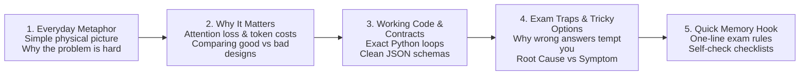
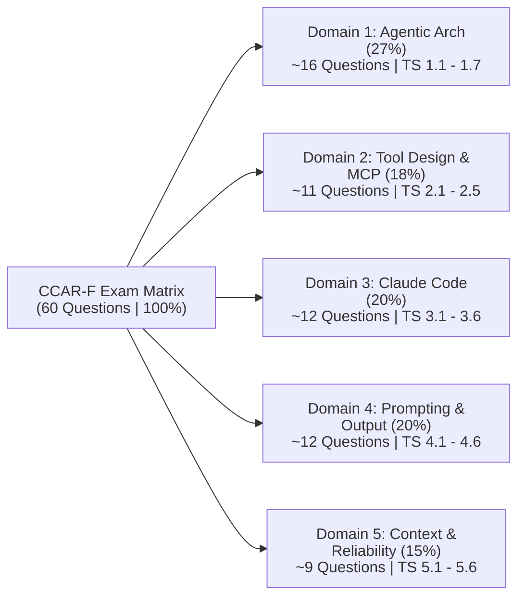
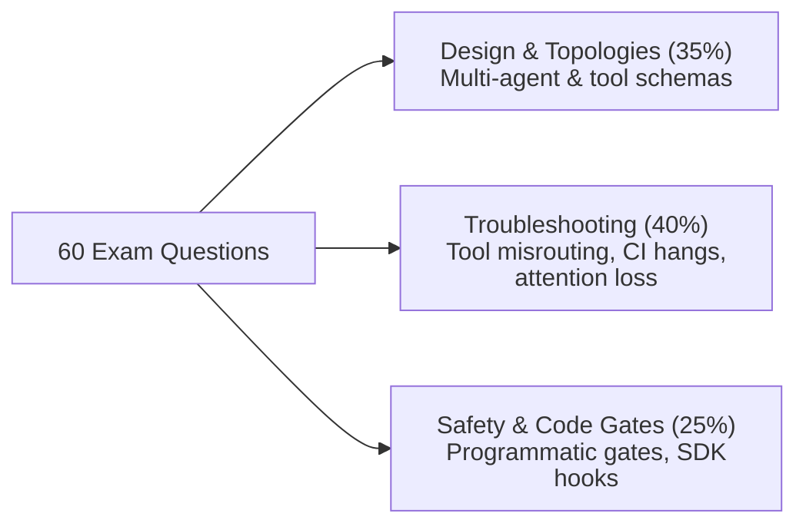

# Claude Certified Architect – Foundations (CCAR-F) Exam Blueprint

**Official Syllabus & Systems Architecture Curriculum**  
*Credential*: Claude Certified Architect – Foundations (CCAR-F) | *Passing Score*: 720 / 1000 (Scaled Score)  
*Format*: 60 Scenario-Based Questions | 120 Minutes (2.0 min/q) | 4 of 6 Production Scenarios Selected

---

## 📋 1. Exam Specifications & Candidate Profile

| Specification | Details | Architectural Relevance |
| :--- | :--- | :--- |
| **Credential** | Claude Certified Architect – Foundations (CCAR-F) | Validates systems design, reliability engineering, and trade-off decisions for Claude applications. |
| **Number of Questions** | 60 Multiple-Choice Questions | 1 correct answer, 3 plausible distractors; no unscored pilot items. |
| **Time Allowed** | 120 minutes | Pacing benchmark of exactly **2.0 minutes per question**. |
| **Passing Score** | **720 / 1000** (Scaled Score) | Scaled across exam forms to balance difficulty across scenarios. |
| **Exam Structure** | **4 scenarios drawn randomly from a bank of 6** | Every item is anchored to realistic customer production problems and SLAs. |
| **Delivery & Cost** | Online Proctored or Test Center (\$125 USD) | Administered via Pearson VUE; every question requires a selected answer before advancing. |
| **Recertification** | 12-month validity period | Keeps architects up to date with new Claude Agent SDK and MCP releases. |

### 🎯 Candidate Competencies: The Systems Architect Shift
The CCAR-F certification targets Senior Software Engineers, Solution Architects, and Systems Architects who are moving past basic chatbot prompting to build reliable, stateful software systems. Certified architects know how to:
1. **Control Agentic Loops**: Build client-side control loops using `stop_reason == "end_turn"` and `tool_use` state machines via the **Claude Agent SDK**.
2. **Design Model Context Protocol (MCP) Tools**: Create clear tool descriptions, structured error objects (`isError`, categories, retry signals), and read-only MCP Resources.
3. **Configure Enterprise Claude Code**: Set up configuration hierarchies (`CLAUDE.md`), path-scoped rules (`.claude/rules/*.md`), custom skills with sandbox forking, and headless CI/CD (`-p`).
4. **Guarantee Structured Output**: Guarantee valid JSON through `tool_use`, handle missing facts with nullable fields, and build validation-retry loops.
5. **Manage Context & Human Review**: Prevent context bloat, establish immutable Case Facts layers, and audit automated decisions with stratified random sampling.

---

## 🧠 2. The 5-Step Learning Method

To master real engineering intuition, every topic and scenario in this curriculum follows 5 clear steps:

> **1. Simple Picture (Mental Model)** → **2. Architectural Why** → **3. Working Code / Schema** → **4. Exam Traps & Wrong Answers** → **5. Memory Hook**



### The 4 Production Failure Modes
Architectural decisions on the CCAR-F exam come down to solving four core failure modes of large language models:

1. **Attention Dilution (Losing Focus)**: When you dump too many files or competing instructions into one prompt, Claude's attention spreads thin—just like a human reading 20 browser tabs at once. Subtle bugs and edge cases get missed. *Fix*: Multi-pass review, prompt chaining, and giving agents only 4–5 tools.
2. **Context Saturation & Growing Token Costs (O(N²))**: As conversations grow, every new token has to pay attention to every previous token. Unchecked history makes calls slow and expensive. *Fix*: Trimming tool outputs with `PostToolUse` hooks, keeping Case Facts outside summaries, and using scratchpads.
3. **Why Prompts Fail Under Pressure**: Natural language instructions (like "Please verify ID first") are like polite signs. Under tricky user prompts or high complexity, the model will occasionally ignore them. *Fix*: Real code gates and SDK `PreToolUse` hooks running in deterministic application code.
4. **Tool Misrouting**: When tool descriptions are short or overlap (like `get_customer` vs `lookup_order`), Claude has to guess which to pick. *Fix*: Rich descriptions with expected formats, examples, and negative boundaries ("Do NOT use for X; use Y").

---

## ⚖️ 3. Domain Weightings & Question Distribution

| Domain | Focus Area | Exam Weight | Approximate Items | Practice & Conceptual References |
| :---: | :--- | :---: | :---: | :--- |
| **Domain 1** | **Agentic Architecture & Orchestration** | **27%** | **~16 questions** | [Domain 1 Guide](domain1/README.md) · [Deep Dive Concepts](domain1/KEY_CONCEPTS.md) |
| **Domain 2** | **Tool Design & MCP Integration** | **18%** | **~11 questions** | [Domain 2 Guide](domain2/README.md) · [Deep Dive Concepts](domain2/KEY_CONCEPTS.md) |
| **Domain 3** | **Claude Code Configuration & Workflows** | **20%** | **~12 questions** | [Domain 3 Guide](domain3/README.md) · [Deep Dive Concepts](domain3/KEY_CONCEPTS.md) |
| **Domain 4** | **Prompt Engineering & Structured Output** | **20%** | **~12 questions** | [Domain 4 Guide](domain4/README.md) · [Deep Dive Concepts](domain4/KEY_CONCEPTS.md) |
| **Domain 5** | **Context Management & Reliability** | **15%** | **~9 questions** | [Domain 5 Guide](domain5/README.md) · [Deep Dive Concepts](domain5/KEY_CONCEPTS.md) |
| **Total** | **All 5 Domains (27 Task Statements)** | **100%** | **60 questions** | [Interactive Progress Checklist](PROGRESS.md) |



---

## 🏛️ 4. Architectural Topologies: Comparing Trade-Offs

The exam tests whether you can pick the right architecture for speed, cost, and reliability:

### Multi-Agent Topologies (Domain 1)
| Pattern | How It Works | Strengths | Production Weaknesses | Exam Verdict |
| :--- | :--- | :--- | :--- | :--- |
| **Monolithic Single Agent** | One big agent with all system tools and all chat history. | Simple setup; single loop. | High attention dilution; tool confusion; context bloat. | Only for simple, quick tasks with ≤ 3 tools. |
| **Peer-to-Peer Mesh** | Subagents call each other directly without a central boss. | Decentralized. | Message explosions (O(N²)); runaway loops; zero central audit trail. | **Anti-Pattern on Exam**: Always reject in favor of Hub-and-Spoke. |
| **Hub-and-Spoke (Coordinator)** | Central coordinator breaks down the goal and delegates to isolated workers via `Task`. | Isolated contexts; single point of error handling; runs workers in parallel. | Coordinator can become a bottleneck if tasks are sliced too small. | **Gold Standard**: Research, complex reports ([Scenario 3](scenarios/scenario_3_multi_agent_research/)). |

### Execution Workflows (Domain 3)
| Execution Mode | How It Operates | Speed / Token Cost | Risk Profile | When to Use on the Exam |
| :--- | :--- | :--- | :--- | :--- |
| **Direct Execution** | Claude writes code edits or bash commands immediately. | Fast; low token cost for small fixes. | Can make broken assumptions on large codebases. | Small, single-file bug fixes with known error traces. |
| **Plan Mode** | Claude explores files, drafts an architecture blueprint, and waits for approval. | Higher upfront token cost; prevents costly rework. | Slower initial turnaround; overkill for one-line edits. | Multi-file refactors (10+ files), service migrations ([Scenario 2](scenarios/scenario_2_code_generation/)). |

### Structured Output Strategies (Domain 4)
| Strategy | How It Works | Syntax Guarantee | Hallucination Risk | When to Use on the Exam |
| :--- | :--- | :--- | :--- | :--- |
| **Markdown Regex Parsing** | Ask Claude for ` ```json ` markdown code block; parse string in Python. | Zero guarantee (markdown prose breaks `json.loads`). | High (model explains missing fields in prose). | Legacy anti-pattern; reject on exam. |
| **Schema via `tool_use` (All Required)** | Model invokes tool with schema where all fields are mandatory. | 100% valid JSON syntax. | High (Claude fabricates missing data to satisfy schema). | Only when every document is guaranteed to contain every single field. |
| **Schema via `tool_use` + Nullable Fields** | Tool schema marks uncertain fields as `["string", "null"]`. | 100% valid JSON syntax. | Zero (Claude returns `null` instead of guessing). | Enterprise invoices, insurance, and medical records ([Scenario 6](scenarios/scenario_6_structured_data_extraction/)). |

---

## 🚫 5. Official Scope Demarcation

| In Scope (What to Study) | Out of Scope (Do Not Study) |
| :--- | :--- |
| • Agent loops: `stop_reason` control (`tool_use`, `end_turn`, `pause_turn`) | • Fine-tuning model weights or LoRA adapters |
| • Multi-agent: Hub-and-spoke coordination, parallel `Task` spawning | • Claude API billing tiers, payment methods, or invoicing math |
| • SDK hooks: `PreToolUse` (gating), `PostToolUse` (trimming) | • Deploying MCP servers on Kubernetes, Docker, or Nomad |
| • MCP servers, tools, resources, `isError`, `.mcp.json` environment expansion | • Constitutional AI, RLHF, DPO, or internal training algorithms |
| • Claude Code: `CLAUDE.md` hierarchy, skills (`context: fork`), path rules | • Embedding models, vector distance math, or vector DB internals |
| • Plan mode vs. direct execution and the Interview Pattern | • Computer Use (desktop GUI interaction / OS mouse automation) |
| • CI/CD headless automation (`-p`, `--output-format json`, `--json-schema`) | • Multimodal image parsing, vision models, or OCR pipelines |
| • Structured output via `tool_use` & JSON Schema with nullable attributes | • Streaming protocols, WebSockets, or Server-Sent Events (SSE) |
| • Closed-loop validation, retry feedback, and unrecoverable error aborts | • Rate limiting algorithms (token bucket, sliding window math) |
| • Message Batches API: 50% discount, 24h turnaround trade-offs | • Cloud provider-specific IAM setups (AWS IAM, GCP IAM, Azure RBAC) |
| • Context trimming, Case Facts layers, `/compact` summarization | • Prompt caching internals (beyond knowing it saves cost and latency) |
| • Stratified random sampling (5–10%) for drift audits & confidence routing | • Custom tokenization algorithms or Byte-Pair Encoding (BPE) math |

---

## 🏛️ 6. The 27 Task Statements Curriculum Matrix

### [Domain 1: Agentic Architecture & Orchestration (27%)](domain1/README.md) · [Deep Dive Concepts](domain1/KEY_CONCEPTS.md)
*Designing autonomous loops, multi-agent topologies, subagent invocation, workflow gates, hooks, and session lifecycles.*

| Task Statement | Simple Picture | Core Knowledge & Skills | Practice Code | Exam Trap to Avoid |
| :--- | :--- | :--- | :--- | :--- |
| **TS 1.1: Agentic Loops** | Car Dashboard: Claude is the gauge (`stop_reason`); code operates the pedal and wheels. | Loop lifecycle, deterministic `stop_reason` inspection, tool result appending, safety caps. | [`main.py`](domain1/ts_1_1_multi_tool_agent_loop/main.py) | **Trap**: Parsing text (`"Done"`) or using turn caps as completion signal. |
| **TS 1.2: Coordinator-Subagent Patterns** | Air Traffic Controller: Tower coordinates isolated planes without pilot chatter. | Hub-and-spoke topology, strict context isolation, dynamic complexity routing. | [`main.py`](domain1/ts_1_2_coordinator_subagents/main.py) | **Trap**: Assuming subagents inherit parent history or chat peer-to-peer. |
| **TS 1.3: Subagent Invocation & Spawning** | Kitchen Order Tickets: Head chef pins 3 tickets at once so line cooks prepare dishes concurrently. | `Task` tool in `allowedTools`, parallel subagent spawning in single turn, metadata passing. | [`main.py`](domain1/ts_1_3_subagent_invocation_spawning/main.py) | **Trap**: Spawning subagents sequentially across multiple turns (adds 40%+ latency). |
| **TS 1.4: Workflow Enforcement & Handoffs** | Bank Vault Turnstile: A paper sign cannot stop an intruder; only a real deadbolt enforces entry. | Programmatic prerequisite gates vs prompt guidance; structured handoff manifests. | [`main.py`](domain1/ts_1_4_prerequisite_enforcement/main.py) | **Trap**: Relying on prompt warnings ("never refund without verifying") for financial safety. |
| **TS 1.5: Agent SDK Hooks** | Security Scanner & Currency Exchange: `PreToolUse` halts prohibited items; `PostToolUse` normalizes currency. | `PreToolUse` (interception / gating), `PostToolUse` (normalization), guaranteed compliance. | [`main.py`](domain1/ts_1_5_sdk_hooks/main.py) | **Trap**: Normalizing messy data in the prompt instead of deterministically in `PostToolUse`. |
| **TS 1.6: Task Decomposition Strategies** | Assembly Line Inspection: Check individual parts first, then test the assembled car. | Prompt chaining vs adaptive decomposition; attention dilution in multi-file changes. | [`main.py`](domain1/ts_1_6_task_decomposition/main.py) | **Trap**: Evaluating 15+ files in a single prompt or expanding model context window. |
| **TS 1.7: Session State, Resumption & Forking** | Tree Pruning & Lab Notebook: Save verified branch points; prune stale dead ends before proceeding. | `--resume <session>`, `fork_session` for divergent branches; injecting summaries over stale sessions. | [`main.py`](domain1/ts_1_7_session_management/main.py) | **Trap**: Resuming a stale conversation after code changes without informing the agent of file diffs. |

---

### [Domain 2: Tool Design & MCP Integration (18%)](domain2/README.md) · [Deep Dive Concepts](domain2/KEY_CONCEPTS.md)
*Tool descriptions, structured error contracts, least privilege allocation, MCP server scoping, and built-in tool selection.*

| Task Statement | Simple Picture | Core Knowledge & Skills | Practice Code | Exam Trap to Avoid |
| :--- | :--- | :--- | :--- | :--- |
| **TS 2.1: Tool Interface Design** | Labeled Kitchen Drawers: Labeling a drawer "stuff" causes confusion; labeling "forks, NOT knives" works. | Descriptions as primary selection mechanism; input formats, edge cases, boundaries. | [`main.py`](domain2/ts_2_1_tool_interface_design/main.py) | **Trap**: Building an external ML routing classifier instead of clarifying tool descriptions. |
| **TS 2.2: Structured MCP Error Handling** | Emergency Room Triage Tag: Tag indicates whether injury is minor (retryable), chronic, or fatal (escalate). | `isError` flag, categorization (`transient`, `validation`, `business`, `permission`), `isRetryable: bool`. | [`main.py`](domain2/ts_2_2_mcp_structured_errors/main.py) | **Trap**: Throwing raw exceptions or returning generic `"Operation failed"` text strings. |
| **TS 2.3: Tool Distribution & Tool Choice** | Specialist's Toolbelt: A carpenter carries a hammer and tape, not the whole hardware store. | Tool saturation degradation (18 vs 4–5 tools); least privilege; `tool_choice` modes. | [`main.py`](domain2/ts_2_3_tool_distribution_and_choice/main.py) | **Trap**: Giving every subagent full access to all tools "just in case". |
| **TS 2.4: MCP Server Integration** | Library Card Catalog: Browse card catalog (MCP Resource) instead of walking every aisle. | Project `.mcp.json` vs user `~/.claude.json`; `${ENV_VAR}` expansion; MCP resources. | [`main.py`](domain2/ts_2_4_mcp_server_integration/main.py) | **Trap**: Hardcoding API tokens in `.mcp.json` or placing team servers in user-level configuration. |
| **TS 2.5: Built-in Tools Selection** | Map, Magnifying Glass, Scalpel: Map (`Glob`) finds cities; glass (`Grep`) finds street; scalpel (`Edit`) repairs sign. | `Glob` (paths) → `Grep` (patterns) → `Read` (files); `Edit` collision fallback to `Read + Write`. | [`main.py`](domain2/ts_2_5_builtin_tools_usage/main.py) | **Trap**: Bulk-reading entire repositories into context; retrying failing `Edit` calls repeatedly. |

---

### [Domain 3: Claude Code Configuration & Workflows (20%)](domain3/README.md) · [Deep Dive Concepts](domain3/KEY_CONCEPTS.md)
*`CLAUDE.md` hierarchy, custom slash commands, path-scoped rules, plan mode vs direct execution, interview pattern, and CI/CD.*

| Task Statement | Simple Picture | Core Knowledge & Skills | Practice Code | Exam Trap to Avoid |
| :--- | :--- | :--- | :--- | :--- |
| **TS 3.1: CLAUDE.md Hierarchy & Scoping** | Employee Handbook & Office Rules: Company handbook applies globally; team board adds local standards. | User (`~/.claude/`) → Project (`.claude/`) → Directory; `@import` modularity; `/memory` command. | [`main.py`](domain3/ts_3_1_claude_code_workflows/main.py) | **Trap**: Storing shared team conventions in `~/.claude/CLAUDE.md` (not committed to Git). |
| **TS 3.2: Commands & Custom Skills** | Specialized Subcontractor: Subcontractor does messy demo in sandbox (`context: fork`) and gives clean report. | Project `.claude/commands/`, `SKILL.md` frontmatter (`context: fork`, `allowed-tools`, `argument-hint`). | [`main.py`](domain3/ts_3_2_slash_commands_and_skills/main.py) | **Trap**: Running verbose discovery commands in primary context without `context: fork`. |
| **TS 3.3: Path-Specific Rules** | PPE in the Cleanroom: Hard hat rules apply on construction sites; sterile gown rules apply in labs. | YAML frontmatter `paths: [...]` glob patterns; conditional loading on file match. | [`main.py`](domain3/ts_3_3_path_specific_rules/main.py) | **Trap**: Placing rules for scattered files (e.g. `**/*.test.*`) into directory-bound `CLAUDE.md`. |
| **TS 3.4: Plan Mode vs Direct Execution** | Architectural Blueprint vs Spackling: Draw blueprints before moving walls; fix drywall holes directly. | Plan mode for architectural refactors (40+ files); Direct execution for single-file scoped fixes. | [`main.py`](domain3/ts_3_4_plan_mode_and_refinement/main.py) | **Trap**: Entering Plan Mode for trivial single-file syntax corrections. |
| **TS 3.5: Iterative Refinement & Interview** | Tailor Fitting a Suit: Tailor pins seams with 2–3 precise measurements instead of guessing "make it nice". | 2–3 concrete I/O examples; test-driven iteration; Interview Pattern for hidden requirements. | [`main.py`](domain3/ts_3_5_iterative_refinement_interview/main.py) | **Trap**: Supplying vague prose instructions ("make it faster") rather than input/output test assertions. |
| **TS 3.6: CI/CD Pipeline Integration** | Silent Robot on Assembly Line: Robot must never freeze waiting for human keyboard input on automated line. | Non-interactive `-p` / `--print` flag; `--output-format json`; `--json-schema`; independent review instance. | [`main.py`](domain3/ts_3_6_cicd_pipeline_automation/main.py) | **Trap**: Running `claude` in automated CI scripts without `-p` (hangs runner waiting for stdin). |

---

### [Domain 4: Prompt Engineering & Structured Output (20%)](domain4/README.md) · [Deep Dive Concepts](domain4/KEY_CONCEPTS.md)
*Explicit rubrics, negative boundaries, few-shot reasoning, schema enforcement via tool use, validation-retry limits, and Batches.*

| Task Statement | Simple Picture | Core Knowledge & Skills | Practice Code | Exam Trap to Avoid |
| :--- | :--- | :--- | :--- | :--- |
| **TS 4.1: Explicit Criteria & False Positives** | Strict Building Code: Building inspector has a checklist specifying violations and exemptions. | Concrete categorical rubrics with negative boundaries to minimize false alarms; severity criteria. | [`main.py`](domain4/ts_4_1_explicit_criteria_classification/main.py) | **Trap**: Prompting "only report high-confidence findings" (fails to reduce false alarms). |
| **TS 4.2: Few-Shot Prompting & Consistency** | Master Apprentice Demo: Show apprentice 2 difficult edge cases rather than 20 obvious standard nails. | 2–4 targeted input/output pairs demonstrating reasoning on edge cases; format consistency. | [`main.py`](domain4/ts_4_2_few_shot_and_multi_instance/main.py) | **Trap**: Stacking 20+ examples that consume context without demonstrating distinct edge cases. |
| **TS 4.3: Structured Output via Tool Use** | Strict Customs Declaration: Form provides exact boxes and allows marking "N/A" rather than guessing. | Guaranteed JSON syntax via `tool_use`; nullable fields prevent hallucinations; enum `"other"` + detail. | [`main.py`](domain4/ts_4_3_structured_output_tool_use/main.py) | **Trap**: Making all schema fields required when source documents lack data (causes hallucinations). |
| **TS 4.4: Validation & Retry Loops** | Math Quiz Correction: Teacher circles arithmetic mistake for re-calculation; teacher escalates missing test page. | Targeted feedback on schema/math errors; fast-failing and escalating when source facts are absent. | [`main.py`](domain4/ts_4_4_validation_retry_feedback/main.py) | **Trap**: Retrying extraction when the document simply does not contain the required entity. |
| **TS 4.5: Message Batches API Strategy** | Bulk Postal Delivery vs Courier: Mail cargo overnight for half price; hire courier for instant dispatch. | 50% discount for 24h non-blocking jobs; `custom_id` tracking; forbidden for blocking CI gates. | [`main.py`](domain4/ts_4_5_message_batches_api/main.py) | **Trap**: Proposing the Batch API for blocking PR merge checks (takes up to 24 hours). |
| **TS 4.6: Multi-Instance & Multi-Pass Review** | Independent Peer Review: Author does not grade their own paper; peer reviewer inspects with fresh eyes. | Independent review instances (no author bias); Pass 1 file-level local, Pass 2 cross-file integration. | [`main.py`](domain4/ts_4_6_multi_pass_review/main.py) | **Trap**: Asking the generating Claude session to perform a "rigorous self-review" of its own code. |

---

### [Domain 5: Context Management & Reliability (15%)](domain5/README.md) · [Deep Dive Concepts](domain5/KEY_CONCEPTS.md)
*Case Facts layer, tool output trimming, immediate escalation, error propagation, scratchpads, and stratified sampling.*

| Task Statement | Simple Picture | Core Knowledge & Skills | Practice Code | Exam Trap to Avoid |
| :--- | :--- | :--- | :--- | :--- |
| **TS 5.1: Context Window Preservation** | Executive Briefing Folder: Critical account numbers pinned to folder front; details summarized behind. | Immutable "Case Facts" block outside summarized history; aggressive tool output trimming. | [`main.py`](domain5/ts_5_1_context_preservation/main.py) | **Trap**: Relying on generic progressive summarization for order numbers, prices, and dates. |
| **TS 5.2: Escalation & Ambiguity Patterns** | Floor Manager Call: When customer demands supervisor, cashier transfers call immediately without grilling them. | Immediate escalation on human demand; proactive clarification on multi-match ties; policy gap triggers. | [`main.py`](domain5/ts_5_2_escalation_and_provenance/main.py) | **Trap**: Forcing customer through diagnostic questions when they explicitly ask for a human. |
| **TS 5.3: Error Propagation & Coverage** | Weather Station Report: Distinguish zero rainfall (sunny day) from damaged rain gauge sensor (outage). | Distinguish valid empty sets from upstream outages; synthesize coverage manifests with gaps. | [`main.py`](domain5/ts_5_3_error_propagation_coverage/main.py) | **Trap**: Silently suppressing errors by returning an empty list as a successful result. |
| **TS 5.4: Codebase Exploration & Scratchpads** | Detective's Caseboard: Detective writes leads on whiteboard; erases scrap notes to keep evidence clean. | Scratchpad pattern, Explore subagent, and structured state manifests for crash recovery; `/compact`. | [`main.py`](domain5/ts_5_4_scratchpads_and_human_review/main.py) | **Trap**: Allowing raw file exploration outputs to accumulate in the main coordinator context. |
| **TS 5.5: Human Review & Confidence Calibration** | Factory Quality Spot-Check: Sample 10% of green-lit products across all shifts to catch hidden machine drift. | Calibrated routing with 5–10% stratified random sampling of high-confidence extractions. | [`main.py`](domain5/ts_5_5_human_review_calibration/main.py) | **Trap**: Automating 100% of high-confidence extractions without random sampling audits. |
| **TS 5.6: Provenance & Uncertainty Handling** | Historical Source Ledger: Record two conflicting census figures side-by-side with citations; never average them. | Timestamps and source citations; preserving conflicting data with attribution without averaging. | [`main.py`](domain5/ts_5_6_provenance_and_uncertainty/main.py) | **Trap**: Averaging conflicting numerical figures from different sources into a single fabricated number. |

---

## 🎯 7. The 6 Production Scenarios Architecture Matrix

On every CCAR-F exam form, **4 of these 6 production scenarios are randomly selected**, anchoring the majority of scenario questions.

👉 **Practice Exam Hub**: For the complete 60-question authentic diagnostic practice exam and scenario decision trees, see [**`scenarios/MASTER_SCENARIO_PRACTICE.md`**](scenarios/MASTER_SCENARIO_PRACTICE.md).

| Scenario | Target Domains & Weaved TS | Core Architectural Patterns & SLAs | Dedicated Lab Links |
| :--- | :--- | :--- | :--- |
| **[Scenario 1: Customer Support Resolution Agent](scenarios/scenario_1_customer_support/)** | **D1, D2, D5**<br>`TS 1.4, 2.1, 2.2, 5.1, 5.2` | • Programmatic auth prerequisite gate before refund tools<br>• Immediate human escalation on user demand<br>• Context trimming (55 raw CRM fields → 4 attributes)<br>• Immutable Case Facts layer<br>• **SLA**: ≥ 80% FCR, < 2.5s turn latency | [Guide](scenarios/scenario_1_customer_support/SCENARIO_GUIDE.md)<br>[Simulation](scenarios/scenario_1_customer_support/simulation.py)<br>[Tests](scenarios/scenario_1_customer_support/test_scenario_1_simulation.py) |
| **[Scenario 2: Code Generation with Claude Code](scenarios/scenario_2_code_generation/)** | **D3, D5**<br>`TS 3.1, 3.2, 3.3, 3.4, 3.5` | • Path-scoped rules in `.claude/rules/*.md`<br>• Plan Mode for multi-file architectural refactors<br>• Interview Pattern with concrete selectable options<br>• Custom skills with `context: fork`<br>• **SLA**: < 40k context tokens, 0 assumptions | [Guide](scenarios/scenario_2_code_generation/SCENARIO_GUIDE.md)<br>[Simulation](scenarios/scenario_2_code_generation/simulation.py)<br>[Tests](scenarios/scenario_2_code_generation/test_scenario_2_simulation.py) |
| **[Scenario 3: Multi-Agent Research System](scenarios/scenario_3_multi_agent_research/)** | **D1, D2, D5**<br>`TS 1.2, 1.3, 2.4, 5.3, 5.6` | • Single-turn concurrent `Task` spawning<br>• Strict subagent context isolation<br>• `VALID_EMPTY` vs `UPSTREAM_FAILURE` differentiation<br>• Preserving conflicting statistics with citations<br>• **SLA**: < 20s turn latency, 100% cited sources | [Guide](scenarios/scenario_3_multi_agent_research/SCENARIO_GUIDE.md)<br>[Simulation](scenarios/scenario_3_multi_agent_research/simulation.py)<br>[Tests](scenarios/scenario_3_multi_agent_research/test_scenario_3_simulation.py) |
| **[Scenario 4: Developer Productivity with Claude](scenarios/scenario_4_developer_productivity/)** | **D1, D2, D3**<br>`TS 1.7, 2.3, 2.4, 2.5` | • Progressive discovery (`Glob` → `Grep` → chunked `Read`)<br>• Surgical `Edit` with fallback to `Read + Write`<br>• Exposing API catalogs as read-only MCP Resources<br>• Least-privilege tool allocation (4–5 tools)<br>• **SLA**: < 15k exploration context tokens | [Guide](scenarios/scenario_4_developer_productivity/SCENARIO_GUIDE.md)<br>[Simulation](scenarios/scenario_4_developer_productivity/simulation.py)<br>[Tests](scenarios/scenario_4_developer_productivity/test_scenario_4_simulation.py) |
| **[Scenario 5: Claude Code for Continuous Integration](scenarios/scenario_5_continuous_integration/)** | **D3, D4**<br>`TS 3.6, 4.1, 4.5, 4.6` | • Non-interactive headless execution (`-p`, `--output-format json`)<br>• Two-Pass Review (Pass 1 file local, Pass 2 integration)<br>• Avoiding Batch API for blocking PR checks<br>• Negative boundaries in rubrics to avoid test false alarms<br>• **SLA**: < 3m PR review latency | [Guide](scenarios/scenario_5_continuous_integration/SCENARIO_GUIDE.md)<br>[Simulation](scenarios/scenario_5_continuous_integration/simulation.py)<br>[Tests](scenarios/scenario_5_continuous_integration/test_scenario_5_simulation.py) |
| **[Scenario 6: Structured Data Extraction](scenarios/scenario_6_structured_data_extraction/)** | **D4, D5**<br>`TS 4.3, 4.4, 4.5, 5.5` | • Schema enforcement via `tool_use`<br>• Nullable fields for non-guaranteed attributes<br>• Closed-loop retry with targeted feedback; fast failure<br>• Confidence calibration + 10% stratified sampling<br>• **SLA**: ≥ 85% STP, 0 fabricated facts | [Guide](scenarios/scenario_6_structured_data_extraction/SCENARIO_GUIDE.md)<br>[Simulation](scenarios/scenario_6_structured_data_extraction/simulation.py)<br>[Tests](scenarios/scenario_6_structured_data_extraction/test_scenario_6_simulation.py) |

---

## 🎯 8. Question Types & How You Are Tested

The exam questions evaluate architectural judgment, not textbook trivia:

1. **Architecture Design (~35% of exam)**: Picking the right multi-agent topology, scoping tools, and choosing context compaction strategies to meet explicit business SLAs.
2. **Troubleshooting (~40% of exam)**: Diagnosing tool misrouting, CI runner freezes, attention dilution, or data errors from logs and picking the right architectural fix.
3. **Safety & Real Code Gates (~25% of exam)**: Ensuring security, auth checks, financial caps, and compliance using real code gates and SDK hooks.



> 💡 **Next Steps**: For the high-yield decision tables, 15 Golden Rules, distractor elimination playbooks, and exam-day pacing strategy, review the companion [**`EXAM_REFRESHER.md`**](EXAM_REFRESHER.md).

---

## 🔗 Master Navigation Hub

- ⚡ [**Exam Refresher Cheat Sheet (`EXAM_REFRESHER.md`)**](EXAM_REFRESHER.md): The 15 Golden Rules, rapid decision matrix, and distractor traps.
- 🎯 [**Master Scenario Practice (`scenarios/MASTER_SCENARIO_PRACTICE.md`)**](scenarios/MASTER_SCENARIO_PRACTICE.md): Complete 60-question authentic diagnostic practice exam.
- 📖 [**Official Scenarios Guide (`scenarios/README.md`)**](scenarios/README.md): Detailed scenario walkthroughs and architecture guides.
- ✅ [**Progress Tracker (`PROGRESS.md`)**](PROGRESS.md): 27 task statements and 6 scenario checklist.
- 🏠 [**Root README (`README.md`)**](README.md): Main repository hub and zero-token offline test suite.
- 🛡️ [**Execution Policy (`EXECUTION_POLICY.md`)**](EXECUTION_POLICY.md): Zero-token testing and live execution standards.
