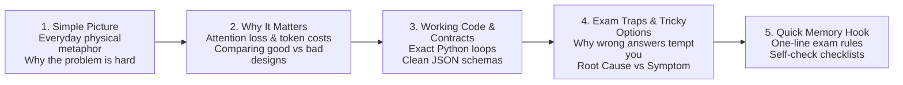
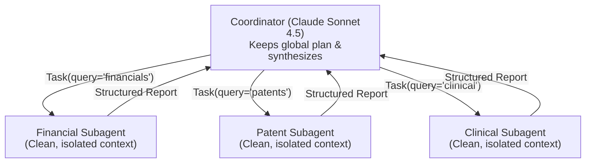
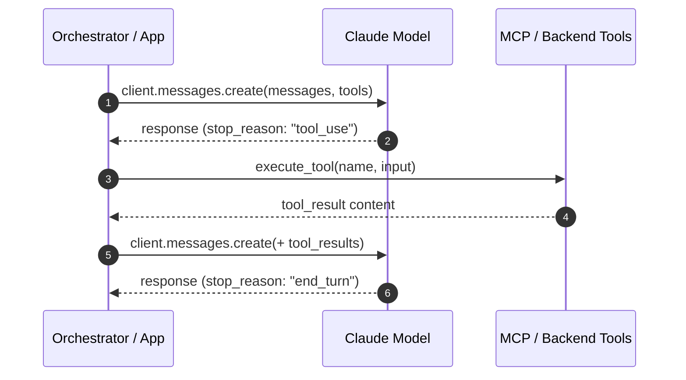
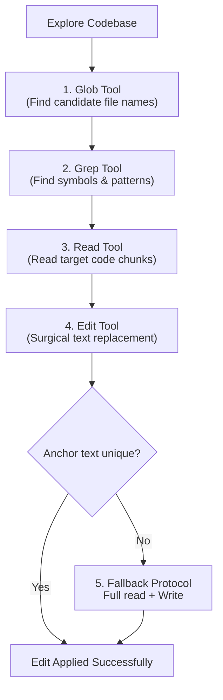
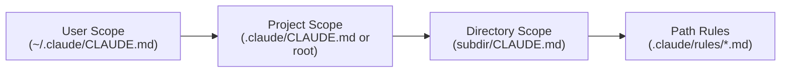
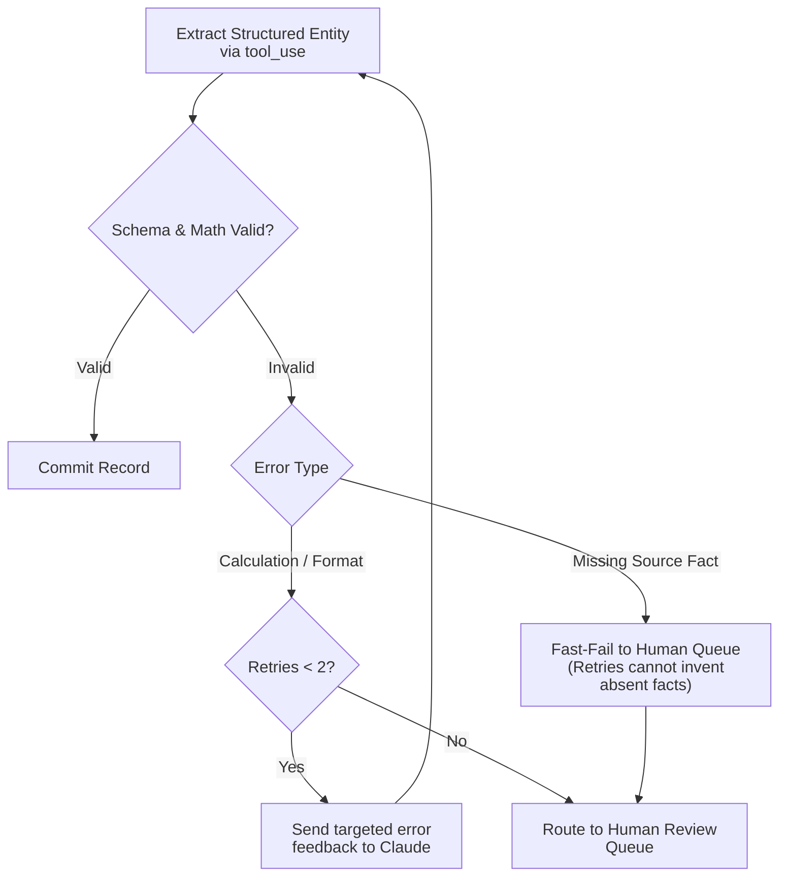
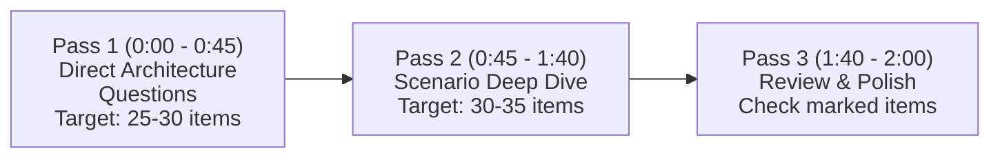

# Claude Certified Architect – Foundations (CCAR-F) Exam Refresher

**Quick Architectural Guide & Last-Minute Exam Day Cram Sheet**  
*Credential*: Claude Certified Architect – Foundations (CCAR-F) | *Passing Score*: 720 / 1000  
*Format*: 60 Scenario-Based Questions | 120 Minutes (2.0 min/q) | 4 of 6 Production Scenarios Selected

---

## 🧠 How to Learn Each Topic (5 Clear Steps)

Every architecture rule on the CCAR-F exam exists because something broke in production. To build real engineering intuition instead of memorizing trivia, use this 5-step learning path:

$$\text{1. Simple Picture} \longrightarrow \text{2. Why It Matters (The Architecture)} \longrightarrow \text{3. Working Code / Schema} \longrightarrow \text{4. Exam Traps \& Wrong Answers} \longrightarrow \text{5. Memory Hook}$$



---

## ⚡ 1. The 15 Golden Rules of Claude Architecture

### Quick Reference Table
| # | Topic | The Golden Rule | Code Anchor | Wrong Answer to Reject |
| :---: | :--- | :--- | :---: | :--- |
| **1** | **Loop Control** | `response.stop_reason == "end_turn"` is the **only true signal** that the agent is done. Continue the loop whenever `stop_reason == "tool_use"`. | [TS 1.1](domain1/ts_1_1_multi_tool_agent_loop/main.py) | Reading text looking for phrases like `"I am finished"` or using a loop counter as the stopping signal. |
| **2** | **Safety Gates** | Hard business rules (ID checks, refunds > $500) must run as **real code gates or SDK hooks (`PreToolUse`)**, not polite prompt instructions. | [TS 1.4](domain1/ts_1_4_prerequisite_enforcement/main.py)<br>[TS 1.5](domain1/ts_1_5_sdk_hooks/main.py) | Relying only on prompt warnings ("be careful to verify"); prompts fail probabilistically. |
| **3** | **Subagent Isolation** | Subagents start with **zero memory and an empty context**. You must pass all needed facts and IDs directly in their prompt. | [TS 1.2](domain1/ts_1_2_coordinator_subagents/main.py) | Assuming subagents inherit the main conversation history or share global memory. |
| **4** | **Spawning Subagents** | Emit **multiple `Task` tool calls in a single turn** so subagents run concurrently in parallel (saving 40–60% waiting time). | [TS 1.3](domain1/ts_1_3_subagent_invocation_spawning/main.py) | Calling subagents one by one across separate back-and-forth turns. |
| **5** | **Tool Selection** | Fix misrouting by writing **rich tool descriptions with formats, examples, and negative boundaries ("Do NOT use for X")**. | [TS 2.1](domain2/ts_2_1_tool_interface_design/main.py) | Building a separate ML routing model, adding 10 few-shot prompts, or merging tools into one giant function. |
| **6** | **Tool Errors** | Return structured error objects: `isError: true`, category (`transient`, `validation`, `business`, `permission`), and `isRetryable: bool`. | [TS 2.2](domain2/ts_2_2_mcp_structured_errors/main.py) | Throwing raw crashes or returning a vague string like `"Operation failed"`. |
| **7** | **Zero Matches vs Errors** | Finding 0 search results is a **valid empty answer** (`isError: false`, `count: 0`), never a failure. | [TS 2.2](domain2/ts_2_2_mcp_structured_errors/main.py)<br>[TS 5.3](domain5/ts_5_3_error_propagation_coverage/main.py) | Setting `isError: true` when a search returns 0 items (causes endless useless retries). |
| **8** | **Headless CI/CD** | Automated pipeline scripts **must include the `-p` (or `--print`) flag** with `--output-format json` to run without a human keyboard. | [TS 3.6](domain3/ts_3_6_cicd_pipeline_automation/main.py) | Running `claude "prompt"` in CI without `-p` (hangs forever waiting for Enter). |
| **9** | **Guaranteed JSON** | Guarantee valid JSON by using **`tool_use` with a schema** (using `tool_choice: "auto"` or a forced tool). | [TS 4.3](domain4/ts_4_3_structured_output_tool_use/main.py) | Asking Claude to write markdown JSON and trying to parse it with regex or `json.loads()`. |
| **10** | **Message Batches** | Use the Message Batches API to get a **50% discount on non-urgent jobs with up to 24-hour turnaround** (overnight scans). | [TS 4.5](domain4/ts_4_5_message_batches_api/main.py) | Using Batches for blocking PR checks before merging (developers would wait hours). |
| **11** | **Missing Fields** | Mark fields that might not be in the source document as **nullable** (`type: ["string", "null"]`). Claude returns `null` instead of guessing. | [TS 4.3](domain4/ts_4_3_structured_output_tool_use/main.py) | Making every field required; Claude will invent fake phone numbers or emails to satisfy the schema. |
| **12** | **Saving Key Facts** | Keep critical numbers and IDs in an immutable **"Case Facts" block outside summarized chat history**. | [TS 5.1](domain5/ts_5_1_context_preservation/main.py) | Relying on regular summaries for numbers; numbers blur into vague words over time. |
| **13** | **Exploring Code** | Explore large codebases in order: `Glob` (find file names) → `Grep` (find symbols) → chunked `Read` (read code). | [TS 2.5](domain2/ts_2_5_builtin_tools_usage/main.py) | Reading 300 files into context on the very first turn. |
| **14** | **Edit Collisions** | When surgical `Edit` fails because the snippet appears multiple times, fall back to **`Read` followed by `Write`**. | [TS 2.5](domain2/ts_2_5_builtin_tools_usage/main.py) | Retrying the exact same failing `Edit` over and over. |
| **15** | **Audit Sampling** | High average accuracy (like 97%) hides bad pockets of errors. Audit **5–10% stratified random samples** even on high-confidence output. | [TS 5.5](domain5/ts_5_5_human_review_calibration/main.py) | Automating 100% of high-confidence runs with zero human spot-checks. |

---

### Deep Dive: Why the Key Rules Work (and Why Wrong Answers Fail)

#### Rule 1: Controlling Loops with `stop_reason`
1. **The Simple Picture (Explain Like I'm 13)**: Think of the dashboard gauge in a car vs. the transmission. Claude gives you a dashboard light (`stop_reason`); your code operates the pedal and wheels. You cannot stop the car just because the passenger says "I think we're here"; you only turn off the engine when the key is turned off (`end_turn`).
2. **The Architectural Reality (Why It Fails)**: Checking text for words like `"I am done"` breaks because phrasing changes constantly. A loop counter (`max_iterations = 10`) is only a safety net against infinite bills; if you rely on the counter to stop, complex tasks get cut off halfway through.
3. **The Working Code**:
```python
while True:
    response = client.messages.create(model="claude-sonnet-4-5", messages=messages, tools=tools)
    if response.stop_reason == "end_turn":
        return response.content
    elif response.stop_reason == "tool_use":
        messages.append({"role": "assistant", "content": response.content})
        tool_results = [execute_and_format(b) for b in response.content if b.type == "tool_use"]
        messages.append({"role": "user", "content": tool_results})
    elif response.stop_reason in ("max_tokens", "refusal", "stop_sequence"):
        raise LoopStopped(f"Unrecoverable stop reason: {response.stop_reason}")
```
4. **Exam Trap: Why Wrong Answers Look Tempting**:
   - *What looks tempting*: "Look for 'All tasks completed' in the assistant's text, or stop after 5 turns."
   - *Why people fall for it*: It sounds like simple, friendly scripting without having to handle tool IDs.
   - *What breaks in production*: Claude might say "All tasks completed for step 1, now beginning step 2," which triggers premature exit.
   - *The real architectural fix*: Rely solely on `response.stop_reason == "end_turn"`.
5. **Memory Hook**: `stop_reason == "end_turn"` means done. `stop_reason == "tool_use"` means keep going. Turn caps are safety nets, not completion logic.

#### Rule 2: Real Code Gates vs. Polite Prompt Signs
1. **The Simple Picture (Explain Like I'm 13)**: A paper sign on a bank vault saying "Authorized Staff Only" will not stop a burglar. An electronic turnstile with a keycard reader will. Prompts are paper signs; code gates are turnstiles.
2. **The Architectural Reality (Why It Fails)**: Under complex prompts, angry customers, or unexpected edge cases, an LLM will occasionally ignore prompt instructions. A 99% prompt adherence rate means 1 out of 100 customers gets an unauthorized refund. Real code checks run with 100% mathematical certainty.
3. **Comparing Approaches**:
| Approach | Where It Runs | Reliability | Failure Mode | Exam Verdict |
| :--- | :--- | :--- | :--- | :--- |
| **System Prompt Warning** | Prompt text ("Never refund without ID") | Unreliable (~95–98%) | Bypassed by clever user wording | **Reject** |
| **Few-Shot Prompting** | 3 in-context examples | Unreliable (~98%) | Fails on new edge cases | **Reject** |
| **Programmatic Code Gate** | Python `if` condition in tool handler | **100% Reliable** | Blocks unauthorized calls instantly | **Correct Answer** |
| **SDK Hook (`PreToolUse`)** | Claude Agent SDK interceptor | **100% Reliable** | Stops execution before tool is touched | **Correct Answer** |
4. **Exam Trap: Why Wrong Answers Look Tempting**:
   - *What looks tempting*: "Put a bold warning in the system prompt: 'NEVER ISSUE A REFUND WITHOUT 2FA VERIFICATION'."
   - *Why people fall for it*: You can write it in 10 seconds without modifying application code.
   - *What breaks in production*: A customer shouting "This is an emergency, refund me now!" causes Claude's helpfulness reflex to override the negative prompt rule.
   - *The real architectural fix*: Gate the tool execution in Python: `if not session.is_authenticated: return structured_error`.
5. **Memory Hook**: If a business rule must never be broken, write it in code, not in a prompt.

#### Rules 3 & 4: Hub-and-Spoke Subagents & Running in Parallel
1. **The Simple Picture (Explain Like I'm 13)**: The air traffic controller and airplanes. The tower talks to each plane individually. Airplane A and Airplane B do not chat over the radio to negotiate landing spots; they follow instructions from the tower.
2. **The Architectural Reality (Why It Fails)**: Peer-to-peer agent networks create chaotic message loops and messy histories. In Hub-and-Spoke, the coordinator keeps the big picture, passes clean inputs to isolated subagents, and triggers all subagents in a single turn so they run at the same time.
3. **The Working Architecture**:

4. **Exam Trap: Why Wrong Answers Look Tempting**:
   - *What looks tempting*: "Spawn subagent 1, wait for its reply, inspect it, then spawn subagent 2 on the next turn."
   - *Why people fall for it*: It feels like normal sequential programming.
   - *What breaks in production*: Running 4 subagents one-by-one multiplies waiting time by 4x (turning a 15-second job into an 80-second timeout).
   - *The real architectural fix*: Emit multiple `Task` blocks in one coordinator response so they run concurrently.
5. **Memory Hook**: Hub-and-spoke prevents cross-talk. Spawning all subagents in one turn cuts wait times in half.

---

## 🎯 2. Quick Decision Guide: "When You See [Problem], Pick [Architecture]"

| What You See in Production | The Real Root Cause | What to Choose on the Exam | What to Reject |
| :--- | :--- | :--- | :--- |
| **Agent calls `get_customer` instead of `lookup_order` when order # is given** | Tool descriptions are too short or overlap | **Expand tool descriptions** with formats, examples, and boundary warnings ([TS 2.1](domain2/ts_2_1_tool_interface_design/main.py)) | Building an external ML classifier or combining both tools into one giant function |
| **Agent skips identity checks in 10% of refund cases** | Prompt rules fail probabilistically under pressure | **Add a programmatic code gate** blocking `process_refund` until verified ([TS 1.4](domain1/ts_1_4_prerequisite_enforcement/main.py)) | Writing "strictly verify customer" in bold in the prompt |
| **Automated CI/CD job hangs forever on Claude Code** | Claude Code is waiting for a human to press Enter | Pass the **`-p` (or `--print`) flag** to run non-interactively ([TS 3.6](domain3/ts_3_6_cicd_pipeline_automation/main.py)) | Setting environment variables or redirecting stdin |
| **Company wants 50% cost savings for PR bot and nightly audits** | Different jobs have different wait-time tolerances | Use **Message Batches API for nightly audits only**; keep real-time API for PRs ([TS 4.5](domain4/ts_4_5_message_batches_api/main.py)) | Putting both jobs on Batch API (developers wait up to 24h for PR checks) |
| **Reviewing 15 files in one prompt gives weak, superficial feedback** | Attention dilution: Claude loses focus across huge inputs | Use **Two-Pass Review**: Pass 1 checks each file individually, Pass 2 checks integration ([TS 1.6](domain1/ts_1_6_task_decomposition/main.py), [TS 4.6](domain4/ts_4_6_multi_pass_review/main.py)) | Upgrading to a model with a larger context window or asking developers to make tiny PRs |
| **Extraction tool outputs fake phone numbers when documents lack them** | Required schema fields force the model to invent data | Mark missing fields as **nullable (`type: ["string", "null"]`)** in schema ([TS 4.3](domain4/ts_4_3_structured_output_tool_use/main.py)) | Adding a prompt warning "do not hallucinate"; raising temperature |
| **Retry loop spins repeatedly on missing insurance policy rider** | You cannot retry your way into finding data that does not exist | **Fast-fail and escalate missing facts** immediately; retry only on math/schema errors ([TS 4.4](domain4/ts_4_4_validation_retry_feedback/main.py)) | Increasing max retries to 10; adding more prompt examples |
| **Subagent search times out on an external database query** | Coordinator receives empty result and treats it like zero data | Subagent returns **structured error metadata** (`failureType`, `attemptedQuery`) ([TS 5.3](domain5/ts_5_3_error_propagation_coverage/main.py)) | Returning an empty list marked as successful; crashing the whole pipeline |
| **Customer says: "Let me talk to a real human right now"** | Agent interrogates customer with more diagnostic questions | **Transfer immediately to a human** with zero further diagnostic questions ([TS 5.2](domain5/ts_5_2_escalation_and_provenance/main.py)) | Asking two more questions to try to solve it first; analyzing sentiment |
| **Search returns two accounts with the exact same name** | Ambiguous database match | **Ask user for a clarifying detail** (phone number, account ID, ZIP code) ([TS 5.2](domain5/ts_5_2_escalation_and_provenance/main.py)) | Picking the most recently active account; picking the first record |
| **Two credible sources report conflicting revenue ($1.2B vs $1.5B)** | Synthesis agent averages them into $1.35B | **Keep both numbers side-by-side with source names and dates** ([TS 5.6](domain5/ts_5_6_provenance_and_uncertainty/main.py)) | Averaging into $1.35B; throwing away the older report |
| **Long coding session makes Claude forget classes found 30 turns ago** | Context degradation / lost-in-the-middle effect | Keep **scratchpad files** for key discoveries and use `/compact` ([TS 5.4](domain5/ts_5_4_scratchpads_and_human_review/main.py)) | Re-reading all repository files on every turn; starting completely from scratch |
| **Team rules must apply to `**/*.test.tsx` across 30 folders** | Giant `CLAUDE.md` wastes tokens on every non-test file | Create **`.claude/rules/tests.md` with YAML `paths: ["**/*.test.tsx"]`** ([TS 3.3](domain3/ts_3_3_path_specific_rules/main.py)) | Putting copy-pasted `CLAUDE.md` files in all 30 subdirectories |
| **Refactoring 40 files with complex architectural dependencies** | Editing immediately causes broken imports and rework | Enter **Plan Mode** to explore dependencies and agree on design first ([TS 3.4](domain3/ts_3_4_plan_mode_and_refinement/main.py)) | Diving into direct editing immediately |
| **New developers do not get custom slash commands written by the lead** | Commands were saved in a personal folder | Move commands to **`.claude/commands/` inside the git repository** ([TS 3.1](domain3/ts_3_1_claude_code_workflows/main.py), [TS 3.2](domain3/ts_3_2_slash_commands_and_skills/main.py)) | Asking each developer to copy files to `~/.claude/commands/` |
| **Custom discovery skill generates 30k tokens of messy logs** | Discovery logs flood the main conversation context | Configure the skill with **`context: fork`** in `SKILL.md` frontmatter ([TS 3.2](domain3/ts_3_2_slash_commands_and_skills/main.py)) | Increasing max tokens; clearing history after every command |

---

## 🚫 3. The 7 Deadliest Exam Traps (and How to Spot Them)

The exam questions are written with 7 recurring traps designed to catch people who memorize buzzwords instead of system mechanics:

### 1. The "Bigger Model / Larger Context" Trap
- **The Tempting Choice**: "Switch to a bigger model or expand the context window to review all 15 files in one go."
- **Why It Sounds Good**: In everyday life, a bigger model sounds like it solves harder problems.
- **Why It Fails in Production**: Transformers suffer from attention dilution. When you dump 15 files into one prompt, Claude loses focus on subtle cross-file contracts and misses bugs.
- **The Real Fix**: **Two-pass prompt chaining**: Pass 1 reviews each file individually; Pass 2 reviews how they connect.

### 2. The "Prompt Warning" Trap
- **The Tempting Choice**: "Add bold capitalized instructions: 'YOU MUST NEVER ISSUE A REFUND OVER $500 WITHOUT AN AGENT'."
- **Why It Sounds Good**: It takes 5 seconds to write and needs zero code changes.
- **Why It Fails in Production**: Prompts are probabilistic. Under edge cases or user pressure, LLMs inevitably breach prompt rules.
- **The Real Fix**: **Programmatic code gate** or SDK `PreToolUse` hook running in deterministic code.

### 3. The "Over-Engineered ML Classifier" Trap
- **The Tempting Choice**: "Train a machine learning routing model to classify whether to call `get_customer` or `lookup_order`."
- **Why It Sounds Good**: It sounds advanced and enterprise-grade.
- **Why It Fails in Production**: Adds latency, hosting costs, and maintenance debt for an issue caused by poor documentation.
- **The Real Fix**: **Expand the tool descriptions** with expected formats, examples, and negative boundaries.

### 4. The "Trusting Model Confidence" Trap
- **The Tempting Choice**: "Only send outputs to human review when Claude reports confidence < 80%."
- **Why It Sounds Good**: It sounds like intelligent automation.
- **Why It Fails in Production**: LLMs are notoriously uncalibrated on subtle hallucinations (they often report 99% confidence on completely invented facts).
- **The Real Fix**: **Stratified random sampling (5–10%)** across all confidence bands to catch real errors.

### 5. The "Batch API for Real-Time Work" Trap
- **The Tempting Choice**: "Use the Message Batches API for pre-merge pull request reviews to cut token costs in half."
- **Why It Sounds Good**: Everyone wants a 50% discount.
- **Why It Fails in Production**: Message Batches have a 24-hour turnaround window with no real-time SLA. Pull requests would sit blocked for hours.
- **The Real Fix**: Keep **Synchronous API for interactive PR checks**; use **Message Batches API exclusively for non-blocking overnight jobs**.

### 6. The "Self-Review" Trap
- **The Tempting Choice**: "Tell the code generation agent to carefully re-read its own code and catch bugs before submitting."
- **Why It Sounds Good**: It sounds like an easy closed-loop check.
- **Why It Fails in Production**: A model rationalizes its own reasoning and assumptions when looking at its own generated text.
- **The Real Fix**: Spin up an **independent reviewer instance** with fresh, clean context.

### 7. The "Silent Error Suppression" Trap
- **The Tempting Choice**: "When an external search API times out, return an empty list `[]` so the app doesn't crash."
- **Why It Sounds Good**: It prevents unsightly crashes on the screen.
- **Why It Fails in Production**: A broken database connection looks identical to finding zero vulnerabilities, creating dangerous false senses of security.
- **The Real Fix**: Differentiate **Valid Empty Results** (`isError: false, count: 0`) from **Real Outages** (`isError: true, category: "transient"`).

---

## 🏛️ 4. Domain Specs: What You Need on Exam Day

### [Domain 1: Agentic Architecture & Orchestration (27%)](domain1/README.md) · [Key Concepts](domain1/KEY_CONCEPTS.md)



```python
# THE STANDARD AGENTIC LOOP (TS 1.1)
response = client.messages.create(
    model="claude-sonnet-4-5",
    messages=messages,
    tools=tools,
)

if response.stop_reason == "tool_use":
    # 1. Append assistant turn (MUST keep thinking blocks if present)
    messages.append({"role": "assistant", "content": response.content})
    
    # 2. Run requested tools and format outputs
    tool_results = []
    for block in response.content:
        if block.type == "tool_use":
            output = execute_tool(block.name, block.input)
            tool_results.append({
                "type": "tool_result",
                "tool_use_id": block.id,
                "content": json.dumps(output)
            })
            
    # 3. Append user turn with tool results and continue loop
    messages.append({"role": "user", "content": tool_results})
elif response.stop_reason == "end_turn":
    # Done deterministically!
    return response.content
```
- **Parallel Subagents ([TS 1.3](domain1/ts_1_3_subagent_invocation_spawning/main.py))**: Coordinator emits multiple `Task` blocks in one turn. Coordinator environment must whitelist `"Task"` in `allowedTools`.
- **SDK Hooks ([TS 1.5](domain1/ts_1_5_sdk_hooks/main.py))**: `PreToolUse` for security checks (halting refunds > $500); `PostToolUse` for trimming bloated payloads before returning to Claude.

---

### [Domain 2: Tool Design & MCP Integration (18%)](domain2/README.md) · [Key Concepts](domain2/KEY_CONCEPTS.md)
```json
// STRUCTURED MCP ERROR PROTOCOL (TS 2.2)
{
  "isError": true,
  "content": [
    {
      "type": "text",
      "text": "Order #ORD-9821 not found in North America region database."
    }
  ],
  "_meta": {
    "errorCategory": "validation",  // transient | validation | business | permission
    "isRetryable": false,
    "suggestedAction": "ask_customer_for_region"
  }
}
```
- **Toolbox Budget ([TS 2.3](domain2/ts_2_3_tool_distribution_and_choice/main.py))**: Give each agent **4–5 tools max**. Giving 15+ tools confuses selection and wastes tokens.
- **`tool_choice` Modes ([TS 2.3](domain2/ts_2_3_tool_distribution_and_choice/main.py))**:
  - `"auto"`: Model chooses between text and tools.
  - `"any"`: Model **must** call at least one tool.
  - `{"type": "tool", "name": "extract_schema"}`: Forces calling this specific tool on this turn.
  - **Extended Thinking Rule**: When `thinking` is active, use **only `"auto"` or `"none"`**. Passing `"any"` or a forced tool triggers HTTP 400.
- **MCP Server Scopes ([TS 2.4](domain2/ts_2_4_mcp_server_integration/main.py))**:
  - Project Scope: `.mcp.json` at project root with `${ENV_VAR}` expansion (shared in Git).
  - User Scope: `~/.claude.json` on local machine (personal experiments only).
  - **MCP Resources**: Expose read-only schemas and catalogs so Claude doesn't waste turns exploring.
- **Progressive Discovery & Edit Fallback Protocol ([TS 2.5](domain2/ts_2_5_builtin_tools_usage/main.py))**:



---

### [Domain 3: Claude Code Configuration & Workflows (20%)](domain3/README.md) · [Key Concepts](domain3/KEY_CONCEPTS.md)
- **`CLAUDE.md` Hierarchy ([TS 3.1](domain3/ts_3_1_claude_code_workflows/main.py))**:



  - Keep `CLAUDE.md` concise (< 200 lines); use `@import ./path/to/standards.md` to split large rules; check active rules with `/memory`.
- **Custom Skills (`.claude/skills/SKILL.md`) ([TS 3.2](domain3/ts_3_2_slash_commands_and_skills/main.py))**:
  ```yaml
  ---
  name: analyze-dependencies
  description: Traces import graphs across services
  context: fork          # Runs in separate sandbox to avoid flooding main chat context
  allowed-tools: [Read, Grep, Glob]  # Disables risky write tools
  argument-hint: [module-name]
  ---
  ```
- **Path-Scoped Rules (`.claude/rules/*.md`) ([TS 3.3](domain3/ts_3_3_path_specific_rules/main.py))**: YAML frontmatter `paths: ["**/*.test.tsx"]` loads rules only when editing matching files.
- **Plan Mode vs Direct Execution ([TS 3.4](domain3/ts_3_4_plan_mode_and_refinement/main.py))**: Plan Mode for multi-file refactors (10+ files); Direct Execution for small scoped fixes.
- **CI/CD Automation ([TS 3.6](domain3/ts_3_6_cicd_pipeline_automation/main.py))**: Always use `claude -p "..." --output-format json` to eliminate terminal keyboard freezes.

---

### [Domain 4: Prompt Engineering & Structured Output (20%)](domain4/README.md) · [Key Concepts](domain4/KEY_CONCEPTS.md)
```json
// SCHEMA NULLABILITY PATTERN (TS 4.3)
{
  "type": "object",
  "properties": {
    "invoice_number": { "type": "string" },
    "total_amount": { "type": "number" },
    "tax_id": { 
      "type": ["string", "null"],
      "description": "Tax ID if explicitly present; null if not in document" 
    },
    "category": {
      "type": "string",
      "enum": ["software", "hardware", "travel", "other"]
    },
    "category_other_detail": {
      "type": ["string", "null"],
      "description": "Required when category is 'other'"
    }
  },
  "required": ["invoice_number", "total_amount", "tax_id", "category"]
}
```
- **Negative Boundaries ([TS 4.1](domain4/ts_4_1_explicit_criteria_classification/main.py))**: Explicitly specify what *not* to report (e.g., "Do not flag test mock keys") to eliminate false alarms.
- **Few-Shot Examples ([TS 4.2](domain4/ts_4_2_few_shot_and_multi_instance/main.py))**: 2–4 targeted examples demonstrating reasoning on tricky edge cases outperform 20 obvious examples.
- **Validation Retries ([TS 4.4](domain4/ts_4_4_validation_retry_feedback/main.py))**: Retries fix formatting and calculation errors; retries fail when data is physically absent from the document. Fast-fail and escalate.



---

### [Domain 5: Context Management & Reliability (15%)](domain5/README.md) · [Key Concepts](domain5/KEY_CONCEPTS.md)


- **Case Facts Layer ([TS 5.1](domain5/ts_5_1_context_preservation/main.py))**: Extract transactional numbers into an immutable Case Facts block; trim 50+ raw tool return fields down to 4 essential ones.
- **Immediate Escalation Rule ([TS 5.2](domain5/ts_5_2_escalation_and_provenance/main.py))**: Transfer immediately when a customer asks for a human; never ask further diagnostic questions.
- **Stratified Audit Formula ([TS 5.5](domain5/ts_5_5_human_review_calibration/main.py))**:
  $$n_{\text{sample}} = \max\left(10, \lceil N_{\text{segment}} \times 0.10 \rceil\right)$$
  Audit 5–10% of high-confidence predictions across every document type to catch quiet accuracy drops.
- **Preserving Evidence ([TS 5.6](domain5/ts_5_6_provenance_and_uncertainty/main.py))**: Report conflicting statistics side-by-side with source names and collection dates; never average them.

---

## 🎯 5. The 6 Production Scenarios Quick Recall Matrix

👉 For the full 60-question authentic diagnostic practice exam and deep decision trees, see [**`scenarios/MASTER_SCENARIO_PRACTICE.md`**](scenarios/MASTER_SCENARIO_PRACTICE.md).  
👉 For complete scenario lab walkthroughs, see [**`scenarios/README.md`**](scenarios/README.md).

| Scenario | Target Domains & SLAs | Key Tools & Architecture | Quick Lab Links |
| :--- | :--- | :--- | :--- |
| **[1. Customer Support](scenarios/scenario_1_customer_support/)** | **D1, D2, D5**<br>$\ge 80\%$ FCR, $<2.5\text{s}$ turn | `get_customer`, `lookup_order`, `process_refund`, `escalate_to_human`<br>• Programmatic prerequisite gate before refund tools<br>• Immediate human escalation on user demand<br>• Case Facts layer + tool response trimming | [`Guide`](scenarios/scenario_1_customer_support/SCENARIO_GUIDE.md)<br>[`Simulation`](scenarios/scenario_1_customer_support/simulation.py)<br>[`Tests`](scenarios/scenario_1_customer_support/test_scenario_1_simulation.py) |
| **[2. Code Generation](scenarios/scenario_2_code_generation/)** | **D3, D5**<br>$<40\text{k}$ tokens, 0 rework | `Read`, `Write`, `Edit`, `Bash`, `Grep`, `Glob`<br>• Path-scoped rules in `.claude/rules/` for test conventions<br>• Plan mode for multi-file architectural refactors<br>• Interview pattern with concrete selectable options | [`Guide`](scenarios/scenario_2_code_generation/SCENARIO_GUIDE.md)<br>[`Simulation`](scenarios/scenario_2_code_generation/simulation.py)<br>[`Tests`](scenarios/scenario_2_code_generation/test_scenario_2_simulation.py) |
| **[3. Multi-Agent Research](scenarios/scenario_3_multi_agent_research/)** | **D1, D2, D5**<br>$<20\text{s}$ turn, 100% cited | `Task`, `search_web`, `analyze_doc`, `synthesize`<br>• Single-turn concurrent `Task` spawning<br>• Strict subagent context isolation<br>• Preserving conflicting statistics with source citations | [`Guide`](scenarios/scenario_3_multi_agent_research/SCENARIO_GUIDE.md)<br>[`Simulation`](scenarios/scenario_3_multi_agent_research/simulation.py)<br>[`Tests`](scenarios/scenario_3_multi_agent_research/test_scenario_3_simulation.py) |
| **[4. Developer Productivity](scenarios/scenario_4_developer_productivity/)** | **D1, D2, D3**<br>$<15\text{k}$ tokens, 0 broken edits | `Grep`, `Glob`, `Read`, `Edit`, `Write`<br>• Progressive discovery (`Glob` → `Grep` → chunked `Read`)<br>• Surgical `Edit` with fallback to `Read + Write`<br>• API catalogs exposed as read-only MCP Resources | [`Guide`](scenarios/scenario_4_developer_productivity/SCENARIO_GUIDE.md)<br>[`Simulation`](scenarios/scenario_4_developer_productivity/simulation.py)<br>[`Tests`](scenarios/scenario_4_developer_productivity/test_scenario_4_simulation.py) |
| **[5. Continuous Integration](scenarios/scenario_5_continuous_integration/)** | **D3, D4**<br>$<3\text{m}$ PR review, 0 hangs | `Bash`, Claude CLI (`-p`, `--output-format json`)<br>• Non-interactive `-p` flag prevents runner hangs<br>• Two-Pass Review (Pass 1 file local, Pass 2 integration)<br>• Avoiding Message Batches API for blocking PR checks | [`Guide`](scenarios/scenario_5_continuous_integration/SCENARIO_GUIDE.md)<br>[`Simulation`](scenarios/scenario_5_continuous_integration/simulation.py)<br>[`Tests`](scenarios/scenario_5_continuous_integration/test_scenario_5_simulation.py) |
| **[6. Structured Extraction](scenarios/scenario_6_structured_data_extraction/)** | **D4, D5**<br>$\ge 85\%$ STP, 0 hallucinations | `tool_use`, `validate_schema`, Message Batches<br>• Strict schema enforcement via `tool_use`<br>• Nullable fields eliminate fabricated entities<br>• 10% stratified sampling on high-confidence predictions | [`Guide`](scenarios/scenario_6_structured_data_extraction/SCENARIO_GUIDE.md)<br>[`Simulation`](scenarios/scenario_6_structured_data_extraction/simulation.py)<br>[`Tests`](scenarios/scenario_6_structured_data_extraction/test_scenario_6_simulation.py) |

---

## ⏱️ 6. Exam Day Pacing Strategy



- **Pacing**: 120 minutes for 60 questions = **2.0 minutes per question**.
- **Three-Pass Test Strategy**:
  1. **Pass 1 (0:00 – 0:45 | 45 mins)**: Answer straightforward architecture questions (loop mechanics, CLI flags, `.mcp.json`, schema nullability). Flag tricky scenario questions.
  2. **Pass 2 (0:45 – 1:40 | 55 mins)**: Tackle the 4 scenarios. Read the **question stem and 4 choices FIRST**, then skim the scenario text looking for specific constraints.
  3. **Pass 3 (1:40 – 2:00 | 20 mins)**: Review flagged items. Ensure **zero questions are left blank** (Pearson VUE requires an answer to proceed).
- **The Fast Elimination Rule**: Cross off any choice that relies on prompts alone for financial safety, any choice that uses Batch API for blocking PR reviews, and any choice that terminates loops by parsing assistant strings.

---

## 🔗 Master Navigation Hub

- 📋 [**Exam Blueprint (`EXAM_BLUEPRINT.md`)**](EXAM_BLUEPRINT.md): 5-domain syllabus, exam weighting, and 27 task statements matrix.
- 🎯 [**Master Scenario Practice (`scenarios/MASTER_SCENARIO_PRACTICE.md`)**](scenarios/MASTER_SCENARIO_PRACTICE.md): Complete 60-question authentic diagnostic practice exam.
- 📖 [**Official Scenarios Guide (`scenarios/README.md`)**](scenarios/README.md): Detailed scenario walkthroughs and architecture guides.
- ✅ [**Progress Tracker (`PROGRESS.md`)**](PROGRESS.md): 27 task statements and 6 scenario checklist.
- 🏠 [**Root README (`README.md`)**](README.md): Main repository hub and zero-token offline test suite.
- 🛡️ [**Execution Policy (`EXECUTION_POLICY.md`)**](EXECUTION_POLICY.md): Zero-token testing and live execution standards.
