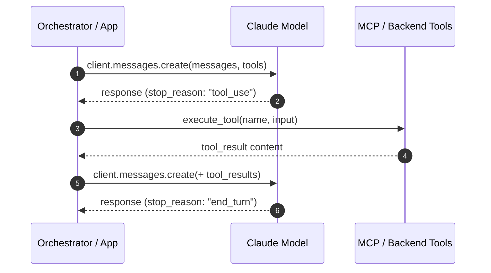
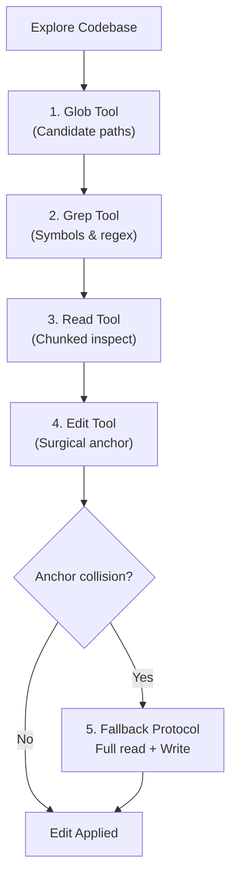
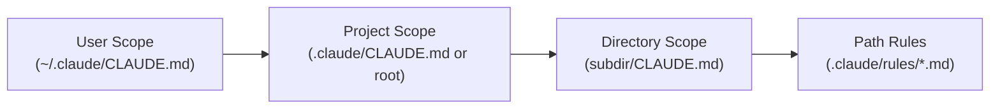
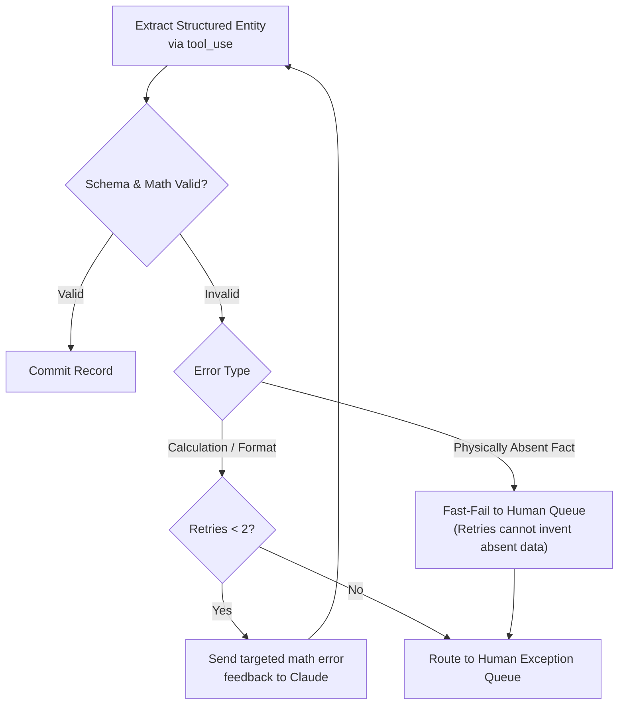
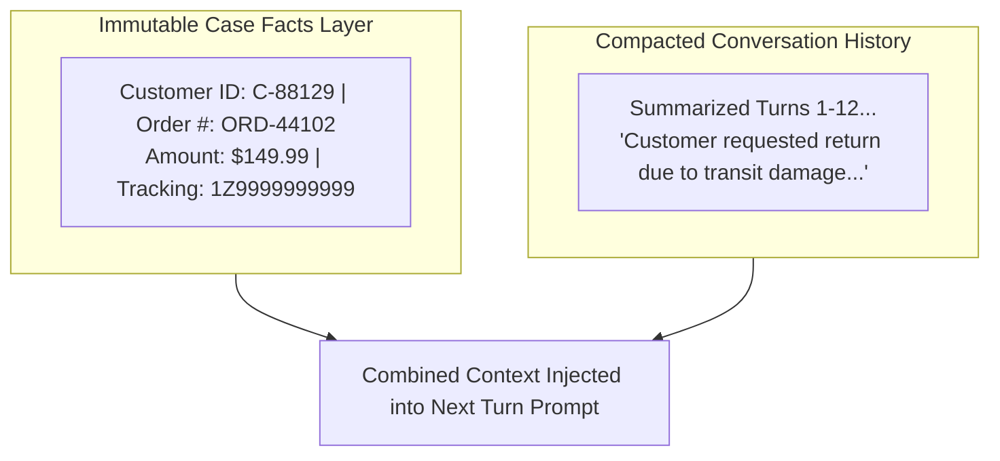
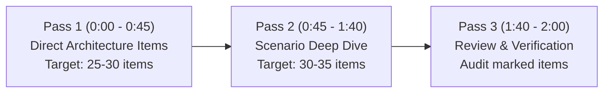

# Claude Certified Architect – Foundations (CCAR-F) Exam Refresher

**High-Yield Architectural Cheat Sheet & Last-Minute Exam Day Cram Guide**  
*Credential*: Claude Certified Architect – Foundations | *Passing Score*: 720 / 1000  
*Format*: 60 Scenario-Based Questions | 120 Minutes (2.0 min/q) | 4 of 6 Production Scenarios Randomly Selected

---

## ⚡ 1. The 15 Golden Architectural Rules of Claude Systems Design

| # | Topic | The Golden Architectural Rule | Code Anchor | Distractor to Reject |
| :---: | :--- | :--- | :---: | :--- |
| **1** | **Loop Control** | `response.stop_reason == "end_turn"` is the **sole deterministic signal** of completion. Continue when `"tool_use"`. | [TS 1.1](domain1/ts_1_1_multi_tool_agent_loop/main.py) | Parsing assistant text (e.g. `"I am done"`) or using iteration turn caps as completion signal. |
| **2** | **Compliance Gates** | Critical business logic (identity verification, finance > $500) requires **programmatic prerequisite gates or SDK hooks (`PreToolUse`)**. | [TS 1.4](domain1/ts_1_4_prerequisite_enforcement/main.py)<br>[TS 1.5](domain1/ts_1_5_sdk_hooks/main.py) | Relying on system prompt instructions alone ("strictly verify customer"); prompts fail probabilistically. |
| **3** | **Subagent Isolation** | Subagents operate with **100% isolated context by default**. Findings and metadata must be passed explicitly in prompts; no shared memory. | [TS 1.2](domain1/ts_1_2_coordinator_subagents/main.py) | Assuming subagents inherit parent conversation history or global session memory. |
| **4** | **Subagent Spawning** | Emit **multiple `Task` calls in a single coordinator response** to trigger concurrent, parallel execution (40–60% latency reduction). | [TS 1.3](domain1/ts_1_3_subagent_invocation_spawning/main.py) | Sequential round-trips over separate turns; sequential loop waiting for subagent 1 before spawning subagent 2. |
| **5** | **Tool Selection** | Refine **tool descriptions with explicit input formats, example queries, edge cases, and boundary statements**. | [TS 2.1](domain2/ts_2_1_tool_interface_design/main.py) | Deploying external ML routing classifiers, prompt-stuffing with 10 few-shot examples, or monolithic tool merges. |
| **6** | **MCP Error Contracts** | Return structured error metadata: `isError: true`, `errorCategory` (`transient`, `validation`, `business`, `permission`), and `isRetryable: bool`. | [TS 2.2](domain2/ts_2_2_mcp_structured_errors/main.py) | Throwing raw unhandled exceptions or returning generic failure strings (e.g. `"Operation failed"`). |
| **7** | **Empty Results vs Errors** | A query returning 0 records is a **valid empty match** (`isError: false`, `count: 0`). | [TS 2.2](domain2/ts_2_2_mcp_structured_errors/main.py)<br>[TS 5.3](domain5/ts_5_3_error_propagation_coverage/main.py) | Flagging 0 records as `isError: true` (triggers wasteful retries and misleads coordinator). |
| **8** | **Headless CI/CD** | Automated pipeline scripts **must pass the `-p` (or `--print`) flag** with `--output-format json` to run non-interactively. | [TS 3.6](domain3/ts_3_6_cicd_pipeline_automation/main.py) | Running `claude "prompt"` without `-p` (causes CI runner to hang indefinitely waiting for stdin). |
| **9** | **Schema Compliance** | Guaranteed valid JSON syntax is achieved via **`tool_use`** with JSON schemas (optionally `tool_choice: "any"` or named tool). | [TS 4.3](domain4/ts_4_3_structured_output_tool_use/main.py) | Asking the model to output Markdown JSON and attempting to parse with regex or `json.loads()`. |
| **10** | **Message Batches API** | Message Batches API gives **50% cost savings for 24h non-blocking jobs** (nightly audits, weekly reports). | [TS 4.5](domain4/ts_4_5_message_batches_api/main.py) | Using Batches for blocking pre-merge PR review gates (up to 24h latency, no SLA). |
| **11** | **Nullable Fields** | Mark non-guaranteed schema attributes as **nullable** (`type: ["string", "null"]`). Claude returns `null` instead of hallucinating. | [TS 4.3](domain4/ts_4_3_structured_output_tool_use/main.py) | Making all fields required; model fabricates fake email addresses, phone numbers, or dates to satisfy schema. |
| **12** | **Case Facts Layer** | Extract transactional facts (order IDs, amounts, dates) into a persistent **"Case Facts" block outside summarized history**. | [TS 5.1](domain5/ts_5_1_context_preservation/main.py) | Relying on progressive summarization for numbers; numbers degrade into vague prose across compaction. |
| **13** | **Progressive Discovery** | Large codebase exploration follows: `Glob` (find paths) → `Grep` (find patterns) → chunked `Read` (examine code). | [TS 2.5](domain2/ts_2_5_builtin_tools_usage/main.py) | Bulk-reading entire repositories or whole directories into context on Turn 1. |
| **14** | **Edit Collision Fallback** | When surgical `Edit` fails due to non-unique anchor text, fallback protocol is **`Read` followed by `Write`**. | [TS 2.5](domain2/ts_2_5_builtin_tools_usage/main.py) | Repeatedly retrying failing `Edit` calls without expanding anchor lines or falling back to full rewrite. |
| **15** | **Stratified Sampling** | Aggregate accuracy (e.g. 97%) masks disastrous segment error rates. Use **5–10% stratified random sampling** on high-confidence predictions. | [TS 5.5](domain5/ts_5_5_human_review_calibration/main.py) | Automating 100% of high-confidence predictions with zero human review sampling; relying on self-reported confidence. |

---

## 🎯 2. Rapid Decision Matrix: "If You See [Symptom], Choose [Architecture]"

| Observed Production Symptom | Root Cause | Correct Architectural Remedy | Distractor to Reject |
| :--- | :--- | :--- | :--- |
| **Agent calls `get_customer` instead of `lookup_order` when order # is provided** | Minimal or overlapping tool descriptions | **Expand tool descriptions** with input formats, edge cases, and boundary statements ([TS 2.1](domain2/ts_2_1_tool_interface_design/main.py)) | Build an external classifier model or consolidate tools into one generic function |
| **Agent skips identity verification in 12% of refund cases** | Prompt compliance is probabilistic, not deterministic | **Implement programmatic prerequisite gate** blocking `process_refund` until ID verified ([TS 1.4](domain1/ts_1_4_prerequisite_enforcement/main.py)) | Add prompt warnings ("strictly ensure verification") or add few-shot examples |
| **CI pipeline job hangs indefinitely on Claude Code execution** | Claude Code is running in interactive mode waiting for user input | Add the **`-p` (or `--print`) flag** to run non-interactively ([TS 3.6](domain3/ts_3_6_cicd_pipeline_automation/main.py)) | Set environment variables or redirect stdin from `/dev/null` |
| **Manager wants 50% API cost reduction for PR bot and nightly debt audits** | Workflows have different latency tolerances | Use **Message Batches API for nightly audits only**; keep synchronous API for PRs ([TS 4.5](domain4/ts_4_5_message_batches_api/main.py)) | Switch both workflows to Batch API (blocks PRs for up to 24 hours) |
| **Single-pass review of 14 files produces superficial and contradictory remarks** | Attention dilution across large multi-file context | Split into **Two-Pass Review**: Pass 1 per-file local checks, Pass 2 cross-file integration ([TS 1.6](domain1/ts_1_6_task_decomposition/main.py), [TS 4.6](domain4/ts_4_6_multi_pass_review/main.py)) | Switch to a larger model with bigger context window; require devs to split PRs |
| **Extraction pipeline outputs fake phone numbers when documents lack them** | Required schema fields force model to invent values | Set absent fields as **nullable (`type: ["string", "null"]`)** in JSON schema ([TS 4.3](domain4/ts_4_3_structured_output_tool_use/main.py)) | Add prompt warning "do not hallucinate"; increase temperature |
| **Extraction retry loop spins continuously on missing insurance policy rider** | Missing source facts cannot be fixed by retrying | **Fast-fail and escalate unrecoverable errors** immediately; retry only on format/math errors ([TS 4.4](domain4/ts_4_4_validation_retry_feedback/main.py)) | Increase max retry counter to 10; add more few-shot examples |
| **Subagent search times out on complex research query** | Coordinator receives generic error and terminates workflow | Subagent returns **structured error context** (`failureType`, `attemptedQuery`, `partialResults`) ([TS 5.3](domain5/ts_5_3_error_propagation_coverage/main.py)) | Return an empty list marked as successful; kill entire multi-agent job |
| **Customer explicitly demands: "Let me talk to a human supervisor right now"** | Agent attempts further diagnostic questions, frustrating user | **Escalate immediately to human** without asking further diagnostic questions ([TS 5.2](domain5/ts_5_2_escalation_and_provenance/main.py)) | Attempt to resolve issue first; analyze customer sentiment score |
| **Customer query matches two different accounts with the same name** | Ambiguous entity lookup | **Ask customer for clarifying identifier** (phone number, account ID, ZIP code) ([TS 5.2](domain5/ts_5_2_escalation_and_provenance/main.py)) | Use heuristics to select the most active account; pick the first record returned |
| **Two credible sources report conflicting revenue figures ($1.2B vs $1.5B)** | Synthesis agent averages numbers or picks one arbitrarily | **Preserve both figures with citations, dates, and source attribution** ([TS 5.6](domain5/ts_5_6_provenance_and_uncertainty/main.py)) | Average the two numbers into $1.35B; discard the older figure silently |
| **Extended codebase exploration causes agent to forget previously discovered classes** | Context degradation / lost-in-the-middle effect in long session | Maintain **scratchpad files** for key findings and use `/compact` or explore subagents ([TS 5.4](domain5/ts_5_4_scratchpads_and_human_review/main.py)) | Re-read all files on every turn; restart session from scratch with no context |
| **Conventions must apply to `**/*.test.tsx` across 30 directories** | Monolithic `CLAUDE.md` causes context bloat on non-test files | Create **`.claude/rules/tests.md` with YAML frontmatter `paths: ["**/*.test.tsx"]`** ([TS 3.3](domain3/ts_3_3_path_specific_rules/main.py)) | Place identical `CLAUDE.md` files in all 30 subdirectories |
| **Monolith refactoring across 45 files with uncertain service boundaries** | High risk of costly rework and circular dependencies | Enter **Plan Mode** to explore dependencies and design architecture before writing code ([TS 3.4](domain3/ts_3_4_plan_mode_and_refinement/main.py)) | Start direct execution immediately; write code first and refactor as you go |
| **New team members don't receive custom slash commands created by lead** | Slash commands created in user-level directory | Move commands to **`.claude/commands/` in the project repository** (Git versioned) ([TS 3.1](domain3/ts_3_1_claude_code_workflows/main.py), [TS 3.2](domain3/ts_3_2_slash_commands_and_skills/main.py)) | Add instructions to `~/.claude/commands/` on each developer's laptop |
| **Subagent exploratory skill produces 30k tokens of verbose logs** | Verbose discovery output pollutes coordinator's main context | Configure skill with **`context: fork`** in `SKILL.md` frontmatter ([TS 3.2](domain3/ts_3_2_slash_commands_and_skills/main.py)) | Increase coordinator max_tokens; clear conversation history after each run |

---

## 🚫 3. The 7 Deadly Distractor Traps on the CCAR-F Exam

Anthropic's exam authors use 7 consistent distractor patterns. Learn to identify and immediately eliminate them:

1. **The "Bigger Model / Larger Context Window" Trap**: Switching models does **not** cure attention dilution. Use **two-pass prompt chaining** instead.
2. **The "Prompt-Only Compliance" Trap**: Prompts fail probabilistically. Use **deterministic programmatic gates** or SDK hooks for financial/regulatory actions.
3. **The "Over-Engineered Machine Learning" Trap**: Avoid building external routing classifiers. **Refining tool descriptions** with input formats and edge cases fixes misrouting at zero infrastructure cost.
4. **The "Self-Reported Confidence & Sentiment" Trap**: LLM self-confidence is uncalibrated on subtle bugs; sentiment does not correlate with complexity. Use **explicit categorical rubrics** and **stratified random sampling**.
5. **The "Batch API for Blocking Workflows" Trap**: Message Batches API has a **24h turnaround window without latency SLAs**. Never use Batches for blocking pre-merge CI checks.
6. **The "Self-Review Bias" Trap**: A model rationalizes its own generative reasoning. Code review bots must use an **independent review instance** with fresh context.
7. **The "Silent Error Suppression" Trap**: Returning empty lists on subagent timeouts masks coverage gaps. Return **structured error context** (`failureType`, `attemptedQuery`, `partialResults`).

---

## 🏛️ 4. Domain-by-Domain High-Yield Architectural Specs

### [Domain 1: Agentic Architecture & Orchestration (27%)](domain1/README.md) · [Key Concepts](domain1/KEY_CONCEPTS.md)



```python
# THE STANDARD AGENTIC LOOP PATTERN (TS 1.1)
response = client.messages.create(
    model="claude-3-7-sonnet-20250219",
    messages=messages,
    tools=tools,
)

if response.stop_reason == "tool_use":
    # 1. Append assistant turn with tool_use blocks
    messages.append({"role": "assistant", "content": response.content})
    
    # 2. Execute requested tools and collect results
    tool_results = []
    for block in response.content:
        if block.type == "tool_use":
            output = execute_tool(block.name, block.input)
            tool_results.append({
                "type": "tool_result",
                "tool_use_id": block.id,
                "content": json.dumps(output)
            })
            
    # 3. Append user turn with tool_result blocks & loop continues
    messages.append({"role": "user", "content": tool_results})
elif response.stop_reason == "end_turn":
    # Task is completed deterministically!
    return response.content
```
- **Parallel Subagents ([TS 1.3](domain1/ts_1_3_subagent_invocation_spawning/main.py))**: Coordinator emits multiple `Task` blocks in a single turn. Coordinator environment must whitelist `"Task"` in `allowedTools`.
- **SDK Hooks ([TS 1.5](domain1/ts_1_5_sdk_hooks/main.py))**: `PreToolUse` for deterministic boundary enforcement (blocking refunds > $500); `PostToolUse` for normalizing heterogeneous outputs before returning to Claude.

---

### [Domain 2: Tool Design & MCP Integration (18%)](domain2/README.md) · [Key Concepts](domain2/KEY_CONCEPTS.md)
```json
// STRUCTURED MCP ERROR PROTOCOL (TS 2.2)
{
  "isError": true,
  "content": [
    {
      "type": "text",
      "text": "Order #9921 not found in North America region database."
    }
  ],
  "_meta": {
    "errorCategory": "validation",  // transient | validation | business | permission
    "isRetryable": false,
    "suggestedAction": "ask_customer_for_region"
  }
}
```
- **Least Privilege ([TS 2.3](domain2/ts_2_3_tool_distribution_and_choice/main.py))**: Restrict agents to **4–5 tools**. Over-provisioning 15+ tools degrades selection reliability.
- **`tool_choice` Configuration Modes ([TS 2.3](domain2/ts_2_3_tool_distribution_and_choice/main.py))**:
  - `"auto"`: Model decides whether to call a tool or respond with text.
  - `"any"`: Model **must** call at least one tool (model chooses which tool).
  - `{"type": "tool", "name": "extract_schema"}`: Forces invocation of a specific tool on this turn.
- **MCP Server Scopes ([TS 2.4](domain2/ts_2_4_mcp_server_integration/main.py))**:
  - Project Scope: `.mcp.json` at project root with `${ENV_VAR}` expansion.
  - User Scope: `~/.claude.json` on local machine (personal/experimental only).
  - **MCP Resources**: Expose read-only schemas and catalogs to eliminate exploratory tool calls.
- **Progressive Discovery & Edit Fallback Protocol ([TS 2.5](domain2/ts_2_5_builtin_tools_usage/main.py))**:



---

### [Domain 3: Claude Code Configuration & Workflows (20%)](domain3/README.md) · [Key Concepts](domain3/KEY_CONCEPTS.md)
- **`CLAUDE.md` Hierarchy ([TS 3.1](domain3/ts_3_1_claude_code_workflows/main.py))**:



  - Use `@import ./path/to/standards.md` for modularity; verify with `/memory`.
- **Custom Skills (`.claude/skills/SKILL.md`) ([TS 3.2](domain3/ts_3_2_slash_commands_and_skills/main.py))**:
  ```yaml
  ---
  name: analyze-dependencies
  description: Traces import graphs across services
  context: fork          # Crucial: runs in isolated subagent context to prevent token bloat
  allowed-tools: [Read, Grep, Glob]  # Restricts write/bash tools
  argument-hint: [module-name]
  ---
  ```
- **Path-Scoped Rules (`.claude/rules/*.md`) ([TS 3.3](domain3/ts_3_3_path_specific_rules/main.py))**: YAML frontmatter `paths: ["**/*.test.tsx"]` loads rules conditionally on file match.
- **Plan Mode vs Direct Execution ([TS 3.4](domain3/ts_3_4_plan_mode_and_refinement/main.py))**: Plan Mode for multi-file refactors (10+ files); Direct Execution for single-file scoped fixes.
- **CI/CD Non-Interactive Execution ([TS 3.6](domain3/ts_3_6_cicd_pipeline_automation/main.py))**: Use `claude -p "..." --output-format json` to eliminate terminal stdin hangs.

---

### [Domain 4: Prompt Engineering & Structured Output (20%)](domain4/README.md) · [Key Concepts](domain4/KEY_CONCEPTS.md)
```json
// SCHEMA NULLABILITY PATTERN (TS 4.3)
{
  "type": "object",
  "properties": {
    "invoice_number": { "type": "string" },
    "total_amount": { "type": "number" },
    "tax_id": { 
      "type": ["string", "null"],
      "description": "Tax ID if explicitly present; null if not in document" 
    },
    "category": {
      "type": "string",
      "enum": ["software", "hardware", "travel", "other"]
    },
    "category_other_detail": {
      "type": ["string", "null"],
      "description": "Required when category is 'other'"
    }
  },
  "required": ["invoice_number", "total_amount", "tax_id", "category"]
}
```
- **Negative Boundaries ([TS 4.1](domain4/ts_4_1_explicit_criteria_classification/main.py))**: Define exact negative conditions (e.g. "Do not flag test mock keys or informal comments") to eliminate false positives.
- **Few-Shot Prompting ([TS 4.2](domain4/ts_4_2_few_shot_and_multi_instance/main.py))**: 2–4 targeted examples demonstrating reasoning on edge cases outperform 20 trivial examples.
- **Validation Retry Limits ([TS 4.4](domain4/ts_4_4_validation_retry_feedback/main.py))**: Retries resolve schema and arithmetic errors; retries fail when facts are absent from source documents. Fast-fail and escalate.




---

### [Domain 5: Context Management & Reliability (15%)](domain5/README.md) · [Key Concepts](domain5/KEY_CONCEPTS.md)

- **Context Preservation ([TS 5.1](domain5/ts_5_1_context_preservation/main.py))**: Extract numbers into immutable Case Facts block; trim 50+ raw tool return fields to the 4 essential fields.
- **Immediate Escalation Rule ([TS 5.2](domain5/ts_5_2_escalation_and_provenance/main.py))**: Escalate immediately on explicit customer demand; never ask further diagnostic questions.
- **Stratified Sampling Formula ([TS 5.5](domain5/ts_5_5_human_review_calibration/main.py))**:
  $$n_{\text{sample}} = \max\left(10, \lceil N_{\text{segment}} \times 0.10 \rceil\right)$$
  Audit 5–10% of high-confidence predictions across every document segment to catch distribution drift.
- **Information Provenance ([TS 5.6](domain5/ts_5_6_provenance_and_uncertainty/main.py))**: Preserve conflicting statistics with citations and collection dates; never average them.

---

## 🎯 5. The 6 Production Scenarios Quick Recall Matrix

👉 For the full 60-question authentic diagnostic practice exam and deep decision trees, see [**`scenarios/MASTER_SCENARIO_PRACTICE.md`**](scenarios/MASTER_SCENARIO_PRACTICE.md).  
👉 For complete scenario lab walkthroughs, see [**`scenarios/README.md`**](scenarios/README.md).

| Scenario | Target Domains & SLAs | Key Tools & Architecture | Quick Lab Links |
| :--- | :--- | :--- | :--- |
| **[1. Customer Support](scenarios/scenario_1_customer_support/)** | **D1, D2, D5**<br>$\ge 80\%$ FCR, $<2.5\text{s}$ turn | `get_customer`, `lookup_order`, `process_refund`, `escalate_to_human`<br>• Programmatic prerequisite gate before refund tools<br>• Immediate human escalation on user demand<br>• Case Facts layer + tool response trimming | [`Guide`](scenarios/scenario_1_customer_support/SCENARIO_GUIDE.md)<br>[`Simulation`](scenarios/scenario_1_customer_support/simulation.py)<br>[`Tests`](scenarios/scenario_1_customer_support/test_scenario_1_simulation.py) |
| **[2. Code Generation](scenarios/scenario_2_code_generation/)** | **D3, D5**<br>$<40\text{k}$ tokens, 0 rework | `Read`, `Write`, `Edit`, `Bash`, `Grep`, `Glob`<br>• Path-scoped rules in `.claude/rules/` for test conventions<br>• Plan mode for multi-file architectural refactors<br>• Interview pattern with concrete selectable options | [`Guide`](scenarios/scenario_2_code_generation/SCENARIO_GUIDE.md)<br>[`Simulation`](scenarios/scenario_2_code_generation/simulation.py)<br>[`Tests`](scenarios/scenario_2_code_generation/test_scenario_2_simulation.py) |
| **[3. Multi-Agent Research](scenarios/scenario_3_multi_agent_research/)** | **D1, D2, D5**<br>$<20\text{s}$ turn, 100% cited | `Task`, `search_web`, `analyze_doc`, `synthesize`<br>• Single-turn concurrent `Task` spawning<br>• Strict subagent context isolation<br>• Preserving conflicting statistics with source citations | [`Guide`](scenarios/scenario_3_multi_agent_research/SCENARIO_GUIDE.md)<br>[`Simulation`](scenarios/scenario_3_multi_agent_research/simulation.py)<br>[`Tests`](scenarios/scenario_3_multi_agent_research/test_scenario_3_simulation.py) |
| **[4. Developer Productivity](scenarios/scenario_4_developer_productivity/)** | **D1, D2, D3**<br>$<15\text{k}$ tokens, 0 broken edits | `Grep`, `Glob`, `Read`, `Edit`, `Write`<br>• Progressive discovery (`Glob` → `Grep` → chunked `Read`)<br>• Surgical `Edit` with fallback to `Read + Write`<br>• API catalogs exposed as read-only MCP Resources | [`Guide`](scenarios/scenario_4_developer_productivity/SCENARIO_GUIDE.md)<br>[`Simulation`](scenarios/scenario_4_developer_productivity/simulation.py)<br>[`Tests`](scenarios/scenario_4_developer_productivity/test_scenario_4_simulation.py) |
| **[5. Continuous Integration](scenarios/scenario_5_continuous_integration/)** | **D3, D4**<br>$<3\text{m}$ PR review, 0 hangs | `Bash`, Claude CLI (`-p`, `--output-format json`)<br>• Non-interactive `-p` flag prevents runner hangs<br>• Two-Pass Review (Pass 1 file local, Pass 2 integration)<br>• Avoiding Message Batches API for blocking PR checks | [`Guide`](scenarios/scenario_5_continuous_integration/SCENARIO_GUIDE.md)<br>[`Simulation`](scenarios/scenario_5_continuous_integration/simulation.py)<br>[`Tests`](scenarios/scenario_5_continuous_integration/test_scenario_5_simulation.py) |
| **[6. Structured Extraction](scenarios/scenario_6_structured_data_extraction/)** | **D4, D5**<br>$\ge 85\%$ STP, 0 hallucinations | `tool_use`, `validate_schema`, Message Batches<br>• Strict schema enforcement via `tool_use`<br>• Nullable fields eliminate fabricated entities<br>• 10% stratified sampling on high-confidence predictions | [`Guide`](scenarios/scenario_6_structured_data_extraction/SCENARIO_GUIDE.md)<br>[`Simulation`](scenarios/scenario_6_structured_data_extraction/simulation.py)<br>[`Tests`](scenarios/scenario_6_structured_data_extraction/test_scenario_6_simulation.py) |

---

## ⏱️ 6. Exam Day Time Management & Test-Taking Protocol



- **Time Allocation**: 120 minutes for 60 questions = **2.0 minutes per question**.
- **Three-Pass Pacing Strategy**:
  1. **Pass 1 (0:00 – 0:45 | 45 mins)**: Answer the 25–30 direct architecture items (loop control, CLI flags, `.mcp.json`, schema nullability). Mark challenging scenario items.
  2. **Pass 2 (0:45 – 1:40 | 55 mins)**: Deep dive into the 4 scenarios. Read the **question stem and answer choices FIRST**, then scan scenario text for relevant constraints.
  3. **Pass 3 (1:40 – 2:00 | 20 mins)**: Review marked items. Ensure **zero questions are left blank** (Pearson VUE requires an answer to advance).
- **The Elimination Rule**: Cross off any option that relies on prompt compliance for financial safety, any option that uses the Message Batches API for pre-merge PRs, and any option that suggests parsing assistant text strings for loop termination.

---

## 🔗 Master Navigation Hub

- 📋 [**Exam Blueprint (`EXAM_BLUEPRINT.md`)**](EXAM_BLUEPRINT.md): 5-domain syllabus, exam weighting, and 27 task statements matrix.
- 🎯 [**Master Scenario Practice (`scenarios/MASTER_SCENARIO_PRACTICE.md`)**](scenarios/MASTER_SCENARIO_PRACTICE.md): Complete 60-question authentic diagnostic practice exam.
- 📖 [**Official Scenarios Guide (`scenarios/README.md`)**](scenarios/README.md): Detailed scenario walkthroughs and architecture guides.
- ✅ [**Progress Tracker (`PROGRESS.md`)**](PROGRESS.md): 27 task statements and 6 scenario checklist.
- 🏠 [**Root README (`README.md`)**](README.md): Main repository hub and zero-token offline test suite.
- 🛡️ [**Execution Policy (`EXECUTION_POLICY.md`)**](EXECUTION_POLICY.md): Zero-token testing and live execution standards.
