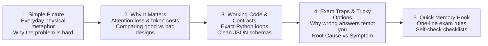
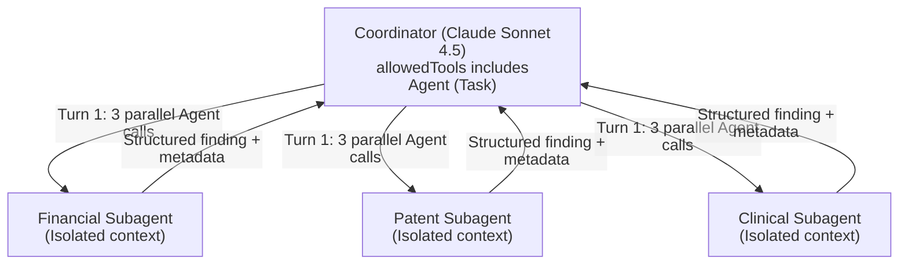
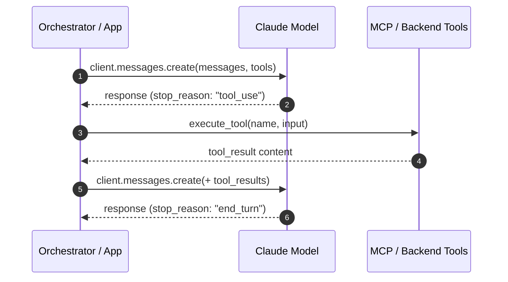
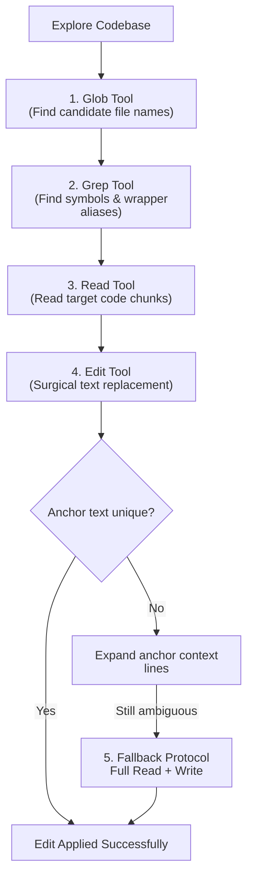
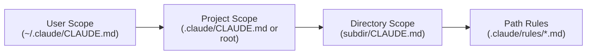
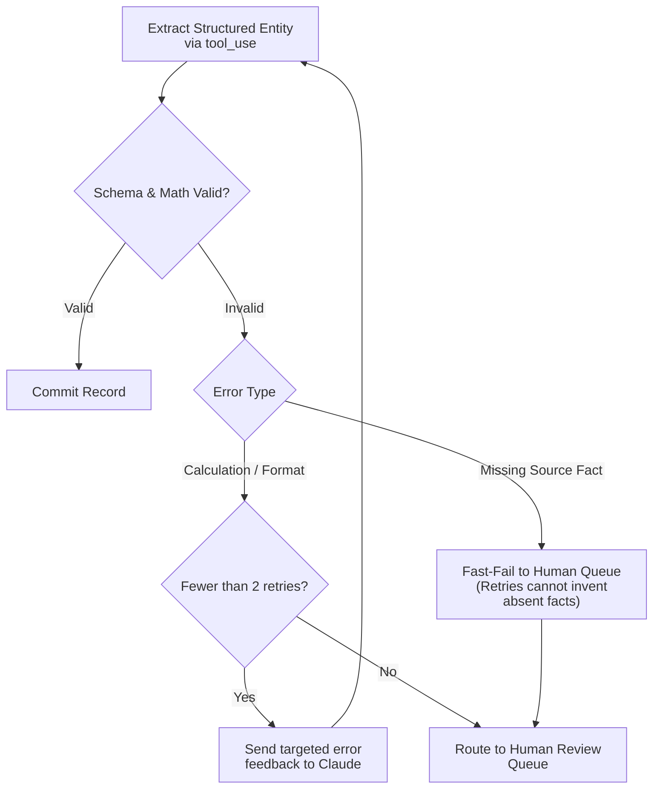
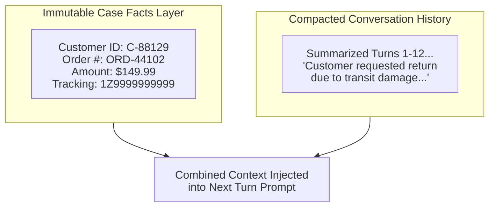
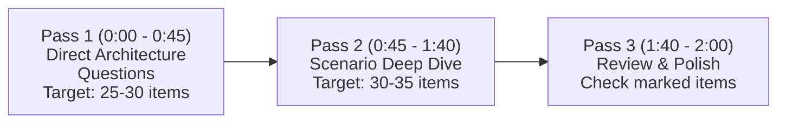

# 🎓 Claude Certified Architect – Foundations (CCAR-F) Exam Refresher

> **⚡ Last-Minute Exam Day Cram Sheet & Complete 30-TS Architectural Playbook**  
> 🏅 **Credential:** Claude Certified Architect – Foundations (CCAR-F) · 🎯 **Passing Score:** `720 / 1000`  
> 📝 **Format:** 60 Scenario-Based Questions · ⏱️ **Time:** 120 Minutes (`2.0 min/question`) · 🎬 **Scenarios:** 4 of 6 Selected

---

## 🧭 Quick Jump Navigation

| Section | What You Get | Best Time to Read |
| :--- | :--- | :--- |
| **[🧠 Learning Method & Weights](#-how-to-learn-each-topic-5-clear-steps)** | 5-step intuition builder & 5-domain exam weights | Start here |
| **[⚡ 1. The 27 Golden Rules (All 30 TS)](#-1-the-27-golden-rules-all-30-task-statements-covered)** | Quick reference table + full 5-part Deep Dive per domain | Core study |
| **[🎯 2. Quick Decision Guide](#-2-quick-decision-guide-when-you-see-problem-pick-architecture)** | Production symptom → root cause → exam choice | Rapid pattern matching |
| **[🚫 3. Top 10 Deadliest Exam Traps](#-3-the-10-deadliest-exam-traps-and-how-to-spot-them)** | Tempting distractors & why they break in production | Night before exam |
| **[🏛️ 4. Domain Specs & Code Cheat-Sheets](#️-4-domain-specs-what-you-need-on-exam-day)** | Exact loops, JSON schemas, CLI flags, & Claude 4.5 rules | Final 30-min review |
| **[🎬 5. The 6 Production Scenarios](#-5-the-6-production-scenarios-quick-recall-matrix)** | SLAs, key tools, & architecture per scenario | Scenario warm-up |
| **[⏱️ 6. Exam Day Pacing Strategy](#️-6-exam-day-pacing-strategy)** | 3-pass clock management & fast elimination checklist | Morning of exam |

---

## 🧠 How to Learn Each Topic (5 Clear Steps)

Every rule on the CCAR-F exam exists because something broke in production. Build real engineering intuition using this 5-step path:

> **1. Simple Picture** → **2. Why Naive Fails** → **3. Working Pattern** → **4. Exam Trap** → **5. Memory Hook**



### 📊 Exam Weights & 30-Task-Statement Coverage

| Domain | Focus Area | Weight | ~Questions | Task Statements Covered | Guide |
| :---: | :--- | :---: | :---: | :---: | :---: |
| 🏗️ **D1** | **Agentic Architecture & Orchestration** | **27%** | ~16 | TS 1.1 – TS 1.7 (7) | [Domain 1](domain1/README.md) |
| 🔧 **D2** | **Tool Design & MCP Integration** | **18%** | ~11 | TS 2.1 – TS 2.5 (5) | [Domain 2](domain2/README.md) |
| 💻 **D3** | **Claude Code Configuration & Workflows** | **20%** | ~12 | TS 3.1 – TS 3.6 (6) | [Domain 3](domain3/README.md) |
| 🎯 **D4** | **Prompt Engineering & Structured Output** | **20%** | ~12 | TS 4.1 – TS 4.6 (6) | [Domain 4](domain4/README.md) |
| 🛡️ **D5** | **Context Management & Reliability** | **15%** | ~9 | TS 5.1 – TS 5.6 (6) | [Domain 5](domain5/README.md) |

---

## ⚡ 1. The 27 Golden Rules (All 30 Task Statements Covered)

### 📋 Quick Reference Table

| # | Domain | TS | Topic | The Golden Rule | Code Anchor | Wrong Answer to Reject |
| :---: | :---: | :---: | :--- | :--- | :---: | :--- |
| **1** | 🏗️ D1 | **1.1** | **Loop Control** | `response.stop_reason == "end_turn"` is the **only true exit**. Loop on `"tool_use"`; `MAX_ITERATIONS` is an emergency cap only. | [TS 1.1](domain1/ts_1_1_multi_tool_agent_loop/main.py) | Checking chat text for `"I am finished"` or using a fixed counter as the normal exit. |
| **2** | 🏗️ D1 | **1.4, 1.5** | **Safety Gates & Hooks** | Hard rules (ID checks, refunds > \$500) must run in **code gates or `PreToolUse` hooks**; `PostToolUse` trims/redacts outputs. | [TS 1.4](domain1/ts_1_4_prerequisite_enforcement/main.py)<br>[TS 1.5](domain1/ts_1_5_sdk_hooks/main.py) | Relying on prompt warnings (`"be careful to verify"`); prompts fail probabilistically. |
| **3** | 🏗️ D1 | **1.2** | **Subagent Isolation** | Subagents start with **zero memory (`[]`)**. Route all traffic through the coordinator and inject needed facts into every prompt. | [TS 1.2](domain1/ts_1_2_coordinator_subagents/main.py) | Peer-to-peer subagent mesh, or assuming subagents inherit parent chat history. |
| **4** | 🏗️ D1 | **1.3** | **Parallel Spawning** | Allow `"Agent"` (formerly `"Task"`) in `allowedTools` and emit **multiple `Agent` calls in one turn** to run concurrently. | [TS 1.3](domain1/ts_1_3_subagent_invocation_spawning/main.py) | Calling subagents one by one across separate turns, or forgetting `Agent` in `allowedTools`. |
| **5** | 🏗️ D1 | **1.6** | **Task Decomposition** | Use **Two-Pass Prompt Chaining** (Pass 1 per-file + Pass 2 cross-file integration) for large reviews; **adaptive** plans for open discovery. | [TS 1.6](domain1/ts_1_6_task_decomposition/main.py) | Dumping 15 files into one prompt or switching to a bigger model/context window. |
| **6** | 🏗️ D1 | **1.7** | **Session Lifecycle** | `--resume` when files are valid; `--fork-session` to compare branches; **fresh session + summary** when tool results go stale. | [TS 1.7](domain1/ts_1_7_session_management/main.py) | Silently resuming a 60-turn session after a git rebase or large refactor. |
| **7** | 🔧 D2 | **2.1** | **Tool Descriptions** | Fix misrouting by writing **rich descriptions** (purpose, input formats, examples, edge cases, negative `BOUNDARY` rules). | [TS 2.1](domain2/ts_2_1_tool_interface_design/main.py) | Building an external ML router, adding few-shot bloat, or merging unrelated tools. |
| **8** | 🔧 D2 | **2.2** | **Tool Errors & Empty Sets** | Return `isError: true`, category (`transient`/`validation`/`business`/`permission`), and `isRetryable`. **0 matches = valid empty (`isError: false`)**. | [TS 2.2](domain2/ts_2_2_mcp_structured_errors/main.py) | Returning `"Operation failed"`, or marking 0 search results as an error. |
| **9** | 🔧 D2 | **2.3** | **Tool Budget & `tool_choice`** | Keep **4–5 scoped tools per role**. Use `tool_choice` (`auto`/`any`/named)—**never force tools when extended thinking is on** (HTTP 400). | [TS 2.3](domain2/ts_2_3_tool_distribution_and_choice/main.py) | Giving 18+ tools to every agent, or combining `any`/forced tool with `thinking`. |
| **10** | 🔧 D2 | **2.4** | **MCP Config & Resources** | Team servers go in **`.mcp.json`** with **`${ENV_VAR}` secrets**; personal in `~/.claude.json`; expose static schemas as **MCP Resources**. | [TS 2.4](domain2/ts_2_4_mcp_server_integration/main.py) | Committing raw API tokens to Git or wasting bash turns exploring schemas. |
| **11** | 🔧 D2 | **2.5** | **Built-in Discovery & Edit** | Explore incrementally (**`Glob` → `Grep` → chunked `Read`** + wrapper aliases). On `Edit` collision: expand anchor, then **`Read` + `Write`**. | [TS 2.5](domain2/ts_2_5_builtin_tools_usage/main.py) | Reading 300 files upfront, or repeating the same failing `Edit`. |
| **12** | 💻 D3 | **3.1** | **`CLAUDE.md` Hierarchy** | Shared team rules live in **project `./CLAUDE.md` / `.claude/CLAUDE.md`** (< 200 lines + `@import`), never personal `~/.claude/CLAUDE.md`. Debug with `/memory`. | [TS 3.1](domain3/ts_3_1_claude_code_workflows/main.py) | Putting team standards in home directories (invisible to teammates and CI). |
| **13** | 💻 D3 | **3.2** | **Commands & Skills** | Team shortcuts go in `.claude/commands/`. Noisy on-demand workflows use **`SKILL.md` with `context: fork`** and scoped `allowed-tools`. | [TS 3.2](domain3/ts_3_2_slash_commands_and_skills/main.py) | Running verbose discovery skills inline in the main conversation. |
| **14** | 💻 D3 | **3.3** | **Path-Scoped Rules** | Use **`.claude/rules/*.md` with YAML `paths:` globs** (e.g. `**/*.test.tsx`) for conventions spanning many directories. | [TS 3.3](domain3/ts_3_3_path_specific_rules/main.py) | Copy-pasting `CLAUDE.md` into 30 subdirectories. |
| **15** | 💻 D3 | **3.4, 3.5** | **Plan Mode & Refinement** | Use **Plan Mode** for multi-file/ambiguous changes; **Direct Execution** for clear 1-file bugs. Refine with **2–3 I/O examples** & the **Interview Pattern**. | [TS 3.4](domain3/ts_3_4_plan_mode_and_refinement/main.py)<br>[TS 3.5](domain3/ts_3_5_iterative_refinement_interview/main.py) | Entering Plan Mode for a 1-line stack-trace fix, or giving vague prose (`"be careful"`). |
| **16** | 💻 D3 | **3.6** | **Headless CI/CD** | Run CI with **`claude -p` (`--print`)**, `--output-format json`, and `--json-schema`, using an **independent review instance**. | [TS 3.6](domain3/ts_3_6_cicd_pipeline_automation/main.py) | Running `claude` without `-p` (hangs), or inventing flags (`--batch`, `CLAUDE_HEADLESS`). |
| **17** | 🎯 D4 | **4.1** | **Explicit Criteria** | Define concrete **report vs. skip** rules, **negative boundaries**, and code severity examples. **Disable noisy categories** while refining. | [TS 4.1](domain4/ts_4_1_explicit_criteria_classification/main.py) | Prompting `"be conservative"` or filtering alerts by self-reported confidence. |
| **18** | 🎯 D4 | **4.2** | **Few-Shot Diversity** | Provide **2–4 targeted examples** across **varied layouts** (table, narrative, receipt) with explicit reasoning and `null` cases. | [TS 4.2](domain4/ts_4_2_few_shot_and_multi_instance/main.py) | Providing 15 identical tabular examples (causes layout overfitting). |
| **19** | 🎯 D4 | **4.3** | **Guaranteed JSON** | Enforce JSON syntax via **`tool_use` + `input_schema`** (`strict: true`) and check **math/semantics in Python code**. | [TS 4.3](domain4/ts_4_3_structured_output_tool_use/main.py) | Asking for markdown ` ```json ` prose, or assuming a schema verifies arithmetic. |
| **20** | 🎯 D4 | **4.3, 4.4** | **Nullables & Retry Limits** | Mark uncertain fields **`["string", "null"]`** + `"unclear"`/`"other"` enums. Retry fixable format/math errors; **fast-fail absent facts**. | [TS 4.3](domain4/ts_4_3_structured_output_tool_use/main.py)<br>[TS 4.4](domain4/ts_4_4_validation_retry_feedback/main.py) | Making every field required, or retrying 5 times when the source lacks the fact. |
| **21** | 🎯 D4 | **4.5** | **Message Batches** | **50% off**, up to **24h window**, no latency SLA. Test on a sample first, match by **`custom_id`**, and resubmit only failed IDs. | [TS 4.5](domain4/ts_4_5_message_batches_api/main.py) | Batching blocking pre-merge PR checks, or resubmitting an entire 10k batch. |
| **22** | 🎯 D4 | **4.6** | **Independent Multi-Pass** | Eliminate self-review bias with an **independent reviewer**; split PRs into **Pass 1 (per-file) + Pass 2 (integration)**; route low confidence to humans. | [TS 4.6](domain4/ts_4_6_multi_pass_review/main.py) | Having the generating session review its own code, or silently dropping low-confidence findings. |
| **23** | 🛡️ D5 | **5.1, 5.4** | **Case Facts & External Memory** | Pin exact IDs/amounts in **Case Facts** outside summaries; trim 40+ tool fields early; put key findings first; use **`scratchpad.md` & `/compact`**. | [TS 5.1](domain5/ts_5_1_context_preservation/main.py)<br>[TS 5.4](domain5/ts_5_4_scratchpads_and_human_review/main.py) | Trusting progressive summaries to keep exact numbers, or telling Claude `"don't forget"`. |
| **24** | 🛡️ D5 | **5.2** | **Escalation & Ambiguity** | **Escalate immediately** on human request, policy gap, or no progress. On multiple DB matches, **ask for more IDs**—never guess. | [TS 5.2](domain5/ts_5_2_escalation_and_provenance/main.py) | Escalating from sentiment/confidence scores, or picking the most recent customer match. |
| **25** | 🛡️ D5 | **5.3** | **Propagation & Coverage** | Subagents retry `transient` errors locally, then return structured error context; coordinator continues and adds **Coverage Notices**. | [TS 5.3](domain5/ts_5_3_error_propagation_coverage/main.py) | Aborting the whole workflow on one outage, or hiding missing sources. |
| **26** | 🛡️ D5 | **5.5** | **Segmented Audit Sampling** | Measure accuracy **per `(type, field)` segment**, calibrate field confidence on labeled sets, and **audit 5–10% stratified samples** (including high-confidence). | [TS 5.5](domain5/ts_5_5_human_review_calibration/main.py) | Approving 100% automation from 97% aggregate accuracy. |
| **27** | 🛡️ D5 | **5.6** | **Provenance & Conflicts** | Preserve **claim-source mappings & dates**; show conflicting values **side-by-side**; distinguish timelines from conflicts; render by content type. | [TS 5.6](domain5/ts_5_6_provenance_and_uncertainty/main.py) | Averaging conflicting numbers (`$1.35B`) or flagging different years as contradictions. |

---

### 🔍 Deep Dive by Domain: Why Every Rule Works (and Why Wrong Answers Fail)

Every rule uses the same 5-part blueprint: **🧒 Simple Picture** · **💥 Why Naive Fails** · **✅ Working Pattern** · **⚠️ Exam Trap** · **🧠 Memory Hook**.

---

#### 🏗️ Domain 1: Agentic Architecture & Orchestration (27% · Rules 1–6)

##### Rule 1: Controlling Loops with `stop_reason` ([TS 1.1](domain1/ts_1_1_multi_tool_agent_loop/README.md))
- **🧒 Simple Picture:** Think of a car's dashboard light vs. the driver. Claude turns on `"tool_use"` when it needs data and `"end_turn"` when the trip is finished. You never stop the car just because a passenger says *"Almost there!"*
- **💥 Why Naive Fails:** Scanning text for `"I am done"` misfires whenever Claude narrates before a tool call (*"I'll mark this resolved once I check the order"*). A fixed `for _ in range(5):` loop cuts off complex runs early, and treating `"max_tokens"` as success executes truncated tool JSON.
- **✅ Working Pattern:**

```python
MAX_ITERATIONS = 20  # Safety cap for runaway bugs only, never the normal exit

for _ in range(MAX_ITERATIONS):
    response = client.messages.create(model="claude-sonnet-4-5", messages=messages, tools=tools)

    if response.stop_reason == "end_turn":
        return extract_text(response)
    if response.stop_reason == "tool_use":
        # Echo full content unchanged (keeps tool_use IDs and thinking block signatures)
        messages.append({"role": "assistant", "content": response.content})
        results = [run_tool(b) for b in response.content if b.type == "tool_use"]
        messages.append({"role": "user", "content": results})
        continue
    if response.stop_reason == "pause_turn":
        messages.append({"role": "assistant", "content": response.content})
        continue
    raise LoopStopped(f"Abnormal stop_reason: {response.stop_reason}")
```

- **⚠️ Exam Trap:**
  - *Tempting wrong choice:* "Check `content[0].text` for `'All tasks completed'`, or increase the loop cap to 50."
  - *Why it breaks:* Narration text fires early; larger caps waste calls on short tasks and still cut off longer ones.
  - *Real fix:* Branch strictly on `response.stop_reason` (`end_turn`, `tool_use`, `pause_turn`), preserve `thinking` blocks verbatim, and keep `MAX_ITERATIONS` as an error fallback only.
- **🧠 Memory Hook:** *Read `stop_reason`, never the chat text; echo assistant blocks unchanged.*

##### Rule 2: Real Code Gates vs. Polite Prompt Signs ([TS 1.4](domain1/ts_1_4_prerequisite_enforcement/README.md) · [TS 1.5](domain1/ts_1_5_sdk_hooks/README.md))
- **🧒 Simple Picture:** A paper sign on a bank vault saying `"Authorized Staff Only"` will not stop a burglar. An electronic turnstile with a keycard reader will. Prompts are paper signs; code gates and hooks are turnstiles.
- **💥 Why Naive Fails:** Prompts are **probabilistic**—even 99% compliance leaks 1 unauthorized refund in 100 under pressure or edge cases. And `PostToolUse` runs *after* execution, so it cannot un-send money; it only normalizes, trims, or redacts tool outputs before they enter context.
- **✅ Working Pattern:**

| Approach | Where It Runs | Reliability | Behavior / Failure Mode | Exam Verdict |
| :--- | :--- | :--- | :--- | :--- |
| **System Prompt Warning** | Prompt text ("Never refund without ID") | Probabilistic (~95–98%) | Bypassed by urgent user wording | **Reject** |
| **Few-Shot Prompting** | 3 in-context examples | Probabilistic (~98%) | Fails on unseen edge cases | **Reject** |
| **Programmatic Code Gate** | Python `if` check in tool handler | **100% Deterministic** | Blocks unverified calls before execution | **Correct Answer** |
| **SDK Hook (`PreToolUse`)** | Claude Agent SDK interceptor | **100% Deterministic** | Denies policy/amount violations (e.g. > \$500) before tool runs | **Correct Answer** |

- **⚠️ Exam Trap:**
  - *Tempting wrong choice:* "Add bold uppercase instructions: `'NEVER ISSUE A REFUND WITHOUT VERIFYING IDENTITY'`."
  - *Why it breaks:* A demanding customer (*"Emergency, refund me now!"*) causes Claude's helpfulness to override prompt rules.
  - *Real fix:* Gate execution in Python workflow state (`if not state.verified: return error`) or a `PreToolUse` hook; use `PostToolUse` for output cleanup/trimming.
- **🧠 Memory Hook:** *Rules that must never break go in code gates or `PreToolUse` hooks, never prompts.*

##### Rule 3: Hub-and-Spoke Coordinator & Subagent Isolation ([TS 1.2](domain1/ts_1_2_coordinator_subagents/README.md))
- **🧒 Simple Picture:** An air traffic controller and airplanes. The tower sees the whole sky and hands each pilot exact coordinates. Pilots never chat peer-to-peer over open radio to negotiate routes.
- **💥 Why Naive Fails:** A single monolithic agent doing search + reading + writing drowns in context noise. A peer-to-peer mesh creates untraceable loops. And assuming a subagent can see the parent chat fails because every subagent starts with an empty `[]` message list.
- **✅ Working Pattern:**
  - Use a flat **hub-and-spoke** topology (leaf subagents never spawn sub-subagents).
  - Explicitly inject every required ID, constraint, and goal into each subagent's prompt.
  - Run a coverage check (`evaluate_synthesis`) on returned findings and re-delegate missing slices.
- **⚠️ Exam Trap:**
  - *Tempting wrong choice:* "The final report missed music trends even though the art and film subagents returned great results—tune the synthesis subagent's prompt."
  - *Why it breaks:* The synthesis agent only sees what it receives; the coordinator decomposed the query too narrowly and never assigned music.
  - *Real fix:* Fix the **coordinator's decomposition** to cover every topic slice and inject explicit context into every subagent call.
- **🧠 Memory Hook:** *Subagents start blind (`[]`); all traffic flows through the coordinator.*

##### Rule 4: Single-Turn Concurrent Subagent Spawning ([TS 1.3](domain1/ts_1_3_subagent_invocation_spawning/README.md))
- **🧒 Simple Picture:** A restaurant kitchen sending appetizer, salad, and dessert tickets out at the same time instead of waiting for each course to finish before starting the next.
- **💥 Why Naive Fails:** Spawning subagents one per turn makes total latency the **sum** (`T1 + T2 + T3`) instead of the **slowest single subagent** (`max(T1, T2, T3)`). Also, if `"Agent"` (formerly `"Task"`) is omitted from `allowedTools`, the coordinator cannot spawn subagents at all.
- **✅ Working Pattern:**



- **⚠️ Exam Trap:**
  - *Tempting wrong choice:* "Add more detailed step-by-step instructions to each subagent's `AgentDefinition` to speed up execution."
  - *Why it breaks:* Sequential round-trips stay slow—and if `"Agent"` is missing from `allowedTools`, subagents never launch.
  - *Real fix:* Whitelist `"Agent"` in `allowedTools`, emit independent `Agent` calls together in **Turn 1**, and keep `content` separate from source `metadata`.
- **🧠 Memory Hook:** *`"Agent"` in `allowedTools`, all independent spawns in one turn.*

##### Rule 5: Two-Pass Prompt Chaining & Adaptive Decomposition ([TS 1.6](domain1/ts_1_6_task_decomposition/README.md))
- **🧒 Simple Picture:** Grading 15 student essays: grade each essay individually with a fresh checklist first, then do one comparison pass to spot contradictions across essays. For exploring an unknown cave, draw the map first and adapt as you discover new tunnels.
- **💥 Why Naive Fails:** Stuffing 14 changed files into one giant review prompt causes **attention dilution**—file 1 gets style nitpicks while cross-file security bugs in file 12 are missed. Using a fixed script for unfamiliar legacy codebases breaks as soon as real dependencies surprise you.
- **✅ Working Pattern:**
  - **Known repeatable multi-file workflow (PR review):** **Two-Pass Prompt Chaining** — Pass 1 reviews each file in isolation (fast worker `claude-haiku-4-5`) producing compact finding cards + signatures; Pass 2 audits cross-file contracts (`claude-sonnet-4-5`).
  - **Open-ended discovery ("add tests to legacy repo"):** **Dynamic Adaptive Decomposition** — map structure, prioritize high-risk modules, and adapt the plan after each step.
- **⚠️ Exam Trap:**
  - *Tempting wrong choice:* "Upgrade to a larger model/context window, vote 3 times, or ask developers to split PRs into 1-file PRs."
  - *Why it breaks:* Bigger windows still dilute attention; voting repeats the same single-pass blind spot.
  - *Real fix:* Split into per-file Pass 1 + cross-file Pass 2.
- **🧠 Memory Hook:** *Fixed workflow → two-pass chain; unknown legacy repo → map, prioritize, adapt.*

##### Rule 6: Session Resumption, Forking, & Stale-Context Resets ([TS 1.7](domain1/ts_1_7_session_management/README.md))
- **🧒 Simple Picture:** A video-game save file. Load the save (`--resume`) if the world hasn't changed. Tell the game what moved if a few items shifted. Copy the save (`--fork-session`) to try two competing strategies. If the whole map was rebuilt, start a **New Game** carrying a short notebook of verified facts.
- **💥 Why Naive Fails:** Resuming a 60-turn session silently after a `git rebase` or major refactor leaves stale `Read` outputs in memory—Claude edits lines that no longer exist.
- **✅ Working Pattern:**
  - Unchanged repo → `claude --resume <name>` (SDK: `resume=<id>`).
  - A few files changed → `--resume` and explicitly list the changed files so Claude re-reads them.
  - Compare 2 designs → `--fork-session` (SDK: `fork_session=True`; copies history, not disk files).
  - Many stale tool results → extract verified facts into a structured Markdown summary and start a **fresh session** seeded with that summary.
- **⚠️ Exam Trap:**
  - *Tempting wrong choice:* "Always `--resume` the existing 65-turn session after rebasing 40 commits so Claude keeps prior reasoning."
  - *Why it breaks:* Stale cached file contents corrupt every subsequent edit.
  - *Real fix:* Summarize verified facts into a fresh session whenever codebase drift makes old tool outputs stale.
- **🧠 Memory Hook:** *Valid → resume; small drift → name changed files; big drift → fresh session + summary; A/B → fork.*

---

#### 🔧 Domain 2: Tool Design & MCP Integration (18% · Rules 7–11)

##### Rule 7: Rich Tool Descriptions Drive Selection ([TS 2.1](domain2/ts_2_1_tool_interface_design/README.md))
- **🧒 Simple Picture:** Kitchen drawer labels. A drawer labeled `"Stuff"` mixes up forks and knives. A drawer labeled `"Dinner forks only — NOT steak knives (use Drawer 2)"` stops misrouting immediately.
- **💥 Why Naive Fails:** Short, generic descriptions (`"Retrieves customer details"` vs `"Retrieves order details"`) look nearly identical to Claude, causing coin-flip tool calls on prompts like *"Where is order ORD-9821 for alice@example.com?"*
- **✅ Working Pattern (5-Part Tool Description):**
  1. **Core purpose** (exact resource/action)
  2. **Input formats** (`ORD-` + digits vs `CUST-XXXX` / email)
  3. **2–3 example queries**
  4. **Edge cases** (what returns on zero matches)
  5. **Negative boundary** (`"BOUNDARY: Do NOT use for order tracking; use lookup_order instead"`)
  - Also split vague multi-purpose tools (`analyze_document` → `extract_data_points`, `summarize_content`, `verify_claim_against_source`) and audit the system prompt for overriding keyword bias.
- **⚠️ Exam Trap:**
  - *Tempting wrong choice:* "Train a BERT/ML routing classifier in front of Claude, or merge `get_customer` and `lookup_order` into one mega-tool."
  - *Why it breaks:* Adds brittle infrastructure and fails multi-intent queries—or creates one ambiguous schema.
  - *Real fix:* Expand tool descriptions with formats, examples, and negative boundaries first.
- **🧠 Memory Hook:** *The description is the router—fix the labels before adding classifiers.*

##### Rule 8: Structured Error Contracts & Valid Empty Sets ([TS 2.2](domain2/ts_2_2_mcp_structured_errors/README.md))
- **🧒 Simple Picture:** An ER triage tag vs. shouting `"Patient sick!"`. And an empty filing folder (proven zero records) vs. a locked cabinet (`503 Timeout`).
- **💥 Why Naive Fails:** Returning `"Operation failed"` gives Claude zero recovery signal. Flagging `0` search results as `isError: true` triggers pointless retries; returning `[]` on a network timeout hides an outage.
- **✅ Working Pattern:**

```json
{
  "isError": true,
  "errorCategory": "transient",
  "isRetryable": true,
  "message": "Inventory service timed out after 5s for SKU-101.",
  "attemptedQuery": "SKU-101",
  "partialResults": []
}
```

  - **Categories:** `transient` (subagent retries locally up to cap), `validation` (fix input), `business` (explain policy/escalate), `permission` (stop/escalate).
  - **Empty search:** `{"isError": false, "count": 0, "results": []}` (valid domain truth).
- **⚠️ Exam Trap:**
  - *Tempting wrong choice:* "Escalate every subagent timeout immediately to the coordinator, or return `isError: true` when 0 rows match."
  - *Why it breaks:* Wastes coordinator turns on transient blips and triggers endless retries on valid empty queries.
  - *Real fix:* Retry `transient` errors locally, propagate only unresolved errors with context, and keep `isError: false` for empty sets.
- **🧠 Memory Hook:** *Name the error (`isError`, category, `isRetryable`), retry transient locally, never flag `count: 0` as an error.*

##### Rule 9: Least-Privilege Tool Allocation & `tool_choice` ([TS 2.3](domain2/ts_2_3_tool_distribution_and_choice/README.md))
- **🧒 Simple Picture:** A plumber brings a 5-tool plumbing belt, not all 18 tools in the garage. Fewer tools = faster, sharper picks. And `tool_choice` is the rule for *when* a tool must be used.
- **💥 Why Naive Fails:** Giving 18+ tools to every agent degrades selection accuracy and burns thousands of schema tokens per turn. Open tools (`fetch_url`) invite SSRF/unwanted browsing. Combining `tool_choice: "any"` or a forced tool with manual extended thinking returns **HTTP 400**.
- **✅ Working Pattern:**
  - Limit each role to **4–5 scoped tools**; replace open primitives (`fetch_url`) with constrained ones (`load_document` by ID/allowlisted host); give synthesis a narrow read-only `verify_fact` tool.
  - **`tool_choice` modes:** `"auto"` (text or tools), `"any"` (must call some tool), `{"type": "tool", "name": "..."}` (must call this tool first, then switch back to `"auto"` on Turn 2).
  - **Thinking constraint:** When `thinking` is enabled, use **only `"auto"` or `"none"`**.
- **⚠️ Exam Trap:**
  - *Tempting wrong choice:* "Give every agent all 20 company tools 'just in case', or combine `tool_choice: 'any'` with `thinking={'type': 'enabled'}`."
  - *Why it breaks:* Causes tool saturation/misselection and triggers an immediate HTTP 400 with extended thinking.
  - *Real fix:* Scope to 4–5 tools per role; never combine forced/`any` `tool_choice` with manual thinking.
- **🧠 Memory Hook:** *4–5 scoped tools per role; extended thinking allows only `tool_choice` `auto` or `none`.*

##### Rule 10: MCP Server Scoping, `${ENV_VAR}` Secrets & Resources ([TS 2.4](domain2/ts_2_4_mcp_server_integration/README.md))
- **🧒 Simple Picture:** A shared team Wi-Fi setup sheet in Git (`.mcp.json`) vs. personal notes (`~/.claude.json`), with passwords kept in each person's locker (`${GITHUB_TOKEN}`), and a library card catalog (**MCP Resources**) so you don't search every aisle.
- **💥 Why Naive Fails:** Putting shared MCP servers in `~/.claude.json` leaves teammates without them. Hardcoding tokens in `.mcp.json` leaks credentials into Git history. Exploring database schemas via 12 bash tool calls burns turns and tokens.
- **✅ Working Pattern:**
  - Project `.mcp.json` (committed) with `"env": {"GITHUB_TOKEN": "${GITHUB_TOKEN}"}`.
  - User `~/.claude.json` for personal/experimental servers; all configured servers' tools load together at startup (`mcp__<server>__<action>`).
  - Expose read-only static schemas, issue catalogs, and doc trees as **MCP Resources** (`catalog://schema/orders`). If Claude still prefers `Grep` over an MCP tool, improve the MCP tool's description (don't remove `Grep`).
- **⚠️ Exam Trap:**
  - *Tempting wrong choice:* "Paste the API token in `.mcp.json`, or disable `Grep` so Claude uses the MCP search tool."
  - *Why it breaks:* Leaks secrets to Git and cripples local code search.
  - *Real fix:* Expand secrets via `${ENV_VAR}`, use MCP Resources for static catalogs, and sharpen MCP tool descriptions.
- **🧠 Memory Hook:** *Team in `.mcp.json`, personal in `~/.claude.json`, secrets in `${ENV_VAR}`, catalogs in Resources.*

##### Rule 11: Progressive Discovery & 3-Stage Edit Fallback ([TS 2.5](domain2/ts_2_5_builtin_tools_usage/README.md))
- **🧒 Simple Picture:** Checking the library shelf index (`Glob`), then the book index (`Grep`), then reading only the target pages (`Read`). For edits, use correction tape on a unique sentence (`Edit`), or copy the full clean page (`Read` + `Write`) if that phrase appears five times.
- **💥 Why Naive Fails:** Reading 300 files upfront floods context. Grepping only an internal helper name misses callers importing it via wrapper re-exports (`__init__.py`). Repeating an ambiguous `Edit` fails identically every time, while blindly overwriting a 900-line file with `Write` risks dropping unrelated functions.
- **✅ Working Pattern:**
  1. **Discovery funnel:** `Glob` (file paths) → `Grep` (symbols) → chunked `Read` (read imports + wrapper `__init__.py` exports, then `Grep` every exported alias).
  2. **3-Stage Edit Fallback:** Attempt surgical `Edit` → on non-unique anchor collision, expand `old_string` to 5–8 surrounding lines → if still ambiguous, `Read` full file and `Write` the complete replacement.
- **⚠️ Exam Trap:**
  - *Tempting wrong choice:* "Read all files in `src/` on turn 1, or always overwrite files with `Write` to avoid `Edit` errors."
  - *Why it breaks:* Floods tokens and risks silent code deletions.
  - *Real fix:* `Glob` → `Grep` → `Read` (plus wrapper aliases), and surgical `Edit` with expand-anchor / `Read + Write` fallback.
- **🧠 Memory Hook:** *`Glob` for paths, `Grep` for content/aliases, `Edit` unique anchor else `Read` + `Write`.*

---

#### 💻 Domain 3: Claude Code Configuration & Workflows (20% · Rules 12–16)

##### Rule 12: `CLAUDE.md` Hierarchy, `@import` Modularity & `/memory` ([TS 3.1](domain3/ts_3_1_claude_code_workflows/README.md))
- **🧒 Simple Picture:** Posters on walls. The school hallway poster (project `CLAUDE.md`) is seen by every teammate and CI runner. Your private diary (`~/.claude/CLAUDE.md`) is seen only by you. A classroom poster (directory `CLAUDE.md`) applies only inside that room.
- **💥 Why Naive Fails:** Putting team standards in `~/.claude/CLAUDE.md` gives *"works on my laptop, fails for Priya and CI"*. Bloating root `CLAUDE.md` past 200 lines dilutes attention across unrelated rules.
- **✅ Working Pattern:**
  - Commit shared standards in `./CLAUDE.md` or `.claude/CLAUDE.md` (< 200 lines); modularize into `.claude/rules/*.md` via `@path/to/file` imports (`CLAUDE.md` files concatenate across scopes, not override).
  - Run `/memory` first whenever Claude appears to ignore an instruction. Remember `CLAUDE.md` is guidance, not hard enforcement (use `PreToolUse` for guarantees).
- **⚠️ Exam Trap:**
  - *Tempting wrong choice:* "Store team build and commit conventions in `~/.claude/CLAUDE.md`."
  - *Why it breaks:* Home-directory configs are never committed to Git or read by teammates/CI.
  - *Real fix:* Move shared rules to project-level `CLAUDE.md` / `.claude/rules/`, keep it modular with `@import`, and verify with `/memory`.
- **🧠 Memory Hook:** *Scope decides who gets it; team rules in Git, debug with `/memory`.*

##### Rule 13: Shared Commands & Isolated Skills (`context: fork`) ([TS 3.2](domain3/ts_3_2_slash_commands_and_skills/README.md))
- **🧒 Simple Picture:** A shared remote-control shortcut (`.claude/commands/`) vs. a recipe cooked in a separate kitchen (`context: fork`) so the messy prep stays out of your living room.
- **💥 Why Naive Fails:** Putting a team `/review` command in `~/.claude/commands/` hides it from teammates. Running a heavy codebase-audit skill inline dumps 30k tokens of grep logs into the main conversation. Editing a shared skill directly creates merge conflicts for personal tweaks.
- **✅ Working Pattern:**
  - Shared commands: `.claude/commands/<name>.md` (personal: `~/.claude/commands/`).
  - On-demand skills: `.claude/skills/<name>/SKILL.md` with YAML frontmatter `context: fork` (returns summary only), `allowed-tools: [Read, Grep, Glob]`, and `argument-hint`.
  - Personal tweak of a team skill: copy to `~/.claude/skills/` under a **different name**. Rules that must *always* apply belong in `CLAUDE.md`, not a skill.
- **⚠️ Exam Trap:**
  - *Tempting wrong choice:* "Put always-on security rules in a skill, or run verbose dependency discovery inline in the main session."
  - *Why it breaks:* Skills only load on demand, and inline discovery pollutes the main context window.
  - *Real fix:* Always-on → `CLAUDE.md`; noisy on-demand workflow → skill with `context: fork`.
- **🧠 Memory Hook:** *Commands in `.claude/commands/`; noisy workflows in `SKILL.md` with `context: fork`.*

##### Rule 14: Path-Scoped Rules for Cross-Folder Patterns ([TS 3.3](domain3/ts_3_3_path_specific_rules/README.md))
- **🧒 Simple Picture:** *"Whenever you wear a lab coat, also wear goggles."* The rule follows the **file pattern** (`**/*.test.tsx`), not the folder.
- **💥 Why Naive Fails:** Copying `CLAUDE.md` into 30 subdirectories is unmaintainable, misses newly added folders, and wrongly applies test rules to sibling `Button.tsx` source files in the same directory.
- **✅ Working Pattern:**
  - Create `.claude/rules/testing.md` with YAML frontmatter: `paths: ["**/*.test.tsx", "tests/**"]`. It loads just-in-time only when matching files are touched (`*.md` matches root only; `**/*.md` matches everywhere).
- **⚠️ Exam Trap:**
  - *Tempting wrong choice:* "Add a `CLAUDE.md` file inside every directory that contains co-located test files."
  - *Why it breaks:* Drifts across folders and leaks test conventions into implementation files.
  - *Real fix:* Use a single `.claude/rules/*.md` file with `paths:` glob patterns.
- **🧠 Memory Hook:** *Co-located files across many folders → `.claude/rules/*.md` with `paths:` globs.*

##### Rule 15: Plan Mode vs. Direct Execution & Iterative Refinement ([TS 3.4](domain3/ts_3_4_plan_mode_and_refinement/README.md) · [TS 3.5](domain3/ts_3_5_iterative_refinement_interview/README.md))
- **🧒 Simple Picture:** Drafting an architectural blueprint before knocking down load-bearing walls (**Plan Mode**) vs. grabbing spackle to patch one nail hole (**Direct Execution**). And showing a tailor 2–3 exact measurements (**I/O examples**) instead of saying *"make it look nice."*
- **💥 Why Naive Fails:** Diving straight into a 20-file monolith split breaks imports and wastes rework. Entering Plan Mode for a 1-line bug with a clear stack trace wastes time. Giving vague prose (*"be more consistent"*) leaves edge cases open, and dumping 100 files into main chat instead of an Explore subagent overflows context.
- **✅ Working Pattern:**
  - **Plan Mode (`Shift+Tab` / `--permission-mode plan`):** Multi-file refactors, unfamiliar architectures, multiple valid designs (use Explore subagent for reconnaissance).
  - **Direct Execution:** Small, localized fixes with clear requirements or stack traces.
  - **Refinement (TS 3.5):** Give **2–3 concrete input/output examples**; write failing tests first; use the **Interview Pattern** (let Claude ask clarifying questions before coding) when requirements are open; group *interacting* issues in one message and *independent* issues in separate turns.
- **⚠️ Exam Trap:**
  - *Tempting wrong choice:* "Always use Plan Mode for every bug fix to be safe, or write a longer prose prompt when formatting stays inconsistent."
  - *Why it breaks:* Plan Mode adds unnecessary overhead to trivial fixes; prose cannot beat 2–3 concrete I/O examples.
  - *Real fix:* Match mode to blast radius, and refine with concrete I/O examples + Interview Pattern.
- **🧠 Memory Hook:** *Big/ambiguous → Plan Mode; clear 1-file → Direct; vague output → 2–3 I/O examples + Interview.*

##### Rule 16: Headless CI/CD Automation with `-p` & JSON Schemas ([TS 3.6](domain3/ts_3_6_cicd_pipeline_automation/README.md))
- **🧒 Simple Picture:** A factory robot with nobody at the keyboard. Without `-p`, Claude waits forever for Enter. `-p` means *"answer once in JSON and exit."* And the author never grades its own exam.
- **💥 Why Naive Fails:** Interactive `claude` hangs CI runners. Scraping prose headings breaks inline PR comment scripts. Self-review in the authoring session rationalizes the author's own bugs.
- **✅ Working Pattern:**

```bash
claude -p "Review this PR diff against CLAUDE.md criteria" \
  --output-format json \
  --json-schema '{"type":"object","properties":{"findings":{"type":"array"}}}'
```

  - Always use an **independent review instance**; on re-runs after new commits, include prior findings and ask only for *newly introduced or still-unaddressed* issues. For test generation, pass existing test files so it doesn't duplicate coverage. (Do not use `--bare` if CI needs `CLAUDE.md`!)
- **⚠️ Exam Trap:**
  - *Tempting wrong choice:* "Set `CLAUDE_HEADLESS=true` or `--batch`, or resume the generating session to review its own PR."
  - *Why it breaks:* Both flags are fabricated (do not exist), and same-session review suffers self-review bias.
  - *Real fix:* Use `-p` (`--print`), `--output-format json`, `--json-schema`, and a fresh independent instance.
- **🧠 Memory Hook:** *CI needs `-p`, `--output-format json --json-schema`, and independent reviewer eyes.*

---

#### 🎯 Domain 4: Prompt Engineering & Structured Output (20% · Rules 17–22)

##### Rule 17: Explicit Criteria, Negative Boundaries & Category Disablement ([TS 4.1](domain4/ts_4_1_explicit_criteria_classification/README.md))
- **🧒 Simple Picture:** A sports referee rulebook. `"Be fair"` causes endless arguments; `"Yellow card for late tackle (video example); ignore clean shoulder-to-shoulder contact"` is clear. If one rule causes constant bad calls, pause that rule until rewritten.
- **💥 Why Naive Fails:** Vague directives (*"be conservative; only report high-confidence bugs"*) fail because model confidence isn't calibrated—noisy alerts cause **alert fatigue**, making engineers dismiss real security vulnerabilities.
- **✅ Working Pattern:**
  - Define **explicit report categories**, **explicit skip categories / negative boundaries** (e.g., ignore `mock_*` keys in `tests/`), and **concrete code examples per severity tier**.
  - Attach `detected_pattern` tags to track dismissal rates. If a category has high false positives, **temporarily disable that category** while refining criteria and re-test before re-enabling.
- **⚠️ Exam Trap:**
  - *Tempting wrong choice:* "Tell Claude to be more conservative or filter out findings with model confidence < 0.85."
  - *Why it breaks:* Models often assign 90%+ confidence to stylistic false positives.
  - *Real fix:* Write explicit report/skip boundaries and temporarily disable noisy categories.
- **🧠 Memory Hook:** *Explicit report + skip criteria beat `"be conservative"`; disable noisy categories instead of filtering confidence.*

##### Rule 18: Few-Shot Prompting with 2–4 Structurally Diverse Examples ([TS 4.2](domain4/ts_4_2_few_shot_and_multi_instance/README.md))
- **🧒 Simple Picture:** Teaching an apprentice carpenter with 3 tricky corner joints instead of hammering 20 identical straight nails.
- **💥 Why Naive Fails:** Giving 15 identical tabular invoice examples causes **structural overfitting**—accuracy collapses when a service invoice arrives as a narrative paragraph or scanned key-value receipt.
- **✅ Working Pattern:**
  - Provide **2–4 targeted examples** showing: (a) **varied document layouts** (table, narrative prose, key-value receipt), (b) **acceptable pattern vs. genuine issue** pairs, (c) **explicit `null`/empty cases**, and (d) brief **reasoning steps** explaining *why* the output matches.
- **⚠️ Exam Trap:**
  - *Tempting wrong choice:* "Add 15 more tabular invoice examples, or write a regex CSV pre-processor for narrative paragraphs."
  - *Why it breaks:* More identical examples deepen overfitting and burn tokens; regex breaks on varied prose.
  - *Real fix:* Curate 2–4 structurally diverse examples with reasoning and null cases.
- **🧠 Memory Hook:** *2–4 diverse examples with reasons beat 15 identical ones.*

##### Rule 19: Guaranteed JSON Syntax via `tool_use` ([TS 4.3](domain4/ts_4_3_structured_output_tool_use/README.md))
- **🧒 Simple Picture:** Handing Claude a printed form (`input_schema`) instead of blank paper (`"Return JSON"`). The form guarantees valid boxes, though it still cannot check your addition.
- **💥 Why Naive Fails:** Prose JSON breaks `json.loads()` with markdown fences or trailing commas. Schemas validate **shape/types only**—not whether `sum(line_items) == stated_total`. And forcing `tool_choice` (`"any"` or named tool) with manual extended thinking returns **HTTP 400**.
- **✅ Working Pattern:**
  - Define extraction tools with `input_schema`, `"strict": true`, and `"additionalProperties": false`.
  - Use `tool_choice: "any"` (unknown doc type among tools) or `{"type": "tool", "name": "..."}` (mandatory first step)—with `thinking` off. If `thinking` is on, use `tool_choice: "auto"` (and omit `temperature`, `top_k`, `top_p`).
  - Place long `<document_data>` **before** instructions/schema at the bottom of the prompt, and compute `calculated_total` vs `stated_total` (`conflict_detected`) in Python.
- **⚠️ Exam Trap:**
  - *Tempting wrong choice:* "Ask for JSON in markdown fences, or combine `tool_choice: 'any'` with extended thinking so Claude verifies the math."
  - *Why it breaks:* Markdown fences fail parsing; forced tool + thinking raises HTTP 400; schemas never catch math bugs.
  - *Real fix:* `tool_use` for syntax + `"auto"` if thinking is on + Python code for semantic/math validation.
- **🧠 Memory Hook:** *`tool_use` guarantees JSON syntax; Python checks math; never force tools with thinking.*

##### Rule 20: Nullable Fields & Validation Retry Boundaries ([TS 4.3](domain4/ts_4_3_structured_output_tool_use/README.md) · [TS 4.4](domain4/ts_4_4_validation_retry_feedback/README.md))
- **🧒 Simple Picture:** A customs form with an `"N/A"` box (`null`), plus a teacher circling a math slip to re-calculate—vs. stopping immediately if the required page was never attached.
- **💥 Why Naive Fails:** Non-nullable `required` fields force Claude to fabricate `"PO-99999"` when absent. Closed enums force wrong categories. Retrying 3 times when data is physically absent from the source document pressures Claude into inventing fake values on attempt 3.
- **✅ Working Pattern:**
  - Schema: `"type": ["string", "null"]` for missing-prone fields; add `"unclear"` and `"other"` + `other_detail` to enums.
  - Retry loop (TS 4.4):
    - **Recoverable** (bad date format, arithmetic mismatch) → retry with source document + failed extraction + exact validator error.
    - **Unrecoverable** (fact missing from source) → abort retries immediately; keep `null` or route to human review.
- **⚠️ Exam Trap:**
  - *Tempting wrong choice:* "Keep all fields required and retry up to 5 times with `'Do not leave fields blank'`."
  - *Why it breaks:* Combines schema pressure with retry pressure, maximizing hallucinations.
  - *Real fix:* Nullable schema fields + `"unclear"`/`"other"` enums + targeted retry for fixable errors only.
- **🧠 Memory Hook:** *Nullable stops fabrication; retries fix format/math, never absent facts.*

##### Rule 21: Message Batches API Economics & SLA Math ([TS 4.5](domain4/ts_4_5_message_batches_api/README.md))
- **🧒 Simple Picture:** Express courier vs. bulk overnight freight. Bulk freight costs **50% less**, finishes within **24 hours**, and items arrive out of order—so every item carries a `custom_id` label.
- **💥 Why Naive Fails:** Batching blocking pre-merge PR checks or interactive chat stalls users for hours (no latency SLA). Ignoring `custom_id` scrambles matches, and resubmitting an entire batch when 1% fails wastes 99% of compute.
- **✅ Working Pattern:**
  - **Use for:** Nightly debt audits, weekly compliance reports, offline test gen (up to 100k requests / 256 MB per batch). **Never for:** blocking PR gates or live chat.
  - **SLA math:** `Worst Case = Submission Interval + 24h + Margin` (30h SLA with 2h margin → submit every 4 hours).
  - **Workflow:** Test prompt on 50–100 sample items first; match results by `custom_id`; resubmit only `errored`/`expired` IDs (chunking oversized documents).
- **⚠️ Exam Trap:**
  - *Tempting wrong choice:* "Route pre-merge CI checks through the Message Batches API to save 50%, or resubmit all 8,000 items after 18 timeouts."
  - *Why it breaks:* Blocks merges for up to 24h and wastes redundant tokens.
  - *Real fix:* Synchronous API for blocking work; Batches for async jobs with `custom_id` partial resubmission.
- **🧠 Memory Hook:** *50% off, 24h window, no SLA—never batch anything someone is waiting on.*

##### Rule 22: Independent Multi-Instance & Two-Pass Review ([TS 4.6](domain4/ts_4_6_multi_pass_review/README.md))
- **🧒 Simple Picture:** Peer review by a fresh colleague instead of proofreading your own essay—checking each chapter for typos first (Pass 1), then checking plot consistency across chapters (Pass 2).
- **💥 Why Naive Fails:** Same-session review suffers **self-review bias** (the model defends its own prior reasoning). Single-pass multi-file review dilutes attention, and dropping low-confidence findings silently hides real bugs.
- **✅ Working Pattern:**
  - Spawn an **independent reviewer instance** with clean context (only code diffs + criteria, zero authoring reasoning).
  - Run **Pass 1** (isolated per-file review) + **Pass 2** (cross-file integration over signatures & call sites), merge/deduplicate, and **route** by confidence (`high` → report, `low/missing` → human review, never silent drop).
- **⚠️ Exam Trap:**
  - *Tempting wrong choice:* "Have the code-generating session enable extended thinking and carefully audit its own output."
  - *Why it breaks:* Even with thinking, prior conversation turns anchor the model to its own assumptions.
  - *Real fix:* Independent fresh reviewer + two-pass architecture + confidence-based routing.
- **🧠 Memory Hook:** *Fresh reviewer kills self-bias; two passes catch cross-file bugs; route low confidence, don't drop it.*

---

#### 🛡️ Domain 5: Context Management & Reliability (15% · Rules 23–27)

##### Rule 23: Case Facts, Tool Trimming, Scratchpads & `/compact` ([TS 5.1](domain5/ts_5_1_context_preservation/README.md) · [TS 5.4](domain5/ts_5_4_scratchpads_and_human_review/README.md))
- **🧒 Simple Picture:** A laminated **Case Facts card** outside the telephone game so `\$149.99 on ORD-9921` never turns into `"about \$150"`, paired with a detective's notebook (`scratchpad.md`) for long investigations.
- **💥 Why Naive Fails:** Progressive summarization erases exact IDs, cents, and dates. Dumping 40+ raw CRM fields per tool call bloats context and triggers **lost-in-the-middle** attention drops. Telling Claude `"remember LegacyOrderManager"` after turn 35 fails when context is already saturated.
- **✅ Working Pattern:**
  - Keep an immutable **Case Facts** block pinned at the **top** of the prompt, outside summarized narrative, with recent verbatim turns at the **end**.
  - Trim bloated tool payloads (`47 fields → 4–5 needed fields`) via `PostToolUse` *before* appending to history; subagents return structured facts/citations, not 2,000-word reasoning transcripts.
  - For large codebases (TS 5.4): write discoveries to `scratchpad.md`, delegate noisy reads to **Explore subagents**, summarize between phases, use `/compact`, and persist per-agent state + coordinator **`manifest.json`** for crash recovery.
- **⚠️ Exam Trap:**
  - *Tempting wrong choice:* "Add `'preserve all numbers and IDs verbatim'` to the summarization prompt, or restart a crashed 2-hour job from scratch."
  - *Why it breaks:* LLM prose summarization still drifts, and restarting wastes hours of compute.
  - *Real fix:* Separate structured Case Facts from summaries, trim early, persist scratchpads, and resume from manifests.
- **🧠 Memory Hook:** *Case Facts outside summaries; trim tools early; key facts at top/end; scratchpads & manifests on disk.*

##### Rule 24: Rule-Based Escalation & Ambiguity Resolution ([TS 5.2](domain5/ts_5_2_escalation_and_provenance/README.md))
- **🧒 Simple Picture:** Immediately calling the floor manager when a shopper asks for one (no 5-question quiz first)—and asking for an account ID or ZIP code when `"John Smith"` matches three accounts instead of guessing.
- **💥 Why Naive Fails:** Guessing among 3 matching accounts risks refunding or exposing the wrong customer's data. Investigating first when a user asks for a human causes frustration. Escalating via sentiment scores or self-reported confidence misroutes easy fixes and misses policy gaps.
- **✅ Working Pattern:**
  - **Escalate immediately** (with a structured handoff summary: ID, verified status, root cause, tried steps, recommended action) on: (1) explicit human request, (2) policy gap/exception, or (3) agent stuck with no progress.
  - **Frustration alone (within policy):** acknowledge empathetically and resolve (escalate if they repeat/insist).
  - **Multiple DB matches:** ask the customer for another unique identifier (email, order ID, ZIP)—never pick by recency.
  - **Improve escalation accuracy:** add **explicit escalation criteria + few-shot examples** (not sentiment classifiers or confidence scores).
- **⚠️ Exam Trap:**
  - *Tempting wrong choice:* "Train a sentiment classifier to trigger escalation, or pick the most recently active account when two John Smiths match."
  - *Why it breaks:* Sentiment/confidence are poor proxies for policy gaps, and guessing leaks/mutates the wrong account.
  - *Real fix:* Explicit criteria + few-shot examples for escalation; ask clarifying IDs on multi-match.
- **🧠 Memory Hook:** *Human request or policy gap → escalate now; multiple matches → ask, never guess.*

##### Rule 25: Multi-Agent Error Propagation & Coverage Annotations ([TS 5.3](domain5/ts_5_3_error_propagation_coverage/README.md))
- **🧒 Simple Picture:** A weather station whose rain gauge is unplugged must report `"sensor offline"` rather than `"0 mm rainfall"`, so forecasters publish the sunny regions while noting which region's sensor was down.
- **💥 Why Naive Fails:** Returning `"Search unavailable"` hides *what* failed and partial results. Turning a timeout into `[]` fakes a clean search. Aborting an entire 5-source research report because 1 source timed out throws away 80% of valid intelligence.
- **✅ Working Pattern:**
  - Subagents retry `transient` errors locally up to their retry budget; unresolved failures propagate structured error context (`failure_type`, `attempted_query`, `partial_results`, `alternatives`).
  - Coordinator distinguishes `ACCESS_FAILURE` from `VALID_EMPTY`, continues synthesis with surviving subagents, and attaches explicit **Coverage Annotations** explaining what was checked and what was omitted.
- **⚠️ Exam Trap:**
  - *Tempting wrong choice:* "Fail the entire workflow when one subagent times out, or omit the missing section silently."
  - *Why it breaks:* Aborting wastes completed work; silent omission deceives readers into thinking coverage was 100%.
  - *Real fix:* Local transient retry → structured error propagation → graceful synthesis + Coverage Notice.
- **🧠 Memory Hook:** *Recover transient locally; propagate structured gaps; continue and annotate coverage.*

##### Rule 26: Per-Segment Accuracy & Stratified Audit Sampling ([TS 5.5](domain5/ts_5_5_human_review_calibration/README.md))
- **🧒 Simple Picture:** A school boasting a 97% average can still hide one failing class behind five easy ones. And spot-checking only `"I'm confused"` homework misses students who are **confidently wrong**.
- **💥 Why Naive Fails:** 95% clean invoices at 99.8% + 5% handwritten customs forms at 58% still averages ~97.7% overall (**Simpson's Paradox**). Flat random sampling skips rare segments, and uncalibrated models assign 0.99 confidence to hallucinations.
- **✅ Working Pattern:**
  - Measure accuracy **per `(document_type, field)` segment** before reducing human review for that segment.
  - Calibrate **field-level confidence** against labeled holdout sets (`0.90` confidence ≈ 90% accuracy).
  - Continuously audit a **5–10% stratified random sample** of *high-confidence* automated approvals from every segment; always route low-confidence, ambiguous, or conflicting items to humans.
- **⚠️ Exam Trap:**
  - *Tempting wrong choice:* "Aggregate accuracy is 97.6%—enable full straight-through processing and only review confidence < 0.80."
  - *Why it breaks:* Rare segments suffer silent ~40% failure rates and overconfident hallucinations slip through unmonitored.
  - *Real fix:* Per-segment validation + field-level calibration + stratified sampling including high-confidence items.
- **🧠 Memory Hook:** *Overall accuracy hides weak segments; sample 5–10% stratified, including high-confidence.*

##### Rule 27: Provenance Preservation, Conflicts & Content Rendering ([TS 5.6](domain5/ts_5_6_provenance_and_uncertainty/README.md))
- **🧒 Simple Picture:** A historical ledger with footnotes. If Witness A says `\$1.2B` and Witness B says `\$1.4B` for Q3, you quote both side-by-side with their dates and methods—never invent `\$1.3B` as an average. And 1,200 staff in 2024 vs. 1,850 in 2026 is a **timeline**, not a contradiction.
- **💥 Why Naive Fails:** Summarization strips claim-to-source links; averaging creates synthetic numbers neither source supports; missing dates turn normal multi-year growth into false conflicts; forcing all content into one format obscures financial tables or lists.
- **✅ Working Pattern:**
  - Preserve structured **claim-source mappings** (`claim`, `source`, `excerpt`, `publication_date`, `period`, `method`) through every synthesis step.
  - Group by metric & period: same period + different values → **Contested** (present side-by-side with attribution/methodology); different periods → **Temporal timeline**; single/agreeing → **Established** (separated clearly from contested).
  - Render by **content type**: financial numbers as **tables**, news/events as **prose**, technical enumerations as **lists**.
- **⚠️ Exam Trap:**
  - *Tempting wrong choice:* "Average conflicting numbers into a midpoint, silently pick the newer publisher, or flag 2024 vs 2026 values as a contradiction."
  - *Why it breaks:* Invents fake facts, hides uncertainty, or manufactures false contradictions.
  - *Real fix:* Keep claim-source-date provenance, annotate conflicts side-by-side, separate established from contested, and match format to content type.
- **🧠 Memory Hook:** *Keep source + date on every claim; show conflicts side-by-side; never average.*

---

## 🎯 2. Quick Decision Guide: "When You See [Problem], Pick [Architecture]"

| Domain | What You See in Production | The Real Root Cause | What to Choose on the Exam | What to Reject |
| :---: | :--- | :--- | :--- | :--- |
| 🏗️ D1 | **Agent calls `get_customer` instead of `lookup_order` when order # is given** | Tool descriptions are too short or overlap | **Expand tool descriptions** with formats, examples, and boundary warnings ([TS 2.1](domain2/ts_2_1_tool_interface_design/main.py)) | Building an external ML classifier or combining unrelated tools |
| 🏗️ D1 | **Agent skips identity checks in 10% of refund cases** | Prompt rules fail probabilistically under pressure | **Add a programmatic code gate** or `PreToolUse` hook ([TS 1.4](domain1/ts_1_4_prerequisite_enforcement/main.py), [TS 1.5](domain1/ts_1_5_sdk_hooks/main.py)) | Writing `"strictly verify customer"` in bold in the prompt |
| 🏗️ D1 | **Subagents defined, never called, or slow sequential runs** | Missing `"Agent"` in `allowedTools` or 1 call/turn | Whitelist `"Agent"` and **emit multiple `Agent` calls in 1 turn** ([TS 1.3](domain1/ts_1_3_subagent_invocation_spawning/main.py)) | Spawning sequentially across turns or tweaking subagent system prompts |
| 🏗️ D1 | **Session resumes after git rebase and edits deleted lines** | Stale cached file reads in old session history | **Extract verified summary → start fresh session** ([TS 1.7](domain1/ts_1_7_session_management/main.py)) | Silently `--resume`ing a 60-turn stale session |
| 🔧 D2 | **Agent mispicks among 18+ tools or forces tool with `thinking`** | Tool saturation & incompatible `tool_choice` | **4–5 scoped tools/role**; use `auto`/`none` with thinking ([TS 2.3](domain2/ts_2_3_tool_distribution_and_choice/main.py)) | Keeping 20 tools or passing `tool_choice: "any"` + `thinking` (HTTP 400) |
| 🔧 D2 | **MCP token leaks or Claude wastes 12 turns exploring DB schema** | Secret committed or schema lacks MCP Resource | **`.mcp.json` + `${ENV_VAR}`**; expose **MCP Resources** ([TS 2.4](domain2/ts_2_4_mcp_server_integration/main.py)) | Hardcoding keys or removing `Grep` |
| 💻 D3 | **New developers lack team commands or rules** | Files saved in personal `~/.claude/` folder | Move to **`.claude/CLAUDE.md` / `.claude/commands/`** in Git ([TS 3.1](domain3/ts_3_1_claude_code_workflows/main.py), [TS 3.2](domain3/ts_3_2_slash_commands_and_skills/main.py)) | Asking teammates to copy `~/.claude/` files manually |
| 💻 D3 | **Team rules must apply to `**/*.test.tsx` across 30 folders** | Giant `CLAUDE.md` wastes tokens on non-test files | **`.claude/rules/tests.md` with `paths: ["**/*.test.tsx"]`** ([TS 3.3](domain3/ts_3_3_path_specific_rules/main.py)) | Copy-pasting `CLAUDE.md` into 30 subdirectories |
| 💻 D3 | **Refactoring 40 files or requirements are ambiguous** | Direct edits cause broken imports & guesswork | **Plan Mode** + **2–3 I/O examples** + **Interview Pattern** ([TS 3.4](domain3/ts_3_4_plan_mode_and_refinement/main.py), [TS 3.5](domain3/ts_3_5_iterative_refinement_interview/main.py)) | Direct editing immediately or vague `"be thorough"` prompts |
| 💻 D3 | **Custom discovery skill dumps 30k tokens of logs into chat** | Discovery runs inline in main session | Configure skill with **`context: fork`** in `SKILL.md` ([TS 3.2](domain3/ts_3_2_slash_commands_and_skills/main.py)) | Clearing history manually or raising `max_tokens` |
| 💻 D3 | **Automated CI/CD job hangs forever on Claude Code** | Claude Code waits for interactive keyboard input | Pass **`-p` (`--print`)** + `--output-format json --json-schema` ([TS 3.6](domain3/ts_3_6_cicd_pipeline_automation/main.py)) | `CLAUDE_HEADLESS=true` or `--batch` (do not exist) |
| 🎯 D4 | **Code review bot triggers alert fatigue on style/test mocks** | Vague criteria & noisy category | **Explicit report/skip criteria**; disable noisy category ([TS 4.1](domain4/ts_4_1_explicit_criteria_classification/main.py)) | Prompting `"be conservative"` or filtering by model confidence |
| 🎯 D4 | **Extraction fails on narrative invoices (works on tables)** | Homogeneous tabular few-shot examples | **2–4 structurally diverse examples** with reasoning ([TS 4.2](domain4/ts_4_2_few_shot_and_multi_instance/main.py)) | Adding 15 more tabular examples or regex CSV hacks |
| 🎯 D4 | **Reviewing 15 files in one prompt gives superficial feedback** | Attention dilution across large unified diff | **Two-Pass Review**: Pass 1 per-file + Pass 2 integration ([TS 1.6](domain1/ts_1_6_task_decomposition/main.py), [TS 4.6](domain4/ts_4_6_multi_pass_review/main.py)) | Bigger context window, self-review, or 3-run voting |
| 🎯 D4 | **Extraction fabricates phone numbers when missing in source** | Required non-nullable schema fields | Mark fields **nullable (`["string", "null"]`)** ([TS 4.3](domain4/ts_4_3_structured_output_tool_use/main.py)) | Prompting `"do not hallucinate"` or raising temperature |
| 🎯 D4 | **Retry loop spins on missing insurance rider** | Fact physically absent from source document | **Fast-fail and escalate** absent data; retry math/format only ([TS 4.4](domain4/ts_4_4_validation_retry_feedback/main.py)) | Increasing max retries to 10 |
| 🎯 D4 | **Need 50% cost savings on PR bot + nightly audits** | Mixing blocking vs. latency-tolerant workloads | **Message Batches API for nightly audits only**; sync for PRs ([TS 4.5](domain4/ts_4_5_message_batches_api/main.py)) | Batching pre-merge PR checks (blocks team up to 24h) |
| 🛡️ D5 | **Subagent times out on an external database query** | Outage hidden as empty or aborts whole run | Return **structured error context** + add **Coverage Notice** ([TS 5.3](domain5/ts_5_3_error_propagation_coverage/main.py)) | Returning `[]` as success or crashing the whole pipeline |
| 🛡️ D5 | **Customer demands a human, or 2 John Smiths match** | Agent quizzes user or guesses by recency | **Transfer immediately**; **ask for clarifying ID** on multi-match ([TS 5.2](domain5/ts_5_2_escalation_and_provenance/main.py)) | Asking diagnostic questions first or picking the latest record |
| 🛡️ D5 | **Two credible sources report `\$1.2B` vs `\$1.5B` for Q3** | Synthesis averages them into synthetic `\$1.35B` | **Show both side-by-side with sources & dates** ([TS 5.6](domain5/ts_5_6_provenance_and_uncertainty/main.py)) | Averaging into `\$1.35B` or silently dropping one source |
| 🛡️ D5 | **Long session forgets classes or exact order amounts** | Context degradation & progressive summarization | **Case Facts block** + **scratchpad** + `/compact` ([TS 5.1](domain5/ts_5_1_context_preservation/main.py), [TS 5.4](domain5/ts_5_4_scratchpads_and_human_review/main.py)) | Telling Claude `"remember exact numbers"` |
| 🛡️ D5 | **97.5% overall accuracy hides 58% failure on customs forms** | Aggregate metric masks weak segment | **Per-segment validation** + **5–10% stratified sampling** ([TS 5.5](domain5/ts_5_5_human_review_calibration/main.py)) | Approving full automation from aggregate accuracy |

---

## 🚫 3. The 10 Deadliest Exam Traps (and How to Spot Them)

1. **🔍 The "Bigger Model / Larger Context" Trap (`TS 1.6`, `TS 4.6`)**  
   - ❌ *Tempting choice:* "Switch to a larger context window to review all 15 files in one prompt."  
   - 💥 *Why it fails:* Attention dilution still misses cross-file defects.  
   - ✅ *Real fix:* **Two-pass prompt chaining** (Pass 1 per-file + Pass 2 integration).
2. **🪧 The "Prompt Warning" Trap (`TS 1.4`, `TS 1.5`)**  
   - ❌ *Tempting choice:* "Add bold uppercase text: `'NEVER REFUND OVER \$500 WITHOUT VERIFYING ID'`."  
   - 💥 *Why it fails:* Prompts are probabilistic and break under social engineering or edge cases.  
   - ✅ *Real fix:* **Programmatic code gate** or **`PreToolUse` SDK hook**.
3. **🤖 The "Over-Engineered ML Router" Trap (`TS 2.1`)**  
   - ❌ *Tempting choice:* "Train a BERT/ML classifier to choose between `get_customer` and `lookup_order`."  
   - 💥 *Why it fails:* Unnecessary latency/ops debt for a documentation gap.  
   - ✅ *Real fix:* **Expand tool descriptions** with input formats, examples, and negative boundaries.
4. **📊 The "Trusting Aggregate Accuracy & Raw Confidence" Trap (`TS 4.1`, `TS 5.5`)**  
   - ❌ *Tempting choice:* "Overall accuracy is 97%, so automate everything and only review items with confidence < 80%."  
   - 💥 *Why it fails:* Aggregate averages hide weak subgroups, and uncalibrated models report 99% confidence on hallucinations.  
   - ✅ *Real fix:* **Per-segment accuracy** + **5–10% stratified sampling** across all bands (including high-confidence); disable noisy categories instead of confidence-filtering.
5. **📦 The "Batch API for Real-Time Work" Trap (`TS 4.5`)**  
   - ❌ *Tempting choice:* "Use Message Batches API for pre-merge PR checks to cut costs by 50%."  
   - 💥 *Why it fails:* 24-hour processing window with no latency SLA blocks developers for hours.  
   - ✅ *Real fix:* **Synchronous API** for blocking/interactive checks; **Message Batches** for overnight/async jobs only.
6. **🪞 The "Self-Review" Trap (`TS 3.6`, `TS 4.6`)**  
   - ❌ *Tempting choice:* "Ask the code-generating session to carefully re-read its own PR for bugs."  
   - 💥 *Why it fails:* Authoring history anchors the model to defend its own assumptions.  
   - ✅ *Real fix:* Spin up an **independent reviewer instance** with fresh context.
7. **🙈 The "Silent Error Suppression" Trap (`TS 2.2`, `TS 5.3`)**  
   - ❌ *Tempting choice:* "When an external search API times out, return `[]` so the pipeline doesn't crash."  
   - 💥 *Why it breaks:* A broken API looks identical to `"zero patents found"`.  
   - ✅ *Real fix:* Separate **Valid Empty (`isError: false, count: 0`)** from **Access Outages (`isError: true`)** + add **Coverage Notices**.
8. **🧠 The "Forced Tool + Extended Thinking" Trap (`TS 2.3`, `TS 4.3`)**  
   - ❌ *Tempting choice:* "Enable `thinking` AND set `tool_choice: 'any'` (or a forced tool) + `temperature: 0`."  
   - 💥 *Why it breaks:* Causes an immediate **HTTP 400** (extended thinking rejects `temperature`/`top_p`/`top_k` and allows only `tool_choice: "auto"` or `"none"`).  
   - ✅ *Real fix:* Force tools with `thinking` off, or keep `thinking` on with `tool_choice: "auto"` and no sampling params.
9. **🔄 The "Silent Rebase Resume" Trap (`TS 1.7`, `TS 5.4`)**  
   - ❌ *Tempting choice:* "Run `claude --resume` after rebasing 40 commits so Claude keeps all prior context."  
   - 💥 *Why it breaks:* Stale cached tool outputs make Claude edit nonexistent lines.  
   - ✅ *Real fix:* Extract verified facts into a summary and start a **fresh session** (or explicitly name the few changed files).
10. **➗ The "Average the Conflict" Trap (`TS 5.6`)**  
    - ❌ *Tempting choice:* "Two reports say `\$1.2B` and `\$1.5B`—average them to `\$1.35B`, or flag 2024 vs 2026 metrics as a conflict."  
    - 💥 *Why it breaks:* Averaging invents a fictional number neither source supports; missing dates fabricate false contradictions.  
    - ✅ *Real fix:* Present conflicting claims **side-by-side with sources & dates**, and render multi-year changes as a **dated timeline**.

---

## 🏛️ 4. Domain Specs: What You Need on Exam Day

### 🧪 Cross-Domain Guardrail: Claude 4.5 Extended Thinking Rules
- **Model Split:** `claude-sonnet-4-5` for coordinators & complex synthesis; `claude-haiku-4-5` for high-throughput leaf workers.
- **Parameter Rules:** When `thinking={"type": "enabled", "budget_tokens": N}` (`N >= 1024` and `N < max_tokens`), **omit `temperature`, `top_k`, and `top_p`**, and use **only `tool_choice` `"auto"` or `"none"`** (HTTP 400 otherwise).
- **Turn Continuity:** Always echo assistant `thinking` blocks (with their cryptographic `signature`) **unmodified** in multi-turn `messages`.

---

### 🏗️ [Domain 1: Agentic Architecture & Orchestration (27%)](domain1/README.md) · [Key Concepts](domain1/KEY_CONCEPTS.md)



```python
# THE STANDARD AGENTIC LOOP (TS 1.1)
response = client.messages.create(
    model="claude-sonnet-4-5",
    messages=messages,
    tools=tools,
)

if response.stop_reason == "tool_use":
    # 1. Append assistant turn (MUST keep thinking blocks & signatures if present)
    messages.append({"role": "assistant", "content": response.content})
    
    # 2. Run requested tools and format outputs
    tool_results = []
    for block in response.content:
        if block.type == "tool_use":
            output = execute_tool(block.name, block.input)
            tool_results.append({
                "type": "tool_result",
                "tool_use_id": block.id,
                "content": json.dumps(output)
            })
            
    # 3. Append user turn with tool results and continue loop
    messages.append({"role": "user", "content": tool_results})
elif response.stop_reason == "end_turn":
    # Done deterministically!
    return response.content
```

- **Parallel Subagents ([TS 1.3](domain1/ts_1_3_subagent_invocation_spawning/main.py)):** Coordinator emits multiple `Agent` (formerly `Task`) blocks in one turn; `allowedTools` must include `"Agent"`.
- **SDK Hooks ([TS 1.5](domain1/ts_1_5_sdk_hooks/main.py)):** `PreToolUse` for policy/threshold gating (halting payouts > \$500); `PostToolUse` for payload trimming and normalization before context append.
- **Decomposition & Sessions ([TS 1.6](domain1/ts_1_6_task_decomposition/main.py), [TS 1.7](domain1/ts_1_7_session_management/main.py)):** Two-pass review (Pass 1 per-file, Pass 2 integration); `--resume`, `--fork-session`, or fresh summary reset after codebase drift.

---

### 🔧 [Domain 2: Tool Design & MCP Integration (18%)](domain2/README.md) · [Key Concepts](domain2/KEY_CONCEPTS.md)

```json
// STRUCTURED MCP ERROR PROTOCOL (TS 2.2)
{
  "isError": true,
  "content": [
    {
      "type": "text",
      "text": "Order #ORD-9821 not found in North America region database."
    }
  ],
  "_meta": {
    "errorCategory": "validation",  // transient | validation | business | permission
    "isRetryable": false,
    "suggestedAction": "ask_customer_for_region"
  }
}
```

- **Tool Descriptions ([TS 2.1](domain2/ts_2_1_tool_interface_design/main.py)):** Include purpose, input formats, 2–3 examples, edge cases, and negative `BOUNDARY` directives.
- **Toolbox Budget ([TS 2.3](domain2/ts_2_3_tool_distribution_and_choice/main.py)):** Give each agent **4–5 scoped tools max**; force tools only when `thinking` is disabled.
- **MCP Server Scopes ([TS 2.4](domain2/ts_2_4_mcp_server_integration/main.py)):** Project `.mcp.json` with `${ENV_VAR}` expansion (in Git); user `~/.claude.json` (personal); static schemas as **MCP Resources**.
- **Progressive Discovery & Edit Fallback ([TS 2.5](domain2/ts_2_5_builtin_tools_usage/main.py)):**



---

### 💻 [Domain 3: Claude Code Configuration & Workflows (20%)](domain3/README.md) · [Key Concepts](domain3/KEY_CONCEPTS.md)



- **`CLAUDE.md` Hierarchy ([TS 3.1](domain3/ts_3_1_claude_code_workflows/main.py)):** Keep root `< 200` lines; split via `@import ./path/to/standards.md`; inspect loaded files with `/memory`.
- **Custom Skills (`.claude/skills/<name>/SKILL.md`) ([TS 3.2](domain3/ts_3_2_slash_commands_and_skills/main.py)):**

```yaml
---
name: analyze-dependencies
description: Traces import graphs across services
context: fork          # Runs in isolated subagent so logs don't flood main chat
allowed-tools: [Read, Grep, Glob]  # Limits risky write tools
argument-hint: [module-name]
---
```

- **Path-Scoped Rules ([TS 3.3](domain3/ts_3_3_path_specific_rules/main.py)):** `.claude/rules/*.md` with `paths: ["**/*.test.tsx"]` loads only when matching files are edited.
- **Modes & Refinement ([TS 3.4](domain3/ts_3_4_plan_mode_and_refinement/main.py), [TS 3.5](domain3/ts_3_5_iterative_refinement_interview/main.py)):** Plan Mode for multi-file refactors; Direct Execution for clear single-file fixes; refine with 2–3 I/O examples, tests, and the Interview Pattern.
- **CI/CD Automation ([TS 3.6](domain3/ts_3_6_cicd_pipeline_automation/main.py)):** `claude -p "..." --output-format json --json-schema '...'` with an independent review instance.

---

### 🎯 [Domain 4: Prompt Engineering & Structured Output (20%)](domain4/README.md) · [Key Concepts](domain4/KEY_CONCEPTS.md)

```json
// SCHEMA NULLABILITY & EXTENSIBLE ENUM PATTERN (TS 4.3)
{
  "type": "object",
  "properties": {
    "invoice_number": { "type": "string" },
    "total_amount": { "type": "number" },
    "tax_id": { 
      "type": ["string", "null"],
      "description": "Tax ID if explicitly present; null if not in document" 
    },
    "category": {
      "type": "string",
      "enum": ["software", "hardware", "travel", "unclear", "other"]
    },
    "category_other_detail": {
      "type": ["string", "null"],
      "description": "Required when category is 'other'"
    }
  },
  "required": ["invoice_number", "total_amount", "tax_id", "category"],
  "additionalProperties": false
}
```

- **Explicit Criteria ([TS 4.1](domain4/ts_4_1_explicit_criteria_classification/main.py)):** Report vs. skip lists + negative boundaries + severity code snippets; disable noisy categories while tuning.
- **Few-Shot Diversity ([TS 4.2](domain4/ts_4_2_few_shot_and_multi_instance/main.py)):** 2–4 structurally varied examples (table, narrative, receipt) with reasoning and null cases.
- **Batches & Multi-Pass ([TS 4.5](domain4/ts_4_5_message_batches_api/main.py), [TS 4.6](domain4/ts_4_6_multi_pass_review/main.py)):** Batches = 50% off, 24h async, `custom_id` partial retry; Two-Pass independent review = Pass 1 per-file + Pass 2 cross-file integration.
- **Validation Retries ([TS 4.4](domain4/ts_4_4_validation_retry_feedback/main.py)):**



---

### 🛡️ [Domain 5: Context Management & Reliability (15%)](domain5/README.md) · [Key Concepts](domain5/KEY_CONCEPTS.md)



- **Case Facts & Codebase Context ([TS 5.1](domain5/ts_5_1_context_preservation/main.py), [TS 5.4](domain5/ts_5_4_scratchpads_and_human_review/main.py)):** Pin transactional IDs/amounts outside summaries; trim 40+ tool fields to 4–5; persist `scratchpad.md`, Explore subagents, `/compact`, and crash manifests.
- **Escalation & Propagation ([TS 5.2](domain5/ts_5_2_escalation_and_provenance/main.py), [TS 5.3](domain5/ts_5_3_error_propagation_coverage/main.py)):** Immediate human transfer on request/policy gap; clarify multi-match IDs; propagate structured error context + Coverage Notices.
- **Stratified Audit Formula ([TS 5.5](domain5/ts_5_5_human_review_calibration/main.py)):**
  > `n_sample = max(10, ceil(N_segment × 0.10))`  
  Validate accuracy per `(type, field)` segment and sample 5–10% across all strata (including high-confidence items).
- **Provenance & Rendering ([TS 5.6](domain5/ts_5_6_provenance_and_uncertainty/main.py)):** Keep `source`, `excerpt`, `date`, and `period` on every claim; present conflicts side-by-side (never average) and separate established from contested findings.

---

## 🎬 5. The 6 Production Scenarios Quick Recall Matrix

> 👉 Full 60-question diagnostic practice exam: [**`scenarios/MASTER_SCENARIO_PRACTICE.md`**](scenarios/MASTER_SCENARIO_PRACTICE.md)  
> 👉 Complete scenario lab walkthroughs: [**`scenarios/README.md`**](scenarios/README.md)

| Scenario | Target Domains & SLAs | Key Tools & Architecture | Quick Lab Links |
| :--- | :--- | :--- | :--- |
| **[1. Customer Support](scenarios/scenario_1_customer_support/)** | **D1, D2, D5**<br>≥ 80% FCR, < 2.5s turn | `get_customer`, `lookup_order`, `process_refund`, `escalate_to_human`<br>• Programmatic prerequisite gate before refund tools<br>• Immediate human escalation on user demand<br>• Case Facts layer + tool response trimming | [`Guide`](scenarios/scenario_1_customer_support/SCENARIO_GUIDE.md)<br>[`Simulation`](scenarios/scenario_1_customer_support/simulation.py)<br>[`Tests`](scenarios/scenario_1_customer_support/test_scenario_1_simulation.py) |
| **[2. Code Generation](scenarios/scenario_2_code_generation/)** | **D3, D5**<br>< 40k tokens, 0 rework | `Read`, `Write`, `Edit`, `Bash`, `Grep`, `Glob`<br>• Path-scoped rules in `.claude/rules/` for test conventions<br>• Plan mode for multi-file architectural refactors<br>• Interview pattern with concrete selectable options | [`Guide`](scenarios/scenario_2_code_generation/SCENARIO_GUIDE.md)<br>[`Simulation`](scenarios/scenario_2_code_generation/simulation.py)<br>[`Tests`](scenarios/scenario_2_code_generation/test_scenario_2_simulation.py) |
| **[3. Multi-Agent Research](scenarios/scenario_3_multi_agent_research/)** | **D1, D2, D5**<br>< 20s turn, 100% cited | `Agent` (`Task`), `search_web`, `analyze_doc`, `synthesize`<br>• Single-turn concurrent `Agent` spawning<br>• Strict subagent context isolation<br>• Preserving conflicting statistics with source citations | [`Guide`](scenarios/scenario_3_multi_agent_research/SCENARIO_GUIDE.md)<br>[`Simulation`](scenarios/scenario_3_multi_agent_research/simulation.py)<br>[`Tests`](scenarios/scenario_3_multi_agent_research/test_scenario_3_simulation.py) |
| **[4. Developer Productivity](scenarios/scenario_4_developer_productivity/)** | **D1, D2, D3**<br>< 15k tokens, 0 broken edits | `Grep`, `Glob`, `Read`, `Edit`, `Write`<br>• Progressive discovery (`Glob` → `Grep` → chunked `Read`)<br>• Surgical `Edit` with fallback to `Read + Write`<br>• API catalogs exposed as read-only MCP Resources | [`Guide`](scenarios/scenario_4_developer_productivity/SCENARIO_GUIDE.md)<br>[`Simulation`](scenarios/scenario_4_developer_productivity/simulation.py)<br>[`Tests`](scenarios/scenario_4_developer_productivity/test_scenario_4_simulation.py) |
| **[5. Continuous Integration](scenarios/scenario_5_continuous_integration/)** | **D3, D4**<br>< 3m PR review, 0 hangs | `Bash`, Claude CLI (`-p`, `--output-format json`)<br>• Non-interactive `-p` flag prevents runner hangs<br>• Two-Pass Review (Pass 1 file local, Pass 2 integration)<br>• Avoiding Message Batches API for blocking PR checks | [`Guide`](scenarios/scenario_5_continuous_integration/SCENARIO_GUIDE.md)<br>[`Simulation`](scenarios/scenario_5_continuous_integration/simulation.py)<br>[`Tests`](scenarios/scenario_5_continuous_integration/test_scenario_5_simulation.py) |
| **[6. Structured Extraction](scenarios/scenario_6_structured_data_extraction/)** | **D4, D5**<br>≥ 85% STP, 0 hallucinations | `tool_use`, `validate_schema`, Message Batches<br>• Strict schema enforcement via `tool_use`<br>• Nullable fields eliminate fabricated entities<br>• 10% stratified sampling on high-confidence predictions | [`Guide`](scenarios/scenario_6_structured_data_extraction/SCENARIO_GUIDE.md)<br>[`Simulation`](scenarios/scenario_6_structured_data_extraction/simulation.py)<br>[`Tests`](scenarios/scenario_6_structured_data_extraction/test_scenario_6_simulation.py) |

---

## ⏱️ 6. Exam Day Pacing Strategy



- **⏱️ Pacing Target:** 120 minutes for 60 questions = **2.0 minutes per question**.
- **📋 Three-Pass Test Strategy:**
  1. **Pass 1 (`0:00 – 0:45` · 45 mins):** Answer straightforward architecture questions (`stop_reason`, CLI flags, `.mcp.json`, schema nullability). Flag dense scenario stems.
  2. **Pass 2 (`0:45 – 1:40` · 55 mins):** Tackle the 4 scenario sets. Read the **question stem and 4 choices FIRST**, then scan the scenario block for constraints.
  3. **Pass 3 (`1:40 – 2:00` · 20 mins):** Review flagged items. Leave **zero questions blank** (Pearson VUE requires an answer to advance).
- **✅ Fast Elimination Checklist (Reject on Sight):**
  - [ ] Prompt-only enforcement for hard financial/security rules
  - [ ] Parsing assistant text or fixed loop caps as normal loop exit
  - [ ] Batch API for blocking pre-merge PR checks
  - [ ] Same-session self-review, `"be conservative"`, or confidence filtering
  - [ ] Returning `[]` on an API outage, or `isError: true` on `count: 0`
  - [ ] Averaging conflicting numbers or forcing `tool_choice` with extended thinking

---

## 🔗 Master Navigation Hub

- 📋 [**Exam Blueprint (`EXAM_BLUEPRINT.md`)**](EXAM_BLUEPRINT.md): 5-domain syllabus, exam weighting, and task statement matrix.
- 🎯 [**Master Scenario Practice (`scenarios/MASTER_SCENARIO_PRACTICE.md`)**](scenarios/MASTER_SCENARIO_PRACTICE.md): Complete 60-question authentic diagnostic practice exam.
- 📖 [**Official Scenarios Guide (`scenarios/README.md`)**](scenarios/README.md): Detailed scenario walkthroughs and architecture guides.
- ✅ [**Progress Tracker (`PROGRESS.md`)**](PROGRESS.md): Task statements and 6-scenario checklist.
- 🏠 [**Root README (`README.md`)**](README.md): Main repository hub and zero-token offline test suite.
- 🛡️ [**Execution Policy (`EXECUTION_POLICY.md`)**](EXECUTION_POLICY.md): Zero-token testing and live execution standards.
