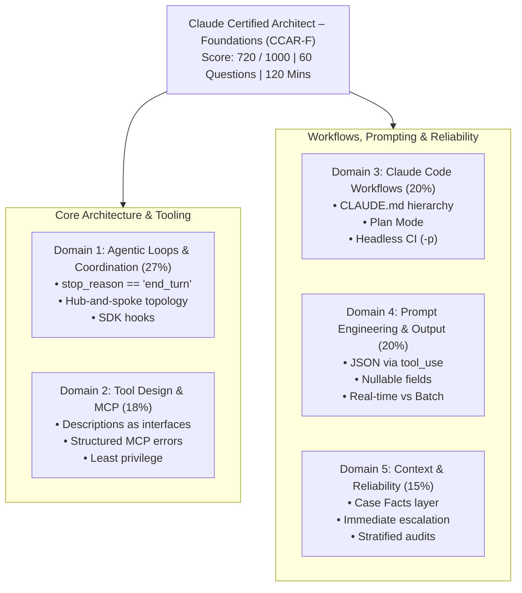

# Claude Certified Architect – Foundations (CCAR-F) Practice Repository

[](tests/)
[](pyproject.toml)
[](https://astral.sh/uv)
[-orange)](EXAM_BLUEPRINT.md)

Comprehensive hands-on practice repository for the **Claude Certified Architect – Foundations Certification** (passing score 720/1000). Features end-to-end implementations for **100% of the 5 Exam Domains (all 27 Task Statements)**, the **6 Official Production Scenarios**, and a **115-test zero-token offline test suite**.

---

## ⚠️ Critical Policy: Zero Live Claude API Execution

To protect API budgets and prevent unintended token spend:
- ❌ **Automated Execution Prohibited**: Never execute scripts or tools that make automated live Anthropic API calls.
- ✅ **100% Zero-Token Offline Testing**: All 115 unit tests (`pytest tests/ scenarios/`) run entirely offline using deterministic mocks (`lib.mock_claude`).
- 👤 **Manual Live Practice Only**: Candidates execute live scripts manually in their WSL Ubuntu terminal when testing with real API credentials:
  ```bash
  uv run domain1/ts_1_1_multi_tool_agent_loop/main.py
  ```
See [EXECUTION_POLICY.md](EXECUTION_POLICY.md) for complete safety guidelines.

---

## ⚡ Quick Start

```bash
# In WSL Ubuntu Terminal:

# 1. Install dependencies
uv sync

# 2. Run the complete offline unit test suite (115 tests, zero API tokens)
uv run pytest

# 3. Format and lint checks
uv run black --check lib/ tests/ scenarios/
uv run flake8 lib/ tests/ scenarios/
uv run mypy lib/sdk_parser_py/

# 4. Optional: Manual live practice (requires ANTHROPIC_API_KEY in .env)
cp .env.example .env
uv run domain1/ts_1_1_multi_tool_agent_loop/main.py

# 5. FastMCP & Interactive Inspector Practice
cd anthropic-api-practice/MCP/cli_project
npx @modelcontextprotocol/inspector ../../../.venv/Scripts/python.exe mcp_server.py
```

---

## 🏛️ Exam Content Domains (27 Task Statements)



### [Domain 1: Agentic Architecture & Orchestration (27%)](domain1/README.md) · [Deep Dive Concepts](domain1/KEY_CONCEPTS.md)

| Task Statement | Topic | Architectural Pattern | Code |
| :--- | :--- | :--- | :--- |
| **TS 1.1** | Agentic Loops | Deterministic termination via `stop_reason == "end_turn"` | [`main.py`](domain1/ts_1_1_multi_tool_agent_loop/main.py) |
| **TS 1.2** | Multi-Agent Coordination | Hub-and-spoke topology, strict context isolation, iterative synthesis | [`main.py`](domain1/ts_1_2_coordinator_subagents/main.py) |
| **TS 1.3** | Subagent Spawning | Single-turn concurrent `Task` tool calls; structured metadata passing | [`main.py`](domain1/ts_1_3_subagent_invocation_spawning/main.py) |
| **TS 1.4** | Workflows & Handoffs | Programmatic prerequisite gates; structured human escalation manifests | [`main.py`](domain1/ts_1_4_prerequisite_enforcement/main.py) |
| **TS 1.5** | SDK Hooks | `PreToolUse` security/financial gating; `PostToolUse` data normalization | [`main.py`](domain1/ts_1_5_sdk_hooks/main.py) |
| **TS 1.6** | Task Decomposition | Two-pass prompt chaining (file-level + integration) to prevent attention dilution | [`main.py`](domain1/ts_1_6_task_decomposition/main.py) |
| **TS 1.7** | Session Management | `--resume`, `fork_session` branching; injecting summaries over stale sessions | [`main.py`](domain1/ts_1_7_session_management/main.py) |

### [Domain 2: Tool Design & MCP Integration (18%)](domain2/README.md) · [Deep Dive Concepts](domain2/KEY_CONCEPTS.md)
| Task Statement | Topic | Architectural Pattern | Code |
| :--- | :--- | :--- | :--- |
| **TS 2.1** | Tool Interfaces | Differentiated descriptions, explicit input formats, and boundary constraints | [`main.py`](domain2/ts_2_1_tool_interface_design/main.py) |
| **TS 2.2** | MCP Structured Errors | `isError` flag, categorization (`transient`, `validation`, `business`), retryable signals | [`main.py`](domain2/ts_2_2_mcp_structured_errors/main.py) |
| **TS 2.3** | Tool Distribution & Choice | Least privilege (4–5 tools per agent); `tool_choice` (`auto`, `any`, forced tool) | [`main.py`](domain2/ts_2_3_tool_distribution_and_choice/main.py) |
| **TS 2.4** | MCP Server Integration | `.mcp.json` scoping with `${ENV_VAR}` expansion; read-only MCP Resources | [`main.py`](domain2/ts_2_4_mcp_server_integration/main.py) |
| **TS 2.5** | Built-in Tools Selection | Progressive discovery: `Glob` → `Grep` → `Read`; `Edit` collision fallback to `Read + Write` | [`main.py`](domain2/ts_2_5_builtin_tools_usage/main.py) |

### [Domain 3: Claude Code Configuration & Workflows (20%)](domain3/README.md) · [Deep Dive Concepts](domain3/KEY_CONCEPTS.md)
| Task Statement | Topic | Architectural Pattern | Code |
| :--- | :--- | :--- | :--- |
| **TS 3.1** | CLAUDE.md Hierarchy | User (`~/.claude/`) → Project (`.claude/`) → Directory scoping; `@import` modularity | [`main.py`](domain3/ts_3_1_claude_code_workflows/main.py) |
| **TS 3.2** | Commands & Skills | Custom `.claude/commands/`, skills with `context: fork` and `allowed-tools` | [`main.py`](domain3/ts_3_2_slash_commands_and_skills/main.py) |
| **TS 3.3** | Path-Specific Rules | Conditional convention loading via `.claude/rules/*.md` with YAML `paths` glob | [`main.py`](domain3/ts_3_3_path_specific_rules/main.py) |
| **TS 3.4** | Plan Mode vs Direct | Plan mode for architectural/multi-file refactors; Direct execution for single-file fixes | [`main.py`](domain3/ts_3_4_plan_mode_and_refinement/main.py) |
| **TS 3.5** | Iterative Refinement | Test-driven iteration, 2–3 I/O examples, and the Interview Pattern for ambiguity | [`main.py`](domain3/ts_3_5_iterative_refinement_interview/main.py) |
| **TS 3.6** | CI/CD Automation | Non-interactive `-p` / `--print`, `--output-format json`, independent review sessions | [`main.py`](domain3/ts_3_6_cicd_pipeline_automation/main.py) |

### [Domain 4: Prompt Engineering & Structured Output (20%)](domain4/README.md) · [Deep Dive Concepts](domain4/KEY_CONCEPTS.md)
| Task Statement | Topic | Architectural Pattern | Code |
| :--- | :--- | :--- | :--- |
| **TS 4.1** | Explicit Criteria | Concrete categorical rubrics with negative boundaries to minimize false positives | [`main.py`](domain4/ts_4_1_explicit_criteria_classification/main.py) |
| **TS 4.2** | Few-Shot Prompting | 2–4 targeted input/output pairs demonstrating reasoning and edge cases | [`main.py`](domain4/ts_4_2_few_shot_and_multi_instance/main.py) |
| **TS 4.3** | Structured Output via Tool Use | Guaranteed JSON schema compliance; nullable fields to prevent hallucinations | [`main.py`](domain4/ts_4_3_structured_output_tool_use/main.py) |
| **TS 4.4** | Validation & Retry Loops | Targeted feedback on schema/math errors; fast-failing on missing source facts | [`main.py`](domain4/ts_4_4_validation_retry_feedback/main.py) |
| **TS 4.5** | Message Batches API | 50% discount for 24h non-blocking jobs; `custom_id` tracking; never for blocking CI | [`main.py`](domain4/ts_4_5_message_batches_api/main.py) |
| **TS 4.6** | Multi-Pass Review | Independent review instances; Pass 1 file-level correctness, Pass 2 cross-file integration | [`main.py`](domain4/ts_4_6_multi_pass_review/main.py) |

### [Domain 5: Context Management & Reliability (15%)](domain5/README.md) · [Deep Dive Concepts](domain5/KEY_CONCEPTS.md)
| Task Statement | Topic | Architectural Pattern | Code |
| :--- | :--- | :--- | :--- |
| **TS 5.1** | Context Preservation | Immutable "Case Facts" block outside summarized history; aggressive tool output trimming | [`main.py`](domain5/ts_5_1_context_preservation/main.py) |
| **TS 5.2** | Escalation Patterns | Immediate escalation on human demand; proactive clarification on multi-match ties | [`main.py`](domain5/ts_5_2_escalation_and_provenance/main.py) |
| **TS 5.3** | Error Propagation & Coverage | Distinguish valid empty sets from upstream outages; synthesize coverage manifests | [`main.py`](domain5/ts_5_3_error_propagation_coverage/main.py) |
| **TS 5.4** | Codebase Exploration | Scratchpad pattern, Explore subagent, and structured manifests for session recovery | [`main.py`](domain5/ts_5_4_scratchpads_and_human_review/main.py) |
| **TS 5.5** | Human Review Calibration | Calibrated routing with 5–10% stratified sampling of high-confidence extractions | [`main.py`](domain5/ts_5_5_human_review_calibration/main.py) |
| **TS 5.6** | Provenance & Uncertainty | Timestamps and source citations; preserving conflicting data without averaging | [`main.py`](domain5/ts_5_6_provenance_and_uncertainty/main.py) |

---

## 🎯 The 6 Production Scenarios

On the CCAR-F certification exam, **4 out of these 6 production scenarios are chosen at random**, anchoring the majority of scenario questions.

👉 **Master Study Engine**: See [**`scenarios/MASTER_SCENARIO_PRACTICE.md`**](scenarios/MASTER_SCENARIO_PRACTICE.md) for the consolidated 6-scenario comparative matrix, decision trees, trade-offs, and complete 60-question authentic diagnostic practice exam.

| Scenario | Primary Domains & Task Statements | Core Architectural Patterns & SLAs | Quick Links |
| :--- | :--- | :--- | :--- |
| **[Scenario 1: Customer Support Resolution Agent](scenarios/scenario_1_customer_support/)** | **D1, D2, D5**<br>`TS 1.4, 2.1, 2.2, 5.1, 5.2` | • Programmatic auth prerequisite gate before refund tools<br>• Immediate human escalation on user demand<br>• Context trimming (55 raw CRM fields → 4 attributes)<br>• Immutable Case Facts layer<br>• **SLA**: $\ge 80\%$ FCR, $<2.5\text{s}$ turn latency | [Guide](scenarios/scenario_1_customer_support/SCENARIO_GUIDE.md)<br>[Simulation](scenarios/scenario_1_customer_support/simulation.py)<br>[Tests](scenarios/scenario_1_customer_support/test_scenario_1_simulation.py) |
| **[Scenario 2: Code Generation with Claude Code](scenarios/scenario_2_code_generation/)** | **D3, D5**<br>`TS 3.1, 3.2, 3.3, 3.4, 3.5` | • Path-scoped rules in `.claude/rules/*.md`<br>• Plan Mode for multi-file architectural refactors<br>• Interview Pattern with concrete selectable options<br>• Custom skills with `context: fork`<br>• **SLA**: $<40\text{k}$ context tokens, 0 assumptions | [Guide](scenarios/scenario_2_code_generation/SCENARIO_GUIDE.md)<br>[Simulation](scenarios/scenario_2_code_generation/simulation.py)<br>[Tests](scenarios/scenario_2_code_generation/test_scenario_2_simulation.py) |
| **[Scenario 3: Multi-Agent Research System](scenarios/scenario_3_multi_agent_research/)** | **D1, D2, D5**<br>`TS 1.2, 1.3, 2.4, 5.3, 5.6` | • Single-turn concurrent `Task` spawning<br>• Strict subagent context isolation<br>• `VALID_EMPTY` vs `UPSTREAM_FAILURE` differentiation<br>• Preserving conflicting statistics with citations<br>• **SLA**: $<20\text{s}$ turn latency, 100% cited sources | [Guide](scenarios/scenario_3_multi_agent_research/SCENARIO_GUIDE.md)<br>[Simulation](scenarios/scenario_3_multi_agent_research/simulation.py)<br>[Tests](scenarios/scenario_3_multi_agent_research/test_scenario_3_simulation.py) |
| **[Scenario 4: Developer Productivity with Claude](scenarios/scenario_4_developer_productivity/)** | **D1, D2, D3**<br>`TS 1.7, 2.3, 2.4, 2.5` | • Progressive discovery (`Glob` → `Grep` → chunked `Read`)<br>• Surgical `Edit` with fallback to `Read + Write`<br>• Exposing API catalogs as read-only MCP Resources<br>• Least-privilege tool allocation (4–5 tools)<br>• **SLA**: $<15\text{k}$ exploration context tokens | [Guide](scenarios/scenario_4_developer_productivity/SCENARIO_GUIDE.md)<br>[Simulation](scenarios/scenario_4_developer_productivity/simulation.py)<br>[Tests](scenarios/scenario_4_developer_productivity/test_scenario_4_simulation.py) |
| **[Scenario 5: Claude Code for Continuous Integration](scenarios/scenario_5_continuous_integration/)** | **D3, D4**<br>`TS 3.6, 4.1, 4.5, 4.6` | • Non-interactive headless execution (`-p`, `--output-format json`)<br>• Two-Pass Review (Pass 1 file local, Pass 2 integration)<br>• Avoiding Batch API for blocking PR checks<br>• Negative boundaries in rubrics to avoid test false alarms<br>• **SLA**: $<3\text{m}$ PR review latency | [Guide](scenarios/scenario_5_continuous_integration/SCENARIO_GUIDE.md)<br>[Simulation](scenarios/scenario_5_continuous_integration/simulation.py)<br>[Tests](scenarios/scenario_5_continuous_integration/test_scenario_5_simulation.py) |
| **[Scenario 6: Structured Data Extraction](scenarios/scenario_6_structured_data_extraction/)** | **D4, D5**<br>`TS 4.3, 4.4, 4.5, 5.5` | • Schema enforcement via `tool_use`<br>• Nullable fields for non-guaranteed attributes<br>• Closed-loop retry with targeted feedback; fast failure<br>• Confidence calibration + 10% stratified sampling<br>• **SLA**: $\ge 85\%$ STP, 0 fabricated facts | [Guide](scenarios/scenario_6_structured_data_extraction/SCENARIO_GUIDE.md)<br>[Simulation](scenarios/scenario_6_structured_data_extraction/simulation.py)<br>[Tests](scenarios/scenario_6_structured_data_extraction/test_scenario_6_simulation.py) |

---

## 🔌 Anthropic API & MCP Practice Labs

Dedicated hands-on sandbox for learning Anthropic API features and the **Model Context Protocol (MCP)**:

- **[`anthropic-api-practice/MCP/cli_project/`](anthropic-api-practice/MCP/cli_project/)**: Production-ready FastMCP implementation integrated with the root UV workspace.
  - **Tools (`@mcp.tool`)**: [`read_doc_contents`](anthropic-api-practice/MCP/cli_project/mcp_server.py#L18) and [`edit_document`](anthropic-api-practice/MCP/cli_project/mcp_server.py#L31) for LLM tool invocation.
  - **Resources (`@mcp.resource`)**: Static URI (`docs://documents`) and template URI (`docs://documents/{doc_id}`) for deterministic, read-only context retrieval.
  - **Prompts (`@mcp.prompt`)**: Pre-built user prompt templates for `/summarize <doc_id>` and `/rewrite_markdown <doc_id>`.
  - **CLI Chat Application**: `prompt-toolkit` interface with tab-autocomplete for slash commands and `@document` mentions.
  - **Interactive Inspector Testing**: Run `npx @modelcontextprotocol/inspector <venv-python> mcp_server.py` to inspect and execute tools/prompts in the web UI.
- **`anthropic-api-practice/*.ipynb`**: Interactive notebooks covering messages, streaming, prompt evaluations, caching, thinking, citations, and tools.

---

## 🧰 Core Shared Libraries

- **`lib/sdk_parser_py/`**: Type-safe response extraction, schema validation, and block extraction ([Usage Guide](lib/sdk_parser_py/USAGE.md)).
- **`lib/response_logger/`**: Production JSONL execution trail recording, deterministic session reconstruction, and offline replay ([Usage Guide](lib/response_logger/README.md)).
- **`lib/mock_claude/`**: Zero-cost deterministic mock client for offline automated unit testing.
- **`.claude/`**: Claude Code native configuration, including slash commands (`/practice`, `/review`, `/audit`), skills (`architect-eval`, `scaffold-exercise`), and path-specific rules (`.claude/rules/`).

---

## 📚 Master Study & Exam Preparation References

- 📋 [**Exam Blueprint (`EXAM_BLUEPRINT.md`)**](EXAM_BLUEPRINT.md): 5-domain syllabus, exam weighting, and 27 task statements matrix.
- ⚡ [**Exam Refresher (`EXAM_REFRESHER.md`)**](EXAM_REFRESHER.md): The 10 Golden Architectural Rules and domain decision matrices.
- 🎯 [**Master Scenario Practice (`scenarios/MASTER_SCENARIO_PRACTICE.md`)**](scenarios/MASTER_SCENARIO_PRACTICE.md): 6-scenario decision trees, trade-offs, and 60-question diagnostic exam.
- 📖 [**Official Scenarios Guide (`scenarios/README.md`)**](scenarios/README.md): Deep-dive walkthrough of the 6 production scenarios.
- 🛡️ [**Execution Policy (`EXECUTION_POLICY.md`)**](EXECUTION_POLICY.md): Detailed API safety and zero-token testing standards.
