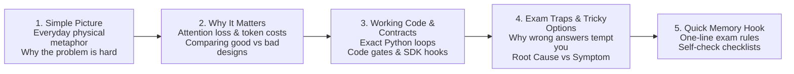
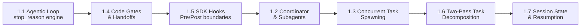

# Domain 1: Agentic Architecture & Orchestration (27% of the Exam)

Domain 1 is the largest domain on the **Claude Certified Architect – Foundations (CCAR-F)** exam, accounting for **27% of all questions** (~16 of 60 questions). It evaluates an architect's ability to design deterministic agentic control loops, coordinate isolated multi-agent systems, enforce non-negotiable business rules in application code, and manage session lifecycles.

> 📖 Master Deep Dive: [KEY_CONCEPTS.md](KEY_CONCEPTS.md) contains the exhaustive architectural blueprints, extended thinking parameters, and complete worked examples.
> 
> ⚡ Quick Cram: [CHEATSHEET.md](CHEATSHEET.md) (question stems to answers, look-alike pairs, exact values, elimination filters).

---

## 🧠 How to Learn Domain 1 (5 Clear Steps)

To master agentic architecture, every task statement in Domain 1 is organized through 5 clear steps:

> **1. Simple Picture (Mental Model)** → **2. Architectural Why** → **3. Working Code / Schema** → **4. Exam Traps & Wrong Answers** → **5. Memory Hook**



---

## 🏛️ Everyday Metaphors: Foundational Mental Models

| Task Statement | Topic | Everyday Physical Metaphor | Why Naive Approaches Fail | Correct Architectural Pattern |
| :--- | :--- | :--- | :--- | :--- |
| **TS 1.1** | **Agentic Loops** | **Car Dashboard Gauge vs Transmission** | Stopping an agent based on conversational text ("I think we're done") fails under natural language variation. | **Deterministic `stop_reason` Inspection**: Continue on `"tool_use"`; exit solely on `"end_turn"` ([TS 1.1](ts_1_1_multi_tool_agent_loop/main.py)). |
| **TS 1.2** | **Coordinator-Subagent Patterns** | **Air Traffic Controller vs Pilot Radio Chatter** | Allowing planes (subagents) to debate routes over shared open channels causes collision and chaos. | **Hub-and-Spoke Topology**: Central coordinator manages isolated leaf agents; zero peer-to-peer chatter ([TS 1.2](ts_1_2_coordinator_subagents/main.py)). |
| **TS 1.3** | **Subagent Spawning** | **Restaurant Kitchen Order Tickets** | Head chef waiting for appetizer to finish before ordering the dessert causes 80-second customer delays. | **Single-Turn Concurrent Spawning**: Coordinator emits multiple `Task` blocks in one turn ([TS 1.3](ts_1_3_subagent_invocation_spawning/main.py)). |
| **TS 1.4** | **Workflow Enforcement** | **Bank Vault Electronic Turnstile** | A warning sign ("Please verify ID before opening vault") is easily bypassed by an urgent intruder. | **Programmatic Prerequisite Gate**: Python code gate blocking financial execution until verified ([TS 1.4](ts_1_4_prerequisite_enforcement/main.py)). |
| **TS 1.5** | **Agent SDK Hooks** | **Airport Security & Currency Exchange** | Checking passports after passengers board is useless; receiving raw mixed currencies confuses cashiers. | **SDK Hooks**: `PreToolUse` for security interception; `PostToolUse` for payload trimming and normalization ([TS 1.5](ts_1_5_sdk_hooks/main.py)). |
| **TS 1.6** | **Task Decomposition** | **Automobile Assembly Line Quality Check** | Inspecting an entire assembled 5,000-part car in one glance causes inspectors to miss missing bolts. | **Two-Pass Prompt Chaining**: Pass 1 audits individual files locally; Pass 2 audits integration contracts ([TS 1.6](ts_1_6_task_decomposition/main.py)). |
| **TS 1.7** | **Session Management** | **Tree Pruning & Lab Notebook** | Continuing an old lab experiment after chemicals were replaced produces corrupted conclusions. | **Clean Session Reset**: Extract key facts into Markdown manifest; start fresh session when code rebased ([TS 1.7](ts_1_7_session_management/main.py)). |

---

## ⚖️ Multi-Agent Topologies: Comparative Trade-Offs

| Topology Pattern | Message Routing | Context Isolation | Failure Mode & Risk | CCAR-F Verdict |
| :--- | :--- | :--- | :--- | :--- |
| **Monolithic Agent** | Single agent calls all tools sequentially. | Zero isolation; single context accumulates all tokens. | Severe attention dilution; tool saturation; context bloat. | Reject for multi-step or multi-source research tasks. |
| **Peer-to-Peer Mesh** | Subagents invoke and message each other directly. | Shared or gossiped memory buffers. | Combinatorial message explosion (O(N²)); untraceable bugs; runaway loops. | **Strict Anti-Pattern on Exam**: Eliminate immediately. |
| **Hub-and-Spoke** | Central coordinator delegates to leaf subagents via `Task`. | **100% Context Isolation**: Subagents inherit zero parent history. | Coordinator decomposition bottleneck if subtasks are partitioned too narrowly. | **Gold Standard on Exam**: Single audit point, clean boundaries, concurrent execution. |

---

## 🗺️ Study-Order Map

Follow this sequential progression. Each step builds on the mechanical guarantees of the prior step:



1. **Single-Agent Mechanics First**: TS 1.1 (the client-side while loop), TS 1.4 (programmatic state gates), and TS 1.5 (SDK interception hooks).
2. **Multi-Agent Systems Next**: TS 1.2 (hub-and-spoke coordination) and TS 1.3 (concurrent single-turn `Task` spawning).
3. **Complex Systems & Session Lifecycles**: TS 1.6 (two-pass prompt chaining for large PRs) and TS 1.7 (session resumption vs fresh summary resets).

---

## 📋 Task Statements at a Glance

| TS | Study Guide | Core Architectural Focus | Key Exam Trap to Avoid |
|---|---|---|---|
| **1.1** | [README](ts_1_1_multi_tool_agent_loop/README.md) | `stop_reason` drives loop control: `tool_use` continues; `end_turn` terminates deterministically. | Parsing assistant text strings for "done", or using an iteration cap as the normal exit. |
| **1.2** | [README](ts_1_2_coordinator_subagents/README.md) | Hub-and-spoke topology, strict context isolation, dynamic complexity routing, gap detection. | Blaming subagents for low coverage when the coordinator decomposed the query too narrowly. |
| **1.3** | [README](ts_1_3_subagent_invocation_spawning/README.md) | `Task` tool in `allowedTools`, parallel single-turn spawning, separating content from metadata. | Spawning subagents sequentially across multiple turns, or assuming subagents inherit context. |
| **1.4** | [README](ts_1_4_prerequisite_enforcement/README.md) | Programmatic prerequisite gates, structured handoff manifests, multi-concern decomposition. | Attempting to fix a skipped business rule with stronger prompts or few-shot examples. |
| **1.5** | [README](ts_1_5_sdk_hooks/README.md) | `PreToolUse` for financial/policy gating; `PostToolUse` for PII redaction and payload trimming. | Placing non-negotiable security or compliance rules solely in natural language prompts. |
| **1.6** | [README](ts_1_6_task_decomposition/README.md) | Prompt chaining vs adaptive decomposition, two-pass review (file-level + integration). | Proposing a larger model or bigger context window to evaluate 15+ files in one prompt. |
| **1.7** | [README](ts_1_7_session_management/README.md) | `--resume <session>`, `fork_session` for divergent branches, clean session resets with summary. | Resuming a 60-turn stale session after git rebase without informing Claude of file diffs. |

---

## ⚡ The 8 Golden Architectural Rules of Domain 1

1. **Loop on `stop_reason`, Never on Free Text (TS 1.1)**:  
   `response.stop_reason == "tool_use"` means execute tools, append results, and call again. `response.stop_reason == "end_turn"` is the sole deterministic completion signal. Parsing assistant prose for `"I am done"` fails because phrasing varies. `MAX_ITERATIONS` is strictly a safety cap against runaway billing.
2. **Echo Assistant Content and Thinking Blocks Verbatim (TS 1.1)**:  
   When building multi-turn history, append the assistant's complete `content` array. When Claude 4.5 extended thinking is active, `ThinkingBlock` elements and their cryptographic `signature` must be returned unmodified. Stripping them causes an immediate HTTP 400 `invalid_request_error`.
3. **Subagents Start with Completely Empty Context (TS 1.2, 1.3)**:  
   Subagents possess zero shared memory and inherit no parent conversation history. The coordinator must explicitly assemble and inject all necessary context (customer ID, order details, target schemas) into the subagent's user prompt.
4. **All Inter-Agent Communication Routes Through the Coordinator (TS 1.2)**:  
   In enterprise systems, subagents never communicate peer-to-peer. The coordinator acts as the single point of truth, logging, and routing. When coverage is incomplete, check whether the coordinator decomposed the query too narrowly.
5. **Emit Parallel Subagents in a Single Turn (TS 1.3)**:  
   Coordinator environments must whitelist `"Task"` in `allowedTools`. To run subagents concurrently, emit multiple `Task` calls in a single coordinator response turn, cutting turn latency by 40–60%.
6. **Programmatic Gates Over Probabilistic Prompts (TS 1.4, 1.5)**:  
   Business, compliance, and financial thresholds (> \$500) must be enforced in application code or SDK hooks (`PreToolUse`). System prompts have a non-zero failure rate under user manipulation or ambiguity.
7. **Two Passes for Large Code Reviews (TS 1.6)**:  
   Evaluating 10+ files in a single prompt induces attention dilution. Implement Two-Pass Prompt Chaining: Pass 1 executes isolated per-file reviews; Pass 2 reviews cross-file interface contracts.
8. **Reset Stale Sessions After Codebase Drift (TS 1.7)**:  
   Resuming an extended session after git rebases or branch switching contaminates context with obsolete file representations. Extract key facts to a Markdown summary, terminate the session, and launch a fresh session with the summary injected.

---

## 🧪 Claude 4.5 Extended Thinking Compliance Notes

- **Model Split**: Use `claude-sonnet-4-5` for the coordinator and complex synthesis; use `claude-haiku-4-5` for high-throughput, specialized leaf subagents.
- **Thinking Configuration**: Enabled via `thinking={"type": "enabled", "budget_tokens": N}` with `N >= 1024` and `N < max_tokens`.
- **Strict Parameter Constraints**:
  - **Never provide `temperature`, `top_k`, or `top_p`** when `thinking` is active (causes HTTP 400).
  - With extended thinking, set `tool_choice: "auto"` or `"none"`. Setting `tool_choice: "any"` or a forced named tool triggers HTTP 400.
  - Thinking tokens consume output token budget against `max_tokens`; always set `max_tokens` substantially higher than `budget_tokens` (e.g. `max_tokens: 8192` with `budget_tokens: 4000`).

---

## 🛠️ Hands-on Labs & Offline Verification

Every folder in Domain 1 includes a study guide, offline unit test, and zero-token simulation:

```bash
# Run all Domain 1 offline tests (zero token cost):
uv run pytest tests/test_domain1_enhancements.py -q
```

| Lab Folder | Focus Implementation | Key Mechanism Tested |
|---|---|---|
| [ts_1_1_multi_tool_agent_loop](ts_1_1_multi_tool_agent_loop/) | Autonomous control loop | Explicit `stop_reason` branching & safety cap fallback |
| [ts_1_2_coordinator_subagents](ts_1_2_coordinator_subagents/) | Coordinator orchestration | Hub-and-spoke research system with coverage gap checks |
| [ts_1_3_subagent_invocation_spawning](ts_1_3_subagent_invocation_spawning/) | Concurrent subagent spawning | Single-turn multiple `Task` emissions with ordered results |
| [ts_1_4_prerequisite_enforcement](ts_1_4_prerequisite_enforcement/) | Programmatic state gating | Refund authorization gate & structured escalation manifest |
| [ts_1_5_sdk_hooks](ts_1_5_sdk_hooks/) | Agent SDK hooks | `PreToolUse` policy interception & `PostToolUse` data normalization |
| [ts_1_6_task_decomposition](ts_1_6_task_decomposition/) | Multi-pass prompt chaining | Pass 1 per-file analysis + Pass 2 integration review |
| [ts_1_7_session_management](ts_1_7_session_management/) | Session state lifecycles | `--resume`, `fork_session`, and summary-seeded restarts |

---

## 🧭 Navigation & Study Links
- 🏠 **Repository Home**: [CCAR-F Exam Preparation Guide](../README.md)
- 📋 **Exam Blueprint**: [5-Domain Blueprint Matrix](../EXAM_BLUEPRINT.md)
- ⚡ **Exam Refresher**: [Core Architectural Rules & Cheatsheet](../EXAM_REFRESHER.md)
- ➡️ **Next Domain**: [Domain 2: Tool Design & Model Context Protocol (MCP)](../domain2/README.md)
- 🎯 **Scenario Practice**: [Master Scenario Practice](../scenarios/MASTER_SCENARIO_PRACTICE.md)
