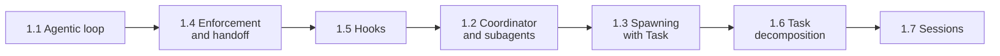

# Domain 1: Agentic Architecture & Orchestration (27% of the Exam)

Domain 1 is the biggest part of the **Claude Certified Architect - Foundations (CCAR-F)** exam. It covers how to build agents that loop, delegate, follow rules, and keep state.

> Deep dive: [KEY_CONCEPTS.md](KEY_CONCEPTS.md) has the long explanations and extra practice scenarios. Each task statement folder below has a short study guide with a worked example and exam-style questions.
>
> Quick revision: [CHEATSHEET.md](CHEATSHEET.md) (question wording to answer, look-alike pairs, exact values, elimination filters).

---

## Exam Weights

| Domain | Weight |
|---|---|
| **Domain 1: Agentic Architecture & Orchestration** | **27%** |
| Domain 2: Tool Design & MCP Integration | 18% |
| Domain 3: Claude Code Configuration & Workflows | 20% |
| Domain 4: Prompt Engineering & Structured Output | 20% |
| Domain 5: Context Management & Reliability | 15% |

---

## Study-Order Map

Read in this order. Each step builds on the last.



1. **Single agent first**: 1.1 (the loop), then 1.4 (rules in code) and 1.5 (hooks).
2. **Then many agents**: 1.2 (hub-and-spoke), then 1.3 (how to spawn).
3. **Then big jobs and long work**: 1.6 (decomposition), then 1.7 (sessions).

---

## Task Statements at a Glance

| TS | Study guide | What it tests | Key trap |
|---|---|---|---|
| **1.1** Agentic loops | [README](ts_1_1_multi_tool_agent_loop/README.md) | `stop_reason` drives the loop: `tool_use` continue, `end_turn` finish. Tool results are appended | Parsing text for "done", or using an iteration cap as the normal stop |
| **1.2** Coordinator and subagents | [README](ts_1_2_coordinator_subagents/README.md) | Hub-and-spoke, isolated context, dynamic selection, partitioned scope, gap-check and re-delegate | Blaming subagents when the coordinator decomposed too narrowly |
| **1.3** Spawning and context | [README](ts_1_3_subagent_invocation_spawning/README.md) | `Task` tool in `allowedTools`, `AgentDefinition`, parallel `Task` calls in one response, content vs metadata | One `Task` per turn, or assuming subagents inherit context |
| **1.4** Enforcement and handoff | [README](ts_1_4_prerequisite_enforcement/README.md) | Programmatic prerequisites, structured handoff, decomposing multi-concern requests | Fixing a skipped step with a stronger prompt, few-shot, or a classifier |
| **1.5** Hooks | [README](ts_1_5_sdk_hooks/README.md) | Pre-tool interception for policy, `PostToolUse` for normalisation | Putting hard rules only in the prompt |
| **1.6** Task decomposition | [README](ts_1_6_task_decomposition/README.md) | Prompt chaining vs adaptive decomposition, per-file plus integration pass | Bigger model, smaller PRs, or consensus voting for a diluted review |
| **1.7** Sessions | [README](ts_1_7_session_management/README.md) | `--resume <session-name>`, `fork_session`, changed-files notice, fresh session with summary | Resuming with stale tool results and saying nothing |

Scenario mapping: 1.1 and 1.5 appear in Scenarios 1 and 4. 1.4 appears in Scenario 1. 1.2 and 1.3 appear in Scenario 3. 1.6 appears in Scenarios 2 and 5. 1.7 appears in Scenarios 2 and 4.

---

## How the Pieces Fit

- **1.1** is the engine. Every other task statement sits on top of the loop.
- **1.4** and **1.5** make that loop safe: gates and hooks run as code, outside the model.
- **1.2** and **1.3** put several loops together under one coordinator.
- **1.6** decides how to split a large job. **1.7** decides how to keep or restart the conversation.

Cross-domain links: tool errors and MCP design are in [Domain 2](../domain2/README.md). Context trimming and escalation are in [Domain 5](../domain5/README.md). Claude Code workflows are in [Domain 3](../domain3/README.md).

---

## Rules to Remember

1. Loop on `stop_reason`, never on text. An iteration cap is a **safety cap**, not the exit.
2. Handle every `stop_reason` on purpose: `tool_use`, `end_turn`, `max_tokens`, `stop_sequence`, `pause_turn`, `refusal`.
3. Subagents start empty. Pass what they need in the prompt.
4. Everything between subagents goes through the coordinator.
5. Parallel subagents are several `Task` tool_use blocks in one coordinator response.
6. If a rule must always hold, use a programmatic gate or a hook, not a prompt.
7. Split big reviews into per-file passes plus a cross-file integration pass.
8. Resume when results are valid, fork to compare, summarise into a fresh session when they are stale.

---

## Claude 4.5 Notes (apply to the whole domain)

- Models: `claude-sonnet-4-5` for coordinators and reasoning, `claude-haiku-4-5` for workers and subagents.
- Extended thinking: `thinking={"type": "enabled", "budget_tokens": N}` with `N >= 1024` and `N < max_tokens`.
- With thinking on: leave out `temperature` (HTTP 400), `top_k`, and `top_p` (only 0.95 to 1.0 allowed). `tool_choice` may only be `auto` or `none`.
- In tool loops, echo assistant content, including `thinking` blocks and their `signature`, back unchanged.

---

## Hands-on Labs

Each folder has a study guide, an offline notebook, and a script that calls the live API. **Run the scripts manually only.** The notebooks and the tests use the mock client and cost nothing.

| Folder | Lab |
|---|---|
| [ts_1_1_multi_tool_agent_loop](ts_1_1_multi_tool_agent_loop/) | Loop with explicit `stop_reason` handling and a safety cap |
| [ts_1_2_coordinator_subagents](ts_1_2_coordinator_subagents/) | Hub-and-spoke research coordinator with gap check |
| [ts_1_3_subagent_invocation_spawning](ts_1_3_subagent_invocation_spawning/) | Parallel `Task` calls with ordered results |
| [ts_1_4_prerequisite_enforcement](ts_1_4_prerequisite_enforcement/) | Refund gate and structured handoff |
| [ts_1_5_sdk_hooks](ts_1_5_sdk_hooks/) | Pre-tool policy hook and `PostToolUse` normalisation |
| [ts_1_6_task_decomposition](ts_1_6_task_decomposition/) | Per-file pass plus integration pass |
| [ts_1_7_session_management](ts_1_7_session_management/) | Resume, fork, and summary-seeded session |

Shared loop helpers: [loop_common.py](loop_common.py). Offline tests: [tests/test_domain1_full.py](../tests/test_domain1_full.py), [tests/test_domain1_enhancements.py](../tests/test_domain1_enhancements.py).

```bash
uv run pytest tests/ -q   # safe, offline
```
