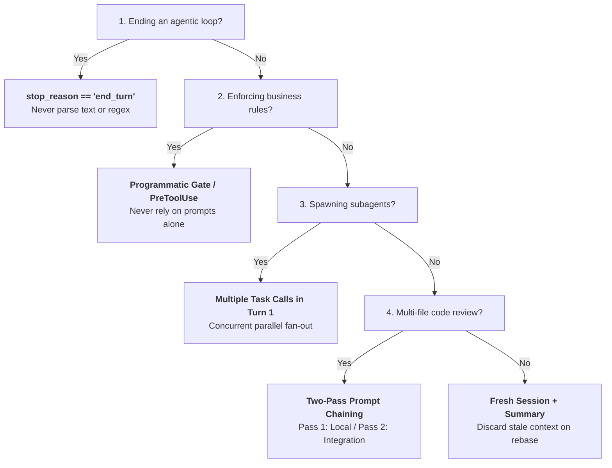

# Domain 1: Agentic Architecture & Orchestration (27% of Exam)

Domain 1 represents the highest-weighted domain on the **Claude Certified Architect – Foundations (CCAR-F)** exam (27%). It covers designing and implementing autonomous agentic systems using Claude and the Claude Agent SDK.

> 📖 **Deep Dive Master Guide**: For exhaustive technical explanations, architecture diagrams, sequence flows, gotchas, to-remember points, and practical scenario questions & answers, see [KEY_CONCEPTS.md](KEY_CONCEPTS.md).

---

## 📋 Task Statements & Core Architectural Principles

### [TS 1.1: Design and Implement Agentic Loops for Autonomous Task Execution](ts_1_1_multi_tool_agent_loop/main.py)
- **Loop Lifecycle**: `client.messages.create()` -> inspect `response.stop_reason` -> if `"tool_use"`, append assistant message, execute tools, append user message with `tool_result` blocks -> repeat until `"end_turn"`.
- **Sole Deterministic Signal**: `response.stop_reason == "end_turn"` is the only reliable signal of task completion.
- **Anti-Patterns**: Parsing assistant text for keywords ("Done", "Complete"), relying on regex, or using loop turn limits as completion triggers.
- **Reference Exercise**: [ts_1_1_multi_tool_agent_loop/](ts_1_1_multi_tool_agent_loop/)

### [TS 1.2: Orchestrate Multi-Agent Systems with Coordinator-Subagent Patterns](ts_1_2_coordinator_subagents/main.py)
- **Hub-and-Spoke Topology**: All communication, state management, audit logging, and routing flows through the coordinator.
- **Context Isolation Contract**: Subagents **do not** inherit coordinator history, memory, or permissions. Subagents start with empty context.
- **Dynamic Routing**: Coordinator dynamically routes by query complexity (direct resolution vs specialized subagent delegation).
- **Iterative Synthesis**: Coordinator evaluates subagent outputs against requirements and re-delegates if gaps exist.
- **Reference Exercise**: [ts_1_2_coordinator_subagents/](ts_1_2_coordinator_subagents/)

### [TS 1.3: Configure Subagent Invocation, Context Passing, and Spawning](ts_1_3_subagent_invocation_spawning/main.py)
- **Spawning Mechanism**: The `Task` tool (must be explicitly whitelisted in `allowedTools` or `tools`).
- **Parallel Spawning**: Emitting multiple `Task` tool use blocks in a single coordinator response/turn enables concurrent subagent execution, reducing latency by 40%–60%.
- **Structured Context**: Separate content/findings from metadata (source URLs, page numbers, timestamps) to preserve provenance.
- **Goal-Oriented Prompts**: Specify clear goals, constraints, and schemas rather than rigid procedural steps.
- **Reference Exercise**: [ts_1_3_subagent_invocation_spawning/](ts_1_3_subagent_invocation_spawning/)

### [TS 1.4: Implement Multi-Step Workflows with Enforcement and Handoff Patterns](ts_1_4_prerequisite_enforcement/main.py)
- **Programmatic Prerequisite Gates**: State machine / code checks (e.g., blocking `process_refund` until `get_customer` verifies ID) provide 100% deterministic compliance guarantees that prompts cannot ensure.
- **Structured Handoff Manifests**: Compile comprehensive case manifests (customer ID, verified identity, issue summary, actions attempted, root cause, recommended action) for human agents.
- **Escalation Triggers**: Immediate escalation on explicit customer demand, unhandled policy gaps, or technical barriers.
- **Reference Exercise**: [ts_1_4_prerequisite_enforcement/](ts_1_4_prerequisite_enforcement/)

### [TS 1.5: Apply Agent SDK Hooks for Tool Call Interception and Data Normalization](ts_1_5_sdk_hooks/main.py)
- **Hook Lifecycle**: `PreToolUse` (interception / gating) and `PostToolUse` (normalization).
- **Interception Hooks**: Enforce hard regulatory, security, and financial boundaries (e.g. blocking transactions > $500).
- **PostToolUse Normalization**: Normalize heterogeneous data (Unix timestamps -> ISO 8601, status codes -> uniform enums, PII redaction) before returning to Claude.
- **Reference Exercise**: [ts_1_5_sdk_hooks/](ts_1_5_sdk_hooks/)

### [TS 1.6: Design Task Decomposition Strategies for Complex Workflows](ts_1_6_task_decomposition/main.py)
- **Attention Dilution**: Large multi-file changes (10+ files) degrade model focus if evaluated in a single prompt.
- **Two-Pass Prompt Chaining**: Pass 1 (isolated per-file analysis for local bugs) + Pass 2 (cross-file integration pass for contracts, shared state, and end-to-end security).
- **Adaptive Decomposition**: Dynamic generation of subtasks based on intermediate discoveries during open-ended troubleshooting.
- **Reference Exercise**: [ts_1_6_task_decomposition/](ts_1_6_task_decomposition/)

### [TS 1.7: Manage Session State, Resumption, and Forking](ts_1_7_session_management/main.py)
- **Session Continuation**: `--resume <session-id>` reloads historical message trails for continuous work.
- **Session Forking**: `fork_session` branches from a shared baseline checkpoint into isolated threads for divergent exploration.
- **Stale Context Trap**: Resuming long sessions after source code changes leads to hallucinations over cached outputs. Remedy: Discard stale session, inject a structured summary into a fresh session.
- **Reference Exercise**: [ts_1_7_session_management/](ts_1_7_session_management/)

---

## 🛠️ Hands-on Exercises in this Domain
- `ts_1_1_multi_tool_agent_loop/`: Standard agentic loop with `stop_reason` control and response logging.
- `ts_1_2_coordinator_subagents/`: Hub-and-spoke research coordinator with isolated subagents and iterative synthesis.
- `ts_1_3_subagent_invocation_spawning/`: Spawning parallel subagents via multiple `Task` tool calls in a single turn.
- `ts_1_4_prerequisite_enforcement/`: Deterministic prerequisite gates and structured human handoff summaries.
- `ts_1_5_sdk_hooks/`: Tool call interception compliance hooks and `PostToolUse` normalization.
- `ts_1_6_task_decomposition/`: Multi-pass prompt chaining (local per-file pass + cross-file integration pass).
- `ts_1_7_session_management/`: Named session resumption (`--resume`), `fork_session`, and injected summaries.

---

## ⚡ Domain 1 Exam Rules, Golden Architectural Rules & Anti-Patterns Reference

### 📋 CCAR-F Exam Rules & Scope Boundaries for Domain 1

| Aspect | In-Scope Exam Focus (Official Syllabus) | Out-of-Scope Distractor (Do Not Choose on Exam) |
|---|---|---|
| **Loop Control** | `response.stop_reason` inspection (`"tool_use"` continues, `"end_turn"` terminates). | Parsing natural language strings ("I am done") or setting iteration caps as completion signal. |
| **History Appending** | Strict dual alternating turns: assistant `tool_use` followed by user `tool_result` blocks with matching `tool_use_id`. | Summarizing or paraphrasing tool outputs before passing back to Claude in the loop. |
| **Multi-Agent Topologies** | Hierarchical Hub-and-Spoke coordinator pattern; all inter-agent traffic routes through coordinator. | Peer-to-peer agent meshes, decentralized gossip protocols, or shared memory buses. |
| **Subagent Context** | 100% Context Isolation. Subagents start with empty context; parent findings passed explicitly via prompt. | Assuming subagents inherit parent conversation history or memory automatically. |
| **Subagent Spawning** | Emitting multiple `Task` tool calls in a single turn for concurrent parallel execution. | Sequential turn-by-turn subagent execution or spawning subagents without `"Task"` in `allowedTools`. |
| **Subagent Prompting** | Goal-oriented prompts specifying research goals and quality criteria rather than rigid procedural steps. | Step-by-step procedural micromanagement that strips subagent autonomous reasoning. |
| **Workflow Enforcement** | Deterministic programmatic gates (state machines, pre-tool checks) and SDK hooks (`PreToolUse`). | Relying solely on system prompt instructions for compliance, security, or financial operations. |
| **Hook Lifecycle** | `PreToolUse` for policy/financial gating and interception; `PostToolUse` for PII redaction and payload normalization. | Modifying model weights, fine-tuning classifier heads, or prompt injection regex on raw text. |
| **Multi-Concern Requests** | Decomposing multi-concern customer requests into distinct items, investigating in parallel before synthesis. | Processing multiple distinct issues monolithically in a single query without decomposition. |
| **Task Decomposition** | Two-pass prompt chaining (Pass 1: per-file local checks, Pass 2: cross-file contracts); dynamic investigation plans. | Single-pass monolithic review on large diffs (causes attention dilution); hardcoded static pipelines for open-ended tasks. |
| **Session Lifecycle** | Resuming named sessions (`--resume`), exploratory branching (`fork_session`), fresh sessions with injected summary for stale context. | Resuming 50+ turn sessions after out-of-band codebase changes (causes stale context contamination). |
| **Out-of-Scope Exclusions** | Claude Agent SDK loops, hooks, subagent spawning, and tool results. | Fine-tuning Claude, custom model training, computer use/browser automation, vision/image analysis, rate-limit algorithms. |

---

### 🏆 The 8 Golden Architectural Rules of Domain 1

1. **The Sole Deterministic Exit Signal (`TS 1.1`)**:  
   `response.stop_reason == "end_turn"` is the **only deterministic signal** that an agentic loop has completed its objective. Never terminate an agentic loop based on natural language text content ("Task completed", "Here is the summary") or arbitrary turn counts.
2. **The Dual Message Alternation Contract (`TS 1.1`)**:  
   Every assistant turn containing `tool_use` blocks **must** be immediately followed by a user message containing a matching `tool_result` block for every requested `tool_use_id`. Omitting `tool_result` blocks or summarizing raw outputs breaks the API contract and triggers conversational hallucinations.
3. **Hub-and-Spoke Governance (`TS 1.2`)**:  
   All multi-agent communication, audit logging, synthesis, and error handling **must flow through the central coordinator**. Never allow subagents to communicate directly with one another in peer-to-peer meshes.
4. **Strict Context Isolation Contract (`TS 1.2 & 1.3`)**:  
   Subagents operate in complete context isolation. They **do not inherit** parent conversation history, system prompts, or memory. All relevant background data, search queries, constraints, and source metadata must be explicitly injected into the subagent's prompt.
5. **Single-Turn Concurrent Spawning (`TS 1.3`)**:  
   When subagents perform independent research or analysis, the coordinator **must emit multiple `Task` tool calls in a single response turn**. This triggers concurrent execution and cuts end-to-end task turnaround latency by 40%–60% compared to sequential turns.
6. **Deterministic Enforcement Over Probabilistic Prompts (`TS 1.4 & 1.5`)**:  
   When compliance, identity verification, or financial thresholds are at stake, **enforce ordering and boundaries via deterministic programmatic gates or SDK hooks (`PreToolUse`)**. System prompts have a non-zero failure rate under conversational ambiguity and prompt injection.
7. **Two-Pass Prompt Chaining for Attention Preservation (`TS 1.6`)**:  
   When auditing large PRs (10+ files) or multi-file codebases, split execution into **Pass 1 (isolated per-file analysis)** followed by **Pass 2 (cross-file integration review)**. Monolithic single-pass reviews cause attention dilution, missing critical security defects in secondary files.
8. **Stale Context Resumption Remediation (`TS 1.7`)**:  
   If underlying source code or schemas change while a multi-turn session is active, do not continue the session via `--resume`. **Extract a structured summary of verified facts, discard the stale session, and initialize a fresh session with the summary injected.**

---

### 🚫 Architectural Anti-Patterns to Reject in Domain 1 (Exam Distractor Teardown)

| Anti-Pattern | The Exam Distractor Trap (Why Candidates Pick It) | Fatal Production Consequence | Correct Architectural Solution |
|---|---|---|---|
| **Natural Language Loop Parsing** | Seems intuitive: check if Claude responds with "I am done" or "The task is complete". | Model phrasing varies across temperatures and scenarios. Loops either terminate prematurely or hang indefinitely. | Inspect `response.stop_reason`: loop while `"tool_use"`, exit when `"end_turn"`. |
| **Iteration Turn Cap as Primary Exit** | Adding `max_turns = 10` is an essential safety guardrail against infinite loops. | Using the cap as the primary completion trigger causes agents to abort complex multi-step workflows mid-execution. | Use turn caps strictly as safety timeouts; drive loop completion deterministically via `stop_reason`. |
| **Tool Result Paraphrasing / Summarization** | Candidates assume summarizing tool outputs before feeding back to Claude saves tokens. | Claude loses exact timestamps, UUIDs, numeric balances, and raw error codes, causing hallucinated actions and math errors. | Append raw structured `tool_result` payloads directly to message context; trim verbose fields via SDK hooks. |
| **Implicit Context Inheritance Assumption** | Expecting subagents spawned via `Task` to already know the user's prior chat history. | Subagent receives an empty context, hallucinates background context, or fails immediately with missing argument errors. | Inject all required facts, research goals, and metadata explicitly into the subagent's prompt. |
| **Sequential Multi-Turn Spawning** | Spawning subagent A in turn 1, waiting for output in turn 2, then spawning subagent B in turn 3. | Introduces massive latency overhead (40%+ slowdown) and serializes independent API calls. | Emit all independent `Task` tool calls concurrently in Turn 1 of coordinator output. |
| **Prompt-Only Compliance Enforcement** | Adding *"Never issue refunds over $50 without verified identity"* to the system prompt. | Probabilistic instruction following is vulnerable to jailbreaks, confusion, and hallucinated compliance. | Programmatic prerequisite gate in Python code or `PreToolUse` hook blocking tool execution. |
| **Overly Narrow Topic Decomposition** | Coordinator breaks down "AI in Creative Industries" into only "Digital Art", "Graphic Design", and "Photography". | Subagents execute assigned tasks flawlessly, but final synthesis completely omits Music, Film, and Literature. | Coordinator prompt must include broad scope verification and iterative gap-detection refinement loops. |
| **Resuming Stale Sessions After Code Edits** | Using `claude --resume` on a 65-turn session after pulling 40 upstream commits. | Claude reasons over outdated file representations and stale tool outputs cached in context, producing conflicting edits. | Extract key findings to a structured Markdown summary, close session, and start a fresh session with summary injected. |

---

### 🧠 Domain 1 Rapid Decision Matrix for Scenario Questions

| Question Trigger / Condition | Decision Branch | Architectural Action & Distractor Rule |
| :--- | :---: | :--- |
| **Deterministically ending an agentic loop?** | **YES** | Check `response.stop_reason == "end_turn"` *(NEVER parse assistant text content)*. |
| **Enforcing strict business/financial rules or tool sequence?** | **YES** | Programmatic Prerequisite Gate in code or `PreToolUse` SDK hook *(NEVER prompt instructions alone)*. |
| **Spawning multiple independent subagents efficiently?** | **YES** | Emit multiple `Task` tool calls in a **SINGLE coordinator turn** *(NEVER sequential round-trips)*. |
| **Managing multi-file reviews without missing bugs?** | **YES** | Two-Pass Prompt Chaining: Pass 1 (per-file) + Pass 2 (cross-file integration). |
| **Source code changed out-of-band during extended session?** | **YES** | Discard stale session; inject structured summary into a fresh session. |

