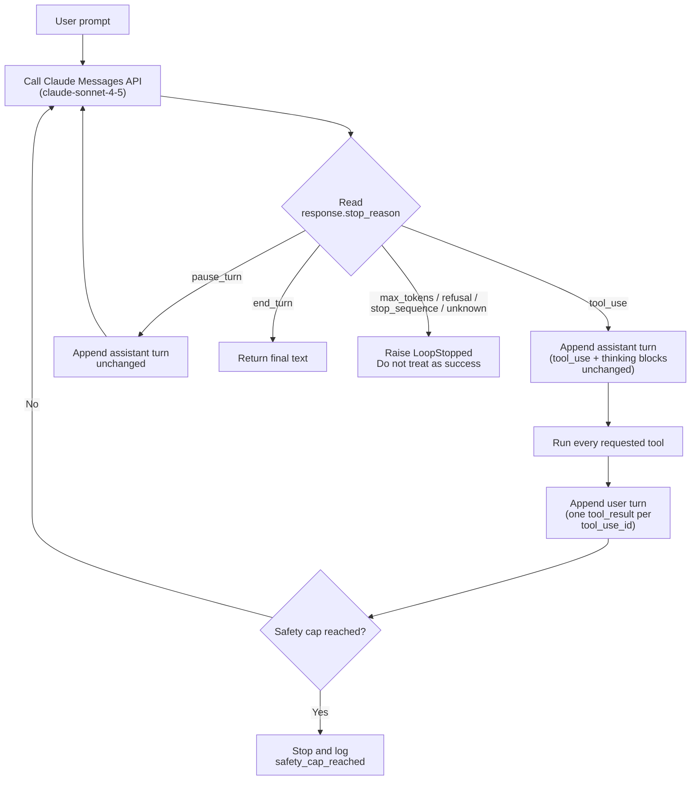

# Task Statement 1.1: Design and Implement Agentic Loops

> Domain 1 (27% of the exam) · Scenarios 1 (Customer Support) and 4 (Developer Productivity) · [Back to Domain 1](../README.md)

## In One Minute

- **What**: An agentic loop sends messages to Claude, runs the tools Claude asks for, sends the results back, and repeats.
- **Control signal**: `response.stop_reason` decides what happens next. Nothing else.
- **Rule**: `tool_use` means run tools and loop again. `end_turn` means finished.
- **Safety cap**: a maximum iteration count is a fallback for bugs. It is never the normal way to stop.
- **Exam answer in one line**: loop on `stop_reason`, never on text, and never on a counter.

---

## 🧒 Explain Like I'm 13

**The picture:** Claude is a chef and your program is the kitchen runner. The chef cannot leave the kitchen, so when something is missing ("I need the current salt price") the chef hands you a ticket. You fetch it, bring it back, and the chef keeps cooking. Every reply from the chef carries a sticky note, `stop_reason`, that says either **"I need a tool"** or **"I'm finished"**.

**In plain steps:**
1. Send the question to Claude.
2. Read the sticky note (`stop_reason`), not the chat text.
3. Note says `tool_use`: run the tool, hand the result back with the matching ticket number, and ask Claude again.
4. Note says `end_turn`: the answer is ready. Stop.

**Why not read the text?** The chef might say "Almost done!" while still waiting for salt. The sticky note never lies, the sentence can.

**Tiny example:** "What is 15% of Tokyo's population?" Claude asks for a search (`tool_use`), then asks for the calculator (`tool_use`), then writes the answer (`end_turn`). Three calls, and your code never guessed anything.

---

## 📌 Overview

### Why it matters
In normal code, the programmer decides the next step. In an agent, **Claude decides** which tool to call and when it has enough facts. Your code is only the loop around that decision.

If you guess "done" by reading Claude's text (for example looking for the word "done"), the loop will stop too early, or never stop. `stop_reason` is a structured field. It does not change with phrasing.

---

## 📖 Concepts Explained

### 1. Every `stop_reason` needs an explicit branch

| `stop_reason` | Meaning | What the loop does |
|---|---|---|
| `tool_use` | Claude wants one or more tools run | Run them, append `tool_result`s, continue |
| `end_turn` | Claude finished its answer | Return the text. Done |
| `pause_turn` | A long server-tool turn was paused | Send the assistant turn back unchanged, continue |
| `max_tokens` | Output was cut at `max_tokens` | Not success. A `tool_use` input may be cut off. Do not run it. Raise `max_tokens` or retry |
| `stop_sequence` | A custom stop string was hit | Handle on purpose. Not the same as finishing |
| `refusal` | Claude declined | Surface it or escalate. Do not retry blindly |
| anything else | A value the code does not know | Stop and report it. Never default to `end_turn` |

In this repo the loop in [main.py](main.py) continues on `tool_use` and `pause_turn`, returns on `end_turn`, and raises `LoopStopped` (from [loop_common.py](../loop_common.py)) for every other value. A silent fallback to `end_turn` would hide truncated or refused answers.

### 2. The two-message contract
After `tool_use`, append two messages in this order:

1. **assistant**: the full `response.content`, unchanged. This keeps the `tool_use` blocks, and any `thinking` blocks with their `signature`.
2. **user**: a list of `tool_result` blocks. Each one carries the matching `tool_use_id`.

A `tool_result` without the assistant `tool_use` before it is rejected with HTTP 400. A response can hold several `tool_use` blocks. Answer all of them in one user message.

### 3. Model-driven loop vs fixed decision tree
- **Model-driven (this task)**: Claude sees the tool results and decides the next tool. The path changes per question.
- **Fixed decision tree or pipeline**: your code decides the order (step 1 always, then step 2). That is right when the order must be guaranteed (see [TS 1.4](../ts_1_4_prerequisite_enforcement/README.md) and [TS 1.6](../ts_1_6_task_decomposition/README.md)). It is not what an agentic loop is.

### 4. The safety cap
`MAX_ITERATIONS = 20` in [main.py](main.py) protects against a bug, such as a tool that always errors and Claude that keeps retrying. The cap is a **safety cap**. Normal runs must end through `stop_reason` long before it. If the cap is hit, log it as a failure (`safety_cap_reached`), do not present it as a result.

---

## 🧪 Worked Example

User asks: *"Search for the population of Tokyo, then calculate 15% of it."*

| Step | Who | What happens |
|---|---|---|
| 1 | Host | Sends `messages = [user: question]` and the two tools |
| 2 | Claude | `stop_reason = "tool_use"`. Content: `tool_use web_search {"query": "tokyo population"}` (id `toolu_A`) |
| 3 | Host | Appends the assistant turn. Runs the search. Appends user turn: `tool_result` for `toolu_A` with the snippet "37,400,000" |
| 4 | Claude | `stop_reason = "tool_use"`. Content: `tool_use calculator {"expression": "37400000 * 0.15"}` (id `toolu_B`) |
| 5 | Host | Appends the assistant turn. Runs the calculator. Appends `tool_result` for `toolu_B`: `5610000` |
| 6 | Claude | `stop_reason = "end_turn"`. Text: "15% of Tokyo's population is about 5.61 million." |
| 7 | Host | Returns the text. Loop ends |

Claude chose search first, then the calculator. The host never hard-coded that order. Three API calls, two tool rounds, and the end came from `end_turn`.

---

## 🔑 Key Terms

- **`stop_reason`**: the API field that says why generation stopped. Values: `tool_use`, `end_turn`, `max_tokens`, `stop_sequence`, `pause_turn`, `refusal`.
- **`tool_use_id`**: the id on each `tool_use` block. The `tool_result` must repeat it exactly.
- **Two-message contract**: assistant `tool_use` turn first, then user `tool_result` turn.
- **Safety cap**: an iteration limit used only as a fallback for runaway loops.
- **Thinking block**: reasoning content with a `signature`. Echo it back unchanged.

---

## 🏗️ Architecture



---

## ⚠️ Exam Traps and Correct Patterns

Each trap shows the scenario, why the wrong answer is tempting, what really goes wrong, and what to do instead.

### Trap 1: Deciding "done" by reading the text

**Exam scenario**: A support loop stops when `"resolved" in response.content[0].text.lower()`. Tickets are sometimes closed before the status check ran.

**Tempting answers**: add a prompt rule ("only say resolved when finished"), or switch to a stricter regex.

**Why they tempt**: the bug looks like a wording problem, so a wording fix feels natural.

**What really happens**:

| Turn | `stop_reason` | Text Claude wrote | Block also in the response | Text-parsing loop does |
|---|---|---|---|---|
| 1 | `tool_use` | "I'll mark this resolved once I check the order status." | `tool_use check_order_status` | Sees "resolved", **exits**. The tool never runs |
| 2 | never reached | - | - | Ticket closed with no status check |

Claude writes text **and** a `tool_use` in the same turn. The text is narration. `stop_reason` is the only field that says whether a tool is pending.

```python
# ANTI-PATTERN: text decides completion
if "resolved" in response.content[0].text.lower():
    break

# PATTERN: structured field decides
if response.stop_reason == "tool_use":
    ...  # run tools, append results, continue
elif response.stop_reason == "end_turn":
    return final_text(response)
else:
    raise LoopStopped(response.stop_reason)  # max_tokens, refusal, unknown
```

**Spot it fast**: any answer option that inspects `content[0].text`, a keyword, or a regex is wrong.

### Trap 2: The iteration cap used as the normal exit

**Exam scenario**: `for _ in range(4):` runs the loop. Long tasks return half-finished answers.

**Tempting answers**: raise the number, or tell Claude "finish within 4 tool calls".

**What really happens**: the number is a guess about task size.

| Task | Tool rounds really needed | `range(4)` result |
|---|---|---|
| Simple lookup | 1 | Works, but only if the code also breaks on `end_turn` |
| Order plus refund plus email | 5 | Cut off after round 4. Last `tool_result` never read |
| Runaway tool error | endless | Stops, but silently looks like a normal answer |

```python
# ANTI-PATTERN: cap is the exit, last turn is the "answer"
for _ in range(4):
    response = client.messages.create(...)
    run_tools(response)
return response.content[0].text

# PATTERN: stop_reason is the exit, cap is a logged failure
for _ in range(MAX_ITERATIONS):          # e.g. 20, fallback only
    response = client.messages.create(...)
    if response.stop_reason == "end_turn":
        return final_text(response)
    ...
raise RuntimeError("safety_cap_reached")   # a bug, not a result
```

**Spot it fast**: if hitting the cap returns a normal-looking answer, the cap is being misused.

### Trap 3: Treating `max_tokens` like success

**Exam scenario**: the response has `stop_reason == "max_tokens"` and the last block is a `tool_use` whose input looks cut off.

```json
{"type": "tool_use", "name": "process_refund", "input": {"order_id": "ORD-99
```

| Option | Result |
|---|---|
| Run it with the parsed part | Wrong order, or a validation crash, or a refund on a guessed id |
| Treat as `end_turn` | User gets a truncated answer presented as final |
| Raise `max_tokens` and retry, or stop with an error | Correct |

With extended thinking, thinking tokens count against `max_tokens`. `max_tokens=4096` with `budget_tokens=4000` leaves about 96 tokens for the tool call, so truncation is likely. Keep `max_tokens` well above `budget_tokens`.

### Trap 4: Breaking the two-message contract

**Exam scenario**: Claude calls `get_customer` and `lookup_order` in one response. The code answers only the first, or appends only the `tool_result` without the assistant turn.

```python
# ANTI-PATTERN: answers one of two tool_use blocks, drops the assistant turn
messages.append({"role": "user", "content": [first_result]})   # HTTP 400

# PATTERN: echo assistant content unchanged, answer EVERY tool_use_id once
messages.append({"role": "assistant", "content": response.content})
results = [
    {"type": "tool_result", "tool_use_id": b.id, "content": run(b)}
    for b in response.content if b.type == "tool_use"
]
messages.append({"role": "user", "content": results})
```

Same rule for `thinking` blocks: `response.content` already contains them with the `signature`. Rebuilding the assistant message from text only removes them and the API returns HTTP 400.

---

## 📝 Exam-Style Practice Questions

**Q1.** A support agent loop ends when `"resolved" in response.content[0].text.lower()`. In production it sometimes ends right after Claude writes "I'll mark this resolved once I check the order status", before the status tool ran. What is the best fix?

- A) Add a system prompt rule: "Only say 'resolved' when truly finished."
- B) Replace the substring check with a regex for "case (is )?resolved".
- C) Continue while `stop_reason == "tool_use"` and finish on `"end_turn"`.
- D) Stop the loop after 3 iterations.

**Q2.** An agent normally needs 2 to 6 tool calls. The loop is `for _ in range(4):`, and long tasks return a half-finished answer. Which change is best?

- A) Raise the count to 100 and keep using it as the exit condition.
- B) Loop on `stop_reason`, and keep a high iteration cap only as a fallback that logs a failure.
- C) Ask Claude to finish within 4 tool calls.
- D) Compare the last two answers and stop when they look similar.

**Q3.** A response arrives with `stop_reason == "max_tokens"` and its last block is a `tool_use` whose input JSON looks cut off. What should the loop do?

- A) Treat it as `end_turn` and return the text.
- B) Run the tool with whatever input was parsed.
- C) Search the text for "done" to decide.
- D) Do not run the tool. Treat it as not successful, and retry with a larger `max_tokens` or raise an error.

### Answers

**Q1: C.**
- A) A prompt is a request, not a guarantee. The loop still guesses from text.
- B) A regex is the same text parsing with a different pattern. It still fires on the "I'll mark this resolved" sentence.
- D) A fixed count ends the loop early. It does not know whether the work is finished.

**Q2: B.**
- A) The cap is still the exit. A bigger number just wastes calls on short tasks and still cuts long ones.
- C) A prompt cannot guarantee a call count. Claude may still need more rounds.
- D) Comparing answers is a text heuristic. It is not a completion signal.

**Q3: D.**
- A) `max_tokens` is a truncation, not a finished turn.
- B) A cut-off input can run the wrong action or fail validation.
- C) Text parsing is the anti-pattern this task rejects.

---

## ✅ Self-Check Checklist

- [ ] I can list all six `stop_reason` values and the loop action for each.
- [ ] I append the assistant `tool_use` turn before the user `tool_result` turn.
- [ ] I answer every `tool_use` block in one user message.
- [ ] I call the iteration limit a safety cap, and my loop ends on `stop_reason`.
- [ ] I echo `thinking` blocks unchanged and never set `temperature` with thinking.

**Memory hook**: *"Read the reason, not the text."*

---

## 🛠️ Hands-on Workbook Guide

Open [ts_1_1_multi_tool_agent_loop.ipynb](ts_1_1_multi_tool_agent_loop.ipynb) (offline, uses the mock client):

1. **Setup**: loads the mock client and logger.
2. **Tools**: a safe AST calculator (no `eval()`) and a mock search.
3. **Loop**: a `while` loop that branches on `stop_reason`.
4. **Simulation**: turn 1 `calculator` tool call, turn 2 `end_turn`.
5. **Checks**: assertions on results and on the explicit `stop_reason` handling.

Code: [main.py](main.py) (live API, run manually only) · Offline tests: [tests/test_domain1_enhancements.py](../../tests/test_domain1_enhancements.py)
