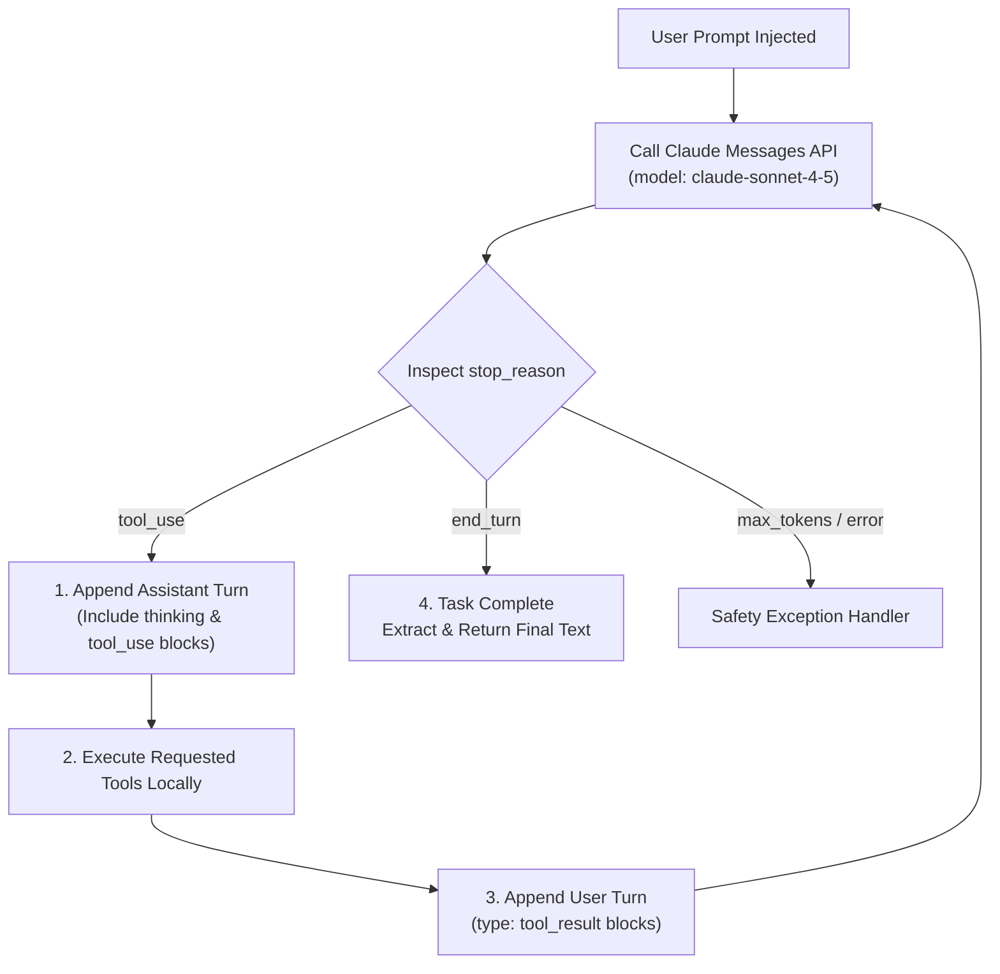

# Task Statement 1.1: Design and Implement Agentic Loops

## 🎯 Exam Objective
Understand how to build autonomous agentic loops using the Claude API, inspect `response.stop_reason` deterministically, maintain conversational history with tool results, and avoid completion anti-patterns.

---

## 🏗️ Architecture: The Deterministic Loop Lifecycle

---

## ⚠️ Critical Exam Distinctions & Anti-Patterns

| Event / Strategy | Implementation | Exam Trap to Reject |
|---|---|---|
| **Loop Termination Signal** | `response.stop_reason == "end_turn"` | **TRAP**: Parsing text for words like `"Done"`, `"Completed"`, or using regex. |
| **Tool Execution Round-Trip** | Append assistant `tool_use` message, then append user `tool_result` message. | **TRAP**: Appending only the tool result without the assistant's preceding `tool_use` turn. |
| **Thinking Block Continuity** | Echo assistant `thinking` blocks back **unmodified with signatures** in subsequent turns. | **TRAP**: Stripping thinking blocks to save tokens (Anthropic API rejects with `400 Bad Request`). |
| **Safety Limits** | `MAX_ITERATIONS = 15` as an emergency runaway brake. | **TRAP**: Relying on turn count or iteration caps as normal termination logic. |

---

## 💡 Architectural Decision Matrix

| Question | Recommended Choice | Rationale |
|---|---|---|
| When should the agent stop calling tools? | Only when `stop_reason == "end_turn"`. | The model alone decides when it has accumulated sufficient evidence to answer. |
| How to handle sampling when thinking is on? | Omit `temperature` completely. | Custom temperature parameters trigger an HTTP `400 Bad Request` API error. |
| Which model to use for the orchestrator loop? | `claude-sonnet-4-5` | Best balance of deep multi-step reasoning, tool choice accuracy, and low latency. |

---

## 🛠️ Production Code Reference
- Interactive Workbook: [`ts_1_1_multi_tool_agent_loop.ipynb`](ts_1_1_multi_tool_agent_loop.ipynb)
- Runnable Script: [`main.py`](main.py)
- Offline Verification: Run via `uv run pytest tests/test_domain1_full.py` in WSL.
