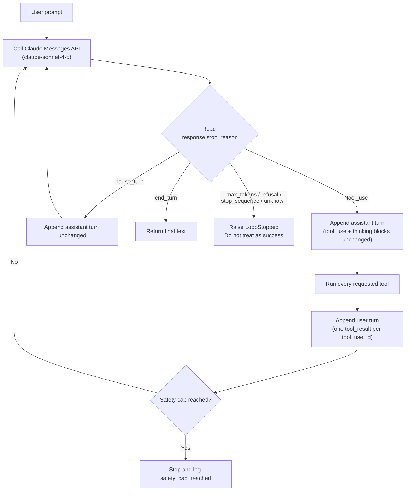

# Task Statement 1.1: Design and Implement Agentic Loops

> Domain 1 (27% of the exam) · Scenarios 1 (Customer Support) and 4 (Developer Productivity) · [Back to Domain 1](../README.md)

## In One Minute

- **What**: An agentic loop sends messages to Claude, runs the tools Claude asks for, sends the results back, and repeats.
- **Control signal**: `response.stop_reason` decides what happens next. Nothing else.
- **Rule**: `tool_use` means run tools and loop again. `end_turn` means finished.
- **Safety cap**: a maximum iteration count is a fallback for bugs. It is never the normal way to stop.
- **Exam answer in one line**: loop on `stop_reason`, never on text, and never on a counter.

---

## 📌 Overview

### Why it matters
In normal code, the programmer decides the next step. In an agent, **Claude decides** which tool to call and when it has enough facts. Your code is only the loop around that decision.

If you guess "done" by reading Claude's text (for example looking for the word "done"), the loop will stop too early, or never stop. `stop_reason` is a structured field. It does not change with phrasing.

### What the exam tests
- You can name what each `stop_reason` means and what the loop must do.
- You reject three anti-patterns: parsing text for completion, using an iteration cap as the main stop, and treating assistant text as the completion signal.
- You know the model-driven loop (Claude chooses the next tool) is different from a fixed decision tree or a fixed pipeline.

---

## 📖 Concepts Explained

### 1. The simple idea
One turn of the loop: **ask, look at `stop_reason`, act, repeat.**

1. Send `messages` and `tools` to Claude.
2. Read `response.stop_reason`.
3. If it is `tool_use`: append the assistant turn, run every requested tool, append one user turn with a `tool_result` for each `tool_use`, and go back to step 1.
4. If it is `end_turn`: return the final text.

### 2. Every `stop_reason` needs an explicit branch

| `stop_reason` | Meaning | What the loop does |
|---|---|---|
| `tool_use` | Claude wants one or more tools run | Run them, append `tool_result`s, continue |
| `end_turn` | Claude finished its answer | Return the text. Done |
| `pause_turn` | A long server-tool turn was paused | Send the assistant turn back unchanged, continue |
| `max_tokens` | Output was cut at `max_tokens` | Not success. A `tool_use` input may be cut off. Do not run it. Raise `max_tokens` or retry |
| `stop_sequence` | A custom stop string was hit | Handle on purpose. Not the same as finishing |
| `refusal` | Claude declined | Surface it or escalate. Do not retry blindly |
| anything else | A value the code does not know | Stop and report it. Never default to `end_turn` |

In this repo the loop in [main.py](main.py) continues on `tool_use` and `pause_turn`, returns on `end_turn`, and raises `LoopStopped` (from [loop_common.py](../loop_common.py)) for every other value. A silent fallback to `end_turn` would hide truncated or refused answers.

### 3. The two-message contract
After `tool_use`, append two messages in this order:

1. **assistant**: the full `response.content`, unchanged. This keeps the `tool_use` blocks, and any `thinking` blocks with their `signature`.
2. **user**: a list of `tool_result` blocks. Each one carries the matching `tool_use_id`.

A `tool_result` without the assistant `tool_use` before it is rejected with HTTP 400. A response can hold several `tool_use` blocks. Answer all of them in one user message.

### 4. Model-driven loop vs fixed decision tree
- **Model-driven (this task)**: Claude sees the tool results and decides the next tool. The path changes per question.
- **Fixed decision tree or pipeline**: your code decides the order (step 1 always, then step 2). That is right when the order must be guaranteed (see [TS 1.4](../ts_1_4_prerequisite_enforcement/README.md) and [TS 1.6](../ts_1_6_task_decomposition/README.md)). It is not what an agentic loop is.

### 5. The safety cap
`MAX_ITERATIONS = 20` in [main.py](main.py) protects against a bug, such as a tool that always errors and Claude that keeps retrying. The cap is a **safety cap**. Normal runs must end through `stop_reason` long before it. If the cap is hit, log it as a failure (`safety_cap_reached`), do not present it as a result.

---

## 🧪 Worked Example

User asks: *"Search for the population of Tokyo, then calculate 15% of it."*

| Step | Who | What happens |
|---|---|---|
| 1 | Host | Sends `messages = [user: question]` and the two tools |
| 2 | Claude | `stop_reason = "tool_use"`. Content: `tool_use web_search {"query": "tokyo population"}` (id `toolu_A`) |
| 3 | Host | Appends the assistant turn. Runs the search. Appends user turn: `tool_result` for `toolu_A` with the snippet "37,400,000" |
| 4 | Claude | `stop_reason = "tool_use"`. Content: `tool_use calculator {"expression": "37400000 * 0.15"}` (id `toolu_B`) |
| 5 | Host | Appends the assistant turn. Runs the calculator. Appends `tool_result` for `toolu_B`: `5610000` |
| 6 | Claude | `stop_reason = "end_turn"`. Text: "15% of Tokyo's population is about 5.61 million." |
| 7 | Host | Returns the text. Loop ends |

Claude chose search first, then the calculator. The host never hard-coded that order. Three API calls, two tool rounds, and the end came from `end_turn`.

---

## 🔑 Key Terms

- **`stop_reason`**: the API field that says why generation stopped. Values: `tool_use`, `end_turn`, `max_tokens`, `stop_sequence`, `pause_turn`, `refusal`.
- **`tool_use_id`**: the id on each `tool_use` block. The `tool_result` must repeat it exactly.
- **Two-message contract**: assistant `tool_use` turn first, then user `tool_result` turn.
- **Safety cap**: an iteration limit used only as a fallback for runaway loops.
- **Thinking block**: reasoning content with a `signature`. Echo it back unchanged.

---

## 🏗️ Architecture

---

## ⚠️ Exam Traps and Correct Patterns

| Topic | Correct pattern | Trap | Why the trap fails |
|---|---|---|---|
| **Completion** | `stop_reason == "end_turn"` | Search the text for "done" or "complete" | Phrasing varies. The text can say "done" while a tool call is still planned |
| **Completion signal** | Use the structured field | Treat the presence of assistant text as "finished" | Claude often writes text and a `tool_use` in the same turn |
| **Iteration cap** | Safety cap only, fixed high | `for i in range(3)` as the normal exit | Cuts off tasks that need more rounds. Wastes calls on tasks that finished |
| **History** | Assistant `tool_use` turn, then user `tool_result` turn | Append only the `tool_result` | HTTP 400. The result has no matching `tool_use` |
| **Thinking** | Echo `thinking` blocks and signatures unchanged | Strip them to save tokens | HTTP 400. The signature check fails |
| **Other stop reasons** | One branch per value, unknown stops the loop | Default to `end_turn` | Hides truncated or refused answers |

---

## ❌ Common Mistakes

- Checking `"done" in text` or a regex on the answer to decide when to stop.
- Using `range(N)` as the main loop condition and treating the last turn as the answer.
- Forgetting to answer every `tool_use` block when Claude calls two tools in one turn.
- Running a `tool_use` from a `max_tokens` response. Its JSON input may be cut off.
- Rebuilding the assistant message from text only and losing `tool_use` or `thinking` blocks.

---

## 💡 Quick Decision Rules

| Question | Answer |
|---|---|
| Should the loop continue? | Only if `stop_reason` is `tool_use` (or `pause_turn`) |
| Is the answer final? | Only if `stop_reason` is `end_turn` |
| What is the iteration cap for? | A fallback against bugs. Never the main stop |
| Where does ordering that must be guaranteed belong? | In code (a gate or fixed pipeline), not left to the model |
| Which model for the agent loop? | `claude-sonnet-4-5` for reasoning. `claude-haiku-4-5` for simple workers |

---

## 🧠 Claude 4.5 Notes

- Models: `claude-sonnet-4-5` (coordinators, reasoning), `claude-haiku-4-5` (workers, subagents).
- Extended thinking: `thinking={"type": "enabled", "budget_tokens": N}` with `N >= 1024` and `N < max_tokens`.
- With thinking on: leave out `temperature` (HTTP 400), and leave `top_k` and `top_p` unset. `tool_choice` may only be `auto` or `none`. `any` or a forced named tool gives HTTP 400.
- In a tool loop, echo the assistant content, including `thinking` blocks and their `signature`, back unchanged with the `tool_result`.

---

## 📝 Exam-Style Practice Questions

**Q1.** A support agent loop ends when `"resolved" in response.content[0].text.lower()`. In production it sometimes ends right after Claude writes "I'll mark this resolved once I check the order status", before the status tool ran. What is the best fix?

- A) Add a system prompt rule: "Only say 'resolved' when truly finished."
- B) Replace the substring check with a regex for "case (is )?resolved".
- C) Continue while `stop_reason == "tool_use"` and finish on `"end_turn"`.
- D) Stop the loop after 3 iterations.

**Q2.** An agent normally needs 2 to 6 tool calls. The loop is `for _ in range(4):`, and long tasks return a half-finished answer. Which change is best?

- A) Raise the count to 100 and keep using it as the exit condition.
- B) Loop on `stop_reason`, and keep a high iteration cap only as a fallback that logs a failure.
- C) Ask Claude to finish within 4 tool calls.
- D) Compare the last two answers and stop when they look similar.

**Q3.** A response arrives with `stop_reason == "max_tokens"` and its last block is a `tool_use` whose input JSON looks cut off. What should the loop do?

- A) Treat it as `end_turn` and return the text.
- B) Run the tool with whatever input was parsed.
- C) Search the text for "done" to decide.
- D) Do not run the tool. Treat it as not successful, and retry with a larger `max_tokens` or raise an error.

### Answers

**Q1: C.**
- A) A prompt is a request, not a guarantee. The loop still guesses from text.
- B) A regex is the same text parsing with a different pattern. It still fires on the "I'll mark this resolved" sentence.
- D) A fixed count ends the loop early. It does not know whether the work is finished.

**Q2: B.**
- A) The cap is still the exit. A bigger number just wastes calls on short tasks and still cuts long ones.
- C) A prompt cannot guarantee a call count. Claude may still need more rounds.
- D) Comparing answers is a text heuristic. It is not a completion signal.

**Q3: D.**
- A) `max_tokens` is a truncation, not a finished turn.
- B) A cut-off input can run the wrong action or fail validation.
- C) Text parsing is the anti-pattern this task rejects.

---

## ✅ Self-Check Checklist

- [ ] I can list all six `stop_reason` values and the loop action for each.
- [ ] I append the assistant `tool_use` turn before the user `tool_result` turn.
- [ ] I answer every `tool_use` block in one user message.
- [ ] I call the iteration limit a safety cap, and my loop ends on `stop_reason`.
- [ ] I echo `thinking` blocks unchanged and never set `temperature` with thinking.

**Memory hook**: *"Read the reason, not the text."*

---

## 🛠️ Hands-on Workbook Guide

Open [ts_1_1_multi_tool_agent_loop.ipynb](ts_1_1_multi_tool_agent_loop.ipynb) (offline, uses the mock client):

1. **Setup**: loads the mock client and logger.
2. **Tools**: a safe AST calculator (no `eval()`) and a mock search.
3. **Loop**: a `while` loop that branches on `stop_reason`.
4. **Simulation**: turn 1 `calculator` tool call, turn 2 `end_turn`.
5. **Checks**: assertions on results and on the explicit `stop_reason` handling.

Code: [main.py](main.py) (live API, run manually only) · Offline tests: [tests/test_domain1_enhancements.py](../../tests/test_domain1_enhancements.py)
