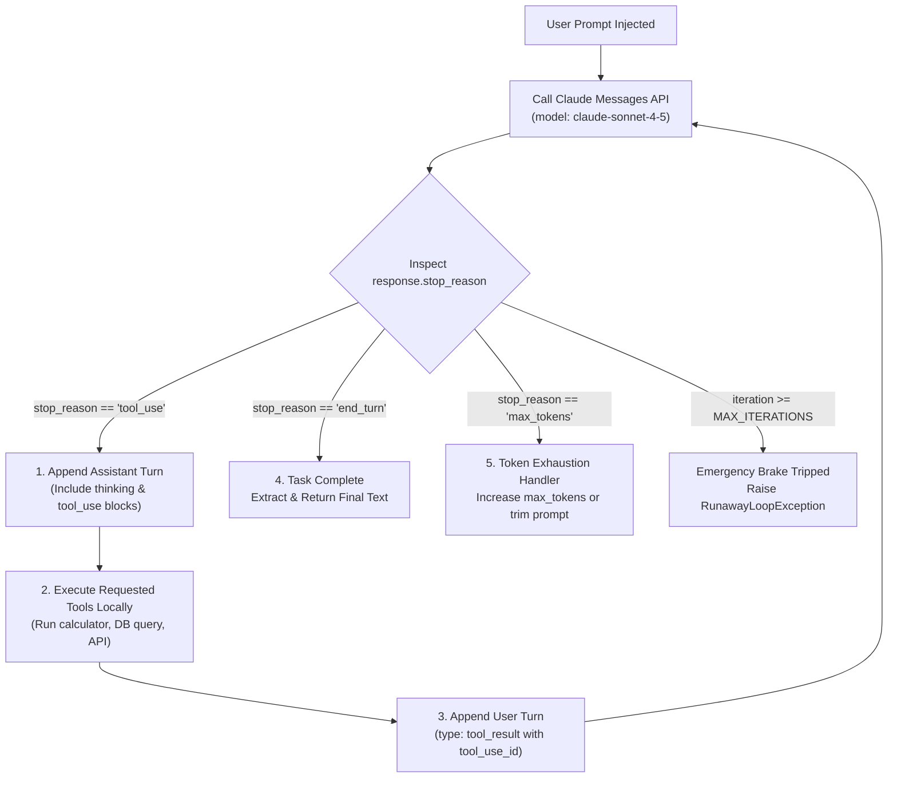

# Task Statement 1.1: Design and Implement Agentic Loops

## 📌 Executive Overview: Goal, Scope & Exam Importance

### Certification Domain & Weight
- **Domain**: Domain 1: Agentic Architecture & Orchestration
- **Domain Weight**: 27% of total CCAR-F exam score (highest-weighted domain on the exam)
- **Scenario Alignment**: Scenario 1 (Customer Support) & Scenario 4 (Developer Productivity)

### The Core Goal
To master the construction of autonomous, multi-turn agentic loops using Claude Messages API primitives. An architect must know how to inspect API response metadata deterministically, maintain bidirectional conversation state with tool execution blocks, manage emergency brakes, and prevent runaway iteration cycles.

### Why This Matters in Production
In traditional software, execution flows along rigid procedural branches. In agentic systems, the LLM acts as an autonomous runtime engine that decides *when* to gather information, *which* external tools to invoke, and *when* it has amassed sufficient facts to conclude its reasoning. 
If an orchestrator relies on fragile string parsing (e.g. checking whether Claude wrote `"Task finished"`), the loop will silently hang, abort prematurely, or hallucinate completion when Claude uses slightly different phrasing. In production, building the loop correctly prevents runaway costs, infinite tool recursion, and lost context.

### Exam Importance
Task Statement 1.1 is tested heavily because it represents the fundamental execution engine of all Claude agents. Exam scenarios will repeatedly test your ability to reject naive completion checks, understand the exact two-turn tool execution contract, and enforce safety boundaries without breaking agent autonomy.

---

## 📖 Deep Narrative: Why We Do What We Do

### 1. The Problem: The Naive Loop Fallacy
Developers new to the Claude API often try to control agent loops using prompt instructions and text analysis:
```python
# ❌ FRAGILE ANTI-PATTERN: String parsing loop termination
response = client.messages.create(...)
if "I have finished" in response.content[0].text or "Done" in response.content[0].text:
    break
```
**Why this fails in production**:
1. **Unpredictable Phrasing**: Claude might say `"Here is the completed analysis"`, `"I've gathered all required facts"`, or simply present the final Markdown table without using the magic word.
2. **Intermediate Mentions**: Claude might write `"I am not done yet; I will now call the calculator"`—a naive string check on `"done"` could trigger false-positive termination.
3. **Structured Tool Use is Ignored**: Claude signals intent to call tools through structured metadata (`stop_reason == "tool_use"`), not through chat text.

### 2. The Architectural Solution: Deterministic State Handshake
Instead of guessing, production architectures use the **Deterministic Handshake Lifecycle**:
1. **Request Phase**: The host application sends conversational history and a list of tool definitions to Claude (`client.messages.create()`).
2. **Evaluation Phase**: The orchestrator inspects `response.stop_reason`.
3. **Branch 1 (`stop_reason == "tool_use"`)**:
   - Claude has determined it cannot answer without external facts.
   - Claude emits one or more `tool_use` blocks containing tool names and validated input arguments.
   - **Crucial Turn Append Requirement**: The orchestrator must first append the assistant's turn (containing the `tool_use` blocks and any reasoning/thinking blocks) to the message list.
   - The host application executes the requested tools locally (database queries, calculators, web search).
   - The orchestrator appends a `user` turn containing matching `tool_result` blocks referencing the corresponding `tool_use_id`.
   - The loop repeats by sending the updated message list back to Claude.
4. **Branch 2 (`stop_reason == "end_turn"`)**:
   - Claude has determined that it has accumulated all necessary information and has generated its final user-facing response.
   - The loop terminates deterministically.
5. **Emergency Brake (`MAX_ITERATIONS`)**:
   - If a misbehaving tool continuously returns errors or if Claude gets trapped in circular tool calls, an iteration cap (e.g. `MAX_ITERATIONS = 15`) prevents infinite loops and catastrophic token spend.

---

## 🔑 Key Technical Terminology Explained

- **`stop_reason`**: An enumerated string returned by the Claude API indicating why generation ceased:
  - `"tool_use"`: The model stopped to request execution of one or more tools. The client *must* execute tools and return results.
  - `"end_turn"`: The model naturally finished its response. No further tools needed.
  - `"max_tokens"`: The response hit the `max_tokens` ceiling before finishing. Requires token budget tuning.
  - `"stop_sequence"`: A user-specified custom stop string was encountered.
- **Dual Turn History Contract**: The Anthropic API strictly requires that every `tool_result` message from the user is preceded by an assistant message containing the matching `tool_use` blocks. Appending `tool_result` without the preceding `tool_use` turn results in an immediate HTTP `400 Bad Request` API error.
- **`tool_use_id`**: A unique alphanumeric identifier (e.g. `toolu_01AbC...`) assigned to each tool call. The client's `tool_result` block must include this exact `tool_use_id` to correlate input arguments with execution output.
- **Circuit Breaker (`MAX_ITERATIONS`)**: An emergency counter that throws a runtime exception if the loop fails to terminate naturally. It is a safeguard against bugs, **never** the normal condition for ending a task.

---

## 🏗️ Architecture: The Deterministic Loop Lifecycle



---

## ⚠️ Critical Exam Distinctions & Distractor Teardown

| Event / Mechanism | Correct Architectural Implementation | Exam Trap to Reject | Why the Trap Fails |
|---|---|---|---|
| **Loop Termination** | Rely exclusively on `response.stop_reason == "end_turn"`. | **TRAP**: Parsing text for `"Done"`, `"Completed"`, or using regex on content. | LLMs vary phrasing naturally. Text parsing leads to premature aborts or infinite loops. |
| **Tool Turn History** | Append the assistant message (with `tool_use` blocks), then append user message (with `tool_result` blocks). | **TRAP**: Appending only the tool result directly to history without the assistant's request. | The Anthropic API schema rejects orphan tool results with an HTTP `400 Bad Request`. |
| **Thinking Continuity** | Echo assistant `thinking` blocks back **unmodified with their signature** in subsequent turns. | **TRAP**: Stripping thinking blocks from intermediate turns to "save tokens". | Stripping thinking blocks breaks the cryptographic signature validation and triggers HTTP `400 Bad Request`. |
| **Emergency Bounds** | Set `MAX_ITERATIONS = 15` as an emergency circuit breaker. | **TRAP**: Using fixed loop counters (e.g. `for i in range(3):`) as normal completion logic. | Prevents the agent from solving tasks that require 4 or 5 iterations, or wastes tokens looping when already finished. |

---

## 💡 Architectural Decision Matrix: Rules of Thumb

| Architectural Dilemma | Recommended Choice | Rapid 30-Second Decision Rule |
|---|---|---|
| **How to decide whether to call more tools?** | Check `stop_reason == "tool_use"` | If `stop_reason == "tool_use"`, execute tools. If `"end_turn"`, return. Never inspect text for loop control. |
| **How to handle sampling with Extended Thinking?** | Omit `temperature` completely | When `thinking={"type": "enabled", "budget_tokens": ...}`, passing `temperature`, `top_p`, or `top_k` causes HTTP 400. |
| **How to choose models for orchestrator loops?** | `claude-sonnet-4-5` for orchestrator, `claude-haiku-4-5` for fast tool tasks | Sonnet provides superior reasoning for multi-step tool sequencing; Haiku provides ultra-fast lightweight execution. |

---

## 🧠 Claude 4.5 Extended Thinking & Parameter Standards

In Claude 4.5 (`claude-sonnet-4-5` and `claude-haiku-4-5`), extended thinking enables the model to reason through complex multi-step tool decisions before committing to an action:

1. **Configuration**:
   ```python
   response = client.messages.create(
       model="claude-sonnet-4-5",
       max_tokens=4096,
       thinking={"type": "enabled", "budget_tokens": 2048},
       # NOTE: temperature, top_p, and top_k MUST BE OMITTED!
       messages=messages,
       tools=tools
   )
   ```
2. **Preservation Invariant**:
   When Claude replies with thinking blocks:
   ```json
   {
     "role": "assistant",
     "content": [
       {"type": "thinking", "thinking": "Let's first calculate...", "signature": "Eq0B..."},
       {"type": "tool_use", "id": "toolu_01", "name": "calculator", "input": {"expression": "125 * 8"}}
     ]
   }
   ```
   This entire block—including the thinking block and its signature—must remain intact when appending to `messages` for turn 2.

---

## 🛠️ Hands-on Workbook Guide: Following the Code Step-by-Step

When exploring [`ts_1_1_multi_tool_agent_loop.ipynb`](ts_1_1_multi_tool_agent_loop.ipynb):
1. **Step 1: Environment & Offline Simulation**: Imports the zero-cost offline `MockClaudeClient` and logger.
2. **Step 2: Safe Tool Definitions**: Demonstrates safe AST expression parsing (avoiding unsafe `eval()`) and structured schemas.
3. **Step 3: The Core Autonomous Agent Loop**: Implements the clean while-loop checking `stop_reason`.
4. **Step 4: Multi-Turn Offline Simulation**: Runs Turn 1 (`calculator`) and Turn 2 (`end_turn`) with complete audit trails.
5. **Step 5: Verification & Safety Assertions**: Verifies that dual history, stop reasons, and error bounds are strictly observed.
