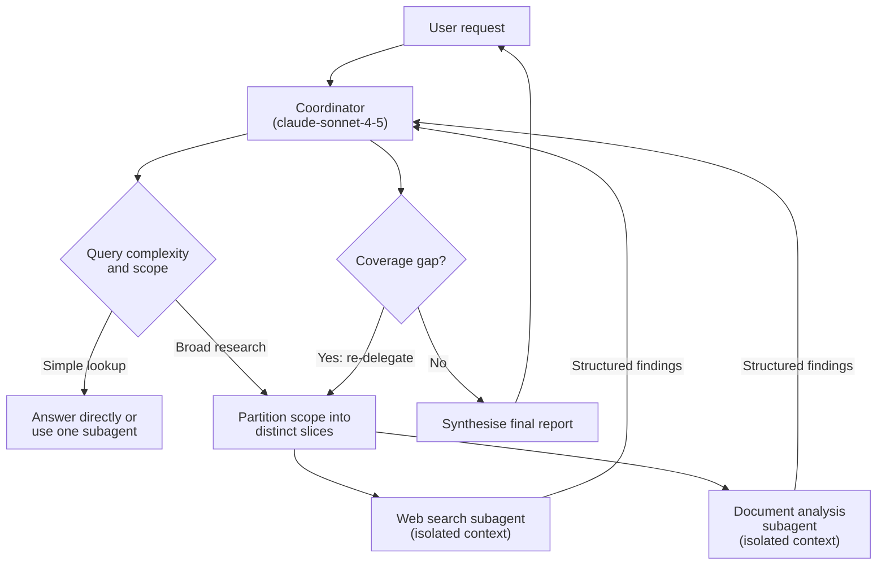

# Task Statement 1.2: Orchestrate Multi-Agent Systems with Coordinator-Subagent Patterns

> Domain 1 (27% of the exam) · Scenario 3 (Multi-Agent Research System) · [Back to Domain 1](../README.md)

## In One Minute

- **What**: One **coordinator** agent plans the work and hands slices to specialised **subagents**. This is hub-and-spoke.
- **Why**: one agent doing everything loses focus. Subagents that talk to each other cannot be audited.
- **Key facts**: subagents start with an **isolated context**. All communication goes **through the coordinator**.
- **Coordinator jobs**: decompose broadly, pick subagents by query complexity, give each a separate slice, check for gaps, re-delegate, then synthesise.
- **Exam answer in one line**: when the final report has gaps but the subagents did their jobs, suspect the coordinator's decomposition.

---

## 🧒 Explain Like I'm 13

**The picture:** A class project. The teacher (coordinator) splits "AI in creative industries" into chapters and gives each student (subagent) a sheet. Students cannot see each other's notebooks, and they do not know what the teacher knows unless it is written on their sheet. Anything one student needs from another goes through the teacher.

**In plain steps:**
1. The teacher splits the topic into parts that together cover everything.
2. Each student gets a sheet with every fact they need.
3. Students hand answers back to the teacher only.
4. The teacher checks for missing chapters, sends someone back if needed, then writes the final report.

**Tiny example:** The report has art and design but no music or film. The students did their jobs perfectly. The teacher only handed out two kinds of sheets. The fix is on the teacher's side.

---

## 📌 Overview

### Why it matters
A single agent that searches, reads documents, and writes the report in one conversation drowns in context. A mesh, where agents message each other, creates loops and hides who did what. Hub-and-spoke keeps one owner of the plan, the budget, and the audit trail.

---

## 📖 Concepts Explained

### 1. How it works

1. **Decompose broadly.** Split the request so all major areas are covered. A topic like "AI in creative industries" needs music, writing, film, design, and visual arts. Not only one of them.
2. **Partition scope.** Give each subagent a different slice (a sub-topic, a date range, a source set). Overlap wastes tokens.
3. **Select dynamically.** A simple lookup may need one subagent, or none. A broad research request needs several.
4. **Isolate context.** A subagent gets its own system prompt, its task inputs, and its tools. Nothing else. If subagent B needs A's findings, the coordinator copies them into B's prompt.
5. **Refine.** Ask a synthesis step what is missing. If gaps exist, send targeted follow-up tasks, then synthesise again.
6. **Return.** Only after coverage is acceptable does the coordinator answer the user.

### 2. In this repo
[main.py](main.py) exposes three coordinator tools: `delegate_web_search`, `delegate_doc_analysis`, `evaluate_synthesis`. Each one calls a local subagent class (`WebSearchSubagent`, `DocumentAnalysisSubagent`, `SynthesisSubagent`) that receives only its arguments. `MultiAgentCoordinator.dispatch_tool` is the single route for every call, and `accumulated_findings` holds the results. `SynthesisSubagent` returns `coverage_sufficient` and `missing_topics`, which drive the refinement loop. The Agent SDK `Task` tool version of spawning is in [TS 1.3](../ts_1_3_subagent_invocation_spawning/README.md).

`max_turns=5` is a **safety cap**. The loop ends on `stop_reason == "end_turn"`. Other stop reasons are handled explicitly, and unknown ones raise `LoopStopped`.

---

## 🧪 Worked Example

Request: *"Research Claude Agent SDK and MCP tool error patterns."*

| Turn | Coordinator output (`stop_reason`) | Host action |
|---|---|---|
| 1 | `tool_use`: `delegate_web_search("claude agent sdk")` | Web subagent returns a finding. Stored in `accumulated_findings` |
| 2 | `tool_use`: `evaluate_synthesis(required_topics=["claude agent sdk", "mcp tool error patterns"])` | Synthesis returns `coverage_sufficient: false`, `missing_topics: ["mcp tool error patterns"]` |
| 3 | `tool_use`: `delegate_web_search("mcp tool error patterns")` | New finding stored |
| 4 | `tool_use`: `evaluate_synthesis(...)` | `coverage_sufficient: true` |
| 5 | `end_turn`: final report | Loop ends |

The gap was found by an explicit check, then fixed by a **targeted** follow-up. The subagents never talked to each other, and each only saw its own query.

**The narrow decomposition sample.** Request: "Research the impact of AI in creative industries." The coordinator creates only visual-arts subtasks (digital art, graphic design, photography). Every subagent does its job well. The report still says nothing about music, writing, or film. **Root cause: the coordinator's decomposition**, not the subagents, the search tool, or the synthesis step.

---

## 🔑 Key Terms

- **Hub-and-spoke**: a coordinator (hub) manages subagents (spokes). All traffic goes through the hub.
- **Context isolation**: a subagent does not inherit the coordinator's conversation or other subagents' results.
- **Dynamic selection**: choosing which subagents to run based on the query's complexity.
- **Scope partitioning**: giving subagents distinct slices to avoid duplicate work.
- **Coverage gap**: a required topic missing from the findings.
- **Iterative refinement**: evaluate gaps, re-delegate, re-synthesise.

---

## 🏗️ Architecture



---

## ⚠️ Exam Traps and Correct Patterns

### Trap 1: Blaming the subagents for a coordinator decomposition error

**Exam scenario**: The task is "research the impact of AI on creative industries". The final report covers only digital art and graphic design. Music, writing, and film are missing. Every subagent's own output is accurate and well sourced.

**Tempting answers**: improve the search subagent's queries, make the synthesis subagent "more thorough", add a document-analysis subagent.

**Why they tempt**: the visible symptom is "the report is incomplete", and search or synthesis sit closest to the report.

**What really happens** (read the coordinator log, not the subagent output):

```text
Coordinator decomposition:
  subagent A -> "AI in digital art"
  subagent B -> "AI in graphic design"
  subagent C -> "AI in illustration"
```

Each subagent did exactly what it was asked. Nobody was asked about music, writing, or film. The coverage hole was created one level up.

**Correct pattern**: partition the whole topic before delegating, then check coverage after.

```text
Coordinator decomposition (fixed):
  A -> visual arts   B -> music   C -> writing and publishing   D -> film and video
  After results: compare covered areas against the topic outline, re-delegate any gap.
```

**Spot it fast**: when the output is missing a whole area but each part is correct, the fault is the decomposition.

### Trap 2: Mesh communication between subagents

**Exam scenario**: To save a step, the web-search subagent sends its findings directly to the analysis subagent.

| Design | Problem |
|---|---|
| Mesh: A to B directly | No single audit trail. Errors in A flow into B unchecked. Nobody owns the token budget. Loops are possible (B asks A, A asks B) |
| Hub-and-spoke: A to coordinator to B | The coordinator can validate, trim, log, and decide whether B should run at all |

```text
ANTI-PATTERN: Search --findings--> Analysis        (coordinator never sees it)
PATTERN:      Search --> Coordinator (validate, log, trim) --> Analysis prompt
```

### Trap 3: Assuming subagents inherit the coordinator's history

**Exam scenario**: The coordinator already learned that the customer is `CUST-88319` and the order is `ORD-2026-9912`. It spawns a subagent with the prompt "Check whether the refund is within policy".

```python
# ANTI-PATTERN: relies on context the subagent does not have
prompt = "Check whether the refund is within policy."
# Subagent messages start as []. It sees no customer, no order, no amount.

# PATTERN: pass exactly what the subagent needs
prompt = (
    "Check refund policy for order ORD-2026-9912 (customer CUST-88319). "
    "Item: noise-cancelling headphones, $249, delivered 2026-10-20, opened. "
    "Return JSON: {eligible: bool, rule_id: str, reason: str}."
)
```

The opposite mistake also loses points: copying the **whole** coordinator history into every subagent bloats its context. Send the relevant slice only.

### Trap 4: Fixed pipeline for every query, and no coverage check

| Query | Right route |
|---|---|
| "What is the return window for unwashed apparel?" | Coordinator answers or uses one lightweight lookup. No subagents |
| "Compare Q3 delays in 4 regions and cross-check weather data" | Decompose, spawn several subagents, synthesise |

After synthesis, ask: "Does this answer every part of the request?" If a source timed out or an area is empty, either re-delegate with a fallback or annotate the gap in the report. Returning the first draft hides the hole.

---

## 📝 Exam-Style Practice Questions

**Q1.** A coordinator is asked to report on "AI in creative industries". It splits the work into digital art, graphic design, and photography only. Each subagent returns excellent findings, but the report omits music, writing, and film. What is the root cause?

- A) The web search subagent returned incomplete results.
- B) The coordinator decomposed the topic too narrowly.
- C) The synthesis subagent has a context window that is too small.
- D) The document analysis subagent was not given the full conversation history.

**Q2.** In a research system, the analysis subagent needs the findings that the search subagent produced. Which design is best?

- A) Let the analysis subagent call the search subagent directly.
- B) Give both subagents a shared mutable memory store.
- C) The coordinator passes the search findings explicitly in the analysis subagent's prompt.
- D) Pass the entire coordinator conversation to every subagent at start-up.

**Q3.** The research system always runs web search, document analysis, and synthesis for every request. A user asks a simple factual question and waits too long. What is the best change?

- A) Let the coordinator choose subagents based on query complexity, and answer simple questions directly.
- B) Switch the coordinator to a larger model.
- C) Run all three subagents in parallel for every request.
- D) Remove the synthesis step for all requests.

### Answers

**Q1: B.**
- A) The subagents were asked about visual arts and did that well. The gap is in what was assigned.
- C) A small synthesis context would lose detail, not remove whole topics that were never researched.
- D) Subagents are meant to start isolated. More history would not add the missing topics.

**Q2: C.**
- A) Direct subagent calls create a mesh. Loops and no single audit trail follow.
- B) Shared memory breaks isolation and makes the system hard to audit.
- D) Copying the whole history bloats context and defeats isolation.

**Q3: A.**
- B) A larger model does not remove unnecessary work.
- C) Parallel runs are faster than serial but still do unneeded work and cost tokens.
- D) Removing synthesis would hurt the complex requests that need it.

---

## ✅ Self-Check Checklist

- [ ] I can explain why subagents do not inherit the coordinator's history.
- [ ] I can say why mesh communication is rejected.
- [ ] I can describe the refinement loop: evaluate gaps, re-delegate, re-synthesise.
- [ ] I choose subagents by query complexity and partition their scopes.
- [ ] When the report misses a whole area, I look at the coordinator's decomposition first.

**Memory hook**: *"Hub plans, spokes work, nothing talks sideways."*

---

## 🛠️ Hands-on Workbook Guide

Open [ts_1_2_coordinator_subagents.ipynb](ts_1_2_coordinator_subagents.ipynb) (offline, mock client):

1. **Setup**: test harness and trail logger.
2. **Subagents**: `WebSearchSubagent`, `DocumentAnalysisSubagent`, `SynthesisSubagent`, each seeing only its own inputs.
3. **Coordinator**: `MultiAgentCoordinator` with one dispatch route and an audit log of every delegation.
4. **Simulation**: a scripted pipeline: web search, document analysis, then a synthesis coverage check.
5. **Checks**: assertions on coverage, gap detection with a missing topic, and the audit log.

Code: [main.py](main.py) (live API, run manually only) · Offline tests: [tests/test_domain1_enhancements.py](../../tests/test_domain1_enhancements.py)
