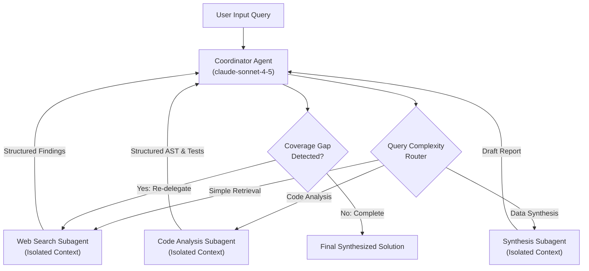

# Task Statement 1.2: Orchestrate Multi-Agent Systems with Coordinator-Subagent Patterns

## 📌 Executive Overview: Goal, Scope & Exam Importance

### Certification Domain & Weight
- **Domain**: Domain 1: Agentic Architecture & Orchestration
- **Domain Weight**: 27% of total CCAR-F exam score
- **Scenario Alignment**: Scenario 3 (Multi-Agent Research System)

### The Core Goal
To design and implement hierarchical multi-agent architectures using the **Hub-and-Spoke** pattern. An architect must enforce strict subagent **context isolation**, implement dynamic query-complexity routing, and construct iterative gap-detection and refinement loops.

### Why This Matters in Production
When a single agent is tasked with handling web research, code analysis, numerical calculations, and executive synthesis in a single conversation context, it quickly suffers from **attention dilution** and catastrophic token bloat. 
Conversely, naive multi-agent systems often connect agents in a peer-to-peer "mesh" where subagents communicate directly with one another. In production, mesh architectures lead to circular invocation loops, uncontrolled token burn, non-deterministic race conditions, and un-auditable outputs. The Hub-and-Spoke pattern provides a deterministic, centrally audited hierarchy where a coordinator directs specialized workers and guarantees quality.

### Exam Importance
Task Statement 1.2 questions frequently test whether candidates understand why subagents must not inherit parent conversation history, why peer-to-peer agent mesh networks are rejected, and how a coordinator detects and remediates synthesis coverage gaps before returning to the user.

---

## 📖 Deep Narrative: Why We Do What We Do

### 1. The Problem: Mesh Networks and Context Bleed
Consider what happens when multi-agent systems are designed without strict topology:
1. **Peer-to-Peer Mesh Anti-Pattern**: If Agent A can directly message Agent B, and Agent B can call Agent C, who can call Agent A, the system is vulnerable to circular recursion. Debugging is impossible because no single entity owns the conversation state or total budget.
2. **Context Bleed (Inheritance Anti-Pattern)**: If a specialized subagent (e.g. searching SEC filings) inherits the coordinator's entire 30,000-token conversational history, its reasoning becomes distracted by irrelevant previous topics, and token costs scale quadratically ($O(N^2)$).

### 2. The Architectural Solution: Hub-and-Spoke with Context Isolation
In production, we enforce three architectural invariants:
1. **Strict Hub-and-Spoke**: All inter-agent communication flows exclusively through the central coordinator. Subagent A never talks to Subagent B. If Subagent B needs Subagent A's findings, the coordinator extracts those findings and explicitly passes them into Subagent B's prompt.
2. **The Context Isolation Contract**: Every subagent is invoked with a **fresh, pristine context**. It receives only:
   - Its specialized system prompt (e.g., "You are an SEC financial analyst").
   - The specific input parameters needed for its task (e.g., `doc_id` and `target_metric`).
   - The minimal toolset required for its domain.
3. **Dynamic Complexity Routing**: The coordinator inspects user query intent:
   - For simple retrieval queries, it answers directly or calls a lightweight tool.
   - For deep multi-faceted research, it dispatches tasks to specialized subagents.
4. **Iterative Refinement & Gap Detection**: Once subagents report their structured findings, the coordinator checks whether all required aspects of the user query have been addressed. If gaps exist (e.g. market data was gathered, but regulatory filings were missing), the coordinator re-delegates targeted follow-up queries before finalizing the output.

---

## 🔑 Key Technical Terminology Explained

- **Hub-and-Spoke Topology**: An architectural pattern where a central Coordinator (the "Hub") manages all subagents (the "Spokes"). The Hub dispatches tasks, collects results, arbitrates errors, and performs final synthesis.
- **Context Isolation Contract**: The rule that subagents operate in sandboxed conversation sessions. They do **not** automatically inherit parent memory, global variables, or unrelated message turns.
- **Dynamic Complexity Routing**: Evaluating the semantic complexity of a user request to decide dynamically which subagents to spawn, avoiding rigid monolithic pipelines.
- **Coverage Gap Detection**: Programmatic or coordinator-evaluated checks to verify that subagent outputs satisfy all criteria in the user request prior to task completion.
- **Attribution Metadata**: Structured data (URL, doc title, section number, publication timestamp) preserved separately from raw text so the coordinator can cite facts accurately.

---

## 🏗️ Architecture: Hub-and-Spoke Topology

---

## ⚠️ Critical Exam Distinctions & Distractor Teardown

| Architectural Pattern | Correct Implementation | Exam Trap to Reject | Why the Trap Fails |
|---|---|---|---|
| **Inter-Agent Communication** | **Hub-and-Spoke**: All inter-agent traffic flows through the coordinator. | **TRAP**: Peer-to-peer mesh topology where subagents invoke each other directly. | Leads to circular recursion, deadlocks, untraceable token spend, and fragmented audit trails. |
| **Context Sharing** | **Context Isolation**: Each subagent starts with a pristine context containing only its task payload. | **TRAP**: Passing the coordinator's full conversational history into every spawned subagent. | Causes attention dilution, context window exhaustion, and quadratic token cost explosions. |
| **Execution Pipeline** | **Dynamic Complexity Routing**: Coordinator routes queries based on semantic requirements. | **TRAP**: A rigid sequential waterfall that passes every query through all subagents. | Wastes latency and token budget on queries that only require one specific subagent. |
| **Output Delivery** | **Iterative Gap Evaluation**: Coordinator verifies synthesis coverage before returning to the user. | **TRAP**: Directly streaming the first subagent's raw draft to the end user. | Delivers incomplete or unverified facts, failing production quality SLAs. |

---

## 💡 Architectural Decision Matrix: Rules of Thumb

| Architectural Dilemma | Recommended Choice | Rapid 30-Second Decision Rule |
|---|---|---|
| **Mesh vs Hub-and-Spoke?** | Hub-and-Spoke | If subagents need to collaborate, route through a coordinator. Never allow peer-to-peer subagent messaging. |
| **Pass full history or task snippet?** | Isolated task snippet | Always isolate subagent context. Pass only the explicit instruction and necessary facts. |
| **How to allocate models?** | Sonnet for Coordinator, Haiku/Sonnet for Workers | Use `claude-sonnet-4-5` for high-level coordination and routing; use `claude-haiku-4-5` for fast, bounded leaf tasks. |

---

## 🧠 Claude 4.5 Extended Thinking & Parameter Standards

In multi-agent coordinator patterns:
- **Coordinator Reasoning**: The coordinator benefits significantly from Extended Thinking (`budget_tokens: 2048` or `4096`) to analyze query intent, assess candidate subagents, and detect coverage gaps.
- **Sampling Constraint**: Omit `temperature`, `top_p`, and `top_k` on both coordinator and subagents when `thinking` is enabled.
- **Thinking Continuity**: In the coordinator's multi-turn loop, assistant thinking blocks from previous routing decisions must be preserved with signatures when dispatching subsequent tools.

---

## 🛠️ Hands-on Workbook Guide: Following the Code Step-by-Step

When exploring [`ts_1_2_coordinator_subagents.ipynb`](ts_1_2_coordinator_subagents.ipynb):
1. **Step 1: Environment & Setup**: Sets up the offline test harness and response audit loggers.
2. **Step 2: Isolated Subagent Classes**: Implements `WebSearchSubagent`, `DocumentAnalysisSubagent`, and `SynthesisSubagent` with isolated scopes.
3. **Step 3: Hub-and-Spoke Coordinator**: Builds `MultiAgentCoordinator` with tool dispatching, centralized audit logging, and gap detection.
4. **Step 4: Multi-Agent Research Simulation**: Runs an end-to-end multi-agent research workflow, verifying coverage status and isolated execution.
5. **Step 5: Verification & Architectural Assertions**: Verifies that subagents never share context memory and all delegation is audited.
