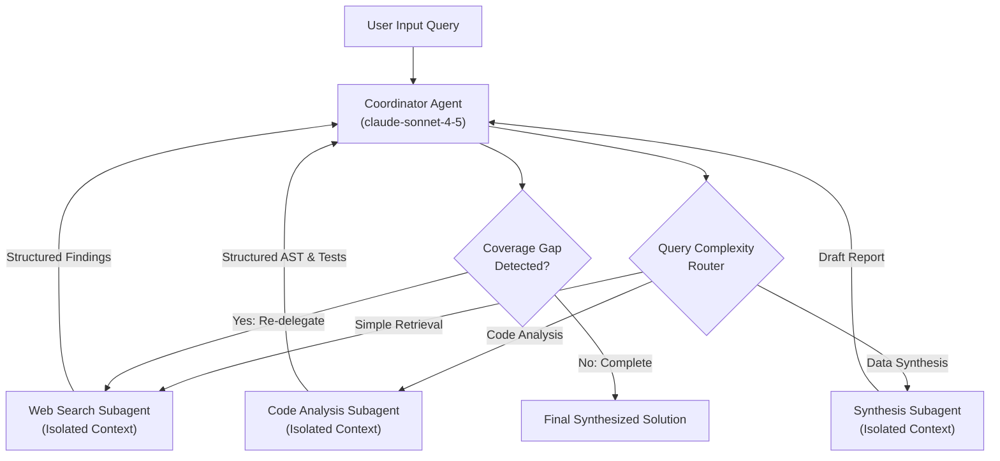

# Task Statement 1.2: Orchestrate Multi-Agent Systems with Coordinator-Subagent Patterns

## 🎯 Exam Objective
Understand how to architect hierarchical multi-agent systems using the **Hub-and-Spoke** pattern, enforce strict subagent **context isolation**, execute dynamic query-complexity routing, and drive iterative refinement loops.

---

## 🏗️ Architecture: Hub-and-Spoke Topology

---

## ⚠️ Critical Exam Distinctions & Anti-Patterns

| Architectural Pattern | Correct Implementation | Exam Trap to Reject |
|---|---|---|
| **Inter-Agent Communication** | **Hub-and-spoke**: All inter-agent traffic flows through the central coordinator. | **TRAP**: Mesh topology where subagents call each other directly without coordinator oversight. |
| **Context Sharing** | **Context isolation**: Each subagent gets its own pristine conversation history with only the relevant task payload. | **TRAP**: Passing the coordinator's entire verbose multi-turn history into every spawned subagent. |
| **Routing Strategy** | **Dynamic complexity routing**: The coordinator inspects query intent and invokes only the subagents needed. | **TRAP**: Forcing every query through a rigid, sequential pipeline across all subagents regardless of query scope. |
| **Iterative Refinement** | Coordinator evaluates synthesis against criteria; if gaps exist, re-delegates follow-up queries before returning. | **TRAP**: Returning the first subagent draft directly to the user without gap verification. |

---

## 💡 Architectural Decision Matrix

| Dimension | Recommended Pattern | Rationale |
|---|---|---|
| **Topology** | Hub-and-Spoke (Coordinator + Leaf Subagents) | Simplifies debugging, enforces audit trails, avoids circular recursion, and isolates token spend. |
| **Model Selection** | Coordinator: `claude-sonnet-4-5` Leaf Subagents: `claude-haiku-4-5` or `claude-sonnet-4-5` | High-reasoning coordinator manages routing; fast, cost-effective models handle narrow domain tasks. |
| **Thinking Level** | Coordinator: `budget_tokens: 2048` (no `temperature`) | Ensures robust routing logic and gap analysis while preserving API parameter rules. |

---

## 🛠️ Production Code Reference
- Interactive Workbook: [`ts_1_2_coordinator_subagents.ipynb`](ts_1_2_coordinator_subagents.ipynb)
- Runnable Script: [`main.py`](main.py)
- Offline Verification: Run via `uv run pytest tests/test_domain1_full.py` in WSL.
