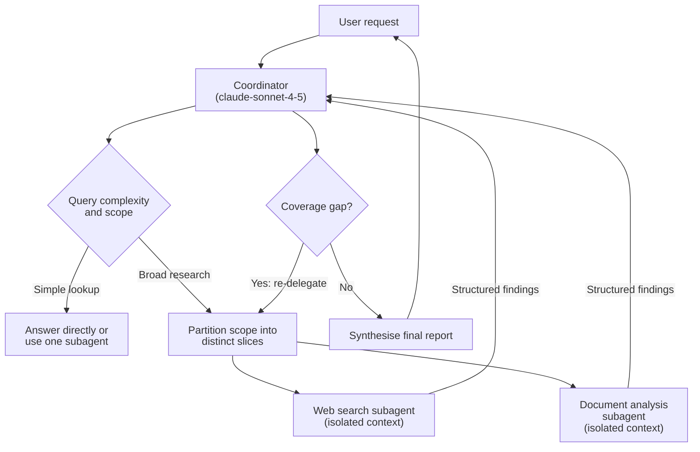

# Task Statement 1.2: Orchestrate Multi-Agent Systems with Coordinator-Subagent Patterns

> Domain 1 (27% of the exam) · Scenario 3 (Multi-Agent Research System) · [Back to Domain 1](../README.md)

## In One Minute

- **What**: One **coordinator** agent plans the work and hands slices to specialised **subagents**. This is hub-and-spoke.
- **Why**: one agent doing everything loses focus. Subagents that talk to each other cannot be audited.
- **Key facts**: subagents start with an **isolated context**. All communication goes **through the coordinator**.
- **Coordinator jobs**: decompose broadly, pick subagents by query complexity, give each a separate slice, check for gaps, re-delegate, then synthesise.
- **Exam answer in one line**: when the final report has gaps but the subagents did their jobs, suspect the coordinator's decomposition.

---

## 🧒 Explain Like I'm 13

**The picture:** A class project. The teacher (coordinator) splits "AI in creative industries" into chapters and gives each student (subagent) a sheet. Students cannot see each other's notebooks, and they do not know what the teacher knows unless it is written on their sheet. Anything one student needs from another goes through the teacher.

**In plain steps:**
1. The teacher splits the topic into parts that together cover everything.
2. Each student gets a sheet with every fact they need.
3. Students hand answers back to the teacher only.
4. The teacher checks for missing chapters, sends someone back if needed, then writes the final report.

**Tiny example:** The report has art and design but no music or film. The students did their jobs perfectly. The teacher only handed out two kinds of sheets. The fix is on the teacher's side.

---

## 📌 Overview

### Why it matters
A single agent that searches, reads documents, and writes the report in one conversation drowns in context. A mesh, where agents message each other, creates loops and hides who did what. Hub-and-spoke keeps one owner of the plan, the budget, and the audit trail.

---

## 📖 Concepts Explained

### 1. The Cognitive Mechanics of Multi-Agent Systems
When an agent attempts to execute an entire research pipeline alone—formulating queries, navigating dozens of search results, reading complex documents, and writing an overarching synthesis—it experiences severe **attention saturation**. The prompt becomes cluttered with raw HTML snippets, navigational breadcrumbs, and abandoned dead-end queries. In transformer architectures, attention weights spread thinner as token counts grow (the "lost-in-the-middle" phenomenon), causing the model to forget its initial research objectives, conflate distinct sources, and produce shallow or hallucinated summaries.

Decomposing the problem into specialized subagents solves this cognitive bottleneck:
- **Focused Attention Span**: Each subagent performs one task with a pristine context window containing only the facts necessary for its specific assignment.
- **Cognitive Specialization**: A search agent has web-browsing tools and instructions optimized for retrieval; an analysis agent has file-parsing tools; a synthesis agent has strict citation and conflict-detection instructions.
- **Linear Token Economics**: By isolating exploration within ephemeral subagent contexts and passing only distilled findings back to the coordinator, the primary conversation window grows linearly rather than quadratically.

### 2. Multi-Agent Topologies: Why Hub-and-Spoke Wins
In multi-agent architecture design, three primary topological patterns emerge:

| Topology | Mechanics | Strengths | Fatal Flaws (Exam Anti-Patterns) |
|---|---|---|---|
| **Monolithic Single-Agent** | One agent executes every tool call sequentially in a single conversation history. | Simple to implement, zero coordination overhead. | Suffers from context saturation, attention dilution, quadratic token costs, and high latency. |
| **Peer-to-Peer Mesh** | Subagents communicate directly with one another without centralized routing. | Decentralized, flexible routing. | **Completely unauditable**. Subagents enter recursive request loops, token spend spirals out of control, and errors cascade unchecked. |
| **Hub-and-Spoke (Standard)** | A central **coordinator (hub)** manages task decomposition, assigns isolated work slices to **subagents (spokes)**, audits coverage, and synthesizes output. | Central audit trail, strict cost bounds, clear accountability, and deterministic gap remediation. | Coordinator becomes a single point of failure if decomposition is overly narrow. |

> [!IMPORTANT]
> **Core Architectural Invariant**: In the Claude Agent SDK and CCAR-F syllabus, **all inter-agent communication must flow through the central coordinator**. Subagents must never call peer subagents directly, nor share mutable global memory.

### 3. The 6-Step Orchestration Lifecycle
Production multi-agent research systems execute a rigorous six-phase lifecycle:

1. **Broad Decomposition**: The coordinator analyzes the user request and maps the required domain breadth. If the topic is *"The Impact of AI on Creative Industries"*, a comprehensive decomposition must encompass visual arts, literature, musical composition, and film production—not merely one prominent subcategory.
2. **Scope Partitioning**: The coordinator assigns strictly non-overlapping slices to subagents (partitioned by domain, source set, or time horizon). Overlapping task assignments waste valuable inference tokens on redundant searches.
3. **Dynamic Routing by Query Complexity**: Not every query justifies spawning a team of subagents. Simple factual lookups (*"What is the return policy window?"*) should be answered directly or via a single lightweight tool call. Broad, open-ended investigations trigger multi-agent fanning out.
4. **Strict Context Isolation**: Subagents begin with an entirely clean slate. They receive their dedicated system prompt, task-specific parameters, and restricted toolset. They inherit **zero conversation history** from the coordinator or other subagents. If Subagent B requires facts discovered by Subagent A, the coordinator explicitly extracts, validates, and injects those facts into Subagent B's invocation prompt.
5. **Iterative Refinement & Gap Auditing**: Rather than immediately presenting raw findings to the user, the coordinator invokes an evaluation step (`evaluate_synthesis`) to audit coverage against the initial topic blueprint. If a coverage gap is detected (e.g., missing data on music production), the coordinator dispatches targeted follow-up tasks to fill the void.
6. **Unified Synthesis & Attribution**: Once coverage meets criteria, the coordinator compiles the structured findings into a cohesive narrative, preserving citations, dates, and conflicting perspectives.

### 4. Implementation in This Repository
In [main.py](main.py), the `MultiAgentCoordinator` encapsulates this architecture:
- Three coordinator tools are declared: `delegate_web_search`, `delegate_doc_analysis`, and `evaluate_synthesis`.
- Each delegation instantiates an isolated subagent class (`WebSearchSubagent`, `DocumentAnalysisSubagent`, `SynthesisSubagent`) receiving only its designated query parameters.
- `MultiAgentCoordinator.dispatch_tool` serves as the centralized, audited gateway for all tool invocations, storing structured results in `accumulated_findings`.
- `SynthesisSubagent` returns deterministic evaluation metadata (`coverage_sufficient: bool` and `missing_topics: list[str]`), driving the coordinator's automated refinement loop.
- `max_turns=5` serves as an emergency safety cap; normal completion terminates deterministically when Claude emits `response.stop_reason == "end_turn"`.

---

## 🧪 Worked Example

### ❌ Invalid Example (Anti-Pattern: Peer-to-Peer Mesh & Shared Mutable History)
```python
# BROKEN: Subagents talk directly to each other and share one huge conversation history
shared_history = [{"role": "user", "content": "Research AI impact on creative industries"}]

# Anti-pattern 1: Subagent A passes entire 40k-token conversation history to Subagent B
subagent_a_response = client.messages.create(messages=shared_history, ...)
shared_history.append({"role": "assistant", "content": subagent_a_response.content})

# Anti-pattern 2: Subagent B calls Subagent C directly without coordinator oversight
# Result: Circular inquiry loops, exploding token costs, and untraceable citations!
```

### ✅ Valid Example (Production Pattern: Hub-and-Spoke with Context Isolation & Gap Auditing)
```python
# CORRECT: Central coordinator dispatches isolated work slices and verifies coverage
coordinator_prompt = "Research Claude Agent SDK and MCP tool error patterns."

# Turn 1: Coordinator delegates focused slice to isolated web subagent
# Notice: WebSubagent receives ONLY its specific query; ZERO coordinator history!
web_result = web_subagent.run(query="Claude Agent SDK architecture")
coordinator.accumulated_findings.append(web_result)

# Turn 2: Coordinator audits coverage against initial topic requirements
evaluation = synthesis_subagent.evaluate(
    findings=coordinator.accumulated_findings,
    required_topics=["Claude Agent SDK", "MCP tool error patterns"]
)
# Returns: coverage_sufficient = False, missing_topics = ["MCP tool error patterns"]

# Turn 3: Coordinator detects the gap and dispatches targeted follow-up
mcp_result = web_subagent.run(query="MCP tool error patterns")
coordinator.accumulated_findings.append(mcp_result)

# Turn 4: Re-audit confirms 100% coverage -> Coordinator synthesizes final report
final_report = synthesis_subagent.synthesize(coordinator.accumulated_findings)
```

**Step-by-step turn sequence:**

| Turn | Coordinator output (`stop_reason`) | Host action |
|---|---|---|
| 1 | `tool_use`: `delegate_web_search("claude agent sdk")` | Web subagent returns finding. Stored in `accumulated_findings` |
| 2 | `tool_use`: `evaluate_synthesis(required_topics=["claude agent sdk", "mcp tool error patterns"])` | Synthesis returns `coverage_sufficient: false`, `missing_topics: ["mcp tool error patterns"]` |
| 3 | `tool_use`: `delegate_web_search("mcp tool error patterns")` | New finding stored |
| 4 | `tool_use`: `evaluate_synthesis(...)` | `coverage_sufficient: true` |
| 5 | `end_turn`: final report | Loop ends cleanly |

The gap was caught by an explicit check, then fixed by a **targeted** follow-up. The subagents never talked to each other, and each saw only its own task parameters.

**The narrow decomposition sample.** Request: "Research the impact of AI in creative industries." The coordinator creates only visual-arts subtasks (digital art, graphic design, photography). Every subagent does its job well. The report still says nothing about music, writing, or film. **Root cause: the coordinator's decomposition**, not the subagents, the search tool, or the synthesis step.

---

## 🔑 Key Terms

- **Hub-and-Spoke Topology**: An architectural pattern where a central coordinator agent (the hub) manages task decomposition, assigns work slices, and synthesizes results from isolated subagents (the spokes).
- **Strict Context Isolation**: The architectural principle where subagents begin with a pristine context buffer containing only their system prompt and task parameters, inheriting zero history from other agents.
- **Dynamic Routing by Query Complexity**: Evaluating user request difficulty to answer simple lookups with a single lightweight tool call, reserving multi-agent coordination strictly for broad research workflows.
- **Scope Partitioning**: Dividing a high-level objective into strictly non-overlapping topical or temporal domains so subagents do not waste tokens on duplicate searches.
- **Coverage Gap Auditing**: A programmatic or model-driven evaluation step (`evaluate_synthesis`) where the coordinator cross-references accumulated findings against required topics before generating final output.
- **Iterative Refinement Loop**: Dispatched follow-up turns where the coordinator queries specific subagents to fill missing gaps identified during synthesis evaluation before publishing the final report.

---

## 🏗️ Architecture



---

## ⚠️ Exam Traps and Correct Patterns

### Trap 1: Blaming the subagents for a coordinator decomposition error

**Exam scenario**: The task is "research the impact of AI on creative industries". The final report covers only digital art and graphic design. Music, writing, and film are missing. Every subagent's own output is accurate and well sourced.

**Tempting answers**: improve the search subagent's queries, make the synthesis subagent "more thorough", add a document-analysis subagent.

**Why they tempt**: the visible symptom is "the report is incomplete", and search or synthesis sit closest to the report.

**What really happens** (read the coordinator log, not the subagent output):

```text
Coordinator decomposition:
  subagent A -> "AI in digital art"
  subagent B -> "AI in graphic design"
  subagent C -> "AI in illustration"
```

Each subagent did exactly what it was asked. Nobody was asked about music, writing, or film. The coverage hole was created one level up.

**Correct pattern**: partition the whole topic before delegating, then check coverage after.

```text
Coordinator decomposition (fixed):
  A -> visual arts   B -> music   C -> writing and publishing   D -> film and video
  After results: compare covered areas against the topic outline, re-delegate any gap.
```

**Spot it fast**: when the output is missing a whole area but each part is correct, the fault is the decomposition.

### Trap 2: Mesh communication between subagents

**Exam scenario**: To save a step, the web-search subagent sends its findings directly to the analysis subagent.

| Design | Problem |
|---|---|
| Mesh: A to B directly | No single audit trail. Errors in A flow into B unchecked. Nobody owns the token budget. Loops are possible (B asks A, A asks B) |
| Hub-and-spoke: A to coordinator to B | The coordinator can validate, trim, log, and decide whether B should run at all |

```text
ANTI-PATTERN: Search --findings--> Analysis        (coordinator never sees it)
PATTERN:      Search --> Coordinator (validate, log, trim) --> Analysis prompt
```

### Trap 3: Assuming subagents inherit the coordinator's history

**Exam scenario**: The coordinator already learned that the customer is `CUST-88319` and the order is `ORD-2026-9912`. It spawns a subagent with the prompt "Check whether the refund is within policy".

```python
# ANTI-PATTERN: relies on context the subagent does not have
prompt = "Check whether the refund is within policy."
# Subagent messages start as []. It sees no customer, no order, no amount.

# PATTERN: pass exactly what the subagent needs
prompt = (
    "Check refund policy for order ORD-2026-9912 (customer CUST-88319). "
    "Item: noise-cancelling headphones, $249, delivered 2026-10-20, opened. "
    "Return JSON: {eligible: bool, rule_id: str, reason: str}."
)
```

The opposite mistake also loses points: copying the **whole** coordinator history into every subagent bloats its context. Send the relevant slice only.

### Trap 4: Fixed pipeline for every query, and no coverage check

| Query | Right route |
|---|---|
| "What is the return window for unwashed apparel?" | Coordinator answers or uses one lightweight lookup. No subagents |
| "Compare Q3 delays in 4 regions and cross-check weather data" | Decompose, spawn several subagents, synthesise |

After synthesis, ask: "Does this answer every part of the request?" If a source timed out or an area is empty, either re-delegate with a fallback or annotate the gap in the report. Returning the first draft hides the hole.

---

## 📝 Exam-Style Practice Questions

**Q1.** A coordinator is asked to report on "AI in creative industries". It splits the work into digital art, graphic design, and photography only. Each subagent returns excellent findings, but the report omits music, writing, and film. What is the root cause?

- A) The web search subagent returned incomplete results.
- B) The coordinator decomposed the topic too narrowly.
- C) The synthesis subagent has a context window that is too small.
- D) The document analysis subagent was not given the full conversation history.

**Q2.** In a research system, the analysis subagent needs the findings that the search subagent produced. Which design is best?

- A) Let the analysis subagent call the search subagent directly.
- B) Give both subagents a shared mutable memory store.
- C) The coordinator passes the search findings explicitly in the analysis subagent's prompt.
- D) Pass the entire coordinator conversation to every subagent at start-up.

**Q3.** The research system always runs web search, document analysis, and synthesis for every request. A user asks a simple factual question and waits too long. What is the best change?

- A) Let the coordinator choose subagents based on query complexity, and answer simple questions directly.
- B) Switch the coordinator to a larger model.
- C) Run all three subagents in parallel for every request.
- D) Remove the synthesis step for all requests.

### Answers

**Q1: B.**
- A) The subagents were asked about visual arts and did that well. The gap is in what was assigned.
- C) A small synthesis context would lose detail, not remove whole topics that were never researched.
- D) Subagents are meant to start isolated. More history would not add the missing topics.

**Q2: C.**
- A) Direct subagent calls create a mesh. Loops and no single audit trail follow.
- B) Shared memory breaks isolation and makes the system hard to audit.
- D) Copying the whole history bloats context and defeats isolation.

**Q3: A.**
- B) A larger model does not remove unnecessary work.
- C) Parallel runs are faster than serial but still do unneeded work and cost tokens.
- D) Removing synthesis would hurt the complex requests that need it.

---

## ✅ Self-Check Checklist

- [ ] I can explain why subagents do not inherit the coordinator's history.
- [ ] I can say why mesh communication is rejected.
- [ ] I can describe the refinement loop: evaluate gaps, re-delegate, re-synthesise.
- [ ] I choose subagents by query complexity and partition their scopes.
- [ ] When the report misses a whole area, I look at the coordinator's decomposition first.

**Memory hook**: *"Hub plans, spokes work, nothing talks sideways."*

---

## 🛠️ Hands-on Workbook Guide

Open [ts_1_2_coordinator_subagents.ipynb](ts_1_2_coordinator_subagents.ipynb) (offline, mock client):

1. **Setup**: test harness and trail logger.
2. **Subagents**: `WebSearchSubagent`, `DocumentAnalysisSubagent`, `SynthesisSubagent`, each seeing only its own inputs.
3. **Coordinator**: `MultiAgentCoordinator` with one dispatch route and an audit log of every delegation.
4. **Simulation**: a scripted pipeline: web search, document analysis, then a synthesis coverage check.
5. **Checks**: assertions on coverage, gap detection with a missing topic, and the audit log.

Code: [main.py](main.py) (live API, run manually only) · Offline tests: [tests/test_domain1_enhancements.py](../../tests/test_domain1_enhancements.py)

---

## 🧭 Navigation & Study Links
- ⬅️ **Previous Topic**: [TS 1.1: Multi-Tool Agent Loop](../ts_1_1_multi_tool_agent_loop/README.md)
- 📋 **Domain Overview**: [Domain 1: Agentic Architecture & Orchestration](../README.md)
- ➡️ **Next Topic**: [TS 1.3: Subagent Spawning & Invocation](../ts_1_3_subagent_invocation_spawning/README.md)
- 🎯 **Scenario Practice**: [Master Scenario Practice](../../scenarios/MASTER_SCENARIO_PRACTICE.md)
