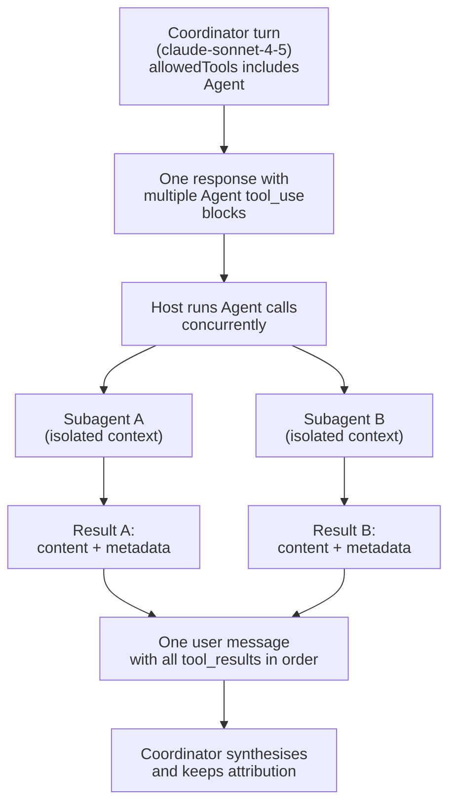

# Task Statement 1.3: Configure Subagent Invocation, Context Passing, and Spawning

> Domain 1 (27% of the exam) · Scenario 3 (Multi-Agent Research System) · [Back to Domain 1](../README.md)

## In One Minute

- **What**: a coordinator spawns subagents with the **`Agent` tool** (called `Task` before Claude Code v2.1.63; `Task` still works as an alias). The coordinator's `allowedTools` must include `"Agent"`.
- **Parallel**: to run subagents at the same time, emit **several `Agent` tool_use blocks in ONE coordinator response**.
- **Context**: a subagent starts empty. Put every fact it needs **in the prompt**.
- **Prompts**: state the goal and quality criteria. Do not write a step-by-step script.
- **Results**: return content and metadata (source URL, document name, page) as separate fields.
- **Exam answer in one line**: `Agent` (formerly `Task`) in `allowedTools`, many `Agent` calls in one turn, explicit context, structured findings.
- **Naming**: if an answer option says `Task` and another says `Agent`, both name the same tool. Pick on the behaviour, not the name.

---

## 🧒 Explain Like I'm 13

**The picture:** Same classroom, but now the question is *how* the teacher hands out the sheets. The hand-out button is the `Agent` tool (formerly `Task`), and it must be switched on (`allowedTools`) or no sheets go out. The teacher should hand out all sheets at the same time, not wait for student 1 to finish before giving student 2 a sheet.

**In plain steps:**
1. Switch the `Agent` tool on.
2. Put every independent job in the **same** response (three `Agent` calls at once).
3. Tell each student the goal and what good looks like, not a click-by-click script.
4. Ask for answers as `finding` plus `source` so nothing loses its label.

**Tiny example:** Three students take 20 seconds each. One at a time = about 60 seconds. All together = about 20 seconds. Only if student 2 needs student 1's answer do you wait.

---

## 📌 Overview

### Why it matters
If the coordinator spawns one subagent per turn, total time is the **sum** of all subagent times. If it spawns them in one turn, total time is about the **slowest** one. Separately, a subagent that returns loose prose loses its sources, so the final report cannot cite anything.

---

## 📖 Concepts Explained

### 1. The Subagent Declaration Standard (`AgentDefinition`)
A production subagent is not merely a generic prompt; it is a formally scoped entity defined by three essential architectural properties:
- **Semantic Description**: Communicates to the coordinator *when* and *for what tasks* this subagent should be invoked. If descriptions are ambiguous or overlap, the coordinator will misroute tasks.
- **System Prompt**: Defines the persona, domain expertise, analytical criteria, and behavioral guardrails specific to the subagent's role.
- **Tool Restriction Whitelist (`allowed_tools`)**: Enforces strict least privilege. A code analyzer receives filesystem read tools (`Read`, `Grep`, `Glob`) but no write tools; a web researcher receives web search tools but no database modification tools.

In [main.py](main.py), this is modeled cleanly via the `AgentDefinition` dataclass, registered in `SUBAGENT_REGISTRY` (`web_researcher`, `code_analyzer`).

### 2. Authorization to Spawn: The `allowedTools` Guardrail
The coordinator agent cannot spawn subagents unless the spawning tool itself is explicitly present in its `allowedTools` configuration. In modern Claude Agent SDK releases, this tool is named `"Agent"` (formerly `"Task"` prior to Claude Code v2.1.63; `"Task"` is retained as an operational alias for backward compatibility):
```python
COORDINATOR_ALLOWED_TOOLS = ["Agent"]  # or ["Task"] in legacy configurations
```
If a system prompt instructs the coordinator to delegate tasks, but `"Agent"` is omitted from `allowedTools`, Claude is physically incapable of emitting the delegation tool call. Furthermore, in agent configuration files (`.claude/agents/*.md`), architects can restrict which subagent personas a thread is permitted to spawn using parameterized syntax: `tools: Agent(worker, researcher), Read`.

### 3. Latency Optimization: Single-Turn Parallel Spawning
In distributed workflows, latency is dominated by sequential model round-trips. If a coordinator decomposes a research goal into three independent subtasks (e.g., investigating web documentation, auditing local test files, and reviewing commit history) and emits one `Agent` call per turn, total execution time is the cumulative sum of all subagent runtimes plus coordinator reasoning overhead:
> `Latency_sequential = Σ(T_subagent_i) + N × T_coordinator`

Claude natively supports emitting **multiple `tool_use` blocks in a single assistant turn**. By prompting the coordinator to identify independent subtasks and emit all corresponding `Agent` calls concurrently, the host executes the subagents in parallel (e.g., via a `ThreadPoolExecutor` or `asyncio.gather`):
> `Latency_parallel ≈ max(T_subagent_i) + T_coordinator`

This yields a **50% to 70% reduction in end-to-end workflow latency**.

> [!IMPORTANT]
> **The Two-Turn Dual-Message Response Rule**: When Claude emits N concurrent `tool_use` blocks in turn K, the host must execute all N tools and return all N matching `tool_result` blocks within a **single user response message** in turn K+1, strictly matching each `tool_use_id`. Returning partial results or interleaving assistant turns causes an HTTP 400 API protocol error.

### 4. Stateless Context Delivery Contract
Subagents do not inherit parent memory, conversation transcripts, or environment scratchpads. They operate as pure functions:
> **Input: Isolated Prompt** → **Execution: Tool Loop** → **Output: Structured Result**
Architects must ensure the coordinator's generated prompt encapsulates every critical entity:
- Specific identifiers (e.g., customer ID `CUST-88319`, order `ORD-2026-9912`, or exact file paths).
- Quantitative constraints and thresholds (e.g., "only papers published after January 2025").
- Target output schemas.

### 5. Goal-Oriented vs. Procedural Prompting
When prompting subagents, architects must distinguish between goal-oriented directives and brittle procedural scripts:
- **Brittle Procedural Prompting (Anti-Pattern)**: *"First call search with query X, click the third link, copy paragraph 2, then run grep on file Y."* If the search tool returns a 404 or page layout shifts, the subagent gets trapped in an error loop and crashes.
- **Goal-Oriented Declarative Prompting (Best Practice)**: *"Extract active patent infringement filings from 2025 involving semiconductor packaging. Return each case with filing date, plaintiff, defendant, and claim amount. If a search yields zero matches, broaden the query to microelectronics."* Declarative prompts empower Claude's internal reasoning loop to navigate tool failures, reformulate queries, and self-correct.

### 6. Decoupling Content from Attribution Metadata
Subagents must return structured payloads that explicitly separate findings from source provenance:
```json
{
  "content": "Claude Code supports project-level and user-level slash commands and skills.",
  "metadata": {
    "source_url": "https://docs.anthropic.com/en/docs/claude-code",
    "doc_title": "Claude Code User Guide",
    "retrieved_at": "2026-10-06T12:00:00Z"
  }
}
```
Keeping metadata in dedicated fields ensures that when the coordinator synthesizes the final report, it can compile rigorous academic or legal citations without performing fragile regex extraction on prose.

---

## 🧪 Worked Example

### ❌ Invalid Example (Anti-Pattern / What Breaks)
*(Anti-Pattern: Sequential Turn Spawning & Assumed Memory)*
```python
# BROKEN: Calling subagents sequentially over multiple turns, assuming they share context
# Turn 1:
response_1 = client.messages.create(
    messages=[{"role": "user", "content": "Analyze customer complaint for CUST-9921"}],
    tools=[AgentTool]
)
# Coordinator emits ONE tool call: Agent(subagent_type="crm_lookup", prompt="Look up customer CUST-9921")
# Wait 8 seconds...

# Turn 2:
# Coordinator emits SECOND tool call: Agent(subagent_type="order_checker", prompt="Check their recent orders")
# Anti-pattern: Subagent 2 has NO IDEA who "their" refers to, because subagents DO NOT inherit context!
# Latency: 8s + 8s = 16 seconds!
```

### ✅ Valid Example (Production Pattern)
*(Production Pattern: Concurrent Spawning & Explicit Context Delivery)*
```python
# CORRECT: Spawning multiple subagents in a single turn with self-contained prompts
# Turn 1: Claude emits BOTH Task/Agent tool calls in ONE response:
#   tool_use_1: Agent(name="web_researcher", prompt="Search official docs for slash commands")
#   tool_use_2: Agent(name="code_analyzer", prompt="Check local .claude/commands/ for custom scripts")

# Host executes both subagents concurrently via asyncio or ThreadPool:
results = await asyncio.gather(
    run_subagent("web_researcher", "Search official docs for slash commands"),
    run_subagent("code_analyzer", "Check local .claude/commands/ for custom scripts")
)
# Latency: max(8s, 8s) = ~8 seconds (50% reduction!)

# Turn 2: Host returns ALL tool_results in ONE user message:
messages.append({"role": "assistant", "content": response.content})
messages.append({
    "role": "user",
    "content": [
        {"type": "tool_result", "tool_use_id": "toolu_A", "content": json.dumps(results[0])},
        {"type": "tool_result", "tool_use_id": "toolu_B", "content": json.dumps(results[1])}
    ]
})
```

**Walkthrough: Official docs & local rule files**
Goal: *"Investigate Claude Code slash commands. Use the web researcher for the official docs and the code analyzer for our local rule files."*

| Step | What happens |
|---|---|
| 1 | Host sends the goal and `tools=[Agent]`. `"Agent"` is in `allowedTools` |
| 2 | Claude replies once with `stop_reason = "tool_use"` and **two** blocks: `Agent(web_researcher, ...)` id `toolu_A`, and `Agent(code_analyzer, ...)` id `toolu_B` |
| 3 | Host runs both subagents at the same time. Total time is bounded by the slower one |
| 4 | Host appends the assistant turn, then **one** user message with `tool_result toolu_A` and `tool_result toolu_B`, in that order |
| 5 | Claude replies `stop_reason = "end_turn"` with the synthesized report |

Each subagent result decouples findings from metadata:
```json
{
  "task_id": "T-WEB",
  "status": "completed",
  "findings": [{
    "content": "Claude Code supports project-level and user-level slash commands and skills.",
    "metadata": {
      "source_url": "https://docs.anthropic.com/en/docs/claude-code",
      "doc_title": "Claude Code User Guide"
    }
  }]
}
```

The report can cite the URL because the metadata stayed attached to the claim.

---

## 🔑 Key Terms

- **`Agent` Tool (formerly `Task`)**: The built-in SDK tool that spawns and executes isolated subagents. (Renamed from `Task` in Claude Code v2.1.63, with backward-compatible aliasing).
- **Tool Whitelist (`allowedTools`)**: The configuration list governing tool execution permissions, which must explicitly contain `"Agent"` (or legacy `"Task"`) for a coordinator to delegate work.
- **Subagent Definition (`AgentDefinition`)**: The structural specification declaring a subagent's role name, specialized system prompt, description, and restricted tool whitelist.
- **Single-Turn Concurrent Spawning**: An orchestration optimization where Claude emits multiple `Agent` tool calls in a single assistant turn, allowing the host to run subagents in parallel and reduce turnaround latency by 50% to 70%.
- **Stateless Context Injection**: Explicitly placing all required entities, constraints, and target schemas into the subagent's invocation prompt, because subagents inherit zero conversation memory from the parent.
- **Metadata Decoupling**: Structuring subagent return payloads to separate factual text (`content`) from its bibliographic citation details (`metadata`: URL, document title, timestamp).
- **Goal-Oriented Declarative Prompting**: Specifying the desired factual outcome and acceptance criteria rather than prescribing rigid procedural tool steps, empowering Claude's internal reasoning loop to self-correct during tool failures.

---

## 🏗️ Architecture



---

## ⚠️ Exam Traps and Correct Patterns

### Trap 1: `Agent` (formerly `Task`) missing from `allowedTools`

**Exam scenario**: The coordinator has `AgentDefinition`s for `searcher` and `analyst`, but never delegates. It tries to do everything itself, badly.

**What really happens**: subagents are spawned by the `Agent` tool. If `"Agent"` is not in the coordinator's `allowedTools`, that tool does not exist for it, so defining agents changes nothing.

```python
# ANTI-PATTERN: agents defined, spawn tool not allowed
options = ClaudeAgentOptions(
    allowed_tools=["Read", "Grep"],
    agents={"searcher": searcher_def, "analyst": analyst_def},
)

# PATTERN
options = ClaudeAgentOptions(
    allowed_tools=["Read", "Grep", "Agent"],
    agents={"searcher": searcher_def, "analyst": analyst_def},
)
```

**Spot it fast**: "subagents are defined but never invoked" points to `allowedTools`.

### Trap 2: One `Agent` call per turn for independent work

**Exam scenario**: Three independent subagents each take about 20 seconds.

| Style | Turns | Wall time |
|---|---|---|
| Sequential: spawn A, wait, spawn B, wait, spawn C | 3 plus synthesis | about 60 s plus overhead |
| Parallel: three `Agent` tool_use blocks in **one** response | 1 plus synthesis | about 20 s plus overhead |

```text
PATTERN (one assistant response):
  tool_use Agent {subagent_type: "searcher",  prompt: "..."}   id=toolu_1
  tool_use Agent {subagent_type: "financial", prompt: "..."}   id=toolu_2
  tool_use Agent {subagent_type: "news",      prompt: "..."}   id=toolu_3
Next user turn: three tool_result blocks, one per id.
```

**Exception**: if B needs A's output, run A first and copy A's result into B's prompt. Parallel is only for independent subtasks.

### Trap 3: Procedural scripts and implied context

```text
ANTI-PATTERN prompt:
  "Step 1: open the 10-Q. Step 2: find the word 'revenue'. Step 3: copy the number."
  -> Breaks when the filing says 'net sales'. Subagent cannot adapt.

PATTERN prompt:
  "Goal: Q3 2026 recognised revenue and cost of goods sold for ACME Corp.
   Quality: figures must match the GAAP table, not the press release.
   Context: ACME reports revenue as 'net sales'. Prior quarter revenue was $41.2M.
   Output: JSON matching RevenueSchema, with page numbers."
```

Give the goal, quality bar, needed facts, and output format. Do not script clicks, and do not write "as discussed earlier".

### Trap 4: Prose findings with no provenance

```text
ANTI-PATTERN: "Margins improved a lot in Q3, according to the filing."
  -> Which filing? Which page? A verification agent cannot check it.

PATTERN:
{
  "finding": "Operating margin expanded by 140 bps year over year.",
  "metadata": {"source_document": "10-Q_Q3_2026.pdf", "page_number": 14,
               "extraction_timestamp": "2026-10-15T09:30:00Z"}
}
```

Keep content and metadata as separate fields so the synthesis step can cite, compare, and de-duplicate sources.

---

## 📝 Exam-Style Practice Questions

**Q1.** A research coordinator needs three independent investigations (financials, legal, patents). It emits one `Agent` call per turn, so the run takes seven round trips. What is the best fix?

- A) Emit all three `Agent` tool_use blocks in a single coordinator response.
- B) Increase `max_tokens` on the coordinator.
- C) Have each subagent spawn the next subagent in the chain.
- D) Describe the three investigations step by step in the system prompt.

**Q2.** A coordinator prompt says to delegate research to subagents, but no subagent is ever spawned. The agent configuration lists `allowedTools=["Read", "Grep"]`. What is the most likely fix?

- A) Add `"Agent"` (formerly `"Task"`) to the coordinator's `allowedTools`.
- B) Raise `budget_tokens` for extended thinking.
- C) Give each subagent the full coordinator history.
- D) Lower the temperature to make delegation more consistent.

**Q3.** Subagents return paragraph summaries. The final report contains claims, but nobody can tell which document or page each claim came from. What is the best change?

- A) Ask the coordinator to guess the sources while writing.
- B) Require structured results that keep the claim (content) separate from metadata such as source URL, document name, and page.
- C) Remove the sources to save tokens.
- D) Set `temperature` to 0 on the subagents.

### Answers

**Q1: A.**
- B) `max_tokens` only changes output length. It does not change how many round trips happen.
- C) Chaining makes the work sequential and drops the coordinator as the single hub.
- D) A step-by-step prompt does not create parallelism. Multiple tool calls in one response does.

**Q2: A.**
- B) Thinking budget does not give the coordinator the ability to spawn.
- C) History does not enable spawning, and subagents are meant to be isolated.
- D) Sampling settings do not control which tools are available. (Also, with thinking on, `temperature` is rejected.)

**Q3: B.**
- A) Guessing sources causes made-up citations.
- C) This removes the information that makes claims verifiable.
- D) Temperature does not make free text structured or add provenance.

---

## ✅ Self-Check Checklist

- [ ] I can say why `"Agent"` (formerly `"Task"`) must be in `allowedTools`.
- [ ] I can explain what an `AgentDefinition` contains.
- [ ] I know parallel spawning means several `Agent` blocks in one response.
- [ ] I pass context in the prompt, because subagents inherit nothing.
- [ ] I write goal prompts and return content and metadata separately.

**Memory hook**: *"Agent in the list, many in one turn, everything in the prompt."*

---

## 🛠️ Hands-on Workbook Guide

Open [ts_1_3_subagent_invocation_spawning.ipynb](ts_1_3_subagent_invocation_spawning.ipynb) (offline, mock client):

1. **Setup**: test harness.
2. **Workers**: simulated subagents that return `{content, metadata}`.
3. **Dispatcher**: handles `Task` calls from one coordinator response.
4. **Simulation**: one response with two `Task` blocks.
5. **Checks**: two subagents ran, and metadata stayed attached.

Code: [main.py](main.py) (live API, run manually only) · Offline tests: [tests/test_domain1_enhancements.py](../../tests/test_domain1_enhancements.py)

---

## 🧭 Navigation & Study Links
- ⬅️ **Previous Topic**: [TS 1.2: Coordinator-Subagent Patterns & Topologies](../ts_1_2_coordinator_subagents/README.md)
- 📋 **Domain Overview**: [Domain 1: Agentic Architecture & Orchestration](../README.md)
- ➡️ **Next Topic**: [TS 1.4: Multi-Step Workflow Enforcement](../ts_1_4_prerequisite_enforcement/README.md)
- 🎯 **Scenario Practice**: [Master Scenario Practice](../../scenarios/MASTER_SCENARIO_PRACTICE.md)
