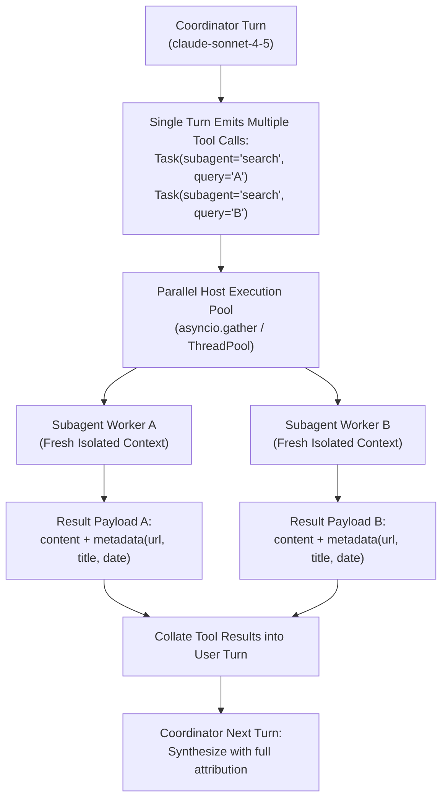

# Task Statement 1.3: Configure Subagent Invocation, Context Passing, and Spawning

## 📌 Executive Overview: Goal, Scope & Exam Importance

### Certification Domain & Weight
- **Domain**: Domain 1: Agentic Architecture & Orchestration
- **Domain Weight**: 27% of total CCAR-F exam score
- **Scenario Alignment**: Scenario 3 (Multi-Agent Research System)

### The Core Goal
To master the mechanics of spawning subagents via the Agent SDK `Task` tool primitive, execute **parallel subagent invocations in a single model turn**, construct **goal-oriented delegation prompts**, and preserve rigorous **source attribution metadata** across agent boundaries.

### Why This Matters in Production
In enterprise research, data extraction, and code auditing, tasks often require querying multiple independent repositories, databases, or web sources. If a coordinator agent spawns subagents sequentially—waiting for Subagent 1 to return before spawning Subagent 2—total turnaround latency scales linearly with task count ($T_{total} = \sum t_i$), violating customer latency SLAs.
Furthermore, if context passing is informal or unstructured, subagents lose source attribution (authors, URLs, timestamps), resulting in synthetic hallucinations where the coordinator cannot verify which document contributed which fact.

### Exam Importance
Task Statement 1.3 is a cornerstone of orchestration efficiency. Exam questions frequently probe whether you recognize that multiple `Task` tool calls can and should be emitted in a **single coordinator turn**, that `Task` must be included in `allowedTools`, and that subagent prompts must be goal-oriented rather than keystroke-level procedural commands.

---

## 📖 Deep Narrative: Why We Do What We Do

### 1. The Problem: The Sequential Round-Trip Bottleneck
Consider a coordinator researching three aspects of an acquisition target: Financials, Legal Liabilities, and Patent Portfolios.
- **The Naive Sequential Pattern**:
  - Turn 1: Coordinator calls `Task(subagent='financial')`.
  - Turn 2: Host runs financial agent, returns findings.
  - Turn 3: Coordinator calls `Task(subagent='legal')`.
  - Turn 4: Host runs legal agent, returns findings.
  - Turn 5: Coordinator calls `Task(subagent='patent')`.
  - Turn 6: Host runs patent agent, returns findings.
  - Turn 7: Coordinator synthesizes final response.
- **Production Consequence**: 7 API round-trips over the network! If each subagent takes 5 seconds, total wall-clock time exceeds 35 seconds, exhausting timeouts.

### 2. The Architectural Solution: Single-Turn Parallel Spawning
In Claude's tool-calling architecture, Claude can emit **multiple tool calls in a single assistant turn**:
```json
{
  "role": "assistant",
  "content": [
    {"type": "tool_use", "id": "task_1", "name": "Task", "input": {"subagent": "financial", "prompt": "..."}},
    {"type": "tool_use", "id": "task_2", "name": "Task", "input": {"subagent": "legal", "prompt": "..."}},
    {"type": "tool_use", "id": "task_3", "name": "Task", "input": {"subagent": "patent", "prompt": "..."}}
  ]
}
```
- **The Parallel Pattern**:
  - Turn 1: Coordinator emits all 3 `Task` calls simultaneously.
  - Execution: The host application runs all 3 subagents concurrently in a Python `ThreadPoolExecutor` or `asyncio.gather()`.
  - Turn 2: The host returns all 3 `tool_result` blocks in a single user turn.
  - Turn 3: Coordinator synthesizes the complete findings.
- **Latency Gain**: Total time drops from 35s to ~7s (the duration of the slowest subagent plus coordinator overhead).

### 3. Context Passing & Attribution Preservation
Subagents do not inherit parent memory. Therefore, the coordinator must pass:
1. **Goal-Oriented Instructions**: State the desired objective and acceptance criteria (e.g., *"Extract all active patent litigation cases filed after 2024 with dollar claim amounts"*), rather than micromanaging low-level button clicks.
2. **Attribution Separation**: Subagents must return data partitioned into `content` (the factual finding) and `metadata` (URL, document ID, page number, timestamp). This prevents factual contamination and ensures auditability.

---

## 🔑 Key Technical Terminology Explained

- **`Task` Tool**: The canonical Agent SDK primitive used by an orchestrator to spawn and delegate work to child subagents. The coordinator's `allowedTools` array must explicitly list `"Task"`.
- **Parallel Tool Use**: Claude's ability to emit multiple `tool_use` blocks in a single response message when multiple independent actions are required.
- **Goal-Oriented Delegation**: Prompting subagents with high-level objectives, quality standards, and constraints, granting the subagent autonomy to navigate its assigned tool suite.
- **Attribution Metadata**: Provenance details (e.g. `source_url`, `filing_date`, `table_reference`) returned alongside factual claims to guarantee verifiability during final coordinator synthesis.
- **Concurrency Pool**: The host-side execution environment (`asyncio` / worker threads) that processes parallel tool calls simultaneously.

---

## 🏗️ Architecture: Parallel Spawning & Attribution Flow



---

## ⚠️ Critical Exam Distinctions & Distractor Teardown

| Spawning / Delegation Technique | Correct Architectural Implementation | Exam Trap to Reject | Why the Trap Fails |
|---|---|---|---|
| **Subagent Spawning Mechanism** | Use the SDK `Task` tool with subagent specification in `allowedTools`. | **TRAP**: Calling arbitrary local shell scripts (`bash python subagent.py`) directly from model output. | Bypasses SDK lifecycle hooks, breaks structured error handling, and introduces remote code execution risks. |
| **Spawning Latency Optimization** | **Parallel Spawning**: Emit multiple `Task` tool calls in a **single** coordinator turn. | **TRAP**: Emitting one `Task` call per turn sequentially across multiple network hops. | Multiplies turnaround time linearly by the number of subagents, violating enterprise SLAs. |
| **Memory Inheritance** | **Explicit Context Passing**: Provide complete instructions and input parameters in the subagent prompt. | **TRAP**: Assuming the spawned subagent automatically inherits the parent conversation transcript. | Subagents run in isolated sessions; assuming shared memory causes missing variable hallucinations. |
| **Prompting Style** | **Goal-Oriented Prompting**: Define objectives, constraints, and schemas. | **TRAP**: Procedural micromanagement detailing every intermediate CLI command. | Restricts agent adaptability when navigating tool failures or unexpected API responses. |

---

## 💡 Architectural Decision Matrix: Rules of Thumb

| Architectural Dilemma | Recommended Choice | Rapid 30-Second Decision Rule |
|---|---|---|
| **Sequential vs Parallel Spawning?** | Parallel in single turn | If subtasks are mutually independent, emit all `Task` calls in one turn. |
| **How to pass context to subagents?** | Explicit parameters in prompt | Never pass the full parent chat history; pass only the specific data needed for the subtask. |
| **How to preserve citations?** | Structured `metadata` dictionary | Separate factual snippets from source URLs, page numbers, and dates to enable clean references. |

---

## 🧠 Claude 4.5 Extended Thinking & Parameter Standards

- **Parallel Tool Decision**: When Extended Thinking is enabled (`budget_tokens: 2048`), Claude evaluates the entire user query during its thinking phase, maps independent facets, and constructs multiple `Task` calls in its first output block.
- **Sampling Rules**: Omit `temperature` across both coordinator and child subagent calls.
- **Thinking Blocks**: Maintain thinking blocks with cryptographic signatures in subsequent coordinator turns as subagent results are evaluated.

---

## 🛠️ Hands-on Workbook Guide: Following the Code Step-by-Step

When exploring [`ts_1_3_subagent_invocation_spawning.ipynb`](ts_1_3_subagent_invocation_spawning.ipynb):
1. **Step 1: Environment & Setup**: Sets up the offline test harness and `ResponseTrail` logger.
2. **Step 2: Subagent Worker Setup**: Implements isolated research workers that return structured `{content, metadata}` bundles.
3. **Step 3: Single-Turn Parallel Spawning**: Simulates the coordinator emitting multiple `Task` invocations in turn 1.
4. **Step 4: Concurrency & Aggregation**: Demonstrates parallel execution, collation into `tool_result` blocks, and multi-source synthesis.
5. **Step 5: Verification & Safety Assertions**: Verifies that parallel invocations execute cleanly and maintain 100% source attribution.
