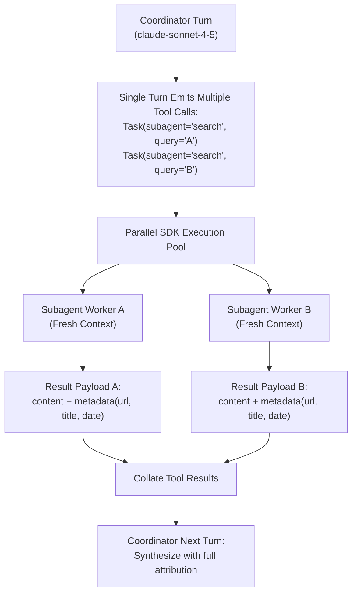

# Task Statement 1.3: Configure Subagent Invocation, Context Passing, and Spawning

## 🎯 Exam Objective
Understand how to spawn subagents using the Agent SDK `Task` tool, trigger parallel execution in a single model turn, pass explicit goal-oriented context, and preserve citation attribution across subagent boundaries.

---

## 🏗️ Architecture: Parallel Spawning & Attribution Flow

---

## ⚠️ Critical Exam Distinctions & Anti-Patterns

| Concept | Correct Implementation | Exam Trap to Reject |
|---|---|---|
| **Subagent Spawning Mechanism** | Use the SDK `Task` tool with subagent specification in `allowedTools`. | **TRAP**: Calling arbitrary shell scripts or non-standard external endpoints directly. |
| **Spawning Latency Optimization** | **Parallel Spawning**: Emit multiple `Task` tool use blocks in a **single** coordinator turn. | **TRAP**: Emitting one `Task` call per turn sequentially, multiplying round-trip latency. |
| **Context Transmission** | **Explicit Context Passing**: Provide complete instructions and input data in the subagent prompt. | **TRAP**: Assuming the spawned subagent inherits parent conversation memory or global session state. |
| **Source Attribution** | Maintain structured separation between `content` and `metadata` (source URL, author, timestamp). | **TRAP**: Merging raw text with citations flattened into unparseable prose. |
| **Prompt Delegation Style** | **Goal-oriented**: Define desired outcome and quality constraints (e.g. "Find API rate limits and SLAs"). | **TRAP**: Over-specifying rigid keystroke-level procedural commands that defeat agent flexibility. |

---

## 💡 Architectural Decision Matrix

| Dimension | Recommended Pattern | Rationale |
|---|---|---|
| **Spawning Topology** | Fan-out in single turn, gather in next turn | Minimizes Claude API network hops and reduces total wall-clock latency for research tasks. |
| **Attribution Contract** | Typed JSON schema with explicit metadata fields | Prevents source hallucination during final synthesis and guarantees auditability. |
| **Subagent Scope** | Bounded single-responsibility tasks | Keeps subagent prompts concise and prevents tool search saturation. |

---

## 🛠️ Production Code Reference
- Interactive Workbook: [`ts_1_3_subagent_invocation_spawning.ipynb`](ts_1_3_subagent_invocation_spawning.ipynb)
- Runnable Script: [`main.py`](main.py)
- Offline Verification: Run via `uv run pytest tests/test_domain1_full.py` in WSL.
