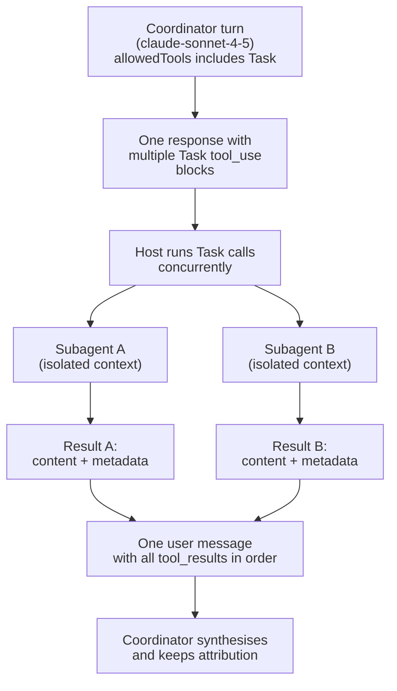

# Task Statement 1.3: Configure Subagent Invocation, Context Passing, and Spawning

> Domain 1 (27% of the exam) · Scenario 3 (Multi-Agent Research System) · [Back to Domain 1](../README.md)

## In One Minute

- **What**: a coordinator spawns subagents with the **`Task` tool**. The coordinator's `allowedTools` must include `"Task"`.
- **Parallel**: to run subagents at the same time, emit **several `Task` tool_use blocks in ONE coordinator response**.
- **Context**: a subagent starts empty. Put every fact it needs **in the prompt**.
- **Prompts**: state the goal and quality criteria. Do not write a step-by-step script.
- **Results**: return content and metadata (source URL, document name, page) as separate fields.
- **Exam answer in one line**: `Task` in `allowedTools`, many `Task` calls in one turn, explicit context, structured findings.

---

## 🧒 Explain Like I'm 13

**The picture:** Same classroom, but now the question is *how* the teacher hands out the sheets. The hand-out button is the `Task` tool, and it must be switched on (`allowedTools`) or no sheets go out. The teacher should hand out all sheets at the same time, not wait for student 1 to finish before giving student 2 a sheet.

**In plain steps:**
1. Switch the `Task` tool on.
2. Put every independent job in the **same** response (three `Task` calls at once).
3. Tell each student the goal and what good looks like, not a click-by-click script.
4. Ask for answers as `finding` plus `source` so nothing loses its label.

**Tiny example:** Three students take 20 seconds each. One at a time = about 60 seconds. All together = about 20 seconds. Only if student 2 needs student 1's answer do you wait.

---

## 📌 Overview

### Why it matters
If the coordinator spawns one subagent per turn, total time is the **sum** of all subagent times. If it spawns them in one turn, total time is about the **slowest** one. Separately, a subagent that returns loose prose loses its sources, so the final report cannot cite anything.

---

## 📖 Concepts Explained

### 1. Configure the subagent: `AgentDefinition`
An `AgentDefinition` has a **description** (so the coordinator knows when to use it), a **system prompt** (its role), and **tool restrictions** (only the tools it needs). In [main.py](main.py), `AgentDefinition` is a dataclass with `name`, `description`, `system_prompt`, `allowed_tools`, kept in `SUBAGENT_REGISTRY` (`web_researcher`, `code_analyzer`).

### 2. Allow the spawn
The coordinator can only spawn if `"Task"` is in its `allowedTools`. Here it is `COORDINATOR_ALLOWED_TOOLS = ["Task"]`, and `run_parallel_spawning_coordinator` only offers `TASK_TOOL` to the model when `"Task"` is allowed.

### 3. Pass context explicitly
A subagent inherits nothing. A good `prompt` field contains the goal, the facts found so far, the quality bar, and the output format. If a finding from another subagent matters, the coordinator copies it in.

Fork-based sessions (`fork_session`, see [TS 1.7](../ts_1_7_session_management/README.md)) are a different way to branch work from a shared baseline.

### 4. Spawn in parallel
Claude can emit more than one `tool_use` block in a single response. For independent subtasks, emit one `Task` block per subtask in the **same** response.

The host in [main.py](main.py) runs those blocks with a `ThreadPoolExecutor`. `pool.map` returns results in the **same order as the tool_use blocks**. The host then answers **every** `tool_use` block in one user message. A block that is not an allowed tool gets an `is_error` `tool_result`, so the history is never left with an unanswered `tool_use`.

### 5. Prompt for goals, not steps
- Goal style: *"Find active patent cases filed after 2024 with claim amounts. Cite a source for each."*
- Procedure style (avoid): *"Open site X, click Y, copy the third row..."*

Goals let the subagent adapt when a tool fails. Procedures break the first time something is different.

### 6. Content versus metadata
Each finding is `{"content": ..., "metadata": {"source_url", "doc_title", ...}}`. The coordinator can then keep the claim and its source together when it writes the report.

---

## 🧪 Worked Example

Goal: *"Investigate Claude Code slash commands. Use the web researcher for the official docs and the code analyzer for our local rule files."*

| Step | What happens |
|---|---|
| 1 | Host sends the goal and `tools=[Task]`. `"Task"` is in `allowedTools` |
| 2 | Claude replies once with `stop_reason = "tool_use"` and **two** blocks: `Task(web_researcher, ...)` id `toolu_A`, and `Task(code_analyzer, ...)` id `toolu_B` |
| 3 | Host runs both subagents at the same time. Total time is about the slower one |
| 4 | Host appends the assistant turn, then **one** user message with `tool_result toolu_A` and `tool_result toolu_B`, in that order |
| 5 | Claude replies `stop_reason = "end_turn"` with a report |

Each result looks like this:

```json
{
  "task_id": "T-WEB",
  "status": "completed",
  "findings": [{
    "content": "Claude Code supports project-level and user-level slash commands and skills.",
    "metadata": {"source_url": "https://docs.anthropic.com/en/docs/claude-code",
                 "doc_title": "Claude Code User Guide"}
  }]
}
```

The report can cite the URL because the metadata stayed attached to the claim.

---

## 🔑 Key Terms

- **`Task` tool**: the Agent SDK tool that spawns a subagent.
- The exam calls the subagent-spawning tool `Task`; current Claude Code docs call the same built-in tool `Agent`. Treat them as the same idea.
- **`allowedTools`**: the tools the coordinator may use. Must include `"Task"` to spawn.
- **`AgentDefinition`**: a subagent's description, system prompt, and tool restrictions.
- **Parallel spawning**: multiple `Task` tool_use blocks in one response.
- **Context passing**: putting needed facts into the subagent prompt.
- **Content vs metadata**: the claim, and where it came from.
- **Goal-oriented prompt**: objective plus quality criteria, no step-by-step script.

---

## 🏗️ Architecture



---

## ⚠️ Exam Traps and Correct Patterns

### Trap 1: `Task` missing from `allowedTools`

**Exam scenario**: The coordinator has `AgentDefinition`s for `searcher` and `analyst`, but never delegates. It tries to do everything itself, badly.

**What really happens**: subagents are spawned by the `Task` tool. If `"Task"` is not in the coordinator's `allowedTools`, that tool does not exist for it, so defining agents changes nothing.

```python
# ANTI-PATTERN: agents defined, spawn tool not allowed
options = ClaudeAgentOptions(
    allowed_tools=["Read", "Grep"],
    agents={"searcher": searcher_def, "analyst": analyst_def},
)

# PATTERN
options = ClaudeAgentOptions(
    allowed_tools=["Read", "Grep", "Task"],
    agents={"searcher": searcher_def, "analyst": analyst_def},
)
```

**Spot it fast**: "subagents are defined but never invoked" points to `allowedTools`.

### Trap 2: One `Task` call per turn for independent work

**Exam scenario**: Three independent subagents each take about 20 seconds.

| Style | Turns | Wall time |
|---|---|---|
| Sequential: spawn A, wait, spawn B, wait, spawn C | 3 plus synthesis | about 60 s plus overhead |
| Parallel: three `Task` tool_use blocks in **one** response | 1 plus synthesis | about 20 s plus overhead |

```text
PATTERN (one assistant response):
  tool_use Task {subagent_type: "searcher",  prompt: "..."}   id=toolu_1
  tool_use Task {subagent_type: "financial", prompt: "..."}   id=toolu_2
  tool_use Task {subagent_type: "news",      prompt: "..."}   id=toolu_3
Next user turn: three tool_result blocks, one per id.
```

**Exception**: if B needs A's output, run A first and copy A's result into B's prompt. Parallel is only for independent subtasks.

### Trap 3: Procedural scripts and implied context

```text
ANTI-PATTERN prompt:
  "Step 1: open the 10-Q. Step 2: find the word 'revenue'. Step 3: copy the number."
  -> Breaks when the filing says 'net sales'. Subagent cannot adapt.

PATTERN prompt:
  "Goal: Q3 2026 recognised revenue and cost of goods sold for ACME Corp.
   Quality: figures must match the GAAP table, not the press release.
   Context: ACME reports revenue as 'net sales'. Prior quarter revenue was $41.2M.
   Output: JSON matching RevenueSchema, with page numbers."
```

Give the goal, quality bar, needed facts, and output format. Do not script clicks, and do not write "as discussed earlier".

### Trap 4: Prose findings with no provenance

```text
ANTI-PATTERN: "Margins improved a lot in Q3, according to the filing."
  -> Which filing? Which page? A verification agent cannot check it.

PATTERN:
{
  "finding": "Operating margin expanded by 140 bps year over year.",
  "metadata": {"source_document": "10-Q_Q3_2026.pdf", "page_number": 14,
               "extraction_timestamp": "2026-10-15T09:30:00Z"}
}
```

Keep content and metadata as separate fields so the synthesis step can cite, compare, and de-duplicate sources.

---

## 📝 Exam-Style Practice Questions

**Q1.** A research coordinator needs three independent investigations (financials, legal, patents). It emits one `Task` call per turn, so the run takes seven round trips. What is the best fix?

- A) Emit all three `Task` tool_use blocks in a single coordinator response.
- B) Increase `max_tokens` on the coordinator.
- C) Have each subagent spawn the next subagent in the chain.
- D) Describe the three investigations step by step in the system prompt.

**Q2.** A coordinator prompt says to delegate research to subagents, but no subagent is ever spawned. The agent configuration lists `allowedTools=["Read", "Grep"]`. What is the most likely fix?

- A) Add `"Task"` to the coordinator's `allowedTools`.
- B) Raise `budget_tokens` for extended thinking.
- C) Give each subagent the full coordinator history.
- D) Lower the temperature to make delegation more consistent.

**Q3.** Subagents return paragraph summaries. The final report contains claims, but nobody can tell which document or page each claim came from. What is the best change?

- A) Ask the coordinator to guess the sources while writing.
- B) Require structured results that keep the claim (content) separate from metadata such as source URL, document name, and page.
- C) Remove the sources to save tokens.
- D) Set `temperature` to 0 on the subagents.

### Answers

**Q1: A.**
- B) `max_tokens` only changes output length. It does not change how many round trips happen.
- C) Chaining makes the work sequential and drops the coordinator as the single hub.
- D) A step-by-step prompt does not create parallelism. Multiple tool calls in one response does.

**Q2: A.**
- B) Thinking budget does not give the coordinator the ability to spawn.
- C) History does not enable spawning, and subagents are meant to be isolated.
- D) Sampling settings do not control which tools are available. (Also, with thinking on, `temperature` is rejected.)

**Q3: B.**
- A) Guessing sources causes made-up citations.
- C) This removes the information that makes claims verifiable.
- D) Temperature does not make free text structured or add provenance.

---

## ✅ Self-Check Checklist

- [ ] I can say why `"Task"` must be in `allowedTools`.
- [ ] I can explain what an `AgentDefinition` contains.
- [ ] I know parallel spawning means several `Task` blocks in one response.
- [ ] I pass context in the prompt, because subagents inherit nothing.
- [ ] I write goal prompts and return content and metadata separately.

**Memory hook**: *"Task in the list, many in one turn, everything in the prompt."*

---

## 🛠️ Hands-on Workbook Guide

Open [ts_1_3_subagent_invocation_spawning.ipynb](ts_1_3_subagent_invocation_spawning.ipynb) (offline, mock client):

1. **Setup**: test harness.
2. **Workers**: simulated subagents that return `{content, metadata}`.
3. **Dispatcher**: handles `Task` calls from one coordinator response.
4. **Simulation**: one response with two `Task` blocks.
5. **Checks**: two subagents ran, and metadata stayed attached.

Code: [main.py](main.py) (live API, run manually only) · Offline tests: [tests/test_domain1_enhancements.py](../../tests/test_domain1_enhancements.py)
