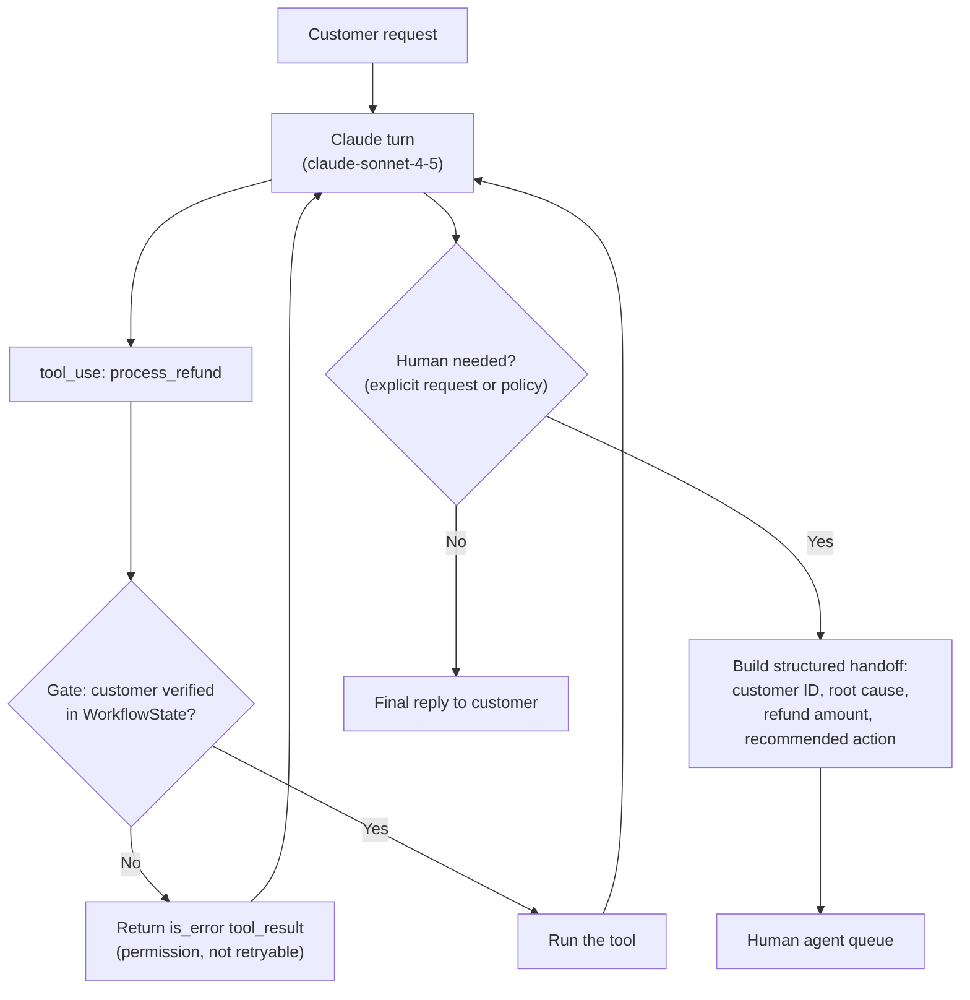

# Task Statement 1.4: Implement Multi-Step Workflows with Enforcement and Handoff Patterns

> Domain 1 (27% of the exam) · Scenario 1 (Customer Support Resolution Agent) · [Back to Domain 1](../README.md)

## In One Minute

- **What**: some steps must happen in a fixed order (verify the customer **before** a refund). Enforce that order in **code**.
- **Why**: a prompt rule works most of the time. "Most of the time" is not enough for money or identity.
- **Handoff**: when a human takes over, send a short **structured summary**, not the whole transcript.
- **Multi-concern requests**: split them into separate items, work each one, then answer together.
- **Exam answer in one line**: for a required order of tools, choose a **programmatic prerequisite**, not a prompt, few-shot examples, or a routing classifier.

---

## 📌 Overview

### Why it matters
Suppose an agent skips `get_customer` in 12% of refund requests. Some refunds then go to the wrong account. Adding "always verify first" to the prompt lowers the rate. It does not make it zero, because the model is probabilistic. Code makes it zero: the tool simply refuses to run until verification has happened.

### What the exam tests
- **Programmatic enforcement** versus prompt-based guidance when compliance must be deterministic.
- **Structured handoff summaries** for a human who cannot see the transcript.
- **Decomposing** multi-concern customer requests.
- Rejecting wrong fixes for the "12% skip verification" sample: stronger prompt, few-shot examples, or a routing classifier.

---

## 📖 Concepts Explained

### 1. The simple idea
Put a **gate** in front of the risky tool. The gate checks state the code has recorded (for example "customer verified"). If the check fails, the tool does not run, and Claude gets an error telling it what to do first.

### 2. How the gate works in this repo
In [main.py](main.py), `WorkflowState` records `verified_customer_id`. The tool `get_customer` sets it. `WorkflowState.check_gate` runs before **every** tool call in `execute_dispatched_tool`:

- `process_refund` and `lookup_order` are blocked until a customer is verified.
- A blocked call returns `{"isError": true, "errorCategory": "permission", "isRetryable": false, "message": ...}`, and the loop marks the `tool_result` with `is_error: true`.
- `lookup_order` also checks that the order belongs to the verified customer.

Claude reads the error, calls `get_customer`, and tries again. The model is still in charge of the conversation. The code only closes the unsafe path.

The gate in the code requires a verified customer. It does **not** require a prior `lookup_order` before a refund. The refund-amount limit lives in the hook of [TS 1.5](../ts_1_5_sdk_hooks/README.md).

### 3. Prompt versus code

| Use | Good for |
|---|---|
| Prompt, examples | Tone, style, how to handle normal cases |
| Code gate or hook | Order of steps, identity, money, permissions |

### 4. Structured handoff
A human agent picking up the case does not have the transcript. `escalate_to_human` builds a summary:

```json
{
  "customer_id": "CUST-101",
  "customer_name": "Alice Smith",
  "root_cause": "Damaged goods in transit",
  "refund_amount": 750.0,
  "recommended_action": "Approve a one-time supervisor exception refund",
  "handoff_timestamp": "2026-10-06T12:00:00Z"
}
```

The human can act in seconds. If the customer **explicitly asks for a human**, escalate right away, without arguing. Sentiment or the model's self-reported confidence are weak triggers.

### 5. Multi-concern requests
A message like *"refund order 991, update my address, and where is my other parcel?"* has three concerns. Break it into three items. Investigate each (independent ones can run in parallel, sharing the verified customer context). Then write one combined answer.

---

## 🧪 Worked Example

Customer: *"Hi, I'm Alice (alice@example.com). Look up ORD-991 and process my refund."*

| Turn | Claude | Host / gate |
|---|---|---|
| 1 | `tool_use`: `process_refund(ORD-991, 85.0)` (skips verification) | Gate blocks. `tool_result` has `is_error: true`, `errorCategory: "permission"`, "verify identity first" |
| 2 | `tool_use`: `get_customer("alice@example.com")` | Found. State now holds `CUST-101` |
| 3 | `tool_use`: `lookup_order("ORD-991")` | Belongs to `CUST-101`. Amount 85.0, eligible |
| 4 | `tool_use`: `process_refund(ORD-991, 85.0)` | Gate allows. Refund id returned |
| 5 | `end_turn`: confirmation to Alice | Loop ends |

The unsafe call in turn 1 never executed. No prompt wording could have promised that. (`max_turns=5` is a safety cap, so longer workflows need a higher value.)

---

## 🔑 Key Terms

- **Programmatic prerequisite (gate)**: code that blocks a tool until required earlier steps are done.
- **Deterministic vs probabilistic**: code always applies the rule. A prompt usually does.
- **Structured handoff summary**: customer ID, root cause, refund amount, recommended action.
- **Explicit human request**: a customer asking for a person. Escalate immediately.
- **Decomposition**: splitting a multi-concern message into separate items.

---

## 🏗️ Architecture



---

## ⚠️ Exam Traps and Correct Patterns

| Topic | Correct pattern | Trap | Why the trap fails |
|---|---|---|---|
| **Required tool order** | Programmatic prerequisite in code | Stronger prompt wording | Still probabilistic. Some runs will skip the step |
| **Required tool order** | Programmatic prerequisite in code | Few-shot examples of correct order | Raises the odds. Does not guarantee |
| **Required tool order** | Programmatic prerequisite in code | A routing classifier for the tool | Routes requests. Does not enforce the order inside the workflow |
| **Handoff** | Structured summary | Dump the full transcript | The human must read it all, and may not have it |
| **Escalation trigger** | Explicit request or policy rule | Sentiment score | Sentiment does not tell you whether the case is hard |
| **Customer asks for a human** | Escalate now | Ask them to justify it first | Frustrates the customer |

---

## ❌ Common Mistakes

- Using the prompt as the security control for money or identity.
- Writing a gate but letting Claude call the tool through a second path that skips it.
- Returning a vague error. Say what is missing ("verify the customer first") so Claude can recover.
- Sending a human the raw chat log with no root cause or recommended action.
- Handling a three-issue message as one blob and answering only one issue.

---

## 💡 Quick Decision Rules

| Question | Answer |
|---|---|
| Must step A always come before step B? | Code gate |
| Is it about style or tone? | Prompt |
| Handing off to a person? | Structured summary |
| Customer says "get me a human"? | Escalate immediately |
| Message has several problems? | Decompose, work each, combine |

---

## 🧠 Claude 4.5 Notes

- Models: `claude-sonnet-4-5` for the support agent loop (`COORDINATOR_MODEL` in [main.py](main.py)), `claude-haiku-4-5` for simple workers.
- Extended thinking: `thinking={"type": "enabled", "budget_tokens": N}` with `N >= 1024` and `N < max_tokens`.
- With thinking on: no `temperature` (HTTP 400), leave `top_k` and `top_p` unset, and `tool_choice` only `auto` or `none`. Do not try to force `get_customer` with a named `tool_choice` on a thinking request. Use a gate instead.
- Echo assistant content (with `thinking` blocks and `signature`) back unchanged after a gate error.

---

## 📝 Exam-Style Practice Questions

**Q1.** In a support agent, about 12% of refund requests skip `get_customer`, and some refunds reach the wrong account. Policy requires verified identity every time. Which change is best?

- A) Add a stronger instruction to the system prompt: "ALWAYS call get_customer first."
- B) Add few-shot examples that show `get_customer` before `process_refund`.
- C) Add a routing classifier that sends refund requests to a specialised agent.
- D) Add a programmatic prerequisite that blocks `process_refund` until `get_customer` has returned a verified customer ID.

**Q2.** An agent escalates a $750 refund to a human who has no access to the chat. What should the handoff contain?

- A) Only the phrase "customer needs help".
- B) A structured summary: customer ID, root cause, refund amount, and recommended action.
- C) The full 40-turn transcript and nothing else.
- D) The customer's sentiment score.

**Q3.** A customer writes: "Refund order 991, change my shipping address, and tell me where parcel 992 is." What is the best approach?

- A) Answer the refund only and ask the customer to send the other two requests separately.
- B) Answer from general knowledge without calling tools.
- C) Decompose into three items, investigate each (in parallel where independent, sharing the verified customer context), then give one combined answer.
- D) Escalate every message that has more than one request.

### Answers

**Q1: D.**
- A) A stronger prompt reduces the rate but cannot make it zero.
- B) Few-shot examples also only raise the odds.
- C) A router picks an agent. It does not guarantee tool order inside the workflow.

**Q2: B.**
- A) The human has no facts to act on.
- C) The human cannot use a transcript they do not have, and a long one buries the key facts.
- D) A sentiment score gives no root cause or action.

**Q3: C.**
- A) Pushes work back to the customer and leaves two issues unresolved.
- B) Account-specific answers need tool data.
- D) Multiple concerns can be solved by the agent. They do not by themselves need a human.

---

## ✅ Self-Check Checklist

- [ ] I can explain why a prompt rule is not a guarantee.
- [ ] I can describe the gate: state flag, check before the tool, structured error back to Claude.
- [ ] I know what goes in a handoff summary (customer ID, root cause, refund amount, recommended action).
- [ ] I escalate immediately when a customer explicitly asks for a human.
- [ ] I can say how to handle a multi-concern request.

**Memory hook**: *"If it must always happen, put it in code."*

---

## 🛠️ Hands-on Workbook Guide

Open [ts_1_4_prerequisite_enforcement.ipynb](ts_1_4_prerequisite_enforcement.ipynb) (offline, mock client):

1. **Setup**: session state and logger.
2. **Gated tool handler**: block the refund until identity is verified.
3. **Simulation**: an unverified refund is blocked, the customer is verified, then the refund succeeds.
4. **Handoff**: build the structured summary (customer ID, root cause, refund amount, recommended action).
5. **Checks**: assertions on the `permission` error, the state change, and the handoff.

Code: [main.py](main.py) (live API, run manually only) · Offline tests: [tests/test_domain1_enhancements.py](../../tests/test_domain1_enhancements.py)
