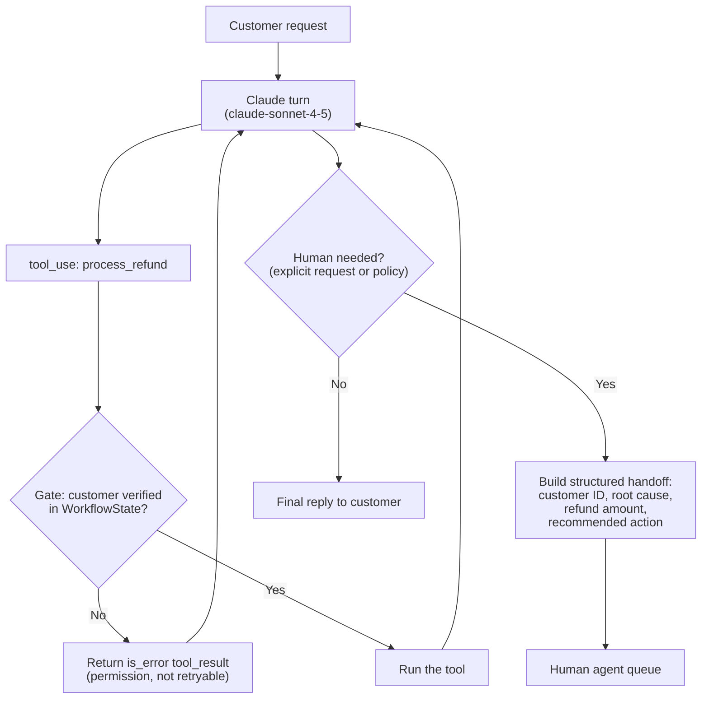

# Task Statement 1.4: Implement Multi-Step Workflows with Enforcement and Handoff Patterns

> Domain 1 (27% of the exam) · Scenario 1 (Customer Support Resolution Agent) · [Back to Domain 1](../README.md)

## In One Minute

- **What**: some steps must happen in a fixed order (verify the customer **before** a refund). Enforce that order in **code**.
- **Why**: a prompt rule works most of the time. "Most of the time" is not enough for money or identity.
- **Handoff**: when a human takes over, send a short **structured summary**, not the whole transcript.
- **Multi-concern requests**: split them into separate items, work each one, then answer together.
- **Exam answer in one line**: for a required order of tools, choose a **programmatic prerequisite**, not a prompt, few-shot examples, or a routing classifier.

---

## 🧒 Explain Like I'm 13

**The picture:** A theme-park ride. A sign saying "You must be this tall" is the **prompt**: most kids obey, some sneak by. A metal bar that physically blocks you is the **code gate**: nobody gets past. For money or identity, use the bar.

**In plain steps:**
1. Keep a tiny memory in code: `customer_verified = False`.
2. When the tool `get_customer` confirms identity, flip it to `True`.
3. `process_refund` checks the flag. If it is `False`, the call is blocked with a message that says what to do first.
4. When a human must take over, give them a one-page summary, not the whole chat.

**Tiny example:** A 1% skip rate sounds small, but 1,000 refunds a day means 10 unverified refunds every day. A bar has a 0% skip rate.

---

## 📌 Overview

### Why it matters
Suppose an agent skips `get_customer` in 12% of refund requests. Some refunds then go to the wrong account. Adding "always verify first" to the prompt lowers the rate. It does not make it zero, because the model is probabilistic. Code makes it zero: the tool simply refuses to run until verification has happened.

---

## 📖 Concepts Explained

### 1. How the gate works in this repo
In [main.py](main.py), `WorkflowState` records `verified_customer_id`. The tool `get_customer` sets it. `WorkflowState.check_gate` runs before **every** tool call in `execute_dispatched_tool`:

- `process_refund` and `lookup_order` are blocked until a customer is verified.
- A blocked call returns `{"isError": true, "errorCategory": "permission", "isRetryable": false, "message": ...}`, and the loop marks the `tool_result` with `is_error: true`.
- `lookup_order` also checks that the order belongs to the verified customer.

Claude reads the error, calls `get_customer`, and tries again. The model is still in charge of the conversation. The code only closes the unsafe path.

The gate in the code requires a verified customer. It does **not** require a prior `lookup_order` before a refund. The refund-amount limit lives in the hook of [TS 1.5](../ts_1_5_sdk_hooks/README.md).

### 2. Prompt versus code

| Use | Good for |
|---|---|
| Prompt, examples | Tone, style, how to handle normal cases |
| Code gate or hook | Order of steps, identity, money, permissions |

### 3. Structured handoff
A human agent picking up the case does not have the transcript. `escalate_to_human` builds a summary:

```json
{
  "customer_id": "CUST-101",
  "customer_name": "Alice Smith",
  "root_cause": "Damaged goods in transit",
  "refund_amount": 750.0,
  "recommended_action": "Approve a one-time supervisor exception refund",
  "handoff_timestamp": "2026-10-06T12:00:00Z"
}
```

The human can act in seconds. If the customer **explicitly asks for a human**, escalate right away, without arguing. Sentiment or the model's self-reported confidence are weak triggers.

### 4. Multi-concern requests
A message like *"refund order 991, update my address, and where is my other parcel?"* has three concerns. Break it into three items. Investigate each (independent ones can run in parallel, sharing the verified customer context). Then write one combined answer.

---

## 🧪 Worked Example

Customer: *"Hi, I'm Alice (alice@example.com). Look up ORD-991 and process my refund."*

| Turn | Claude | Host / gate |
|---|---|---|
| 1 | `tool_use`: `process_refund(ORD-991, 85.0)` (skips verification) | Gate blocks. `tool_result` has `is_error: true`, `errorCategory: "permission"`, "verify identity first" |
| 2 | `tool_use`: `get_customer("alice@example.com")` | Found. State now holds `CUST-101` |
| 3 | `tool_use`: `lookup_order("ORD-991")` | Belongs to `CUST-101`. Amount 85.0, eligible |
| 4 | `tool_use`: `process_refund(ORD-991, 85.0)` | Gate allows. Refund id returned |
| 5 | `end_turn`: confirmation to Alice | Loop ends |

The unsafe call in turn 1 never executed. No prompt wording could have promised that. (`max_turns=5` is a safety cap, so longer workflows need a higher value.)

---

## 🔑 Key Terms

- **Programmatic prerequisite (gate)**: code that blocks a tool until required earlier steps are done.
- **Deterministic vs probabilistic**: code always applies the rule. A prompt usually does.
- **Structured handoff summary**: customer ID, root cause, refund amount, recommended action.
- **Explicit human request**: a customer asking for a person. Escalate immediately.
- **Decomposition**: splitting a multi-concern message into separate items.

---

## 🏗️ Architecture



---

## ⚠️ Exam Traps and Correct Patterns

### Trap 1: Fixing a skipped step with a prompt, few-shot, or classifier

**Exam scenario**: In 8% of cases the agent calls `process_refund` before `get_customer` has verified identity. Four options are offered: (A) stronger prompt, (B) few-shot examples of the right order, (C) a routing classifier, (D) a programmatic prerequisite.

**Why A, B, C tempt**: they are quick, need no code change in the tool layer, and each one really lowers the failure rate.

| Option | What it does | Why it is not enough |
|---|---|---|
| A. "ALWAYS verify first" in the prompt | Raises compliance | Still probabilistic. At 1,000 refunds a day, a 1% miss is 10 unverified refunds a day |
| B. Few-shot examples | Shows the correct order | Same: improves odds, guarantees nothing |
| C. Routing classifier | Picks which tool or agent handles the request | Routes the request. It does not stop the model calling tool 2 before tool 1 inside the workflow |
| D. Gate in code | Refuses the call unless `customer_verified` is true | Deterministic. Only this answers "must **always** happen" |

```python
class RefundWorkflow:
    def __init__(self):
        self.verified_customer_id: str | None = None

    def on_tool_result(self, name: str, result: dict) -> None:
        if name == "get_customer" and result.get("verified"):
            self.verified_customer_id = result["customer_id"]

    def gate(self, name: str, args: dict) -> dict | None:
        if name == "process_refund" and self.verified_customer_id != args.get("customer_id"):
            return {"is_error": True,
                    "content": "BLOCKED: call get_customer and verify this customer before process_refund."}
        return None  # allowed
```

The error text names the missing step, so Claude can recover on the next turn instead of retrying blindly.

**Spot it fast**: keywords "must always", "compliance", "financial", "identity" mean the answer is a code gate. "Probabilistic" options (prompt, few-shot, classifier) are distractors.

### Trap 2: A gate that can be walked around

**Exam scenario**: `process_refund` is gated, but `issue_store_credit` moves the same money and has no gate.

- Anti-pattern: guarding one tool name. The model (or an injected instruction) uses the sibling tool.
- Pattern: check the **state** (`customer_verified`, `amount <= limit`) in every tool that has the side effect, or in one central dispatcher that every call passes through.
- Also verify the identity matches: a verified `CUST-1` must not authorise a refund for `CUST-2`.

### Trap 3: Dumping the transcript on the human agent

```text
ANTI-PATTERN handoff:
  "Here is the full chat log (212 messages)."
  -> Human must re-read everything. Root cause and the next action are unknown.

PATTERN handoff (structured case manifest):
  customer_id: CUST-88319        identity_verified: true
  issue: Full refund requested for water-damaged headphones, order ORD-2026-9912
  attempted: lookup_order (delivered 2 days ago), check_warranty (water damage excluded)
  escalation_reason: $649 exceeds the $500 autonomous limit
  recommended_action: Supervisor review for a one-time courtesy exception
```

The human often has no access to the conversation, so the summary must stand alone.

### Trap 4: Wrong escalation triggers, and multi-concern messages

| Situation | Wrong answer | Right answer |
|---|---|---|
| Customer says "get me a human" | "Can you tell me why?" first | Escalate now. Do not make them justify it |
| Customer is upset but the issue is a simple address change | Escalate on sentiment | Acknowledge, fix it, escalate only if they ask or it fails |
| One message: refund, address change, and a billing question | Answer one issue and ignore the rest | Split into three tasks, investigate each (in parallel if independent), then reply with one unified answer |

---

## 📝 Exam-Style Practice Questions

**Q1.** In a support agent, about 12% of refund requests skip `get_customer`, and some refunds reach the wrong account. Policy requires verified identity every time. Which change is best?

- A) Add a stronger instruction to the system prompt: "ALWAYS call get_customer first."
- B) Add few-shot examples that show `get_customer` before `process_refund`.
- C) Add a routing classifier that sends refund requests to a specialised agent.
- D) Add a programmatic prerequisite that blocks `process_refund` until `get_customer` has returned a verified customer ID.

**Q2.** An agent escalates a $750 refund to a human who has no access to the chat. What should the handoff contain?

- A) Only the phrase "customer needs help".
- B) A structured summary: customer ID, root cause, refund amount, and recommended action.
- C) The full 40-turn transcript and nothing else.
- D) The customer's sentiment score.

**Q3.** A customer writes: "Refund order 991, change my shipping address, and tell me where parcel 992 is." What is the best approach?

- A) Answer the refund only and ask the customer to send the other two requests separately.
- B) Answer from general knowledge without calling tools.
- C) Decompose into three items, investigate each (in parallel where independent, sharing the verified customer context), then give one combined answer.
- D) Escalate every message that has more than one request.

### Answers

**Q1: D.**
- A) A stronger prompt reduces the rate but cannot make it zero.
- B) Few-shot examples also only raise the odds.
- C) A router picks an agent. It does not guarantee tool order inside the workflow.

**Q2: B.**
- A) The human has no facts to act on.
- C) The human cannot use a transcript they do not have, and a long one buries the key facts.
- D) A sentiment score gives no root cause or action.

**Q3: C.**
- A) Pushes work back to the customer and leaves two issues unresolved.
- B) Account-specific answers need tool data.
- D) Multiple concerns can be solved by the agent. They do not by themselves need a human.

---

## ✅ Self-Check Checklist

- [ ] I can explain why a prompt rule is not a guarantee.
- [ ] I can describe the gate: state flag, check before the tool, structured error back to Claude.
- [ ] I know what goes in a handoff summary (customer ID, root cause, refund amount, recommended action).
- [ ] I escalate immediately when a customer explicitly asks for a human.
- [ ] I can say how to handle a multi-concern request.

**Memory hook**: *"If it must always happen, put it in code."*

---

## 🛠️ Hands-on Workbook Guide

Open [ts_1_4_prerequisite_enforcement.ipynb](ts_1_4_prerequisite_enforcement.ipynb) (offline, mock client):

1. **Setup**: session state and logger.
2. **Gated tool handler**: block the refund until identity is verified.
3. **Simulation**: an unverified refund is blocked, the customer is verified, then the refund succeeds.
4. **Handoff**: build the structured summary (customer ID, root cause, refund amount, recommended action).
5. **Checks**: assertions on the `permission` error, the state change, and the handoff.

Code: [main.py](main.py) (live API, run manually only) · Offline tests: [tests/test_domain1_enhancements.py](../../tests/test_domain1_enhancements.py)
