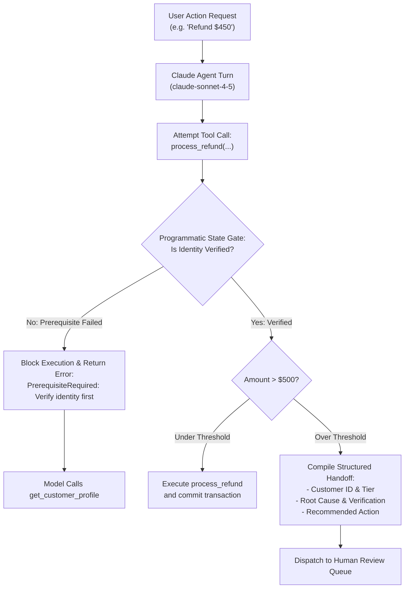

# Task Statement 1.4: Implement Multi-Step Workflows with Enforcement and Handoff Patterns

## 🎯 Exam Objective
Understand how to enforce hard workflow prerequisites deterministically using **programmatic gates** instead of soft prompts, and construct structured handoff payloads for seamless human-in-the-loop escalation.

---

## 🏗️ Architecture: Programmatic Gate & Handoff Pipeline

---

## ⚠️ Critical Exam Distinctions & Anti-Patterns

| Workflow Aspect | Deterministic Implementation | Exam Trap to Reject |
|---|---|---|
| **Prerequisite Enforcement** | **Programmatic code gates**: Code checks state flags before executing sensitive tools and raises structured errors. | **TRAP**: Relying solely on system prompt instructions like "Never process a refund before verifying identity." LLMs have non-zero probabilistic failure rates. |
| **Escalation Payload** | Compile a **structured JSON handoff bundle**: `{customer_id, reason, transaction_amount, verification_status, action_needed}`. | **TRAP**: Passing a raw, unstructured chat transcript dumping thousands of unorganized tokens on the human operator. |
| **Escalation Triggering** | Trigger immediately when a deterministic threshold is exceeded (e.g. `$500` financial threshold or safety flag). | **TRAP**: Allowing the agent to retry or negotiate around hard policy constraints. |

---

## 💡 Architectural Decision Matrix

| Mechanism | Enforcement Mode | Failure Rate | Best Use Case |
|---|---|---|---|
| **System Prompt Rules** | Probabilistic (Model-guided) | > 0% | General style, tone, domain context, guidelines. |
| **Programmatic State Gates** | Deterministic (Code-enforced) | 0% | Security boundaries, financial limits, compliance prerequisites. |
| **Structured Handoff** | Typed Schema Handoff | 0% | Routing high-risk workflows to human supervisors with zero context loss. |

---

## 🛠️ Production Code Reference
- Interactive Workbook: [`ts_1_4_prerequisite_enforcement.ipynb`](ts_1_4_prerequisite_enforcement.ipynb)
- Runnable Script: [`main.py`](main.py)
- Offline Verification: Run via `uv run pytest tests/test_domain1_full.py` in WSL.
