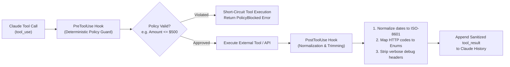

# Task Statement 1.5: Apply Agent SDK Hooks for Tool Call Interception and Data Normalization

## 📌 Executive Overview: Goal, Scope & Exam Importance

### Certification Domain & Weight
- **Domain**: Domain 1: Agentic Architecture & Orchestration
- **Domain Weight**: 27% of total CCAR-F exam score
- **Scenario Alignment**: Scenario 1 (Customer Support) & Scenario 4 (Developer Productivity)

### The Core Goal
To master the Agent SDK lifecycle hooks—specifically **`PreToolUse`** (for outgoing tool call interception, argument validation, and safety guardrails) and **`PostToolUse`** (for raw payload normalization, context trimming, and PII redaction)—before data touches the model or external infrastructure.

### Why This Matters in Production
Enterprise APIs and databases were never designed for LLMs. A single database query to an ERP or CRM system can return an 80-field JSON payload containing internal database shard IDs, employee shift logs, carrier debugging headers, and nested telemetry. 
If an orchestrator naively dumps raw vendor responses into conversational history:
1. **Token Cost Explosion**: A 15-turn conversation accumulates over 50,000 redundant tokens.
2. **"Lost in the Middle" Decay**: Critical customer facts get buried under pages of useless telemetry.
3. **Security Vulnerabilities**: Raw outputs may leak customer PII, internal passwords, or authorization tokens.
By leveraging `PreToolUse` and `PostToolUse` hooks, architects enforce 100% deterministic guardrails and aggressive context hygiene at the infrastructure boundary.

### Exam Importance
Task Statement 1.5 questions frequently ask candidates to identify where policy enforcement and context trimming belong in the request lifecycle. Exam traps will tempt you to trim payloads using system prompt instructions or binary compression (gzip/base64); you must recognize that `PostToolUse` normalization hooks are the standard solution.

---

## 📖 Deep Narrative: Why We Do What We Do

### 1. The PreToolUse Hook: Outgoing Policy Guardrails
Before an external API or database mutation executes, the orchestrator triggers the `PreToolUse` hook:
- **What It Receives**: The tool name and proposed input arguments emitted by Claude.
- **What It Enforces**:
  - **Hard Spend Caps**: Intercepts `execute_trade` or `issue_refund` calls. If the argument `amount > 500`, it aborts execution and reroutes to a human queue.
  - **Rate Limits & Permissions**: Verifies that the current user session has authorization to invoke this specific tool.
  - **PII Scrubbing**: Redacts accidental user credit card numbers from outbound search queries.
- **Why It Matters**: Prevents irreversible external side effects *before* the network packet leaves the host machine.

### 2. The PostToolUse Hook: Incoming Normalization & Trimming
After the external tool executes but *before* its result is appended to the Claude message history, the orchestrator triggers the `PostToolUse` hook:
- **What It Receives**: The raw output payload from the external service.
- **What It Performs**:
  - **Aggressive Field Trimming**: Drops 50+ internal database fields (e.g. `_db_partition_key`, `_warehouse_employee_id`) and retains only the 4 fields relevant to the user query (`order_id`, `status`, `delivery_date`, `total_usd`).
  - **Format Normalization**: Converts inconsistent external data into clean canonical formats (e.g. converting raw Unix epoch seconds `1761728400` into human-readable ISO-8601 strings `"2025-10-29T09:00:00Z"`).
  - **Error Taxonomy Mapping**: Translates raw HTTP 504 gateway errors into structured MCP error contracts (`isError: true, isRetryable: true`).
- **Why It Matters**: Guarantees that Claude's context window contains only pristine, high-density facts, preserving attention and reducing token spend by 80–90%.

---

## 🔑 Key Technical Terminology Explained

- **`PreToolUse` Hook**: An event hook triggered immediately after the LLM requests a tool call but *before* the tool executes. Used for authorization, rate limiting, and argument validation.
- **`PostToolUse` Hook**: An event hook triggered immediately after a tool returns data but *before* the `tool_result` is formatted and appended to conversation history. Used for normalization, PII redaction, and trimming.
- **Context Trimming**: The practice of filtering out irrelevant fields from complex nested JSON payloads to optimize context window utilization.
- **Format Normalization**: Standardizing heterogeneous external data formats (dates, currencies, status codes) into uniform representations before model evaluation.
- **"Lost in the Middle" Effect**: The well-documented phenomenon where large language models overlook facts buried in the middle of massive context windows (100k+ tokens), causing missed instructions and hallucinations.

---

## 🏗️ Architecture: Lifecycle Hooks Pipeline

---

## ⚠️ Critical Exam Distinctions & Distractor Teardown

| Hook / Strategy | Correct Architectural Implementation | Exam Trap to Reject | Why the Trap Fails |
|---|---|---|---|
| **Safety Gating Point** | **`PreToolUse` Hook**: Intercept and abort unauthorized calls before execution. | **TRAP**: Letting tools run and using post-execution checks to "undo" destructive mutations. | Financial transactions and database deletions cannot be cleanly undone after network dispatch. |
| **Context Hygiene Point** | **`PostToolUse` Hook**: Filter raw JSON payloads in middleware before appending to context. | **TRAP**: Asking the LLM in the system prompt to *"please ignore internal telemetry fields"*. | The raw fields still consume context tokens and degrade attention even if Claude tries to ignore them. |
| **Payload Compression** | **Field Trimming**: Extract the exact 4–5 keys needed and drop the rest. | **TRAP**: Compressing raw payloads with gzip or base64-encoding them before passing to Claude. | The Messages API expects valid UTF-8 text. Binary or base64 data increases token count and destroys semantic meaning. |

---

## 💡 Architectural Decision Matrix: Rules of Thumb

| Requirement | Recommended Mechanism | Rapid 30-Second Decision Rule |
|---|---|---|
| **Block unauthorized tool action?** | `PreToolUse` | Intercept before tool runs. Return structured error or redirect to human. |
| **Clean up bloated 50-field JSON?** | `PostToolUse` | Filter in middleware after execution, before saving to message history. |
| **Sanitize PII or sensitive tokens?** | `PostToolUse` | Scrub credit cards and auth keys before they enter persistent conversation memory. |

---

## 🧠 Claude 4.5 Extended Thinking & Parameter Standards

- **Model Guidance**: Use `claude-sonnet-4-5` or `claude-haiku-4-5`.
- **Sampling Rules**: Omit `temperature` whenever thinking is enabled.
- **Thinking Continuity**: When hooks intercept and modify tool results, ensure previous assistant thinking blocks remain unmodified with their cryptographic signatures.

---

## 🛠️ Hands-on Workbook Guide: Following the Code Step-by-Step

When exploring [`ts_1_5_sdk_hooks.ipynb`](ts_1_5_sdk_hooks.ipynb):
1. **Step 1: Setup & Mock CRM Payload**: Prepares raw enterprise ERP responses containing 50+ internal fields.
2. **Step 2: PreToolUse Compliance Interception**: Demonstrates blocking an outbound financial refund exceeding \$500.
3. **Step 3: PostToolUse Payload Trimming**: Demonstrates filtering bloated database rows down to 4 canonical fields.
4. **Step 4: Timestamp Normalization**: Demonstrates converting Unix epoch timestamps to ISO-8601 strings in middleware.
5. **Step 5: Verification Assertions**: Verifies that 100% of internal debugging fields were eliminated from conversation context.
