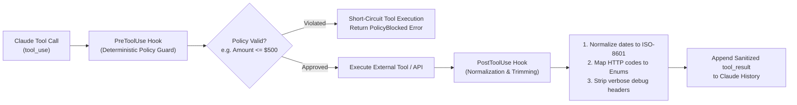

# Task Statement 1.5: Apply Agent SDK Hooks for Tool Call Interception and Data Normalization

## 🎯 Exam Objective
Understand how to use Agent SDK lifecycle hooks (`PreToolUse` and `PostToolUse`) to implement deterministic guardrails, intercept sensitive tool invocations, and normalize heterogeneous API responses before model consumption.

---

## 🏗️ Architecture: Lifecycle Hooks Pipeline

---

## ⚠️ Critical Exam Distinctions & Anti-Patterns

| Hook Type | Primary Exam Purpose | Exam Trap to Reject |
|---|---|---|
| **`PreToolUse` Hook** | **Policy Enforcement & Safety Gating**: Inspect arguments before execution; abort or redirect unauthorized actions (e.g. budget cap, rate limit, permission check). | **TRAP**: Letting tools execute and then relying on post-execution checks to "undo" irreversible destructive changes. |
| **`PostToolUse` Hook** | **Normalization & Context Trimming**: Standardize data types, strip verbose payload fields, convert Unix epochs to ISO 8601, and map HTTP codes to semantic enums. | **TRAP**: Passing raw, 20-page vendor JSON responses with internal stack traces directly into model context. |
| **Enforcement Guarantee** | **100% Deterministic Code Execution**: Hooks run in the host application runtime, outside the LLM reasoning process. | **TRAP**: Asking the LLM in the system prompt to "please format raw tool outputs and obey spend caps". |

---

## 💡 Architectural Decision Matrix

| Requirement | Recommended Hook | Implementation Detail |
|---|---|---|
| **Enforce spend/rate limits** | `PreToolUse` | Intercept arguments, compare against database state or policy table, raise structured error if exceeded. |
| **Sanitize PII / Redact Tokens** | `PostToolUse` | Regex-strip credit cards, API keys, or JWT tokens before payload is stored in conversation context. |
| **Token Conservation** | `PostToolUse` | Strip redundant schema boilerplate, pagination cursors, and keep only requested query columns. |

---

## 🛠️ Production Code Reference
- Interactive Workbook: [`ts_1_5_sdk_hooks.ipynb`](ts_1_5_sdk_hooks.ipynb)
- Runnable Script: [`main.py`](main.py)
- Offline Verification: Run via `uv run pytest tests/test_domain1_full.py` in WSL.
