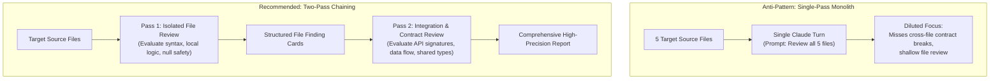

# Task Statement 1.6: Design Task Decomposition Strategies for Complex Workflows

## 🎯 Exam Objective
Understand when to use **Fixed Prompt Chaining** (Multi-Pass Reviews) versus **Dynamic Adaptive Decomposition**, and how to eliminate attention dilution across complex codebases and documents.

---

## 🏗️ Architecture: Two-Pass Review vs Single-Pass Dilution

---

## ⚠️ Critical Exam Distinctions & Anti-Patterns

| Strategy | When to Select on the Exam | Exam Trap to Reject |
|---|---|---|
| **Two-Pass Sequential Chaining** | Fixed multi-file reviews or security audits where local syntax and cross-file contracts both matter. | **TRAP**: Combining file inspection and integration analysis into a single giant prompt ("Review this entire repo in one prompt"). |
| **Dynamic Adaptive Decomposition** | Open-ended workflows where downstream steps depend on exploratory findings (e.g. repo migration, dependency analysis). | **TRAP**: Hardcoding rigid sequential subtask lists upfront for exploratory, unpredictable workflows. |
| **Attention Dilution Avoidance** | Bounding the scope of each pass to either single-file syntax OR cross-module contract validation. | **TRAP**: Stuffing multiple disparate objectives (formatting, security, performance, architecture) into a single agent turn. |

---

## 💡 Architectural Decision Matrix

| Task Nature | Decomposition Strategy | Structure | SLA / Latency Profile |
|---|---|---|---|
| **Deterministic Quality Gates** | Fixed Multi-Pass Chaining | Pass 1 (Local) $\rightarrow$ Pass 2 (Contract) | Predictable step count, higher token spend, near-zero missed bugs. |
| **Open-Ended Architecture Tasks** | Adaptive Tree-of-Thought / Subtasking | Coordinator dynamically generates subtasks | Variable turn count, adaptive to repo complexity. |
| **Simple Narrow Inquiries** | Single Turn with Tools | 1 Loop Iteration | Lowest latency and token cost. |

---

## 🛠️ Production Code Reference
- Interactive Workbook: [`ts_1_6_task_decomposition.ipynb`](ts_1_6_task_decomposition.ipynb)
- Runnable Script: [`main.py`](main.py)
- Offline Verification: Run via `uv run pytest tests/test_domain1_full.py` in WSL.
