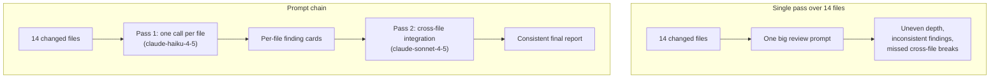

# Task Statement 1.6: Design Task Decomposition Strategies for Complex Workflows

> Domain 1 (27% of the exam) · Scenarios 2 (Code Generation) and 5 (Continuous Integration) · [Back to Domain 1](../README.md)

## In One Minute

- **What**: break a big job into smaller steps so each Claude call has one clear focus.
- **Two styles**: **prompt chaining** (a fixed pipeline you design up front) and **dynamic adaptive decomposition** (the plan changes as you learn).
- **Code review rule**: review each file on its own, then run one **cross-file integration pass**.
- **Open-ended work**: map the structure, find the high-impact areas, make a prioritised plan, and adapt it.
- **Exam answer in one line**: a big multi-file review with uneven results needs per-file passes plus an integration pass. A bigger model, smaller PRs, or voting do not fix it.

---

## 📌 Overview

### Why it matters
Give Claude 14 changed files in one prompt and the review turns uneven. Some files get deep comments and others get one line. The same pattern gets flagged in one file and passed in another. Attention is spread too thin (attention dilution). Splitting the work fixes the cause.

### What the exam tests
- **Prompt chaining** (fixed pipeline) versus **dynamic adaptive** decomposition, and when each fits.
- **Per-file passes** for local problems and a **cross-file integration pass** for contracts and data flow.
- The 14-file pull request sample question: the right answer is per-file passes plus an integration pass. Wrong answers: ask for smaller PRs, use a bigger model or larger context window, or run three times and take the consensus.
- Open-ended tasks: map structure, prioritise, adapt the plan as findings arrive.

---

## 📖 Concepts Explained

### 1. The simple idea
Ask small, focused questions in a sensible order. One call, one job.

### 2. Prompt chaining (fixed pipeline)
Use it when the steps are known in advance and are the same each time, for example a code review.

1. **Pass 1, per file.** One call per changed file. Look only at that file: bugs, security, error handling. Also list the functions it defines (with signatures) and the outside functions it calls.
2. **Pass 2, integration.** One call that receives the Pass 1 findings. Look for what no single file shows: a renamed parameter, mismatched types, a changed return value, data that flows unsafely across modules.

In [main.py](main.py), `run_prompt_chaining_review` does exactly this. Pass 1 uses `WORKER_MODEL` (fast, one file at a time). Pass 2 uses `COORDINATOR_MODEL` (needs reasoning across files). Pass 2 gets the Pass 1 notes, not the raw transcript of Pass 1.

### 3. Dynamic adaptive decomposition
Use it when you do not know the work until you start, for example "add tests to this legacy codebase".

1. **Map the structure**: what modules exist, who depends on whom.
2. **Find high-impact areas**: where changes matter most or risk is highest.
3. **Build a prioritised plan** and **adapt it** as new facts appear.

`plan_adaptive_subtasks` in [main.py](main.py) shows the idea in small form. Given a dependency map, it orders modules leaf-first (a module comes after the modules it imports). Cycles are listed last.

### 4. Which one?

| Situation | Choose |
|---|---|
| Same steps every time (review, extract, classify, summarise) | Prompt chaining |
| Unknown shape, discovery drives the next step | Dynamic adaptive decomposition |
| One small file | Just one call |

---

## 🧪 Worked Example

**Fixed chain.** A pull request changes `auth_service.py` and `api_router.py`.

| Step | Call | Result |
|---|---|---|
| 1 | Pass 1 on `auth_service.py` | "`create_user_token` builds a JWT with no expiry." Defines `create_user_token(user_id)` |
| 2 | Pass 1 on `api_router.py` | "SQL built with an f-string (injection risk)." Calls `verify_token(token)` |
| 3 | Pass 2 with both finding cards | "Tokens never expire, and the router trusts `sub` from them in a raw SQL query. Together this is a worse issue than either alone." |

The third finding exists only because a pass looked **across** files.

**Adaptive.** Task: "Add tests to a legacy service."

| Step | Action |
|---|---|
| 1 | Map: `controller` imports `service`, `service` imports `utils` |
| 2 | Prioritise: `utils` first (leaf, used everywhere), then `service`, then `controller` |
| 3 | After `utils`, tests show a hidden global. The plan adds a "remove the global" task before `service` |

The plan changed because of what was found. A fixed script could not do that.

---

## 🔑 Key Terms

- **Prompt chaining**: a fixed sequence of calls where each output feeds the next.
- **Dynamic adaptive decomposition**: the next subtask depends on what the last one found.
- **Attention dilution**: quality drops when one call has too much to cover.
- **Per-file pass**: a call focused on one file.
- **Cross-file integration pass**: a call that checks contracts and data flow between files.

---

## 🏗️ Architecture

---

## ⚠️ Exam Traps and Correct Patterns

| Topic | Correct pattern | Trap | Why the trap fails |
|---|---|---|---|
| **Large PR review** | Per-file passes plus one integration pass | One prompt for all files | Attention dilution gives uneven results |
| **Uneven review** | Fix the process | "Ask developers for smaller PRs" | Does not fix the review design, and is not always possible |
| **Uneven review** | Fix the process | A bigger model or larger context | A larger window still has the same attention problem |
| **Uneven review** | Fix the process | Run 3 times, take the consensus | Three diluted reviews are still diluted. It also triples cost |
| **Open-ended task** | Map, prioritise, adapt | Fixed script written before looking | Breaks when the code is not what you assumed |

---

## ❌ Common Mistakes

- Asking one prompt to check style, security, tests, and architecture together.
- Skipping the integration pass, so cross-file bugs slip through.
- Using a fixed pipeline for an exploratory task, or an adaptive one for a task with fixed steps.
- Passing all raw Pass 1 output to Pass 2 instead of short finding cards.
- Treating "use a bigger model" as a fix for a structure problem.

---

## 💡 Quick Decision Rules

| Question | Answer |
|---|---|
| Many files, uneven review? | Per-file passes plus an integration pass |
| Steps known up front? | Prompt chaining |
| Steps unknown until you look? | Dynamic adaptive decomposition |
| What goes in Pass 2? | Per-file findings (signatures, calls, issues) |
| Which model for which pass? | Haiku for per-file work, Sonnet for integration |

---

## 🧠 Claude 4.5 Notes

- Models: `claude-haiku-4-5` for per-file workers, `claude-sonnet-4-5` for the integration pass.
- Extended thinking: `thinking={"type": "enabled", "budget_tokens": N}` with `N >= 1024` and `N < max_tokens`. It suits the integration pass.
- With thinking on: no `temperature` (HTTP 400), leave `top_k` and `top_p` unset, and `tool_choice` only `auto` or `none`.
- The passes here are separate single-turn calls. In any tool loop inside a pass, echo `thinking` blocks and `signature` unchanged.

---

## 📝 Exam-Style Practice Questions

**Q1.** A CI job asks Claude to review a 14-file pull request in one prompt. Some files get detailed feedback, others get little, and the same pattern is flagged in one file and missed in another. What is the best fix?

- A) Ask developers to submit smaller pull requests.
- B) Switch to a larger model with a bigger context window.
- C) Split the review into a per-file pass for each file, then run a separate cross-file integration pass.
- D) Run the review three times and keep only the findings that appear in at least two runs.

**Q2.** You must add tests to a large legacy codebase you have never seen. Which approach is best?

- A) Write a fixed five-step plan before looking at the code, and follow it.
- B) Map the structure, identify high-impact areas, build a prioritised plan, and adapt it as dependencies appear.
- C) Ask for tests for every file in one prompt.
- D) Start with the first file alphabetically and continue.

**Q3.** A nightly job always does the same three steps on each support ticket: extract fields, classify the issue, draft a summary. Which decomposition fits?

- A) Dynamic adaptive decomposition, because it is more flexible.
- B) A single prompt that does all three at once.
- C) A multi-agent mesh where agents negotiate the steps.
- D) Prompt chaining: three fixed calls, each output feeding the next.

### Answers

**Q1: C.**
- A) Pushes the problem to developers and does not fix the review design.
- B) A larger window does not remove attention dilution.
- D) Three diluted reviews are still diluted, and cost triples.

**Q2: B.**
- A) The plan was made without knowing the code and cannot adapt.
- C) One prompt over every file causes dilution.
- D) Alphabetical order ignores dependencies and risk.

**Q3: D.**
- A) The steps are known and fixed, so adaptive planning adds nothing.
- B) One prompt loses the focus that separate steps give.
- C) A mesh adds loops and removes predictability.

---

## ✅ Self-Check Checklist

- [ ] I can define prompt chaining and dynamic adaptive decomposition.
- [ ] I can describe a per-file pass and an integration pass.
- [ ] I know why smaller PRs, a bigger model, and consensus voting do not fix the 14-file problem.
- [ ] I can outline the open-ended approach: map, prioritise, adapt.
- [ ] I can pick the style for a given scenario.

**Memory hook**: *"Look at each file, then look across them."*

---

## 🛠️ Hands-on Workbook Guide

Open [ts_1_6_task_decomposition.ipynb](ts_1_6_task_decomposition.ipynb) (offline, mock client):

1. **Setup**: sample files and test harness.
2. **Pass 1**: one review per file.
3. **Pass 2**: cross-file contract check.
4. **Report**: a combined result.
5. **Checks**: assertions on the findings.

Code: [main.py](main.py) (live API, run manually only) · Offline tests: [tests/test_domain1_enhancements.py](../../tests/test_domain1_enhancements.py)
