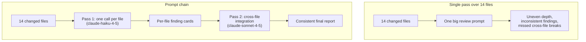

# Task Statement 1.6: Design Task Decomposition Strategies for Complex Workflows

> Domain 1 (27% of the exam) · Scenarios 2 (Code Generation) and 5 (Continuous Integration) · [Back to Domain 1](../README.md)

## In One Minute

- **What**: break a big job into smaller steps so each Claude call has one clear focus.
- **Two styles**: **prompt chaining** (a fixed pipeline you design up front) and **dynamic adaptive decomposition** (the plan changes as you learn).
- **Code review rule**: review each file on its own, then run one **cross-file integration pass**.
- **Open-ended work**: map the structure, find the high-impact areas, make a prioritised plan, and adapt it.
- **Exam answer in one line**: a big multi-file review with uneven results needs per-file passes plus an integration pass. A bigger model, smaller PRs, or voting do not fix it.

---

## 🧒 Explain Like I'm 13

**The picture:** Grading 15 essays at once. By essay 9 you are tired, grade unevenly, and miss that essay 3 and essay 12 contradict each other. Better: grade each essay on its own, then do one last pass that compares them. That is the **per-file pass plus integration pass**. For an unknown job (exploring a cave), you draw a map first and change the plan as you see more.

**In plain steps:**
1. Pass 1: one focused review per file. Write a short finding card for each.
2. Pass 2: give only the cards to a reviewer who looks across files.
3. For open-ended work: map it, rank by importance, adapt as you learn.

**Tiny example:** File A renamed `user_id` to `userId`. File B still reads `user_id`. Each file looks fine alone. Only the pass that sees both catches the break.

---

## 📌 Overview

### Why it matters
Give Claude 14 changed files in one prompt and the review turns uneven. Some files get deep comments and others get one line. The same pattern gets flagged in one file and passed in another. Attention is spread too thin (attention dilution). Splitting the work fixes the cause.

---

## 📖 Concepts Explained

### 1. Prompt chaining (fixed pipeline)
Use it when the steps are known in advance and are the same each time, for example a code review.

1. **Pass 1, per file.** One call per changed file. Look only at that file: bugs, security, error handling. Also list the functions it defines (with signatures) and the outside functions it calls.
2. **Pass 2, integration.** One call that receives the Pass 1 findings. Look for what no single file shows: a renamed parameter, mismatched types, a changed return value, data that flows unsafely across modules.

In [main.py](main.py), `run_prompt_chaining_review` does exactly this. Pass 1 uses `WORKER_MODEL` (fast, one file at a time). Pass 2 uses `COORDINATOR_MODEL` (needs reasoning across files). Pass 2 gets the Pass 1 notes, not the raw transcript of Pass 1.

### 2. Dynamic adaptive decomposition
Use it when you do not know the work until you start, for example "add tests to this legacy codebase".

1. **Map the structure**: what modules exist, who depends on whom.
2. **Find high-impact areas**: where changes matter most or risk is highest.
3. **Build a prioritised plan** and **adapt it** as new facts appear.

`plan_adaptive_subtasks` in [main.py](main.py) shows the idea in small form. Given a dependency map, it orders modules leaf-first (a module comes after the modules it imports). Cycles are listed last.

### 3. Which one?

| Situation | Choose |
|---|---|
| Same steps every time (review, extract, classify, summarise) | Prompt chaining |
| Unknown shape, discovery drives the next step | Dynamic adaptive decomposition |
| One small file | Just one call |

---

## 🧪 Worked Example

**Fixed chain.** A pull request changes `auth_service.py` and `api_router.py`.

| Step | Call | Result |
|---|---|---|
| 1 | Pass 1 on `auth_service.py` | "`create_user_token` builds a JWT with no expiry." Defines `create_user_token(user_id)` |
| 2 | Pass 1 on `api_router.py` | "SQL built with an f-string (injection risk)." Calls `verify_token(token)` |
| 3 | Pass 2 with both finding cards | "Tokens never expire, and the router trusts `sub` from them in a raw SQL query. Together this is a worse issue than either alone." |

The third finding exists only because a pass looked **across** files.

**Adaptive.** Task: "Add tests to a legacy service."

| Step | Action |
|---|---|
| 1 | Map: `controller` imports `service`, `service` imports `utils` |
| 2 | Prioritise: `utils` first (leaf, used everywhere), then `service`, then `controller` |
| 3 | After `utils`, tests show a hidden global. The plan adds a "remove the global" task before `service` |

The plan changed because of what was found. A fixed script could not do that.

---

## 🔑 Key Terms

- **Prompt chaining**: a fixed sequence of calls where each output feeds the next.
- **Dynamic adaptive decomposition**: the next subtask depends on what the last one found.
- **Attention dilution**: quality drops when one call has too much to cover.
- **Per-file pass**: a call focused on one file.
- **Cross-file integration pass**: a call that checks contracts and data flow between files.

---

## 🏗️ Architecture



---

## ⚠️ Exam Traps and Correct Patterns

### Trap 1: One prompt for a 15-file PR, then "fixing" it the wrong way

**Exam scenario**: A single-pass review of a 15-file PR gives deep feedback on some files, shallow comments on others, and flags a pattern in one file while approving the same pattern elsewhere.

**Root cause**: attention dilution. The model spreads limited attention across too much content at once.

| Tempting fix | Why it looks right | Why it fails |
|---|---|---|
| Ask developers for smaller PRs | Smaller input, less dilution | Does not fix the review design. Not always possible. Next big PR fails again |
| Use a bigger model or larger context window | More capacity | A larger window does not remove uneven attention within it |
| Run the review 3 times, keep the consensus | Voting sounds rigorous | Three diluted reviews are still diluted, and cost is 3x |
| Per-file passes plus an integration pass | Changes the structure | Correct |

```text
Pass 1 (per file, focused):  file_01 ... file_15 -> finding cards   (local bugs, style, tests)
Pass 2 (integration):        all cards + changed signatures + call sites -> cross-file issues
```

### Trap 2: Skipping the integration pass

```text
PR: a.py renames the field user_id -> userId in the response. b.py still reads data["user_id"].
Per-file pass on a.py: "clean".   Per-file pass on b.py: "clean" (the key looks fine in isolation).
Only pass 2, which sees both the changed contract and its caller, catches the break.
```

Per-file review alone finds local problems. Cross-file contract bugs need a pass that sees both sides.

### Trap 3: Feeding Pass 2 the raw Pass 1 output

```text
ANTI-PATTERN: paste 15 full review essays into pass 2 (thousands of tokens, same dilution again).

PATTERN: compact finding cards
  {file: "b.py", line: 42, kind: "api_call", symbol: "get_user", assumes: "key user_id"}
  {file: "a.py", line: 10, kind: "contract_change", symbol: "get_user", now: "key userId"}
```

### Trap 4: Choosing the wrong decomposition style

| Task | Style | Why |
|---|---|---|
| Review a PR: per-file analysis, then integration | **Prompt chaining**: steps known up front | Fixed, predictable structure |
| "Add tests to this legacy codebase" | **Dynamic adaptive**: map structure, rank high-impact areas, adjust as dependencies appear | You cannot know the steps until you have looked |

Anti-pattern: a fixed script for the legacy codebase ("step 1 test module A...") breaks when module A depends on something undiscovered. The reverse, an open-ended exploration for a known two-step review, wastes tokens.

---

## 📝 Exam-Style Practice Questions

**Q1.** A CI job asks Claude to review a 14-file pull request in one prompt. Some files get detailed feedback, others get little, and the same pattern is flagged in one file and missed in another. What is the best fix?

- A) Ask developers to submit smaller pull requests.
- B) Switch to a larger model with a bigger context window.
- C) Split the review into a per-file pass for each file, then run a separate cross-file integration pass.
- D) Run the review three times and keep only the findings that appear in at least two runs.

**Q2.** You must add tests to a large legacy codebase you have never seen. Which approach is best?

- A) Write a fixed five-step plan before looking at the code, and follow it.
- B) Map the structure, identify high-impact areas, build a prioritised plan, and adapt it as dependencies appear.
- C) Ask for tests for every file in one prompt.
- D) Start with the first file alphabetically and continue.

**Q3.** A nightly job always does the same three steps on each support ticket: extract fields, classify the issue, draft a summary. Which decomposition fits?

- A) Dynamic adaptive decomposition, because it is more flexible.
- B) A single prompt that does all three at once.
- C) A multi-agent mesh where agents negotiate the steps.
- D) Prompt chaining: three fixed calls, each output feeding the next.

### Answers

**Q1: C.**
- A) Pushes the problem to developers and does not fix the review design.
- B) A larger window does not remove attention dilution.
- D) Three diluted reviews are still diluted, and cost triples.

**Q2: B.**
- A) The plan was made without knowing the code and cannot adapt.
- C) One prompt over every file causes dilution.
- D) Alphabetical order ignores dependencies and risk.

**Q3: D.**
- A) The steps are known and fixed, so adaptive planning adds nothing.
- B) One prompt loses the focus that separate steps give.
- C) A mesh adds loops and removes predictability.

---

## ✅ Self-Check Checklist

- [ ] I can define prompt chaining and dynamic adaptive decomposition.
- [ ] I can describe a per-file pass and an integration pass.
- [ ] I know why smaller PRs, a bigger model, and consensus voting do not fix the 14-file problem.
- [ ] I can outline the open-ended approach: map, prioritise, adapt.
- [ ] I can pick the style for a given scenario.

**Memory hook**: *"Look at each file, then look across them."*

---

## 🛠️ Hands-on Workbook Guide

Open [ts_1_6_task_decomposition.ipynb](ts_1_6_task_decomposition.ipynb) (offline, mock client):

1. **Setup**: sample files and test harness.
2. **Pass 1**: one review per file.
3. **Pass 2**: cross-file contract check.
4. **Report**: a combined result.
5. **Checks**: assertions on the findings.

Code: [main.py](main.py) (live API, run manually only) · Offline tests: [tests/test_domain1_enhancements.py](../../tests/test_domain1_enhancements.py)
