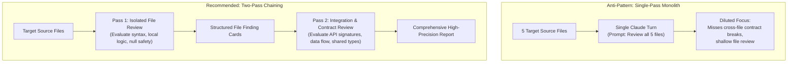

# Task Statement 1.6: Design Task Decomposition Strategies for Complex Workflows

## 📌 Executive Overview: Goal, Scope & Exam Importance

### Certification Domain & Weight
- **Domain**: Domain 1: Agentic Architecture & Orchestration
- **Domain Weight**: 27% of total CCAR-F exam score
- **Scenario Alignment**: Scenario 2 (Code Generation) & Scenario 5 (Continuous Integration)

### The Core Goal
To design sophisticated task decomposition architectures that eliminate **attention dilution** across complex multi-file codebases, choosing appropriately between **Fixed Prompt Chaining (Multi-Pass Reviews)** and **Dynamic Adaptive Decomposition**.

### Why This Matters in Production
When an automated agent is presented with a large pull request or an architectural migration across 10+ files, naive implementations attempt to solve everything in a single prompt: *"Review these 10 files for bugs, security flaws, performance bottlenecks, and architectural alignment."*
In production, this **monolithic single-pass** approach consistently fails. Large language models suffer from finite attention budgets; under heavy cognitive load, they spot trivial local typos while completely missing cross-module breaking changes, signature drifts, and circular dependencies. Breaking complex workflows into structured sequential passes dramatically increases defect detection precision.

### Exam Importance
Task Statement 1.6 questions test whether candidates understand why multi-pass pipelines outperform single-pass monoliths, how to isolate per-file analysis from cross-file contract reviews, and when to use fixed chains versus dynamic adaptive decomposition.

---

## 📖 Deep Narrative: Why We Do What We Do

### 1. The Problem: The Single-Pass Dilution Anti-Pattern
Consider an automated CI reviewer evaluating a pull request touching `auth.py`, `models.py`, and `client.py`:
- In `auth.py`, a function signature changes: `def verify_token(token: str, max_age: int = 3600)`.
- In `client.py`, the caller uses the old argument name: `verify_token(token_str="abc")` (TypeError at runtime!).
- In a single-pass review, the prompt is flooded with 3,000 lines of code. Claude's attention is consumed by local syntax checking in `models.py`. The cross-file signature mismatch in `client.py` goes unnoticed, and the broken code is approved for merge.

### 2. The Architectural Solution: Two-Pass Fixed Prompt Chaining
Production code review and security pipelines use a **Two-Pass Pipeline**:
1. **Pass 1: File-Level Local Review (Isolated)**:
   - Each modified file is inspected individually by a dedicated Claude call.
   - Focus: Local syntax, off-by-one errors, null pointer safety, edge-case handling, and unit test coverage.
   - Output: A structured finding card summarizing exported symbols, modified functions, and local issues.
2. **Pass 2: System Integration & Contract Review**:
   - Claude receives the original PR diff plus the structured finding cards from Pass 1.
   - Focus: Cross-file interface consistency, API signature matches, database schema migrations, and circular dependencies.
   - Output: The final consolidated PR verdict and blocking issues.
By separating local inspection from global integration, each step operates with 100% focused attention.

### 3. Dynamic Adaptive Decomposition for Open-Ended Tasks
While code reviews benefit from fixed sequential passes, exploratory tasks (e.g. migrating an existing monolithic codebase to microservices) require **Dynamic Adaptive Decomposition**:
- The agent does not follow a hardcoded 5-step checklist.
- Instead, Step 1 analyzes AST dependencies to map the call graph.
- Based on the discovered graph topology, Step 2 dynamically generates and prioritizes subtasks (e.g. refactoring leaf utilities before modifying core controllers).

---

## 🔑 Key Technical Terminology Explained

- **Prompt Chaining**: Executing multiple distinct model invocations in sequence, where the structured output of step $N$ serves as the input context for step $N+1$.
- **Attention Dilution**: Degradation in reasoning precision when a model is asked to evaluate too many competing objectives or too much heterogeneous information simultaneously.
- **Two-Pass Architecture**: A design pattern that separates localized component evaluation (Pass 1) from cross-module integration contract evaluation (Pass 2).
- **Dynamic Adaptive Decomposition**: An architectural strategy where intermediate exploratory findings dictate the subsequent subtasks generated by the coordinator.
- **Contract Mismatch**: Breaking changes occurring at the interface boundary between two components (e.g. parameter rename, type drift, missing return values).

---

## 🏗️ Architecture: Two-Pass Review vs Single-Pass Dilution

---

## ⚠️ Critical Exam Distinctions & Distractor Teardown

| Decomposition Strategy | Correct Implementation | Exam Trap to Reject | Why the Trap Fails |
|---|---|---|---|
| **Multi-File Review Structure** | **Two-Pass Sequential Chaining**: Pass 1 for local files; Pass 2 for cross-file contracts. | **TRAP**: Combining all review tasks into a single giant prompt to "minimize token hops". | Dilutes model attention, causing severe blind spots on cross-file signature mismatches. |
| **Exploratory Workflow Structure** | **Dynamic Adaptive Decomposition**: Coordinator generates subtasks based on dependency discovery. | **TRAP**: Hardcoding a rigid procedural script upfront for unknown, evolving codebases. | Fails as soon as the codebase violates rigid assumptions; cannot adapt to unexpected dependencies. |
| **Cognitive Load Management** | Restrict each pass to a single, tightly defined objective (e.g., security scan vs contract check). | **TRAP**: Demanding that one prompt simultaneously check styling, unit tests, security, and architecture. | The model produces shallow, superficial feedback across all dimensions. |

---

## 💡 Architectural Decision Matrix: Rules of Thumb

| Workflow Nature | Recommended Pattern | Rationale |
|---|---|---|
| **Multi-file PR Code Review** | Fixed Two-Pass Chaining | Pass 1 guarantees local correctness; Pass 2 guarantees cross-module compatibility. |
| **Complex Codebase Migration** | Dynamic Adaptive Decomposition | Dependencies must be mapped before task sequencing can be determined. |
| **Simple Bug Fix (1 file)** | Single Turn Direct Execution | Multi-pass chaining adds needless latency and token spend to well-isolated fixes. |

---

## 🧠 Claude 4.5 Extended Thinking & Parameter Standards

- **Pass 2 Integration Reasoning**: Extended Thinking (`budget_tokens: 2048`) is especially powerful in Pass 2 to trace variable lifetimes, call hierarchies, and asynchronous contracts across multiple files.
- **Sampling Rules**: Omit `temperature` across all passes when thinking is enabled.
- **Context Passing**: Do not pass the entire raw conversation of Pass 1 into Pass 2; pass only the structured summary finding cards to keep Pass 2 context pristine.

---

## 🛠️ Hands-on Workbook Guide: Following the Code Step-by-Step

When exploring [`ts_1_6_task_decomposition.ipynb`](ts_1_6_task_decomposition.ipynb):
1. **Step 1: Environment & Setup**: Sets up the test harness and file simulation payloads.
2. **Step 2: Simulating Pass 1 (Local File Audits)**: Reviews individual files for syntax, typing, and local errors.
3. **Step 3: Simulating Pass 2 (Contract Validation)**: Evaluates cross-file parameter signatures and catches breaking deletions.
4. **Step 4: Consolidated Report Generation**: Formats the final CI blocking report with prioritized severities.
5. **Step 5: Verification Assertions**: Verifies that 100% of cross-file contract breaks were caught.
