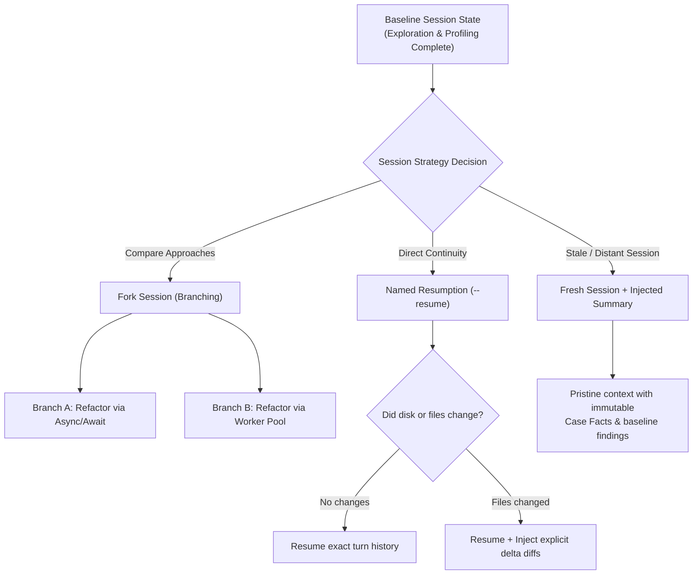

# Task Statement 1.7: Manage Session State, Resumption, and Forking

## 🎯 Exam Objective
Understand session lifecycle management, named resumption (`--resume`), exploratory branching via session forking (`fork_session`), and when to inject structured summaries instead of resuming stale conversation histories.

---

## 🏗️ Architecture: Resumption vs Forking vs Injected Summaries

---

## ⚠️ Critical Exam Distinctions & Anti-Patterns

| Session Feature | Correct Implementation | Exam Trap to Reject |
|---|---|---|
| **Exploring Divergent Options** | **Session Forking (`fork_session`)**: Clone the baseline session state into isolated child sessions to evaluate competing solutions in parallel. | **TRAP**: Running experiments sequentially within a single conversation thread, contaminating context across alternatives. |
| **Handling Environment Drift** | **Inject Structured Summaries**: When files or external database state change between sessions, start fresh and inject verified delta summaries. | **TRAP**: Blindly resuming `--resume` with raw outdated tool outputs, leading the model to hallucinate outdated file contents. |
| **Resumption Identifier** | Use deterministic session keys or `--resume <session-id>` to continue stateful agent workflows. | **TRAP**: Passing complete manual transcripts as prompt strings on every command execution. |

---

## 💡 Architectural Decision Matrix

| Scenario | Recommended Strategy | Context Impact |
|---|---|---|
| **A/B Architecture Exploration** | Fork Session (`fork_session`) | Isolates branches; changes in Branch A cannot pollute Branch B. |
| **Short Interruption (same file state)** | Named Resume (`--resume`) | Zero setup overhead; exact continuity of reasoning. |
| **Resuming After Major Code Edits** | Fresh Session + Structured Summary | Eliminates phantom bugs caused by stale tool output memory. |

---

## 🛠️ Production Code Reference
- Interactive Workbook: [`ts_1_7_session_management.ipynb`](ts_1_7_session_management.ipynb)
- Runnable Script: [`main.py`](main.py)
- Offline Verification: Run via `uv run pytest tests/test_domain1_full.py` in WSL.
