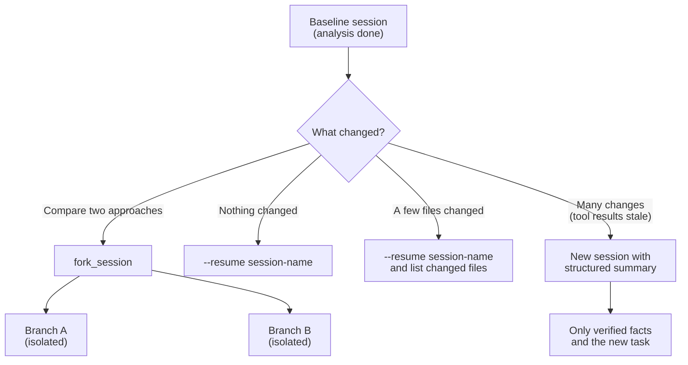

# Task Statement 1.7: Manage Session State, Resumption, and Forking

> Domain 1 (27% of the exam) · Scenarios 2 (Code Generation) and 4 (Developer Productivity) · [Back to Domain 1](../README.md)

## In One Minute

- **What**: a session is a saved conversation. You can continue it, branch it, or replace it with a summary.
- **Resume**: `claude --resume <session-name>` (or `-r`) continues a named session; name one with `--name` / `-n`. In the Agent SDK, pass `resume=<session_id>`. Good when nothing important changed.
- **Fork**: `fork_session` (CLI: `--fork-session` with `--resume`; Python SDK: `fork_session=True`; TypeScript: `forkSession: true`) makes an independent branch from a shared baseline. A fork copies the conversation history, not the files on disk. Good for comparing approaches.
- **Stale results**: if files changed, tell the resumed session which ones. If the old tool results are mostly stale, start a **new session with a structured summary**.
- **Exam answer in one line**: resume when results are still valid, fork to compare, summarise into a fresh session when tool results are stale.

---

## 🧒 Explain Like I'm 13

**The picture:** A video game save file. **Resume** when the world is unchanged. If a friend moved the furniture, **tell the game what changed** before you continue. If the whole map changed, **start a new game** and bring a notes page. **Fork** means copying the save to try two different paths.

**In plain steps:**
1. Nothing changed: resume (`--resume <name>`).
2. A few files changed: resume and list them so Claude re-reads them.
3. Lots changed: new session, seeded with a short summary of verified facts.
4. Two options to compare: fork twice from the same save.

**Tiny example:** Claude read `auth.py` yesterday. Today it was rewritten. If you resume silently, Claude edits the old lines from memory. Say "auth.py changed, re-read it" and it is fine.

---

## 📌 Overview

### Why it matters
Work spans days. On Monday Claude read `db/conn.py` and saw a pool size of 5. On Tuesday you edited it. If you resume Monday's session and say nothing, Claude still believes the old file. It will suggest changes to code that no longer exists. The old tool results are **stale**.

---

## 📖 Concepts Explained

### 1. Resume (`--resume <session-name>`)
Use it when earlier tool results are still true. If a few files changed, **say so**. In [main.py](main.py), `SessionManager.resume(name, changed_files=[...])` appends a user message that lists the changed files and asks the session to re-read them before relying on earlier output. With no changes, it adds nothing.

### 2. Fork (`fork_session`)
Use it to compare approaches. Branch A and Branch B both start from the same analysis. Edits in A never leak into B. In [main.py](main.py), `SessionState.fork` deep-copies the messages and records the parent session id, so the parent and each fork stay independent.

### 3. Fresh session with a structured summary
Use it when many tool results are stale, for example after a big merge. Write down what is still **verified** (decisions, confirmed facts, what changed), then start a new session with that summary and the new instruction. `SessionManager.resume_with_injected_summary` does this: the new session contains only the summary and the current task, never the old stale tool output.

### 4. How to choose

| Situation | Choose |
|---|---|
| Short break. Nothing changed | Resume |
| A few files changed | Resume and name the changed files |
| Compare two designs from one analysis | Fork |
| Large changes or a long gap. Results stale | New session with a structured summary |

---

## 🧪 Worked Example

Monday: you analyse a legacy database layer in session `legacy_db_analysis`. Claude reads `db/conn.py` (pool size 5).

| Day | Event | Right move |
|---|---|---|
| Monday | Baseline analysis is done | Keep session `legacy_db_analysis` |
| Monday | You want to compare Async SQLAlchemy and Prisma | **Fork** twice. Each branch gets its own question. The parent is untouched |
| Tuesday | You edit `db/conn.py` and `db/pool.py` | `--resume legacy_db_analysis`, then tell it: "These files changed: `db/conn.py`, `db/pool.py`. Re-read them." |
| Next week | You merged forty upstream commits | **New session** with a summary: "Decision: Async SQLAlchemy 2.0. 50 sync models. Changed since: schema, pool config." Then the new task: "Produce the migration plan." |

Each choice matches how much of the old context is still true.

---

## 🔑 Key Terms

- **Session**: a saved conversation that can be continued.
- **`--resume <session-name>`**: continue a named session.
- **`fork_session`**: create an independent branch from a baseline.
- **Stale tool results**: earlier file or data reads that no longer match reality.
- **Structured summary**: the verified facts and changes, used to seed a fresh session.
- **Changed-files notice**: a message telling a resumed session which files changed.

---

## 🏗️ Architecture



---

## ⚠️ Exam Traps and Correct Patterns

### Trap 1: Resuming with stale tool results and saying nothing

**Exam scenario**: Yesterday Claude read `auth.py` (lines 40-60 held the login check). Overnight a teammate rewrote it. You resume and ask "add rate limiting to the login check".

```text
ANTI-PATTERN: resume, then prompt as if nothing changed.
  Claude trusts its old Read result and edits lines 40-60 that no longer exist.

PATTERN (small change): resume and say what changed.
  "Since we last spoke, auth.py and session.py were rewritten. Re-read them before editing."

PATTERN (large change): start a fresh session seeded with a structured summary.
```

| Change since last session | Choice |
|---|---|
| Nothing | Resume |
| A few files | Resume and name the changed files |
| Many files, or old tool output is mostly wrong | Fresh session with a summary |

### Trap 2: Exploring two designs in one thread

**Exam scenario**: Compare a Redis cache against an in-memory cache for the same service.

In one thread, the Redis discussion becomes background for the in-memory one. Conclusions leak both ways, so neither option is evaluated fairly. Use a **fork** from the shared baseline.

```bash
claude --resume cache-analysis --fork-session   # branch A: Redis
claude --resume cache-analysis --fork-session   # branch B: in-memory
```

SDK: `resume=session_id` with `fork_session=True` creates a new session id that starts from the same history.

### Trap 3: A vague summary for a fresh session

```text
ANTI-PATTERN: "We looked at the database and found some issues."

PATTERN:
  Verified facts: orders table has no index on customer_id (confirmed with EXPLAIN, 2026-10-28)
  Decisions: add composite index (customer_id, created_at); no schema change
  Changed since: migrations/0042 added; orders.py query rewritten
  Next task: benchmark the new index on staging
  Do NOT reuse: earlier slow-query timings (measured before the change)
```

Put in verified decisions and facts. Leave out raw old tool output, which is the thing you are trying to avoid.

### Trap 4: Pasting the whole transcript instead of resuming

Pasting a long transcript into a new prompt costs tokens, loses the structured turns and `tool_use` pairing, and still carries stale content. If the named session is valid, use `--resume <session-name>`. If not, write a summary, not a paste.

---

## 📝 Exam-Style Practice Questions

**Q1.** After a long analysis session, a developer wants to compare two refactoring approaches that both start from that same analysis, without either approach influencing the other. What is the best way?

- A) Explore both in the same conversation, one after the other.
- B) Start two new sessions and redo the analysis in each.
- C) Resume the session and ask Claude to forget Approach A before starting B.
- D) Use `fork_session` to create two independent branches from the analysis baseline.

**Q2.** A developer resumes yesterday's session. Two files were edited overnight; everything else is the same. What is the best approach?

- A) Resume with `--resume <session-name>` and tell the session which two files changed so it re-reads them.
- B) Resume and say nothing. Claude will notice the differences.
- C) Delete the session and start without any summary.
- D) Fork the session and use the fork as is.

**Q3.** After merging forty upstream commits, a developer wants to continue an old investigation. Most earlier tool results no longer match the code. What is best?

- A) Resume and rely on the earlier tool results.
- B) Start a new session seeded with a structured summary of verified findings and the changes, plus the new task.
- C) Resume and ask Claude to guess which results are stale.
- D) Fork the old session and continue in the fork.

### Answers

**Q1: D.**
- A) The two approaches contaminate each other in one thread.
- B) Redoing the analysis twice wastes time and may give different baselines.
- C) Asking to "forget" is unreliable, and the earlier text is still in context.

**Q2: A.**
- B) Claude has no way to know that files changed outside the session.
- C) Throwing away the context loses useful work for a two-file change.
- D) A fork carries the same stale reads. It adds nothing for this case.

**Q3: B.**
- A) The old tool results are stale and would mislead the work.
- C) Claude cannot know which results are stale without re-reading everything.
- D) A fork still contains the stale tool results.

---

## ✅ Self-Check Checklist

- [ ] I can say when to use `--resume <session-name>`.
- [ ] I can say when to use `fork_session`.
- [ ] I know to tell a resumed session which files changed.
- [ ] I can explain when to start a new session with a structured summary.
- [ ] I know what makes a good summary: verified facts, decisions, changes, next task.

**Memory hook**: *"Resume if true, fork to compare, summarise if stale."*

---

## 🛠️ Hands-on Workbook Guide

Open [ts_1_7_session_management.ipynb](ts_1_7_session_management.ipynb) (offline, mock client):

1. **Baseline**: create the first session.
2. **Fork**: an independent branch that leaves the parent unchanged.
3. **Resume**: continue a named session and tell it which files changed.
4. **Fresh session with summary**: the recovery pattern for stale results.
5. **Checks**: forks stay isolated, the changed-files notice is added, and summaries carry only verified facts.

Code: [main.py](main.py) (live API, run manually only) · Offline tests: [tests/test_domain1_enhancements.py](../../tests/test_domain1_enhancements.py)
