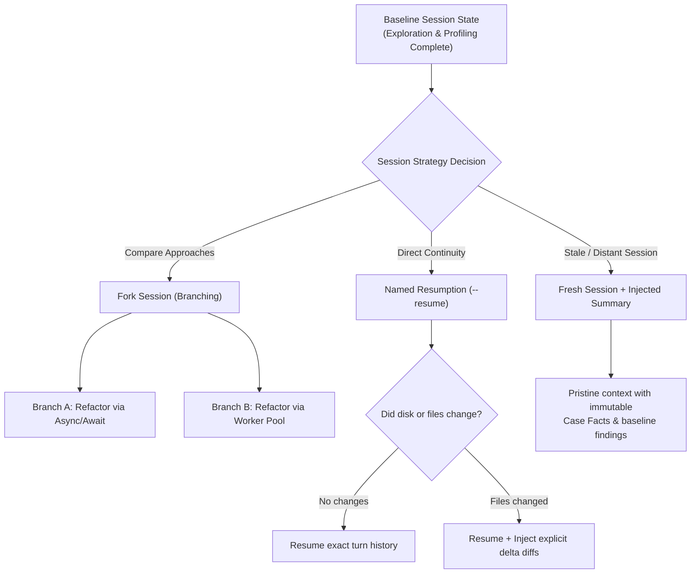

# Task Statement 1.7: Manage Session State, Resumption, and Forking

## 📌 Executive Overview: Goal, Scope & Exam Importance

### Certification Domain & Weight
- **Domain**: Domain 1: Agentic Architecture & Orchestration
- **Domain Weight**: 27% of total CCAR-F exam score
- **Scenario Alignment**: Scenario 2 (Code Generation) & Scenario 4 (Developer Productivity)

### The Core Goal
To master session lifecycle patterns across long-running developer workflows, choosing appropriately between **named session resumption (`--resume`)**, **isolated session branching via forking (`fork_session`)**, and **fresh session re-anchoring with injected summaries** when environment drift occurs.

### Why This Matters in Production
Real-world software engineering tasks are rarely completed in a single continuous prompt. A developer might explore an architecture on Monday, modify files locally on Tuesday, and return to Claude on Wednesday to implement tests. 
If the system naively resumes the Monday session with `--resume`:
1. **Stale Tool Memory**: Claude's history contains cached file contents from Monday. It will hallucinate functions that were deleted or modified outside the chat, causing broken imports and phantom edits.
2. **Context Bleed Across Experiments**: If a developer tests Approach A (Async/Await) and Approach B (Threadpool) in the same thread, Claude conflates both designs, generating invalid hybrid code.
Architects must know how to fork sessions for clean A/B exploration and when to inject structured delta summaries to overcome environment drift.

### Exam Importance
Task Statement 1.7 questions test whether candidates recognize the dangers of resuming stale tool memories, how to isolate competing refactoring experiments using session forking, and how to preserve critical architectural state across session restarts.

---

## 📖 Deep Narrative: Why We Do What We Do

### 1. The Problem: The Stale Memory Trap
Consider a developer troubleshooting a database bottleneck:
- On Turn 10, Claude runs `Read("db/conn.py")` and sees a pooling limit of 5 connections.
- The developer closes their laptop, edits `db/conn.py` manually in VS Code to use 50 connections, and renames the configuration variable.
- The next morning, the developer runs `claude --resume`.
- Claude relies on its turn 10 conversation history. It does not know the file changed. It recommends changing the variable that was already renamed, producing conflicting and erroneous diffs.

### 2. The Architectural Solution: Resumption vs Forking vs Injected Summaries
Production systems employ three distinct session patterns:

1. **Named Session Resumption (`--resume <id>`)**:
   - **When to Use**: Continuing a session where the external environment has **not changed** (zero external file edits or database modifications).
   - **Mechanism**: Restores exact conversational turns, tool results, and scratchpad memory seamlessly.

2. **Session Forking (`fork_session`)**:
   - **When to Use**: Exploring **two or more divergent solutions** from a common baseline (e.g. comparing SQLAlchemy vs Tortoise ORM).
   - **Mechanism**: Clones the baseline session state into Branch A and Branch B. Edits made in Branch A are isolated and cannot pollute Branch B's context.

3. **Fresh Session with Injected Structured Summary**:
   - **When to Use**: Returning to work after **significant external environment changes** (git pull, manual refactoring, schema migrations).
   - **Mechanism**: Discards verbose historical tool calls. Starts a pristine session and injects an authoritative summary:
     ```markdown
     <context_baseline>
     - Prior Architecture Decision: Adopted Redis token caching.
     - Files modified outside session: db/conn.py (pool size updated to 50).
     - Current Objective: Implement unit tests for cache eviction.
     </context_baseline>
     ```
   - **Result**: Zero stale memory, pristine context, and 100% accurate alignment with current disk state.

---

## 🔑 Key Technical Terminology Explained

- **Named Resumption (`--resume`)**: The ability to reload and continue an existing stateful Claude Code or Agent SDK session using a persistent session identifier.
- **Session Forking (`fork_session`)**: Creating an independent, sandboxed clone of a conversation state, allowing parallel experimentation without cross-branch context contamination.
- **Environment Drift**: Divergence between the real state of external infrastructure (files on disk, database schemas) and the cached representations stored in conversational history.
- **Injected Summary**: A compact, structured markdown block summarizing verified conclusions and external delta changes injected into a fresh session to eliminate stale memory.
- **State Manifest**: A persistent file on disk (`manifest.json` / `scratchpad.md`) recording completed milestones, active hypotheses, and pending steps.

---

## 🏗️ Architecture: Resumption vs Forking vs Injected Summaries



---

## ⚠️ Critical Exam Distinctions & Distractor Teardown

| Session Technique | Correct Implementation | Exam Trap to Reject | Why the Trap Fails |
|---|---|---|---|
| **A/B Architecture Comparison** | **Session Forking (`fork_session`)**: Clone baseline into independent exploration branches. | **TRAP**: Testing both approaches sequentially in the same conversational thread. | Context contamination: Claude conflates symbols and architectures from Approach A when implementing Approach B. |
| **Resuming After External Edits** | **Fresh Session + Injected Summary**: Start fresh and summarize verified baseline facts and file diffs. | **TRAP**: Blindly resuming `--resume` with raw outdated tool outputs. | Stale memory: Claude hallucinates old function signatures from previous cached tool outputs. |
| **Session Identification** | Use deterministic session IDs (`--resume <session-id>`) managed by the CLI/SDK runtime. | **TRAP**: Passing complete manual transcripts as prompt strings on every CLI invocation. | Wastes thousands of input tokens and risks formatting errors or prompt truncation. |

---

## 💡 Architectural Decision Matrix: Rules of Thumb

| Scenario | Recommended Strategy | Context Impact |
|---|---|---|
| **Compare 2 competing design patterns** | Fork Session (`fork_session`) | Zero context bleed; Branch A cannot pollute Branch B. |
| **Short coffee break (no files changed)** | Named Resume (`--resume`) | Zero setup overhead; preserves full reasoning momentum. |
| **Resuming after git merge or major edits** | Fresh Session + Injected Summary | Eliminates phantom bugs caused by stale tool output memory. |

---

## 🧠 Claude 4.5 Extended Thinking & Parameter Standards

- **Forking and Thinking Blocks**: When forking a session, previous thinking blocks are copied into the child session, allowing the model to understand the architectural baseline reasoning in both branches.
- **Sampling Rules**: Omit `temperature` whenever thinking is active.
- **Fresh Sessions**: When starting a fresh session with an injected summary, thinking tokens are preserved for reasoning about the new task rather than re-digesting stale transcripts.

---

## 🛠️ Hands-on Workbook Guide: Following the Code Step-by-Step

When exploring [`ts_1_7_session_management.ipynb`](ts_1_7_session_management.ipynb):
1. **Step 1: Setup & Baseline Session**: Establishes a baseline exploration session analyzing performance bottlenecks.
2. **Step 2: Simulating Session Forking**: Clones the baseline into two independent branches (Async vs ThreadPool).
3. **Step 3: Stale Context Demonstration**: Demonstrates the failure mode of resuming a session after files have changed on disk.
4. **Step 4: Fresh Session with Injected Summary**: Implements the clean recovery pattern using structured delta injection.
5. **Step 5: Verification Assertions**: Verifies that forked sessions remain isolated and summaries prevent stale hallucinations.
