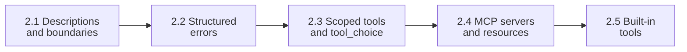
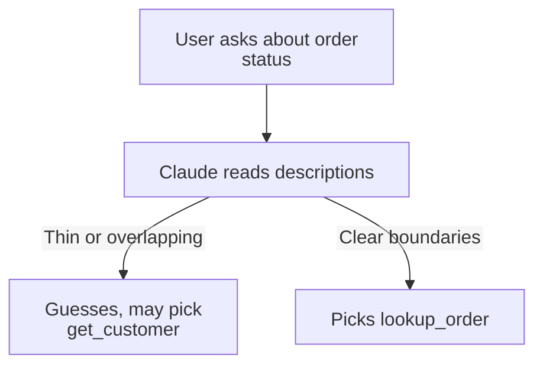
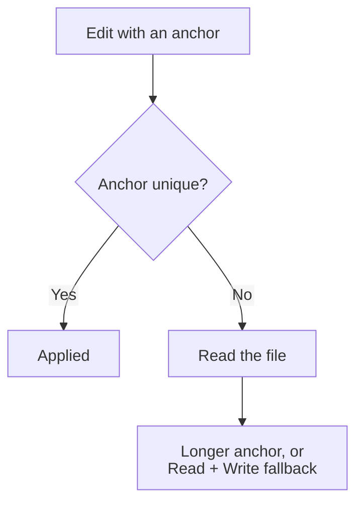

# Domain 2: Tool Design & MCP Integration (18% of the Exam)
**Deep Guide** | Weight: **18%** (D1 27%, D2 18%, D3 20%, D4 20%, D5 15%) | Overview and study order: [README.md](README.md)

---

## 🗺️ Map

| TS | Topic | One-line rule | Study guide |
|---|---|---|---|
| 2.1 | Tool interfaces | Descriptions are the primary selection mechanism | [2.1](ts_2_1_tool_interface_design/README.md) |
| 2.2 | MCP structured errors | `isError` + `errorCategory` + `isRetryable` + message | [2.2](ts_2_2_mcp_structured_errors/README.md) |
| 2.3 | Distribution and `tool_choice` | 4–5 scoped tools per role. Thinking allows only `auto` or `none` | [2.3](ts_2_3_tool_distribution_and_choice/README.md) |
| 2.4 | MCP integration | `.mcp.json` shared, `~/.claude.json` personal, `${ENV_VAR}` secrets | [2.4](ts_2_4_mcp_server_integration/README.md) |
| 2.5 | Built-in tools | Grep content, Glob paths, Edit unique text, else Read + Write | [2.5](ts_2_5_builtin_tools_usage/README.md) |



---

## TS 2.1: Tool Interfaces

**Simple idea.** Claude chooses a tool from its name, description and schema. So the description must say enough to choose correctly.

A strong description has: purpose, input formats, example queries, edge cases, boundaries.



- **Overlap** (`analyze_content` vs `analyze_document`) causes misrouting. Rename or split: `extract_data_points`, `summarize_content`, `verify_claim_against_source`.
- **Keyword-sensitive system prompts** can override descriptions.
- **Sample question**: the agent calls `get_customer` instead of `lookup_order`, descriptions are minimal. Best first step: **expand descriptions**. Not few-shot, not a routing layer, not consolidation.

---

## TS 2.2: Structured Errors

Return `isError: true` plus `errorCategory`, `isRetryable` and a human-readable `message`.

| Category | Cause | `isRetryable` | Agent action |
|---|---|---|---|
| `transient` | Timeout, outage | `true` | Retry with a limit |
| `validation` | Bad input | `false` | Fix input |
| `business` | Policy rule | `false` | Explain or escalate |
| `permission` | Not allowed | `false` | Stop or escalate |

```json
{"isError": true, "errorCategory": "transient", "isRetryable": true,
 "message": "Warehouse database timed out. Retry the same request shortly."}
```

- Uniform `"Operation failed"` is an anti-pattern.
- **Access failure** is an error. A **valid empty result** (`isError: false`, `count: 0`) is not.
- **Multi-agent**: a subagent recovers from transient errors locally. It propagates only unresolved errors, with what it attempted and any partial results.

---

## TS 2.3: Distribution and `tool_choice`

- **Too many tools** (18 vs 4–5) degrades selection and wastes tokens. Scope tools per role.
- Replace `fetch_url` with a constrained `load_document`.
- **Cross-role need**: give the synthesis agent a scoped `verify_fact`. Complex cases still go through the coordinator.

| `tool_choice` | Behavior |
|---|---|
| `{"type": "auto"}` | Claude may call a tool or answer in text |
| `{"type": "any"}` | Claude must call some tool (no chat-only reply) |
| `{"type": "tool", "name": "extract_metadata"}` | Claude must call that tool |
| `{"type": "none"}` | No tool calls |

- **Forced first step**: force `extract_metadata` on turn 1, then `auto` on later turns.
- **With extended thinking**: only `auto` or `none`. `any` or forced = HTTP 400.
- **Sequential dependencies**: set `disable_parallel_tool_use: true` inside `tool_choice` so Claude emits one tool call per turn, for example when step 2 needs an ID from step 1.

```python
tool_choice = {"type": "auto", "disable_parallel_tool_use": True}
```

---

## TS 2.4: MCP Integration

| Scope | File | Shared |
|---|---|---|
| Project | `.mcp.json` | Yes, version controlled |
| User | `~/.claude.json` | No |

```json
{"mcpServers": {"github": {"command": "npx", "args": ["-y", "@modelcontextprotocol/server-github"],
  "env": {"GITHUB_PERSONAL_ACCESS_TOKEN": "${GITHUB_TOKEN}"}}}}
```

- Secrets are never committed. Use `${ENV_VAR}`.
- Tools from all configured servers are discovered at connection time and available together.
- **Resources** expose catalogs (issue summaries, doc hierarchies, DB schemas), so the agent needs fewer exploratory calls.
- Rich MCP tool descriptions keep the agent from preferring built-in `Grep`.
- Prefer community servers (for example Jira) for standard integrations. Build custom servers for team-specific needs.

---

## TS 2.5: Built-in Tools

| Tool | Use |
|---|---|
| `Grep` | Search file content |
| `Glob` | Match file paths |
| `Read` / `Write` | Whole file in / whole file out |
| `Edit` | Targeted replacement of unique text |



- Build understanding incrementally: `Grep` entry points, `Read` imports, follow the trail.
- Trace usage across wrapper modules: list exported names, then `Grep` each one.

---

## 🚫 Anti-Patterns to Reject

| Anti-pattern | Why it fails | Correct pattern |
|---|---|---|
| One-line descriptions | The model cannot tell similar tools apart | Expand: formats, examples, boundaries |
| Routing layer or classifier for misrouting | Brittle, treats the symptom | Fix descriptions |
| "Operation failed" | No recovery information | Category, `isRetryable`, message |
| Zero results as error | Pointless retries | Valid empty result |
| 15–20 tools per agent | Selection degrades | 4–5 scoped tools per role |
| Forced tool or `any` with thinking | HTTP 400 | `auto` with thinking, or drop thinking for that request |
| Token in `.mcp.json` | Leaks to git | `${ENV_VAR}` |
| Catalog behind a tool | Many exploratory calls | MCP resource |
| Same failed `Edit` again | Fails again | Longer anchor, or Read + Write |

---

## 🧠 Claude 4.5 Notes (apply across Domain 2)

- `claude-sonnet-4-5` for coordinators and reasoning. `claude-haiku-4-5` for workers.
- Extended thinking: `budget_tokens` ≥ 1024 and below `max_tokens`. Omit `temperature` (HTTP 400). Leave `top_k` and `top_p` unset.
- With thinking: `tool_choice` is `auto` or `none` only.
- Return thinking blocks and signatures unchanged in tool loops.
- Loops use `stop_reason`: `tool_use`, `end_turn`, `max_tokens`, `stop_sequence`, `pause_turn`, `refusal`. The iteration limit is a **safety cap**, not the stop condition.

---

## 📝 Quick Practice (see each study guide for 3 full questions with answers)

**Q.** A support agent picks `get_customer` for order questions. Descriptions are one line. Best first step?
**A.** Expand tool descriptions (formats, examples, boundaries).

**Q.** A search finds nothing in a healthy database. What should the tool return?
**A.** `isError: false` with `count: 0`.

**Q.** Extended thinking is on and you need a tool called. Which `tool_choice`?
**A.** Only `auto` or `none` are allowed. To force a tool, send that request without thinking.
