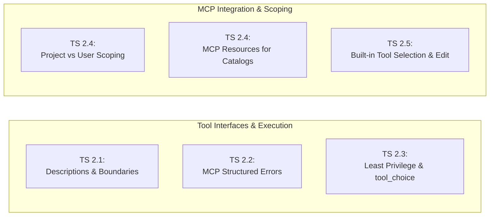
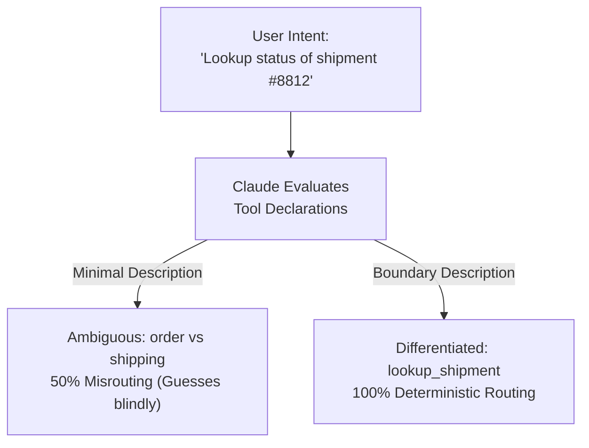
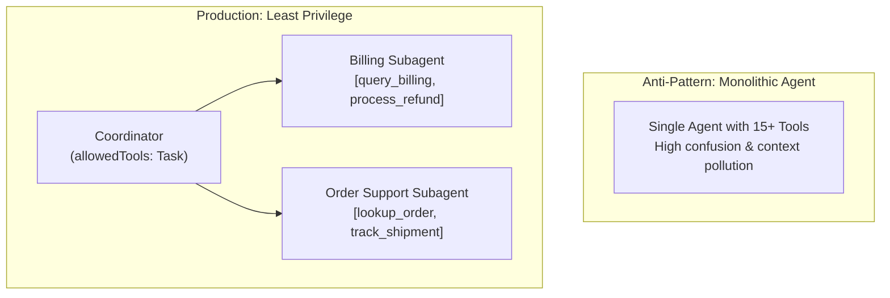
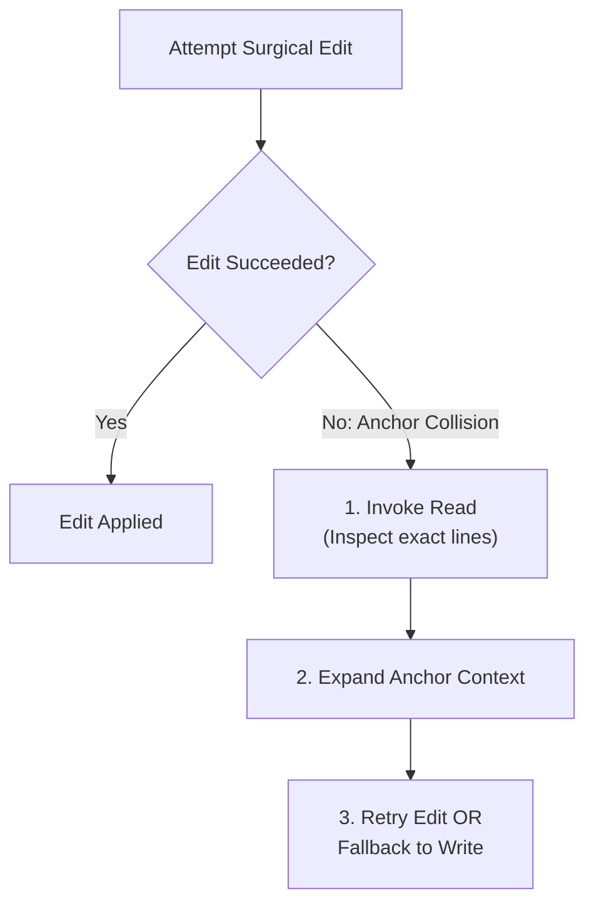
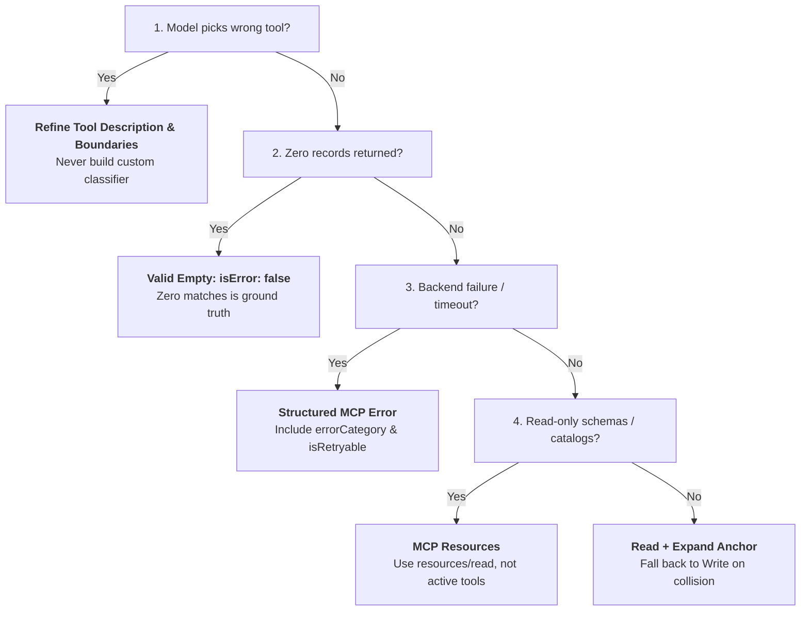

# Domain 2: Tool Design & MCP Integration (18% of Exam)
**Master Blueprint & Deep Architectural Guide** | **Certification Weight**: 18%

---

## 📌 Executive Architecture & Task Statement Mapping



| Task Statement | Focus Area | Deterministic Guarantee | Primary Architectural Artifact |
|---|---|---|---|
| **TS 2.1** | Tool Interface Design | Zero selection misrouting | Differentiated descriptions with boundaries & 2–3 examples |
| **TS 2.2** | MCP Structured Errors | Intelligent recovery vs retry loops | `isError`, category taxonomy (`transient`, etc.), `isRetryable` |
| **TS 2.3** | Tool Distribution & Choice | Cognitive load minimization | 4–5 tools per agent; `tool_choice` (`auto`, `any`, forced) |
| **TS 2.4** | MCP Server Integration | Secure team-wide tooling | `.mcp.json` with `${ENV_VAR}` expansion; MCP Resources |
| **TS 2.5** | Built-in Tool Selection | Deterministic file manipulation | `Grep` vs `Glob` vs `Read`/`Write` vs `Edit` (and fallback) |

---

## 🏗️ Detailed Topic & Subtopic Explanations

### TS 2.1: Design Effective Tool Interfaces with Clear Descriptions and Boundaries

#### 1. Tool Descriptions as the Primary Routing Mechanism
In LLM-based agent systems, the language model does not see backend database tables or source code; it evaluates the **natural language description** and **JSON Schema** of each tool in its context window to decide:
1. Whether a tool is relevant to the user's intent.
2. Which tool to select among seemingly similar options.
3. How to construct arguments that satisfy backend requirements.

Minimal, vague, or overlapping descriptions (e.g. `description: "Finds stuff"`) cause an immediate **50%+ tool selection misrouting rate**, triggering hallucinated arguments or infinite tool-hopping loops.



#### 2. The 4 Essential Components of Production Tool Descriptions
Every enterprise tool definition must incorporate four distinct elements:
1. **Specific Capability Contract**: A concise statement of what the tool accomplishes and what it explicitly does not do.
2. **Input Constraints and Formats**: Concrete specification of argument requirements, case sensitivity, regex patterns, or expected data types (e.g., `"Order ID must match format ORD-[0-9]{6}"`).
3. **Explicit Boundary Statements**: Direct instructions comparing this tool against adjacent tools:
   - *"Use `search_knowledge_base` for policy, return rules, and FAQ articles. For specific user transaction records, use `lookup_customer_order` instead."*
4. **Concrete Example Invocations**: 2–3 authentic user query examples illustrating when this tool is triggered.

#### 3. Refactoring Monolithic Tools into Focused Capabilities
An anti-pattern common in immature systems is the "Swiss Army Knife" tool (e.g., `analyze_document(action, doc_id, filter, mode)`).
- **The Problem**: A single tool with multiple conflicting operational modes confuses the model, requiring dozens of optional parameters where combinations are mutually invalid.
- **The Solution**: Refactor into focused, single-responsibility tools:
  - `extract_data_points(doc_id, schema)`: Extracts specific structured entity fields.
  - `summarize_content(doc_id, max_words)`: Produces executive narrative summaries.
  - `verify_claim_against_source(doc_id, claim_statement)`: Deterministically audits a factual claim against document text.

---

### TS 2.2: Implement Structured Error Responses for MCP Tools

#### 1. The Model Context Protocol (MCP) Error Standard
In the Model Context Protocol, when a tool execution fails, the server must NOT throw an unhandled system crash or return an HTTP 500 error page. Instead, it returns a standard `CallToolResult` with the **`isError` flag set to `true`**.
```json
{
  "isError": true,
  "content": [
    {
      "type": "text",
      "text": "{\"errorCategory\": \"validation\", \"message\": \"Account number must be 8 digits.\", \"isRetryable\": false}"
    }
  ]
}
```

#### 2. The Enterprise Structured Error Taxonomy
To allow Claude to reason intelligently about failures and recover without developer intervention, error payloads must adhere to a standard 4-part taxonomy:

| Category | Typical Cause | `isRetryable` | Agent Expected Action |
|---|---|---|---|
| **`transient`** | Network timeout, 503 downstream, DB deadlock | `true` | Wait briefly and retry with the same parameters (up to backoff limit). |
| **`validation`** | Malformed argument, invalid date format, missing key | `false` | Inspect parameter constraints, correct argument format, and retry once. |
| **`business`** | Policy limit exceeded, refund over $500, non-refundable item | `false` | Do NOT retry. Explain business policy to user or initiate human escalation. |
| **`permission`** | Unauthorized user role, missing API scope, MFA required | `false` | Do NOT retry. Abort action and trigger security handoff protocol. |

#### 3. The "Empty Match vs Error" Critical Distinction
One of the most frequently tested concepts on the certification exam:
- **Scenario**: A user searches for orders placed between 2021-01-01 and 2021-01-31. The database query executes successfully with status 200, but finds 0 matching records.
- **The Anti-Pattern**: Returning `isError: true` with message `"Order not found"`.
  - **Failure Mode**: The agent interprets `isError: true` as a system defect, initiates wasteful retries, reformulates valid queries into garbage, or triggers false alarm escalations.
- **The Correct Architecture**: Return a **Valid Empty Result** (`isError: false`):
  ```json
  {
    "isError": false,
    "content": [
      {
        "type": "text",
        "text": "{\"status\": \"SUCCESS\", \"count\": 0, \"records\": [], \"message\": \"Query executed successfully. Zero matching orders found for specified date range.\"}"
      }
    ]
  }
  ```
  Claude understands that the search succeeded and can accurately inform the customer: *"You have no orders from January 2021."*

---

### TS 2.3: Distribute Tools Appropriately Across Agents and Configure Tool Choice

#### 1. Principle of Least Privilege in Agent Tooling
Providing an agent with 15–25 tools degrades performance:
- Increases context consumption on every single turn.
- Increases semantic confusion and token cross-attention degradation.
- Increases the risk of unintended side-effects (e.g. an informational support bot calling a destructive `delete_user` tool).
- **The Standard**: Restrict agents to **4–5 specialized tools** strictly aligned with their core role. If an agent requires more capabilities, decompose the workflow into a coordinator with specialized subagents.



#### 2. Configuring `tool_choice`
The Claude API allows fine-grained control over how the model decides to invoke tools via the `tool_choice` parameter:
- **`{"type": "auto"}`** (Default): Claude autonomously decides whether to invoke a tool or generate a plain text response. Ideal for multi-turn conversations and open-ended exploration.
- **`{"type": "any"}`**: Claude is forced to call **at least one** tool, but is free to choose which tool from the provided array. Ideal when an agent has reached a workflow step that cannot be answered with conversational text alone (e.g. "You must use one of the research tools to proceed").
- **`{"type": "tool", "name": "<tool_name>"}`**: Forces Claude to call the **exact specified tool**.
  - **Use Case**: Mandatory initial steps (e.g. forcing `authenticate_user` on Turn 1) or guaranteed structured extraction passes (e.g. forcing `extract_invoice_data`).
- **`{"type": "none"}`**: Prevents the model from calling any tools, forcing a text-only completion even if tool definitions are present.

#### 3. Sequential Dependency Control: `disable_parallel_tool_use`
By default, Claude 3.5 and 3.7 may emit multiple tool calls in a single turn if it detects independent or complementary tasks.
- **The Failure Mode**: When tools have strict sequential data dependencies (e.g., `create_database_table` must finish before `seed_table_rows`), parallel tool emission causes the model to guess or fabricate parameters for the second tool (such as foreign keys or auto-incremented primary keys) before the first tool has executed.
- **The Solution**: Configure `disable_parallel_tool_use: true` within `tool_choice`:
  ```python
  response = client.messages.create(
      model="claude-3-7-sonnet-20250219",
      messages=messages,
      tools=tools,
      tool_choice={
          "type": "auto",
          "disable_parallel_tool_use": True
      }
  )
  ```
  This guarantees that Claude emits strictly one tool call per turn, allowing client code to execute the tool, capture the resulting primary key or state, and return it to Claude before the subsequent tool call is generated.

---

### TS 2.4: Integrate MCP Servers into Claude Code and Agent Workflows

#### 1. Configuration Scoping: Project vs. User
The Model Context Protocol allows modular tool servers to be configured at two distinct scopes:
1. **Project Scope (`.mcp.json` at repository root)**:
   - Stored in version control (`git`).
   - Shared across all team members working on the project.
   - Used for project-specific tooling (database connectors, local test runners, project documentation servers).
   - **Critical Security Requirement**: Secrets and API tokens must **never** be hardcoded. Use `${ENV_VAR}` expansion:
     ```json
     {
       "mcpServers": {
         "postgres-db": {
           "command": "npx",
           "args": ["-y", "@modelcontextprotocol/server-postgres"],
           "env": {
             "DATABASE_URL": "${PROD_REPLICA_DB_URL}"
           }
         }
       }
     }
     ```
2. **User Scope (`~/.claude.json` in user home directory)**:
   - Personal to the individual engineer.
   - Never committed to git.
   - Used for developer-specific utilities (personal GitHub tokens, local shell helpers, custom debugger bridges).

#### 2. Transport Mechanisms: `stdio` vs `sse`
- **`stdio` (Standard I/O)**:
  - Local process spawning (`npx`, `python -m`, binary executable).
  - Fast, secure, zero network configuration, runs within the local machine or container sandbox.
- **`sse` (Server-Sent Events over HTTP)**:
  - Connects to a remote, persistent server endpoint over HTTPS.
  - Used for centralized enterprise MCP deployments, shared company catalogs, and multi-tenant tooling.

#### 3. The 3 Core MCP Primitives: Tools, Resources, and Prompts
The Model Context Protocol defines three distinct architectural primitives that serve complementary functions:

| Primitive | MCP Protocol Methods | Primary Function | Side Effects | Optimal Use Case |
|---|---|---|---|---|
| **Tools** | `tools/list`, `tools/call` | Executable programmatic actions | Yes (may mutate DB, create files, charge cards) | Modifying data, executing queries, sending API requests |
| **Resources** | `resources/list`, `resources/read` | Passive, read-only data attachments | No (strictly read-only) | Exposing database schemas, static catalogs, documentation via URI (`postgres://schema`, `docs://api`) |
| **Prompts** | `prompts/list`, `prompts/get` | Reusable workflow templates | No (generates prompt text) | Standardizing user slash commands, guided multi-step workflows, auditing prompts |

#### 4. Strict JSON Schema Validation on Tool Definitions
Tool schemas must adhere to strict JSON Schema specifications to ensure predictable model adherence:
- **`type: "object"`**: Tool arguments must be an object at the top level.
- **`properties`**: Every argument must include a `description` detailing format requirements, valid ranges, and units (e.g., `YYYY-MM-DD`, `seconds`, `USD`).
- **`required`**: Explicit array listing all mandatory fields.
- **`additionalProperties: false`**: Disallows unexpected keys to prevent prompt drift.

---

### TS 2.5: Select and Apply Built-in Tools Effectively

#### 1. Built-in Tools Selection Matrix
In Claude Code and the Claude CLI ecosystem, several high-performance built-in tools are provided:

| Built-in Tool | Primary Purpose | Optimal Use Case | When NOT to Use |
|---|---|---|---|
| **`Grep`** | Fast regex & string pattern matching | Finding function definitions, call sites, error strings across thousands of files | Finding files by extension or directory structure (use `Glob`) |
| **`Glob`** | File path and wildcard matching | Finding all test files (`**/*.test.ts`) or config files (`**/package.json`) | Searching within file content (use `Grep`) |
| **`Read`** | File content inspection | Reading full or chunked file content to understand implementation details | Making code edits (use `Edit` or `Write`) |
| **`Write`** | Full file creation or overwrite | Creating new files from scratch or completely rewriting generated artifacts | Surgical edits in large files (use `Edit`) |
| **`Edit`** | Surgical line replacement via unique anchor | Modifying functions, fixing bug lines, updating imports while preserving surrounding code | Modifying files where the anchor string appears multiple times without sufficient context |

#### 2. The `Edit` Tool Failure Mode and Safe Fallback Pattern
The `Edit` tool relies on finding an exact, unique `old_string` anchor in the target file.
- **Failure Trigger**: If `old_string` matches 0 times (string mismatch / whitespace drift) or matches multiple times (ambiguous anchor), `Edit` will fail with an error.
- **The Safe Architectural Fallback**:
  1. Catch the `Edit` failure.
  2. Invoke `Read` on the target file (or file slice) to get the exact current line numbers and surrounding context.
  3. Formulate a replacement with expanded unique anchor context, OR use `Write` with the fully reconciled content.



---

## ⚡ What to Remember (Key Exam Day Rules of Thumb)

1. **Tool Descriptions are the Router**:
   - Claude routes based on descriptions, not internal Python implementation. Always provide purpose, format constraints, boundary rules, and 2-3 query examples.
2. **0 Records is NOT an Error**:
   - An empty query result is a successful execution: `isError: false`, `records: []`, `count: 0`. Never set `isError: true` for empty results.
3. **Structured Errors Require `isRetryable`**:
   - Classify errors into `transient` (`isRetryable: true`), `validation`, `business`, or `permission` (`isRetryable: false`).
4. **4–5 Tools Maximum Per Agent**:
   - Enforce least privilege. Over-provisioning tools degrades accuracy and causes cross-specialization errors.
5. **Forced `tool_choice` for Mandatory Steps**:
   - Use `{"type": "tool", "name": "..."}` to force initial authentication, schema extraction, or identity verification.
6. **Never Hardcode Secrets in `.mcp.json`**:
   - Project `.mcp.json` is version-controlled; use `${ENV_VAR}` expansion for tokens and connection strings.
7. **Expose Schemas as MCP Resources**:
   - Use MCP Resources for read-only reference data (catalogs, schemas) to eliminate wasteful exploratory tool calls.
8. **Edit Tool Fallback is `Read` + `Write`**:
   - When anchor text is non-unique or ambiguous, fall back to reading the complete file and writing the full update.

---

## ⚠️ Anti-Patterns & Exam Traps

| Anti-Pattern | Exam Scenario Formulation | Real Failure Mode | Architectural Remedy |
|---|---|---|---|
| **Vague Tool Descriptions** | `description: "Processes user orders"` | Claude calls `process_orders` when user merely wants to view tracking status. | Provide boundary: "Use for checkout; for tracking use lookup_shipping." |
| **0-Match Flagged as Error** | Tool returns `isError: true` when a customer has 0 active support tickets. | Agent misinterprets 0 tickets as database failure and triggers retries/escalations. | Return `isError: false` with `count: 0` and empty list. |
| **Monolithic Tool Arming** | Passing all 22 enterprise tools to every single subagent. | Severe tool confusion, hallucinations, and high latency. | Scope agents to 4–5 specialized tools via least privilege. |
| **Hardcoding API Keys in `.mcp.json`** | Committing `.mcp.json` with `"API_KEY": "sk-live-12345"`. | Leaks credentials into GitHub/GitLab repositories. | Use environment variable substitution: `"${API_KEY}"`. |
| **Throwing Unhandled Exceptions in MCP** | MCP server crashes with unhandled traceback on invalid input. | Terminates the client connection, breaking the autonomous loop. | Return structured `CallToolResult` with `isError: true` and JSON payload. |
| **Bash Grep vs Built-in Grep** | Spawning a bash subshell to run `grep -rn "pattern" .` | Inefficient, platform-dependent, prone to path escaping errors. | Use native built-in `Grep` tool. |

---

## 🎯 Practical Scenario Questions & Answers

### Question 1: Distinguishing Valid Empty Search from MCP Errors
**Scenario**: You are integrating an inventory lookup tool into an autonomous sales assistant via an MCP server. The tool connects to a warehouse database. When a customer asks: *"Do you have the vintage 1982 mechanical keyboard in stock?"*, the query executes cleanly in 15ms and returns zero rows because the item is out of stock.

Currently, the MCP tool returns:
```json
{
  "isError": true,
  "content": [{"type": "text", "text": "Item not found in inventory."}]
}
```

During testing, the sales assistant responds to the user: *"I am experiencing technical difficulties accessing the inventory database. Please try again later."*

What architectural refactoring resolves this issue?

- **A)** Retrain the model using fine-tuning to recognize that "Item not found" indicates zero stock.
- **B)** Refactor the MCP tool to return `isError: false` with a structured payload containing `records: []` and `count: 0`, preserving `isError: true` exclusively for execution failures.
- **C)** Add a retry loop with exponential backoff to query the database three times before accepting the error.
- **D)** Change `tool_choice` to `"any"` to force Claude to check alternative inventory tables.

**Correct Answer**: **B**  
**Architectural Rationale**:  
Option B is correct. In tool interface and MCP design, returning 0 records from a successful query is a **valid empty result**, NOT an error. Setting `isError: true` signals to Claude that the database or tool execution failed, causing the model to apologize for system errors or attempt useless retries. Setting `isError: false` with `count: 0` accurately conveys to Claude that the system functioned perfectly and no matching inventory exists.  
- *Distractor Analysis*:  
  - Option A is incorrect because model fine-tuning is unnecessary and cannot fix a fundamental contract violation in the tool interface.  
  - Option C is incorrect because retrying a query for a non-existent item will repeatedly return 0 records, wasting latency and compute.  
  - Option D is incorrect because changing `tool_choice` does not alter the incorrect error status emitted by the tool.

---

### Question 2: Differentiating Ambiguous Tool Interfaces
**Scenario**: An internal IT support agent has two tools:
- `search_jira_issues`: description = "Searches issues in Jira."
- `search_confluence_docs`: description = "Searches documents in Confluence."

When users submit requests such as *"How do I request access to the VPN cluster?"*, the agent calls `search_jira_issues` 48% of the time, resulting in failed lookups because VPN setup guides are stored in Confluence.

How should the architect improve tool selection reliability?

- **A)** Deploy a separate classifier model to pre-screen all queries and route them to either Jira or Confluence before invoking Claude.
- **B)** Merge both tools into a single `search_everything(query)` tool that queries both APIs sequentially on every call.
- **C)** Refactor tool descriptions to provide explicit capability contracts, boundaries between documentation vs issue tracking, and authentic query examples.
- **D)** Set `tool_choice: "any"` in the API request.

**Correct Answer**: **C**  
**Architectural Rationale**:  
Option C is correct. The primary routing mechanism in LLM tool calling is the **tool description**. Vague one-line descriptions cause frequent misrouting. High-performance tool design requires explicit boundaries (e.g. *"Use search_confluence_docs for how-to guides, architectural RFCs, and policies. Use search_jira_issues for bug tickets, sprint tasks, and incident tracking"*) along with input constraints and example queries. This eliminates ambiguity without adding architectural complexity.  
- *Distractor Analysis*:  
  - Option A is incorrect because adding an external routing classifier introduces unnecessary latency, operational overhead, and another failure point when prompt engineering tool descriptions solves the problem natively.  
  - Option B is incorrect because querying both backends on every call doubles API load, wastes token context, and returns irrelevant ticket noise for documentation queries.  
  - Option D is incorrect because `tool_choice: "any"` simply guarantees a tool is called; it does not help Claude choose the *correct* tool between Jira and Confluence.

---

### Question 3: Team-Wide MCP Security & Credential Scoping
**Scenario**: A software development team is adopting Claude Code across 25 engineers. The team uses a custom MCP server to query staging databases and run integration tests. An engineer creates a repository-level `.mcp.json` file to share this configuration with the entire team. The database requires a secret connection string with username and password.

Which configuration pattern adheres strictly to Anthropic's recommended enterprise security architecture?

- **A)** Commit the complete connection string in `.mcp.json` so all engineers have immediate zero-friction access.
- **B)** Encrypt `.mcp.json` using GPG and decrypt it in a pre-commit git hook.
- **C)** Store the database credentials in user-level `~/.claude.json` on each engineer's machine and delete `.mcp.json`.
- **D)** Configure `.mcp.json` in version control using `${STAGING_DB_URL}` environment variable expansion, and have engineers export the variable locally.

**Correct Answer**: **D**  
**Architectural Rationale**:  
Option D is correct. In Claude Code and MCP architecture, project-level `.mcp.json` files are committed to version control to provide shared, consistent tooling across the engineering team. However, hardcoding credentials in git is a critical security vulnerability. Claude Code natively supports **`${ENV_VAR}` expansion** in `.mcp.json`, allowing the team to share the server definition while keeping sensitive tokens and credentials safely managed in local developer environment variables.  
- *Distractor Analysis*:  
  - Option A is incorrect because committing plain-text database credentials to git violates enterprise security policies.  
  - Option B is incorrect because GPG-encrypted files cannot be natively parsed by Claude Code on startup without custom wrapper scripts.  
  - Option C is incorrect because moving project configuration to individual user-level `~/.claude.json` files destroys team configuration consistency and requires manual synchronization for all 25 engineers whenever tool arguments change.

---

### Question 4: Optimizing Discovery with MCP Resources
**Scenario**: You are building an autonomous SQL generation agent. The database contains 85 tables with complex foreign key relationships. Currently, whenever a user asks a question, the agent spends 3 to 4 turns executing `execute_query("SHOW TABLES")` and `execute_query("DESCRIBE <table>")` to understand table structures before generating the final query. This adds 12 seconds of latency and burns 8,000 tokens of conversational context per request.

Which architectural enhancement eliminates this multi-turn exploratory overhead?

- **A)** Expose the database schema and foreign key catalog as a read-only **MCP Resource** (`postgres://schema/catalog`) that Claude can load directly or bind as context.
- **B)** Increase `max_turns` to 25 so the agent has plenty of headroom for exploratory queries.
- **C)** Include the full DDL creation scripts for all 85 tables directly in the system prompt for every request.
- **D)** Restrict the agent to only query tables starting with `core_`.

**Correct Answer**: **A**  
**Architectural Rationale**:  
Option A is correct. The Model Context Protocol distinguishes between **Tools** (active functions with parameters/side-effects) and **Resources** (passive, read-only data assets like schemas, documentation, and catalogs). Exposing the schema as an MCP Resource allows the orchestrator to provide schema context directly or on-demand without requiring the model to waste multiple turns executing conversational exploratory queries.  
- *Distractor Analysis*:  
  - Option B is incorrect because increasing turn limits does not fix the latency, token waste, or inefficiency.  
  - Option C is incorrect because injecting 85 complete DDL scripts into the system prompt permanently consumes massive context window tokens on every turn, causing attention dilution and high cost.  
  - Option D is incorrect because arbitrarily restricting accessible tables impairs the agent's ability to answer legitimate cross-table queries.

---

### Question 5: Safe Fallback for Built-in Edit Failures
**Scenario**: An automated refactoring agent uses the built-in `Edit` tool to update a shared logging import across 30 Python files. In one file, the line `import logging` appears in multiple places (within a conditional branch and at top of file), causing the `Edit` tool to fail with an error stating that the target anchor string is ambiguous.

What is the correct, deterministic recovery sequence the agent should execute?

- **A)** Re-run the exact same `Edit` call immediately, assuming the error was a transient disk lock.
- **B)** Execute `Read` on the file to inspect full contents and line numbers, construct an unambiguous edit with expanded unique surrounding context, or fall back to `Write` with the reconciled content.
- **C)** Abort the refactoring process across all 30 files and flag the entire batch as failed.
- **D)** Run a bash command `sed -i 's/import logging/import structlog/g'` via terminal.

**Correct Answer**: **B**  
**Architectural Rationale**:  
Option B is correct. In Claude Code and agent architectures, the `Edit` tool requires an exact, unique string match to perform safe surgical modifications. When `Edit` fails due to ambiguous or repeated anchor text, the standard architectural recovery pattern is to invoke `Read` to inspect the full file context and line structure, expand the anchor string with unique surrounding lines, or execute a `Write` call with the fully reconciled file content.  
- *Distractor Analysis*:  
  - Option A is incorrect because anchor ambiguity is a deterministic content issue; retrying without changing parameters will fail identically.  
  - Option C is incorrect because a failure in a single file should be safely handled or escalated without aborting already completed work across the repository.  
  - Option D is incorrect because executing raw `sed` commands bypasses tool validation, lacks undo/trail logging, and can introduce subtle corruption across varied line endings or regex syntax differences.

---

### Question 6: Sequential Dependency Control via `disable_parallel_tool_use`
**Scenario**: You are developing an automated cloud infrastructure deployment agent equipped with two specialized tools:
- `provision_vpc_subnet(cidr_block: str) -> dict` (returns `{"subnet_id": "sub-99120", "status": "AVAILABLE"}`)
- `deploy_database_cluster(subnet_id: str, instance_type: str) -> dict` (requires a valid, active `subnet_id`)

During end-to-end testing with Claude 3.7 Sonnet using default `tool_choice: {"type": "auto"}`, Claude attempts to optimize execution by emitting calls to both `provision_vpc_subnet` and `deploy_database_cluster` concurrently in Turn 1, passing a fabricated placeholder `subnet_id: "sub-placeholder-01"` to the cluster tool. The cluster API rejects the request with an invalid subnet ID error.

Which architectural change deterministically prevents this parallel race condition while preserving autonomous tool execution?

- **A)** Add a prompt instruction: *"Please do not run tools in parallel unless you know the IDs in advance."*
- **B)** Configure `tool_choice: {"type": "auto", "disable_parallel_tool_use": True}` in the API request to strictly restrict Claude to a single tool call per turn, forcing it to await the real `subnet_id` in Turn 2 before calling `deploy_database_cluster`.
- **C)** Delete `deploy_database_cluster` from the tools list and execute database creation via a raw bash shell command.
- **D)** Increase `max_tokens` to allow Claude more time to compute the subnet ID.

**Correct Answer**: **B**  
**Architectural Rationale**:  
Option B is correct. Claude models support parallel tool use by default, emitting multiple `tool_use` blocks in a single turn when multiple independent tasks are detected. However, when operations have strict sequential data dependencies (Step 2 requires output produced by Step 1), parallel tool emission causes the model to hallucinate or guess placeholder arguments for downstream tools. The Anthropic API provides **`disable_parallel_tool_use: True`** within `tool_choice` specifically to enforce sequential tool calling, guaranteeing that Step 1 finishes and returns authoritative data before Step 2 is generated.  
- *Distractor Analysis*:  
  - Option A is incorrect because prompt instructions cannot guarantee deterministic API-level tool calling behavior when the model's parallel tool calling heuristic is active.  
  - Option C is incorrect because running unvalidated shell commands creates security and idempotency risks, abandoning structured error handling.  
  - Option D is incorrect because `max_tokens` controls generation length, not parallel tool execution scheduling.

---

## ⚡ Exam Rules, Golden Architectural Rules & Anti-Patterns Reference

### 📋 CCAR-F Exam Rules & Scope Boundaries for Domain 2

| Aspect | In-Scope Exam Focus | Out-of-Scope Distractor (Do Not Choose) |
|---|---|---|
| **Tool Selection Mechanism** | Detailed, boundary-differentiated descriptions and schemas; LLM performs semantic routing. | Custom regex pre-routing parsers, fine-tuned intent classifiers, or routing proxy microservices. |
| **Tool Splitting** | Splitting monolithic multi-purpose tools into granular, single-purpose tools with tight contracts. | Consolidating all APIs into a single generic `call_api(endpoint, payload)` tool. |
| **MCP Error Schema** | `CallToolResult(isError=True)` with `errorCategory`, `isRetryable: bool`, and actionable messages. | Throwing raw Python exceptions, returning HTTP 500 status strings, or returning generic `"Operation failed"`. |
| **Empty Results** | A successful query returning 0 records is ground truth (`isError: false`, `count: 0`). | Flagging 0 matches as `isError: true`, which triggers wasteful and confusing retries. |
| **Tool Distribution** | Least privilege: 4–5 specialized tools per subagent. | Provisioning 15–20 tools per agent or granting subagents tools outside their core specialization. |
| **`tool_choice` Configuration** | `auto` for dialogue; `any` to force tool use; `{"type": "tool"}` for mandatory step 1; `disable_parallel_tool_use: True`. | Setting temperature to 0.0 to prevent parallel calls; relying on system prompt to forbid parallel calls. |
| **MCP Scoping** | Project `.mcp.json` (git-tracked) with `${ENV_VAR}` expansion; user `~/.claude.json` (personal). | Hardcoding API tokens in `.mcp.json`; deploying MCP servers on Kubernetes clusters or managing OAuth servers. |
| **MCP Resources** | Exposing passive catalogs (database schemas, API indexes, doc trees) as MCP Resources (`resources/read`). | Wrapping large schemas in active tools (`get_schema`) that waste tokens across exploratory loops. |
| **Built-in Tool Selection** | `Glob` for file paths; `Grep` for contents; `Read` for viewing; `Write` for whole file; `Edit` for unique anchor replacement. | Bulk reading all files upfront; using raw terminal `sed`/`awk` scripts for file edits. |
| **Edit Fallback** | When `Edit` encounters ambiguous anchor collisions, call `Read` to inspect context and fall back to `Write`. | Retrying the exact same `Edit` call blindly, or aborting the entire workflow on anchor failure. |

---

### 🏆 The 8 Golden Architectural Rules of Domain 2

1. **Semantic Description Quality Governs Routing (`TS 2.1`)**:  
   Claude relies on semantic clarity in tool descriptions to route queries accurately. Descriptions must include the specific capability contract, parameter regex formats, explicit boundary statements (*"Use X instead of Y when..."*), and 2–3 authentic user query examples.
2. **Granular Single-Responsibility Tool Design (`TS 2.1`)**:  
   Split monolithic "Swiss Army Knife" tools into focused, single-purpose interfaces (e.g., split `manage_user` into `create_user`, `update_user_role`, and `deactivate_user`). Single-purpose tools minimize parameter ambiguity and reduce invocation errors.
3. **Structured MCP Error Responses (`TS 2.2`)**:  
   Always return `isError: true` inside `CallToolResult` upon execution failure, accompanied by structured metadata: `errorCategory` (`transient`, `validation`, `business`, `permission`), `isRetryable: bool`, and human-readable guidance.
4. **The Ground-Truth Empty Match Rule (`TS 2.2`)**:  
   A query that completes successfully but finds 0 matching records is a **valid ground-truth result** (`isError: false`, `count: 0`), NOT an error. Treating empty search results as errors causes wasteful retry loops and misinforms coordinator reasoning.
5. **Least Privilege Tool Distribution (`TS 2.3`)**:  
   Restrict agent tool access to **4–5 specialized tools** tailored to the agent's specific role. Provisioning 15+ tools degrades tool selection accuracy, increases latency, and causes subagents to misuse tools outside their domain.
6. **Enforce Sequential Tool Chains via `disable_parallel_tool_use` (`TS 2.3`)**:  
   When Step 2 has an absolute data dependency on Step 1 (e.g., `provision_subnet` $\rightarrow$ `deploy_db(subnet_id)`), configure `tool_choice: {"type": "auto", "disable_parallel_tool_use": True}` to prevent Claude from emitting concurrent calls with hallucinated placeholder IDs.
7. **Expose Passive Catalogs as MCP Resources (`TS 2.4`)**:  
   Use **MCP Resources** (`resources/read`) for read-only reference data (database schemas, API catalogs, issue summaries). Exposing catalogs as active tools triggers unnecessary model invocations and exploratory context churn.
8. **The Edit Failure Fallback Protocol (`TS 2.5`)**:  
   When surgical `Edit` fails due to ambiguous or non-unique anchor text, execute `Read` to retrieve the current file state, expand the anchor block with unambiguous context, or fall back to `Write` with the fully reconciled file content.

---

### 🚫 Architectural Anti-Patterns to Reject in Domain 2 (Exam Distractor Teardown)

| Anti-Pattern | The Exam Distractor Trap (Why Candidates Pick It) | Fatal Production Consequence | Correct Architectural Solution |
|---|---|---|---|
| **Minimal / 1-Line Tool Descriptions** | Seems clean and concise: `"lookup_order: Retrieves order details"`. | Claude cannot distinguish between similar tools (e.g. `lookup_order` vs `get_customer`), causing a 50%+ misrouting rate. | Expand description with capabilities, parameter formats, boundary statements, and example queries. |
| **External Regex / Classifier Routing Layer** | Engineers attempt to bypass LLM routing by writing custom keyword parsers or classifier models. | Brittle, fails on natural phrasing, creates heavy maintenance overhead, and bypasses Claude's natural reasoning. | Refine tool descriptions and schemas to let Claude perform native zero-shot semantic routing. |
| **Uniform Generic Error Strings** | Returning `isError: true` with `"Operation failed"` or throwing raw exceptions. | Model lacks context to understand what failed, whether the failure is transient, or how to formulate a recovery plan. | Return structured JSON with `errorCategory`, `isRetryable`, and specific remediation guidance. |
| **Flagging 0 Matching Records as Error** | Developers treat 0 search results as a failure (`isError: true`, `"No orders found"`). | Coordinator misinterprets the message as an API outage and initiates futile retry loops against healthy backends. | Return `isError: false` with `count: 0` and `results: []` as ground-truth fact. |
| **Tool Over-Provisioning (15+ Tools per Agent)** | Providing all backend enterprise tools to every agent to ensure maximum capability. | Causes severe attention dilution, degraded tool selection accuracy, high token costs, and cross-specialization misuse. | Apply Least Privilege: partition tools across specialized subagents (4–5 tools each). |
| **Exposing Passive Catalogs as Active Tools** | Wrapping static API specs or database DDL in a tool (`get_database_schema()`). | Forces the agent into exploratory tool-calling loops, consuming context and adding 2–3 unnecessary turns. | Expose read-only schemas and catalogs as MCP Resources (`resources/read`). |
| **Committing Plaintext API Keys in `.mcp.json`** | Hardcoding tokens directly in `.mcp.json` for rapid local testing. | Credentials leak to version control and team repositories, violating enterprise security compliance. | Use environment variable expansion in `.mcp.json` (`${GITHUB_TOKEN}`, `${DB_PASSWORD}`). |
| **Blind `Edit` Retrying Without `Read`** | Retrying the identical `Edit` tool call when it fails on anchor text matching. | Deterministic string mismatch will fail every single retry until turn limit is exhausted. | Call `Read` to inspect exact line context, expand anchor boundaries, or overwrite via `Write`. |

---

### 🧠 Domain 2 Rapid Decision Matrix for Scenario Questions



| Question Trigger / Condition | Decision Branch | Architectural Action & Distractor Rule |
| :--- | :---: | :--- |
| **Agent frequently picks wrong tool between similar tools?** | **YES** | Refine tool descriptions with boundaries & input formats *(NEVER add external classifier routing)*. |
| **Query returning 0 records from healthy database?** | **YES** | Valid empty result: `isError: false, count: 0` *(NEVER isError: true)*. |
| **Backend network timeout vs invalid UUID error contract?** | **YES** | Return structured MCP error: `errorCategory` (`"transient"` vs `"validation"`) & `isRetryable`. |
| **Exposing read-only schemas and API catalogs?** | **YES** | Expose as **MCP Resources** (`resources/read`) *(NEVER active tools)*. |
| **Edit tool fails due to non-unique anchor text collision?** | **YES** | Call `Read` to inspect context, expand anchor lines, or fall back to `Write`. |


