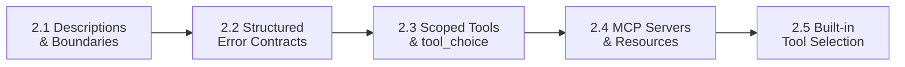
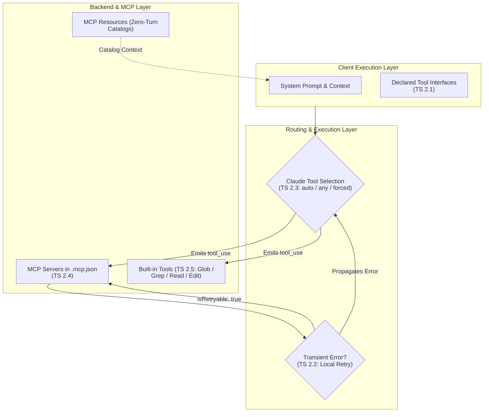
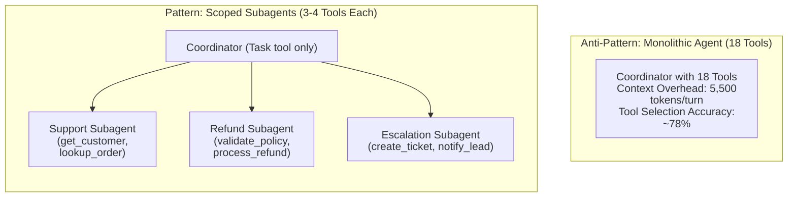
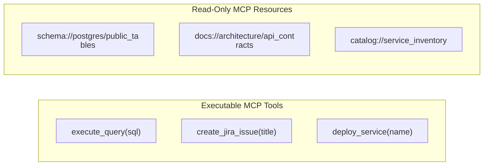
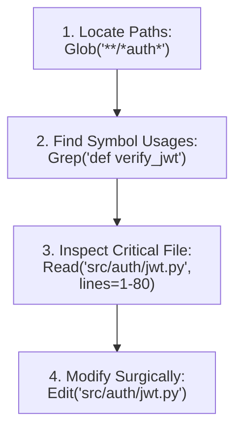
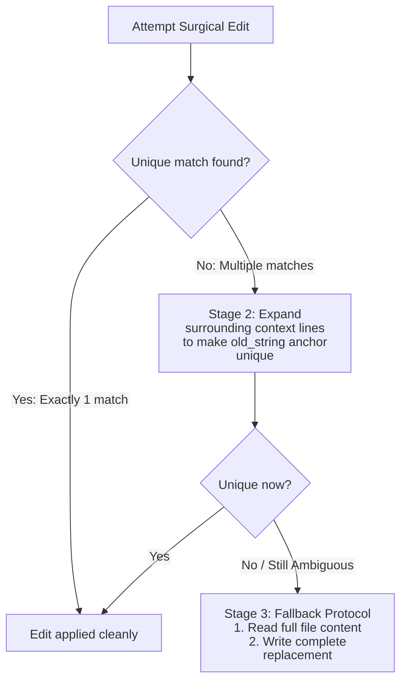
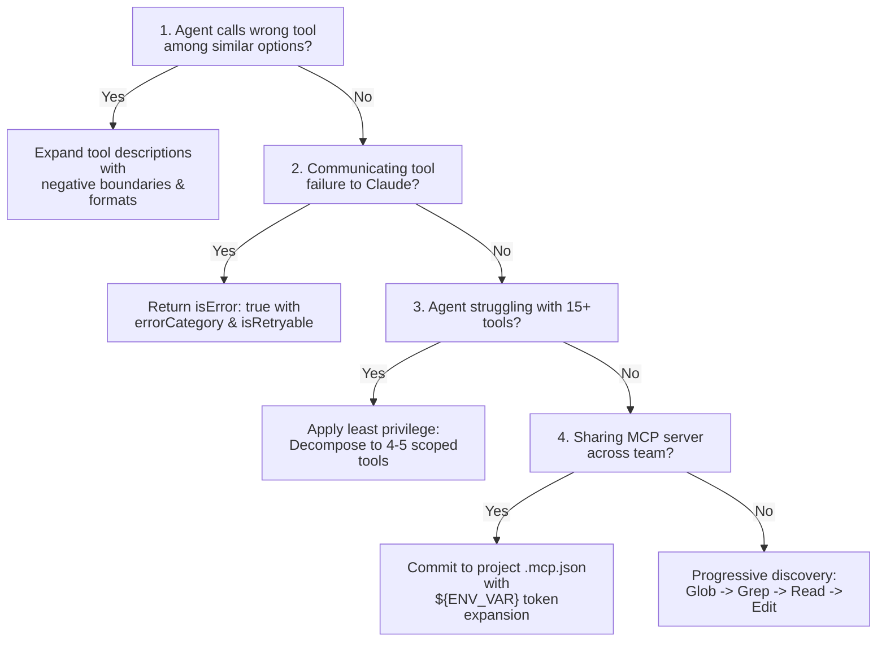

# Domain 2: Tool Design & MCP Integration (18% of Exam)
**Master Blueprint & Deep Architectural Guide** | **Certification Weight**: 18% (Third Highest Weighting on Exam)

---

## 🧭 Study Order, Weights, and One-Line Summaries

**Exam weights**: D1 27% · D2 18% · D3 20% · D4 20% · D5 15%. Domain 2 tests the contract boundary between Claude and external execution environments. Start with the short guides in [README.md](README.md), then use this file for architectural depth.

**Study order**: 2.1 descriptions & boundaries → 2.2 structured errors → 2.3 tool distribution & choice → 2.4 MCP server integration & resources → 2.5 built-in tool selection.

| TS | Study Guide | What It Tests | Key Architectural Trap |
|---|---|---|---|
| 2.1 | [Guide](ts_2_1_tool_interface_design/README.md) | Descriptions as primary routing mechanism, parameters, example queries, negative boundaries | Deploying an ML routing classifier instead of expanding tool descriptions |
| 2.2 | [Guide](ts_2_2_mcp_structured_errors/README.md) | `isError` flag, taxonomy (`transient`, `validation`, `business`, `permission`), `isRetryable`, local recovery | Returning uniform `"Operation failed"` strings or treating empty search results as errors |
| 2.3 | [Guide](ts_2_3_tool_distribution_and_choice/README.md) | Least privilege (4–5 tools/agent), scoped tools, `tool_choice` modes (`auto`, `any`, forced) | Provisioning 18+ tools per agent or forcing tools with Extended Thinking (HTTP 400) |
| 2.4 | [Guide](ts_2_4_mcp_server_integration/README.md) | Project `.mcp.json` vs user `~/.claude.json`, `${ENV_VAR}` secrets, MCP resources for zero-turn catalogs | Hardcoding tokens in git or querying DB schema with iterative bash tools instead of resources |
| 2.5 | [Guide](ts_2_5_builtin_tools_usage/README.md) | Progressive discovery (`Glob` → `Grep` → `Read`), surgical `Edit` fallback to `Read + Write` | Reading 300 files upfront, using `Grep` for file paths, or repeating failing non-unique edits |



---

## 📌 Executive Architecture & Task Statement Mapping

The contract between an autoregressive model and an execution environment relies entirely on the precision of tool schemas. Models do not have intuitive knowledge of your backend database schema, API rate limits, or transactional boundaries. They reason solely over the textual definitions exposed in tool payloads.



| Task Statement | Focus Area | Deterministic Contract | Primary Architectural Artifact |
|---|---|---|---|
| **TS 2.1** | Tool Interface Design | Rich descriptive routing metadata | 5-part description contract with negative boundaries |
| **TS 2.2** | Structured Error Handling | Machine-readable failure taxonomy | `isError` protocol + `errorCategory` + `isRetryable` boolean |
| **TS 2.3** | Distribution & Tool Choice | Attention budget protection (4–5 tools) | Role-scoped `tools` list & `tool_choice` configuration |
| **TS 2.4** | MCP Server Integration | Secure repository-scoped tooling | `.mcp.json` with `${ENV_VAR}` & MCP Resources (`@mcp.resource`) |
| **TS 2.5** | Built-in Tools Selection | Surgical codebase exploration | Progressive discovery pipeline & 3-stage Edit Fallback Protocol |

---

## 🏗️ Detailed Topic & Subtopic Explanations

### TS 2.1: Design Effective Tool Interfaces with Clear Descriptions and Boundaries

#### 1. Why Tool Descriptions Are the Primary Routing Mechanism
In large language model orchestration, tool descriptions are not decorative human documentation; they are **semantic routing vectors**. When Claude processes an incoming request alongside a set of tools, its attention mechanism compares the semantic intent of the query against the names, descriptions, and input schemas of every declared tool.

If descriptions are minimal or functional duplicates (e.g. `get_customer` described as `"Retrieves customer info"` and `lookup_order` described as `"Retrieves order details"`), the semantic distance between the tools collapses. When a user asks: `"Where is package #9921 for alice@example.com?"`, Claude must choose between two plausible identifiers. Without explicit guidance, it will frequently call `get_customer` because the email address appears first in the token sequence, triggering an unneeded round trip and degrading turn latency.

#### 2. The 5-Part Architectural Tool Description Standard
Every enterprise production tool description must contain five distinct components:
1. **Core Purpose**: Exactly what resource or data entity the tool queries or mutates.
2. **Expected Input Formats**: Precise regex patterns, prefixes, or formatting expectations (e.g. `"Customer email, or alphanumeric customer ID prefixed with 'CUST-' (e.g. 'CUST-10492')"`).
3. **Example Queries**: 2–3 realistic customer or user prompts that should explicitly trigger this tool.
4. **Edge Case Behaviors**: What the tool returns when an entity is absent, partially matched, or rate-limited.
5. **Negative Boundary Directives (`BOUNDARY`)**: Explicit negative scoping stating what the tool must **NOT** be used for, explicitly naming the alternative tool.

```python
GET_CUSTOMER_TOOL = {
    "name": "get_customer",
    "description": (
        "Retrieves customer profile, identity verification status, and registered shipping addresses by customer ID or email. "
        "Use this tool EXCLUSIVELY to verify user identity, check account status, or inspect membership tier. "
        "BOUNDARY: Do NOT use this tool for order lookups, shipment tracking, or tracking numbers; use lookup_order instead. "
        "Do NOT use this tool to issue refunds; use process_refund after customer identity is verified. "
        "Example queries: 'Verify customer alice@example.com', 'Get profile for CUST-88192'. "
        "Returns a customer record object, or {isError: false, count: 0} if no matching customer exists."
    ),
    "input_schema": {
        "type": "object",
        "properties": {
            "identifier": {
                "type": "string",
                "description": "Customer email address or CUST-prefixed identifier (e.g., 'CUST-10492')."
            }
        },
        "required": ["identifier"]
    }
}
```

#### 3. Renaming and Splitting Vague Monolithic Tools
A frequent anti-pattern in early agent design is creating generic "Swiss Army Knife" tools like `analyze_document` or `handle_data`. These tools suffer from ambiguous input schemas and unpredictable execution times.
- **The Failure Mode**: Claude cannot reliably determine which internal operation will execute, leading to invalid argument payloads.
- **The Architectural Fix**: Decompose the generic tool into single-responsibility tools with distinct contracts:
  - `extract_data_points`: Takes an unstructured document and pulls specific named entities into a strict schema.
  - `summarize_content`: Generates an executive summary highlighting decisions and open risks.
  - `verify_claim_against_source`: Performs deterministic citation checking between a specific claim and source text.

#### 4. Keyword Collision: When System Prompts Override Tool Descriptions
System prompt phrasing can inadvertently create destructive gravitational pull. If a system prompt states:
> *"Always check customer status and account security before answering any inquiry."*

Claude's attention will prioritize the words `"customer status"` on every turn, causing it to call `get_customer` even when the user explicitly asks: `"Cancel my order #12345"`.
- **Architectural Rule**: Audit system prompts for broad categorical imperatives. Tool descriptions should govern *which* tool to call based on the specific entity requested; system prompts should govern *policies, tone, and high-level workflow orchestration*.

---

### TS 2.2: Implement Structured Error Responses for MCP Tools

#### 1. The MCP `isError` Protocol
When a tool call fails, throwing an unhandled exception or returning a raw HTTP 500 crashes the client or causes the model to fabricate reasoning about the failure. Conversely, returning a generic error string like `"Error: Operation failed"` provides zero semantic signal: Claude cannot know whether the server crashed, whether the input was malformed, or whether the customer violated a corporate policy.

Under the Model Context Protocol (MCP), tool responses communicate failure through the boolean flag `isError: true` at the root of the tool result object.

#### 2. The 4-Category Error Taxonomy
To allow Claude to make intelligent, autonomous recovery decisions, tool errors must return structured metadata adhering to a consistent schema:

```json
{
  "isError": true,
  "errorCategory": "transient",
  "isRetryable": true,
  "message": "Warehouse inventory database connection timed out after 3000ms.",
  "suggested_action": "Retry the request after a short exponential backoff delay."
}
```

| Category | Typical Cause | `isRetryable` | Claude Autonomous Recovery Action |
|---|---|:---:|---|
| **`transient`** | Network timeout, 503 service unavailable, lock contention | `true` | Retry with exponential backoff; up to local retry budget (max 2 attempts). |
| **`validation`** | Malformed argument, missing prefix (e.g. `'10492'` instead of `'CUST-10492'`) | `false` | Inspect schema requirements, reformat input parameter, and retry with corrected syntax. |
| **`business`** | Policy violation (e.g., refund > \$500, return window > 30 days expired) | `false` | **Do not retry**. Explain company policy politely to the user or trigger human escalation. |
| **`permission`** | Auth token expired, unauthorized resource access, missing tenant scope | `false` | **Do not retry**. Halt automated execution and escalate to administrator or human agent. |

#### 3. Distinguishing Access Failures from Valid Empty Sets
A classic distractor on the CCAR-F exam:
- **Access Failure (`isError: true`)**: The backend system was unreachable, database crashed, or authorization failed. This is an infrastructure defect requiring retry or escalation.
- **Valid Empty Result (`isError: false`)**: The query executed perfectly, but no matching entities matched the criteria (e.g. `lookup_order(customer_id="CUST-99")` returns `{"orders": [], "count": 0}`).
- **The Production Disaster**: Treating an empty list as an error causes Claude to retry the query repeatedly or apologize to the user for a "system outage," when it should simply state: *"You currently have no active orders in our system."*

#### 4. Subagent Local Recovery vs Coordinator Escalation
In multi-agent topologies (Scenario 3), transient tool failures must be handled at the **lowest possible architectural layer**:
1. If a Web Search subagent experiences a connection timeout querying Source A, the subagent should catch the error locally and attempt an alternative search query or query Source B.
2. The subagent **must not crash or immediately escalate** to the coordinator on the first transient error.
3. If all local alternatives fail, the subagent returns a structured partial findings payload to the coordinator:
   ```json
   {
     "status": "PARTIAL_SUCCESS",
     "completed_sections": ["market_analysis", "competitor_pricing"],
     "failed_sections": [
       {
         "section": "regulatory_filings",
         "error_category": "transient",
         "attempted_queries": ["SEC EDGAR 10-K 2026", "Company Investor Relations"],
         "reason": "SEC EDGAR API returned HTTP 504 Gateway Timeout"
       }
     ]
   }
   ```
   This allows the coordinator to evaluate whether the final report can be synthesized with noted coverage gaps or if a fallback agent is required.

---

### TS 2.3: Distribute Tools Appropriately Across Agents and Configure Tool Choice

#### 1. The Tool Saturation Problem (Decision Complexity)
As the number of tools declared in an API request increases, model performance degrades non-linearly:
- **Decision Complexity**: When presented with 18 tools simultaneously, the model must evaluate combinations across hundreds of parameters. Tool selection accuracy drops from ~98% to <80%.
- **Token Overhead**: Declaring 18 comprehensive JSON schemas consumes 3,000–6,000 context tokens on **every single turn**, inflating API latency and operational cost.
- **Cross-Specialization Misuse**: An agent assigned to synthesize customer feedback that also has access to raw database mutation tools (`delete_record`, `execute_sql`) may attempt hallucinated repairs instead of reporting findings.
- **The Golden Rule**: Constrain every agent to **4–5 specialized tools** strictly necessary for its defined role.



#### 2. Constrained Tools vs Generic Primitives
Replace broad, unconstrained utilities with domain-specific, validated alternatives:
- Replace `fetch_url` (which allows arbitrary web scraping, SSRF vulnerabilities, and unformatted HTML ingestion) with `load_document` (which enforces allowed domain whitelists and returns sanitized markdown).
- Replace `run_sql_query` with parameterized analytical functions: `get_monthly_churn_rate(month, year)`.

#### 3. Scoped Cross-Role Fact Checking
In multi-agent research pipelines (Scenario 3), a Synthesis agent frequently needs to verify a minor date or number while drafting a 10-page report.
- **Inefficient Pattern**: Synthesis agent halts, returns execution to the Coordinator, Coordinator invokes Search agent, Search agent returns to Coordinator, Coordinator re-invokes Synthesis agent (adds 3 round-trips and 40%+ latency).
- **Architectural Solution**: Provide the Synthesis agent with a single, highly constrained cross-role tool: `verify_fact(claim, source_url)`. Complex, open-ended investigations still route through the Coordinator.

#### 4. Configuring `tool_choice`: Modes and Production Mechanics
The Anthropic API provides four explicit configurations for `tool_choice`:

```python
# 1. auto: Model decides autonomously whether to call a tool or reply with text
tool_choice = {"type": "auto"}

# 2. any: Model MUST call at least one tool, but can choose which one
tool_choice = {"type": "any"}

# 3. forced tool: Model MUST call this exact named tool
tool_choice = {"type": "tool", "name": "extract_customer_metadata"}

# 4. none: Model is prevented from calling any tools (text-only response)
tool_choice = {"type": "none"}
```

- **Enforcing First-Step Extraction**: To guarantee that metadata extraction occurs before any downstream actions, set `tool_choice: {"type": "tool", "name": "extract_metadata"}` on **Turn 1**. On Turn 2 and beyond, relax `tool_choice` to `{"type": "auto"}` so the model can reason over results and converse naturally.
- **Sequential Tool Execution**: By default, Claude can emit multiple tool calls in parallel within a single turn. When Tool B strictly requires the output ID generated by Tool A, enforce sequential turn-by-turn execution:
  ```python
  tool_choice = {"type": "auto", "disable_parallel_tool_use": True}
  ```

#### 5. Extended Thinking Compatibility Constraint (Claude 4.5)
A critical rule tested on the CCAR-F exam:
- When Extended Thinking is enabled (`thinking: {"type": "enabled", "budget_tokens": ...}`):
  - `tool_choice` **MUST be `"auto"` or `"none"`**.
  - Passing `tool_choice: "any"` or a forced tool `{"type": "tool", "name": "..."}` **is rejected with an HTTP 400 Bad Request error**.
  - `temperature`, `top_p`, and `top_k` must be left completely unset.
- **Architectural Two-Pass Solution for Structured Output with Thinking**:
  - **Pass 1 (Reasoning)**: Use `claude-sonnet-4-5` with Extended Thinking and `tool_choice: "auto"` to analyze, transcribe, and reason over complex unstructured documents.
  - **Pass 2 (Extraction)**: Pass the Turn 1 reasoning output to `claude-haiku-4-5` without thinking, using forced `tool_choice` to guarantee strict JSON schema validation.

---

### TS 2.4: Integrate MCP Servers into Claude Code and Agent Workflows

#### 1. Configuration Hierarchy: Project Scope vs User Scope
MCP servers expose external enterprise tools and data sources to Claude. Where the server configuration is stored determines who can access it:

| Configuration Scope | File Path | Shared via Git? | Intended Workload |
|---|---|:---:|---|
| **Project Scope** | `.mcp.json` (repository root) | **YES** | Shared team infrastructure: Jira integrations, CI/CD runners, internal company API servers. |
| **User Scope** | `~/.claude.json` (developer home) | **NO** | Personal, experimental, or developer-specific tooling: local SQLite inspection, staging debuggers. |

- **Exam Scenario Trap**: A developer configures a Jira MCP server in `~/.claude.json`. Teammates clone the repository and report that Claude cannot find the Jira tools.  
  *Root Cause*: The configuration was isolated to the developer's user home directory instead of committed to version control in `.mcp.json`.

#### 2. Environment Variable Expansion for Credential Management
Hardcoding API tokens, private keys, or passwords in `.mcp.json` is a severe security vulnerability that will be flagged in security audits and leaked via git commits.
- Claude Code natively supports **environment variable expansion** using standard `${VAR_NAME}` syntax:

```json
{
  "mcpServers": {
    "github": {
      "command": "npx",
      "args": ["-y", "@modelcontextprotocol/server-github"],
      "env": {
        "GITHUB_PERSONAL_ACCESS_TOKEN": "${GITHUB_TOKEN}"
      }
    },
    "enterprise-db": {
      "command": "uv",
      "args": ["run", "python", "-m", "mcp_sql_server"],
      "env": {
        "DATABASE_URL": "${PROD_DB_URL}",
        "READ_ONLY": "true"
      }
    }
  }
}
```

#### 3. Simultaneous Multi-Server Discovery
When Claude Code or an Agent SDK client initializes, it discovers tools from **all configured MCP servers simultaneously**.
- If `.mcp.json` defines `github`, `jira`, and `postgres`, all tools across all three servers are merged into Claude's active tool registry at connection time.
- **Namespace Hygiene**: Because tools from all servers share a single namespace, tool descriptions must be explicit to avoid inter-server collisions (e.g. `github_search_issues` vs `jira_search_issues`).

#### 4. MCP Resources as Zero-Turn Content Catalogs
MCP differentiates between **Tools** (executable functions that mutate state or run dynamic queries) and **Resources** (read-only binary or text documents that expose contextual data).



- **The Problem with Tools for Exploration**: Having Claude discover database structures by running 15 iterative `describe_table` tool calls wastes 15 turns, thousands of tokens, and multiple minutes.
- **The Architectural Fix: MCP Resources**: Expose the complete database schema catalog or API specification as an MCP Resource (`schema://postgres/tables`). Claude inspects the resource directly at zero turn cost before formulating its first action.

#### 5. Community vs Custom MCP Server Selection
- **Use Existing Community Servers**: Standard SaaS platforms (GitHub, GitLab, Slack, Postgres, Jira, Google Drive) have battle-tested community MCP servers maintained by Anthropic and partner ecosystems.
- **Build Custom Servers Only For**: Proprietary internal microservices, bespoke legacy databases, or domain-specific business logic requiring custom compliance gating.

---

### TS 2.5: Select and Apply Built-in Tools Effectively

#### 1. The Built-in Tool Taxonomy
Claude Code provides specialized built-in primitives for local software development:
- **`Glob`**: Matches file paths and names using pattern globs (e.g. `**/*.test.tsx`, `src/api/**/*.py`). **Does NOT search file contents**.
- **`Grep`**: Searches file contents across directories using regex patterns. Returns file paths, line numbers, and matching text snippets. **Does NOT inspect non-matching files**.
- **`Read`**: Loads the full content (or chunked line ranges) of a specific file into context.
- **`Edit`**: Performs surgical, string-anchored modifications on an existing file by matching unique `old_string` blocks.
- **`Write`**: Creates a new file or completely overwrites an existing file with provided content.
- **`Bash`**: Executes shell commands for running test suites, build scripts, or git commands.

#### 2. The Progressive Codebase Discovery Funnel
Reading all files in an unfamiliar codebase upfront instantly floods the context window with 100k+ tokens, triggering context degradation before any work begins. Engineers must follow the **Progressive Discovery Funnel**:



1. **Phase 1: Structure Discovery (`Glob`)**: Locate where specific modules or test files reside by file naming patterns.
2. **Phase 2: Pattern Identification (`Grep`)**: Search for entry point functions, class definitions, error messages, or import statements across matching paths.
3. **Phase 3: Targeted Inspection (`Read`)**: Read only the specific files and line numbers identified during the Grep phase.
4. **Phase 4: Surgical Modification (`Edit`)**: Apply targeted changes using unique anchor text.

#### 3. The 3-Stage `Edit` Fallback Protocol
The `Edit` tool requires an exact, unique character-for-character match for `old_string`. If `old_string` occurs multiple times in the target file, `Edit` aborts to prevent unintended corruption.



- **Stage 1**: Attempt targeted surgical `Edit` with 2–3 lines of context.
- **Stage 2 (Context Expansion)**: If `Edit` fails due to non-unique match, expand `old_string` to include 5–8 surrounding lines (including enclosing function headers or comments) to create a guaranteed unique anchor.
- **Stage 3 (Read + Write Fallback)**: If non-unique matching persists, execute the deterministic fallback: use `Read` to load the full file, programmatically transform the content in memory, and use `Write` to replace the file cleanly.

#### 4. Tracing Usages Across Wrapper Modules
When tracing how a function is used across an enterprise application (e.g. `charge_customer`), naive search produces severe blind spots:
- **The Anti-Pattern**: Running `Grep "charge_customer"` across the repo finds only 2 direct callers because the payments library wraps the function in `payments/__init__.py` and re-exports it as `process_payment`.
- **The Architectural Protocol**:
  1. `Read` the module definition and its `__init__.py` / `index.ts` re-exports.
  2. Compile a list of all alias names and public exports (`charge_customer`, `process_payment`, `billing_client.charge`).
  3. Execute `Grep` passes for **each exported alias name** across the entire codebase to assemble the true comprehensive caller graph.

---

## ⚡ Exam Rules, Golden Architectural Rules & Anti-Patterns Reference

### 📋 CCAR-F Exam Rules & Scope Boundaries for Domain 2

| Aspect | In-Scope Exam Focus | Out-of-Scope Distractor (Do Not Choose) |
|---|---|---|
| **Tool Selection** | Rich tool descriptions (purpose, input formats, examples, boundaries). | Deploying external semantic routers or NLP classification layers before tools. |
| **Tool Error Contracts** | MCP `isError: true`, error taxonomy (`transient`, `validation`, `business`, `permission`), `isRetryable`. | Throwing raw Python/HTTP 500 exceptions or returning generic `"Failed"` text strings. |
| **Tool Allocation** | Least-privilege allocation (4–5 tools per subagent); scoped cross-role utilities. | Providing all 18+ tools to every agent "just in case" (causes decision degradation). |
| **`tool_choice` Semantics** | Forcing extraction on Turn 1 via `{"type": "tool", "name": "..."}`, relaxing to `"auto"`. | Combining forced `tool_choice` or `"any"` with Extended Thinking (causes HTTP 400). |
| **MCP Server Scoping** | Project `.mcp.json` in git for teams; `${ENV_VAR}` expansion for secrets. | Placing team tools in user `~/.claude.json` or committing raw API keys to `.mcp.json`. |
| **MCP Resources** | Read-only zero-turn catalogs (`@mcp.resource`) for database schemas and documentation. | Using executable tools and repeated bash round-trips for static catalog discovery. |
| **Built-in Tools** | `Glob` for paths, `Grep` for contents, surgical `Edit` with 3-stage fallback to `Read + Write`. | Reading all files into context upfront; using `Grep` to find filenames by extension. |

---

### 🏆 The 8 Golden Architectural Rules of Domain 2

1. **The Description Is the Router (`TS 2.1`)**:  
   Claude routes between tools based on their descriptions and input schemas. When misrouting occurs between similar tools (e.g. `get_customer` vs `lookup_order`), **expand the descriptions with explicit negative `BOUNDARY` instructions first**. Never build external routing classifiers or few-shot prompt bloat before fixing description ambiguity.
2. **Deterministic Failure Semantics (`TS 2.2`)**:  
   Every tool failure must return `isError: true` accompanied by a machine-readable `errorCategory` and an `isRetryable: bool` flag. Claude must never be left guessing whether a failure was caused by network timeout or an irreversible policy violation.
3. **Empty Sets Are Not Failures (`TS 2.2`)**:  
   A database query that executes successfully and finds zero matching rows is a valid response (`isError: false`, `results: []`). It must never return `isError: true`. Conflating empty sets with system outages causes destructive hallucinated retries.
4. **Local Subagent Error Containment (`TS 2.2`)**:  
   Subagents must handle transient failures locally by retrying or trying alternative sources. Only unresolvable errors may propagate to the coordinator, and they must always carry partial results and diagnostic context.
5. **The 5-Tool Saturation Ceiling (`TS 2.3`)**:  
   Constrain each agent to 4–5 purpose-specific tools. Surpassing 15+ declared tools degrades tool selection accuracy, inflates token overhead by thousands of tokens per turn, and causes cross-specialization misuse.
6. **Thinking Blocks Disallow Forced Tools (`TS 2.3`)**:  
   When Claude 4.5 Extended Thinking is enabled, `tool_choice` must be `"auto"` or `"none"`. Combining thinking with forced tools or `"any"` returns an immediate HTTP 400 Bad Request error. Use a two-pass pipeline when thinking and strict schemas are both required.
7. **Zero-Turn Cataloging via MCP Resources (`TS 2.4`)**:  
   Expose static and semi-static metadata (database schemas, issue catalogs, architecture standards) as read-only **MCP Resources**. This eliminates costly exploratory tool turns and grounds reasoning before the first action.
8. **Progressive Codebase Discovery Funnel (`TS 2.5`)**:  
   Always discover codebases incrementally: `Glob` (paths) $\to$ `Grep` (symbols) $\to$ `Read` (targeted lines) $\to$ `Edit` (surgical modifications). Never read entire repositories into context upfront.

---

### 🚫 Architectural Anti-Patterns to Reject in Domain 2 (Exam Distractor Teardown)

| Anti-Pattern | The Exam Distractor Trap (Why Candidates Pick It) | Fatal Production Consequence | Correct Architectural Solution |
|---|---|---|---|
| **External NLP Routing Layer** | Seems sophisticated: train a BERT classifier or regex pre-processor to intercept queries and select tools. | Adds brittle infrastructure, breaks on multi-intent queries, and completely bypasses Claude's natural language comprehension. | Expand tool descriptions with input formats, edge cases, example queries, and negative boundaries. |
| **Uniform `"Operation failed"` String** | Seems simple: return a generic catch-all error string whenever a tool call crashes. | Claude cannot distinguish between a transient timeout and an invalid argument, resulting in wasted retry loops or premature failures. | Implement the MCP structured error contract: `isError: true`, `errorCategory`, and `isRetryable: bool`. |
| **All-Tools Kitchen Sink Allocation** | Seems safe: give every agent all 20 company tools so it never runs out of capabilities. | Increases decision complexity, triggers frequent tool misrouting, and burns 4,000+ tokens on every turn schema payload. | Partition tools by role. Give agents 4–5 specialized tools and route complex requests via the coordinator. |
| **Hardcoding Credentials in `.mcp.json`** | Seems quick: paste the production Jira or GitHub API token directly into the configuration file. | Token is committed to git history, exposed to unauthorized developers, and triggers immediate security compliance failures. | Use environment variable expansion in `.mcp.json`: `"GITHUB_TOKEN": "${GITHUB_TOKEN}"`. |
| **Iterative Bash Schema Discovery** | Seems natural: let Claude run `psql -c "\d table"` through bash to explore database tables. | Consumes 10–15 conversation turns and thousands of tokens before answering the user's primary query. | Expose database tables as read-only MCP Resources (`schema://db/tables`) for zero-turn discovery. |
| **Monolithic File Overwrite on Typo** | Seems easy: use `Write` to dump 1,200 lines of code to fix a single variable name. | High probability of silently dropping unrelated methods, corrupting imports, or timing out generation mid-file. | Use surgical `Edit` with unique string anchors; fall back to `Read + Write` only after anchor expansion fails. |
| **Single-Symbol Grep on Wrapper Modules** | Search `charge_card` and assume you found all callers across the codebase. | Misses 90% of actual callers that import the function through public package re-exports (`pay()`). | Read wrapper modules first, list all re-exported names, and Grep across all alias symbols. |

---

### 🧠 Domain 2 Rapid Decision Matrix for Scenario Questions



| Question Trigger / Condition | Decision Branch | Architectural Action & Distractor Rule |
| :--- | :---: | :--- |
| **Agent misroutes between two similar tools (e.g. `get_customer` vs `lookup_order`)?** | **YES** | **Expand tool descriptions** with explicit negative boundaries and input formats *(NEVER train an ML classifier)*. |
| **Handling API timeout, network crash, or business rule rejection?** | **YES** | Return structured MCP error: `isError: true`, `errorCategory`, `isRetryable` *(NEVER return uniform string)*. |
| **Empty list returned from successful database search?** | **YES** | Return valid empty set `isError: false, count: 0` *(NEVER return isError: true)*. |
| **Agent tool selection accuracy degrading under high tool count?** | **YES** | Decompose monolithic agent into subagents with **4–5 tools per role** *(NEVER add more system prompt instructions)*. |
| **Using Extended Thinking with structured output?** | **YES** | Keep `tool_choice: "auto"` or use two-pass pipeline *(NEVER force tool with thinking -> HTTP 400)*. |
| **Storing team-wide MCP configurations securely?** | **YES** | Project-level `.mcp.json` with `${ENV_VAR}` expansion *(NEVER user `~/.claude.json` or hardcoded tokens)*. |
| **Making a one-line change in a 900-line source file?** | **YES** | Surgical `Edit` with unique anchor context *(NEVER overwrite entire file with `Write`)*. |

---

## 🧭 Navigation & Study Links
- ⬅️ **Previous Domain**: [Domain 1: Agentic Architecture & Orchestration](../domain1/KEY_CONCEPTS.md)
- 📋 **Domain Overview**: [Domain 2: Tool Design & MCP Integration](README.md)
- ⚡ **Exam Refresher**: [Core Architectural Rules & Cheatsheet](../EXAM_REFRESHER.md)
- ➡️ **Next Domain**: [Domain 3: Claude Code Configuration & Workflows](../domain3/KEY_CONCEPTS.md)
- 🎯 **Scenario Practice**: [Master Scenario Practice](../scenarios/MASTER_SCENARIO_PRACTICE.md)
