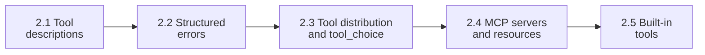
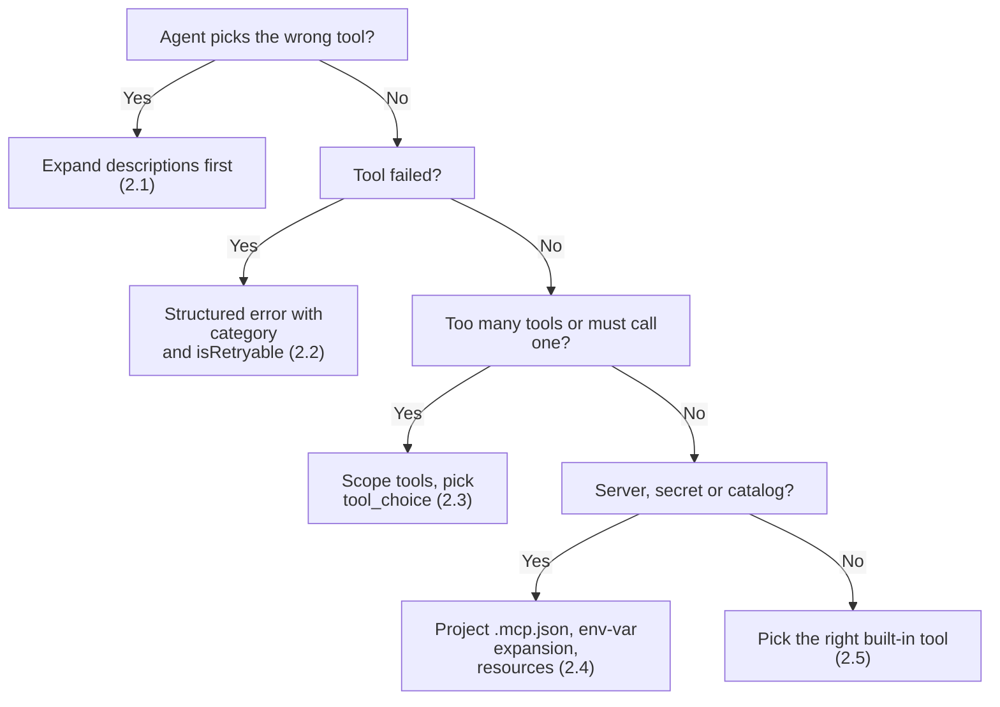

# Domain 2: Tool Design & MCP Integration (18% of the Exam)

Domain 2 is **18%** of the **Claude Certified Architect – Foundations (CCAR-F)** exam. Exam weights: D1 27%, **D2 18%**, D3 20%, D4 20%, D5 15%. Format: 60 multiple-choice questions, 4 of 6 scenarios, pass at 720/1000.

> 📖 Deeper notes, diagrams and anti-patterns: [KEY_CONCEPTS.md](KEY_CONCEPTS.md).
>
> ⚡ Quick revision: [CHEATSHEET.md](CHEATSHEET.md) (question wording to answer, look-alike pairs, exact values, elimination filters).

---

## 🗺️ Study Order

Why this order: good tool descriptions (2.1) come first. Then how tools fail (2.2). Then how many tools each agent gets and when it must call one (2.3). Then where tools come from (2.4). Last, the built-in tools you already have (2.5).

---

## 📋 Task Statements at a Glance

| TS | Study guide | What it tests | Key trap |
|---|---|---|---|
| **2.1** Tool interfaces | [README](ts_2_1_tool_interface_design/README.md) · [Notebook](ts_2_1_tool_interface_design/ts_2_1_tool_interface_design.ipynb) · [Code](ts_2_1_tool_interface_design/main.py) | Descriptions are the main selection mechanism: formats, examples, edge cases, boundaries | Reaching for few-shot, a routing layer or tool merging before fixing descriptions |
| **2.2** MCP structured errors | [README](ts_2_2_mcp_structured_errors/README.md) · [Notebook](ts_2_2_mcp_structured_errors/ts_2_2_mcp_structured_errors.ipynb) · [Code](ts_2_2_mcp_structured_errors/main.py) | `isError`, `errorCategory`, `isRetryable`, message. Local recovery. Empty result vs failure | "Operation failed", or flagging zero results as an error |
| **2.3** Distribution and `tool_choice` | [README](ts_2_3_tool_distribution_and_choice/README.md) · [Notebook](ts_2_3_tool_distribution_and_choice/ts_2_3_tool_distribution_and_choice.ipynb) · [Code](ts_2_3_tool_distribution_and_choice/main.py) | 4–5 scoped tools per role, `load_document`, scoped `verify_fact`, `auto` / `any` / forced | Forced or `any` with extended thinking (HTTP 400) |
| **2.4** MCP integration | [README](ts_2_4_mcp_server_integration/README.md) · [Notebook](ts_2_4_mcp_server_integration/ts_2_4_mcp_server_integration.ipynb) · [Code](ts_2_4_mcp_server_integration/main.py) | `.mcp.json` vs `~/.claude.json`, `${ENV_VAR}`, resources, community servers | Committing secrets, or hiding Grep instead of improving the MCP description |
| **2.5** Built-in tools | [README](ts_2_5_builtin_tools_usage/README.md) · [Notebook](ts_2_5_builtin_tools_usage/ts_2_5_builtin_tools_usage.ipynb) · [Code](ts_2_5_builtin_tools_usage/main.py) | Grep vs Glob, Read/Write vs Edit, Edit fallback, incremental exploration | Retrying the same failed `Edit` |

---

## 🎯 Memory Hooks

- **2.1**: The description is the router.
- **2.2**: Name the failure, say if it can be retried, never call empty an error.
- **2.3**: Small toolbox per role. `any` = any tool, forced = that tool, thinking = `auto` only.
- **2.4**: Team in `.mcp.json`, me in `~/.claude.json`, secrets in `${VARS}`.
- **2.5**: Grep = inside, Glob = names, Edit = unique only, else Read then Write.

---

## 🔗 Cross-Links

- Domain 1 (loops, hooks, prerequisite gates): [domain1](../domain1/README.md). 2.2 errors feed the loop in TS 1.1, and 2.3 forced `tool_choice` supports TS 1.4 gates.
- Domain 3 (Claude Code config): [domain3](../domain3/README.md). 2.4 `.mcp.json` sits beside `CLAUDE.md` and rules.
- Domain 5 (context, escalation, error propagation): [domain5](../domain5/README.md). 2.2 propagation connects to TS 5.3.
- Scenarios: [Scenario 1 Customer Support](../scenarios/scenario_1_customer_support/), [Scenario 3 Research](../scenarios/scenario_3_multi_agent_research/), [Scenario 4 Developer Productivity](../scenarios/scenario_4_developer_productivity/).

---

## ⚡ Domain 2 Golden Rules

1. **Descriptions route the call (2.1)**:  
   The model picks tools almost entirely from their descriptions. State purpose, accepted input formats, an example, edge cases, and boundaries against similar tools. When two tools get confused, expand the descriptions first, before adding few-shot examples, a routing layer, or merging tools.
2. **Split vague tools into specific ones (2.1)**:  
   `analyze_document` becomes `extract_data_points`, `summarize_content`, and `verify_claim_against_source`. Each tool has one purpose and a clear input and output contract. Rename overlapping tools so names do not collide.
3. **Errors are structured (2.2)**:  
   Return `isError`, `errorCategory` (transient, validation, permission, business), `isRetryable`, and a human-readable `message`. "Operation failed" gives the agent nothing to act on. The category decides whether to retry, fix the input, or escalate.
4. **Empty is not an error (2.2)**:  
   A search with no hits is a valid answer: `isError: false`, `count: 0`. Flagging it as an error triggers pointless retries. A real access failure must never be returned as an empty success either.
5. **Subagents recover locally, then propagate (2.2)**:  
   Retry transient failures inside the subagent. Pass up only unresolved errors, with what was attempted, partial results, and possible alternatives, so the coordinator can decide.
6. **Keep 4 to 5 scoped tools per role (2.3)**:  
   Too many tools degrade selection. Give each subagent only what its role needs. Replace a generic `fetch_url` with a constrained `load_document`. Give the synthesis agent a scoped `verify_fact` instead of the full search toolset.
7. **Choose `tool_choice` deliberately (2.3)**:  
   `auto` may return plain text. `any` must call some tool (use it when the tool is unknown but text is not acceptable). A forced `{"type": "tool", "name": ...}` calls that tool (use it to run a step first). With extended thinking on, only `auto` or `none` is valid. `any` or forced returns HTTP 400.
8. **Config and secrets (2.4)**:  
   `.mcp.json` is project-level and shared through version control. `~/.claude.json` is personal. Reference secrets as `${ENV_VAR}` so nothing sensitive is committed. All configured servers are discovered at connection time and available together.
9. **Resources expose catalogs; descriptions beat built-ins (2.4)**:  
   Use MCP resources for content catalogs (issue lists, schemas, doc trees) so the agent does not explore blindly. If the agent prefers built-in Grep over a better MCP tool, improve the MCP tool description rather than hiding Grep.
10. **Edit has a fallback (2.5)**:  
    `Edit` needs a unique anchor. If it fails on a non-unique match, use a longer unique anchor, or Read the file and Write the whole result. Do not retry the same call. Use Grep for content, Glob for file names, and build understanding incrementally.

---

## 🧭 Quick Decision Flow

---

## 🛠️ Running the Code

All Domain 2 modules run offline. Tests: `wsl -d Ubuntu-26.04 bash -c "cd /mnt/c/Repos/Claude_cert && ~/.local/bin/uv run pytest tests -q"`. Scripts that call the Claude API are run by hand only. See [EXECUTION_POLICY.md](../EXECUTION_POLICY.md).
