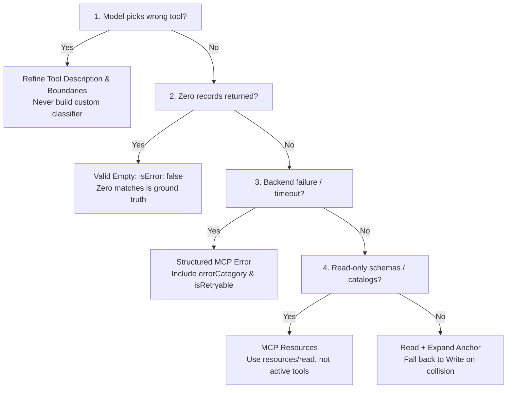

# Domain 2: Tool Design & MCP Integration (18% of Exam)

Domain 2 accounts for 18% of the **Claude Certified Architect – Foundations (CCAR-F)** exam. It covers designing robust tool interfaces, implementing structured error responses for Model Context Protocol (MCP), distributing tools according to least privilege, integrating project vs. user MCP servers, and effectively selecting built-in tools.

> 📖 **Deep Dive Master Guide**: For exhaustive technical explanations, architecture diagrams, sequence flows, gotchas, to-remember points, and practical scenario questions & answers, see [KEY_CONCEPTS.md](KEY_CONCEPTS.md).

---

## 📋 Task Statements & Core Architectural Principles

### [TS 2.1: Design Effective Tool Interfaces with Clear Descriptions and Boundaries](ts_2_1_tool_interface_design/main.py)
- **Primary Routing Mechanism**: LLMs select tools based on descriptions and schemas. Vague descriptions cause a 50%+ misrouting rate.
- **4 Components of Production Descriptions**: Specific capability contract, input constraints & regex formats, explicit boundary statements (when to use vs adjacent tools), and 2–3 authentic user query examples.
- **Tool Refactoring**: Split monolithic "Swiss Army Knife" tools into focused, single-responsibility interfaces.
- **Reference Exercise**: [ts_2_1_tool_interface_design/](ts_2_1_tool_interface_design/)

### [TS 2.2: Implement Structured Error Responses for MCP Tools](ts_2_2_mcp_structured_errors/main.py)
- **The `isError` Flag**: Must be set to `true` on execution failure inside `CallToolResult`.
- **Structured Error Taxonomy**:
  - `transient`: Network timeouts, rate limits (`isRetryable: true`).
  - `validation`: Malformed or missing arguments (`isRetryable: false`).
  - `business`: Policy violations, insufficient balance (`isRetryable: false`, with user explanation).
  - `permission`: Authorization failures (`isRetryable: false`).
- **The Empty Match vs Error Rule**: A successful query returning 0 records is a **VALID EMPTY RESULT** (`isError: false`, `count: 0`), NOT an error. Treating it as an error triggers wasteful retries.
- **Reference Exercise**: [ts_2_2_mcp_structured_errors/](ts_2_2_mcp_structured_errors/)

### [TS 2.3: Distribute Tools Appropriately Across Agents and Configure Tool Choice](ts_2_3_tool_distribution_and_choice/main.py)
- **Principle of Least Privilege**: Limit agents to **4–5 specialized tools** rather than 15–20 broad tools to avoid tool selection degradation.
- **`tool_choice` Modes**:
  - `{"type": "auto"}`: Model decides whether to call a tool or reply with text (exploratory tasks).
  - `{"type": "any"}`: Model is forced to call at least one tool, selecting which one.
  - `{"type": "tool", "name": "..."}`: Forces an exact tool call (mandatory first step).
  - `{"type": "none"}`: Prevents all tool calls.
  - `disable_parallel_tool_use: True`: Forces strictly sequential execution when downstream tools depend on upstream outputs.
- **Reference Exercise**: [ts_2_3_tool_distribution_and_choice/](ts_2_3_tool_distribution_and_choice/)

### [TS 2.4: Integrate MCP Servers into Claude Code and Agent Workflows](ts_2_4_mcp_server_integration/main.py)
- **Configuration Scoping**: Project-level (`.mcp.json` in git) for team tools vs User-level (`~/.claude.json`) for local developer tools.
- **Secure Credentials**: Never commit secrets to git; use `${ENV_VAR}` expansion in `.mcp.json`.
- **The 3 MCP Primitives**: **Tools** (active functions with side effects), **Resources** (passive read-only data blobs/schemas via URIs), and **Prompts** (pre-parameterized slash-command templates).
- **Transports**: `stdio` (local subprocesses) vs `sse` (Server-Sent Events over HTTP).
- **Reference Exercise**: [ts_2_4_mcp_server_integration/](ts_2_4_mcp_server_integration/)

### [TS 2.5: Select and Apply Built-in Tools Effectively](ts_2_5_builtin_tools_usage/main.py)
- **Selection Matrix**: `Grep` (content search), `Glob` (path matching), `Read` (view content), `Write` (full file write), `Edit` (surgical replacement via anchor).
- **Edit Fallback Pattern**: When `Edit` fails due to ambiguous or non-unique anchor text, invoke `Read` to retrieve exact offsets and fall back to `Write` with the reconciled content.
- **Reference Exercise**: [ts_2_5_builtin_tools_usage/](ts_2_5_builtin_tools_usage/)

---

## 🛠️ Hands-on Exercises in this Domain
- `ts_2_1_tool_interface_design/`: Boundary-differentiated tool descriptions and query routing.
- `ts_2_2_mcp_structured_errors/`: MCP error classification taxonomy and valid empty result handling.
- `ts_2_3_tool_distribution_and_choice/`: Least privilege tool distribution and `tool_choice` configuration.
- `ts_2_4_mcp_server_integration/`: Project `.mcp.json` configuration, env var expansion, and MCP Resources.
- `ts_2_5_builtin_tools_usage/`: Built-in tool selection engine and surgical `Edit` fallback workflow.

---

## ⚡ Domain 2 Exam Rules, Golden Architectural Rules & Anti-Patterns Reference

### 📋 CCAR-F Exam Rules & Scope Boundaries for Domain 2

| Aspect | In-Scope Exam Focus (Official Syllabus) | Out-of-Scope Distractor (Do Not Choose on Exam) |
|---|---|---|
| **Tool Selection Mechanism** | Detailed, boundary-differentiated descriptions and schemas; LLM performs native semantic routing. | Custom regex pre-routing parsers, fine-tuned intent classifiers, or routing proxy microservices. |
| **Tool Splitting** | Splitting monolithic multi-purpose tools into granular, single-purpose tools with tight contracts. | Consolidating all APIs into a single generic `call_api(endpoint, payload)` tool. |
| **Tool Quality vs Built-ins** | Detailed MCP tool descriptions to prevent Claude from preferring built-ins (like Grep) over capable MCP tools. | Hiding built-in tools from the environment or renaming built-ins to obscure identifiers. |
| **MCP Error Schema** | `CallToolResult(isError=True)` with `errorCategory`, `isRetryable: bool`, and actionable messages. | Throwing raw Python exceptions, returning HTTP 500 status strings, or returning generic `"Operation failed"`. |
| **Empty Results** | A successful query returning 0 records is ground truth (`isError: false`, `count: 0`). | Flagging 0 matches as `isError: true`, which triggers wasteful and confusing retries. |
| **Tool Distribution** | Least privilege: 4–5 specialized tools per subagent. | Provisioning 15–20 tools per agent or granting subagents tools outside their core specialization. |
| **Constrained Tool Variants** | Replacing generic tools with constrained alternatives (e.g., `load_document` with URL validation over `fetch_url`). | Giving unconstrained broad HTTP clients to untrusted agent workflows. |
| **Cross-Role Scoped Tools** | Providing scoped cross-role tools for high-frequency needs (e.g. `verify_fact` for synthesis) while routing complex cases to coordinator. | Giving full web search tool suites to synthesis agents or batching verifications into blocking passes. |
| **`tool_choice` Configuration** | `auto` for dialogue; `any` to force tool use; `{"type": "tool"}` for mandatory step 1; `disable_parallel_tool_use: True`. | Setting temperature to 0.0 to prevent parallel calls; relying on system prompt to forbid parallel calls. |
| **MCP Scoping** | Project `.mcp.json` (git-tracked) with `${ENV_VAR}` expansion; user `~/.claude.json` (personal). | Hardcoding API tokens in `.mcp.json`; deploying MCP servers on Kubernetes clusters or managing OAuth servers. |
| **Community vs Custom MCP** | Choosing existing community MCP servers (Jira, GitHub) over custom implementations for standard tools. | Re-inventing custom MCP wrappers from scratch for standard third-party developer platforms. |
| **MCP Resources** | Exposing passive catalogs (database schemas, API indexes, doc trees) as MCP Resources (`resources/read`). | Wrapping large schemas in active tools (`get_schema`) that waste tokens across exploratory loops. |
| **Built-in Tool Selection** | `Glob` for file paths; `Grep` for contents; `Read` for viewing; `Write` for whole file; `Edit` for unique anchor replacement. | Bulk reading all files upfront; using raw terminal `sed`/`awk` scripts for file edits. |
| **Edit Fallback** | When `Edit` encounters ambiguous anchor collisions, call `Read` to inspect context and fall back to `Write`. | Retrying the exact same `Edit` call blindly, or aborting the entire workflow on anchor failure. |
| **Out-of-Scope Exclusions** | Tool descriptions, schemas, MCP error contracts, scoping, and built-ins. | Deploying/hosting MCP servers (k8s, docker), OAuth/API key rotation, cloud infra configs (AWS/GCP/Azure). |

---

### 🏆 The 8 Golden Architectural Rules of Domain 2

1. **Semantic Description Quality Governs Routing (`TS 2.1`)**:  
   Claude relies on semantic clarity in tool descriptions to route queries accurately. Descriptions must include the specific capability contract, parameter regex formats, explicit boundary statements (*"Use X instead of Y when..."*), and 2–3 authentic user query examples.
2. **Granular Single-Responsibility Tool Design (`TS 2.1`)**:  
   Split monolithic "Swiss Army Knife" tools into focused, single-purpose interfaces (e.g., split generic `analyze_document` into `extract_data_points`, `summarize_content`, and `verify_claim_against_source`). Single-purpose tools minimize parameter ambiguity and reduce invocation errors.
3. **Structured MCP Error Responses (`TS 2.2`)**:  
   Always return `isError: true` inside `CallToolResult` upon execution failure, accompanied by structured metadata: `errorCategory` (`transient`, `validation`, `business`, `permission`), `isRetryable: bool`, and human-readable guidance.
4. **The Ground-Truth Empty Match Rule (`TS 2.2`)**:  
   A query that completes successfully but finds 0 matching records is a **valid ground-truth result** (`isError: false`, `count: 0`), NOT an error. Treating empty search results as errors causes wasteful retry loops and misinforms coordinator reasoning.
5. **Least Privilege Tool Distribution (`TS 2.3`)**:  
   Restrict agent tool access to **4–5 specialized tools** tailored to the agent's specific role. Provisioning 15+ tools degrades tool selection accuracy, increases latency, and causes subagents to misuse tools outside their domain.
6. **Enforce Sequential Tool Chains via `disable_parallel_tool_use` (`TS 2.3`)**:  
   When Step 2 has an absolute data dependency on Step 1 (e.g., `provision_subnet` $\rightarrow$ `deploy_db(subnet_id)`), configure `tool_choice: {"type": "auto", "disable_parallel_tool_use": True}` to prevent Claude from emitting concurrent calls with hallucinated placeholder IDs.
7. **Expose Passive Catalogs as MCP Resources (`TS 2.4`)**:  
   Use **MCP Resources** (`resources/read`) for read-only reference data (database schemas, API catalogs, issue summaries). Exposing catalogs as active tools triggers unnecessary model invocations and exploratory context churn.
8. **The Edit Failure Fallback Protocol (`TS 2.5`)**:  
   When surgical `Edit` fails due to ambiguous or non-unique anchor text, execute `Read` to retrieve the current file state, expand the anchor block with unambiguous context, or fall back to `Write` with the fully reconciled file content.

---

### 🚫 Architectural Anti-Patterns to Reject in Domain 2 (Exam Distractor Teardown)

| Anti-Pattern | The Exam Distractor Trap (Why Candidates Pick It) | Fatal Production Consequence | Correct Architectural Solution |
|---|---|---|---|
| **Minimal / 1-Line Tool Descriptions** | Seems clean and concise: `"lookup_order: Retrieves order details"`. | Claude cannot distinguish between similar tools (e.g. `lookup_order` vs `get_customer`), causing a 50%+ misrouting rate. | Expand description with capabilities, parameter formats, boundary statements, and example queries. |
| **External Regex / Classifier Routing Layer** | Engineers attempt to bypass LLM routing by writing custom keyword parsers or classifier models. | Brittle, fails on natural phrasing, creates heavy maintenance overhead, and bypasses Claude's natural reasoning. | Refine tool descriptions and schemas to let Claude perform native zero-shot semantic routing. |
| **Uniform Generic Error Strings** | Returning `isError: true` with `"Operation failed"` or throwing raw exceptions. | Model lacks context to understand what failed, whether the failure is transient, or how to formulate a recovery plan. | Return structured JSON with `errorCategory`, `isRetryable`, and specific remediation guidance. |
| **Flagging 0 Matching Records as Error** | Developers treat 0 search results as a failure (`isError: true`, `"No orders found"`). | Coordinator misinterprets the message as an API outage and initiates futile retry loops against healthy backends. | Return `isError: false` with `count: 0` and `results: []` as ground-truth fact. |
| **Tool Over-Provisioning (15+ Tools per Agent)** | Providing all backend enterprise tools to every agent to ensure maximum capability. | Causes severe attention dilution, degraded tool selection accuracy, high token costs, and cross-specialization misuse. | Apply Least Privilege: partition tools across specialized subagents (4–5 tools each). |
| **Exposing Passive Catalogs as Active Tools** | Wrapping static API specs or database DDL in a tool (`get_database_schema()`). | Forces the agent into exploratory tool-calling loops, consuming context and adding 2–3 unnecessary turns. | Expose read-only schemas and catalogs as MCP Resources (`resources/read`). |
| **Committing Plaintext API Keys in `.mcp.json`** | Hardcoding tokens directly in `.mcp.json` for rapid local testing. | Credentials leak to version control and team repositories, violating enterprise security compliance. | Use environment variable expansion in `.mcp.json` (`${GITHUB_TOKEN}`, `${DB_PASSWORD}`). |
| **Blind `Edit` Retrying Without `Read`** | Retrying the identical `Edit` tool call when it fails on anchor text matching. | Deterministic string mismatch will fail every single retry until turn limit is exhausted. | Call `Read` to inspect exact line context, expand anchor boundaries, or overwrite via `Write`. |

---

### 🧠 Domain 2 Rapid Decision Matrix for Scenario Questions

| Question Trigger / Condition | Decision Branch | Architectural Action & Distractor Rule |
| :--- | :---: | :--- |
| **Agent frequently picks wrong tool between similar tools?** | **YES** | Refine tool descriptions with boundaries & input formats *(NEVER add external classifier routing)*. |
| **Query returning 0 records from healthy database?** | **YES** | Valid empty result: `isError: false, count: 0` *(NEVER isError: true)*. |
| **Backend network timeout vs invalid UUID error contract?** | **YES** | Return structured MCP error: `errorCategory` (`"transient"` vs `"validation"`) & `isRetryable`. |
| **Exposing read-only schemas and API catalogs?** | **YES** | Expose as **MCP Resources** (`resources/read`) *(NEVER active tools)*. |
| **Edit tool fails due to non-unique anchor text collision?** | **YES** | Call `Read` to inspect context, expand anchor lines, or fall back to `Write`. |

