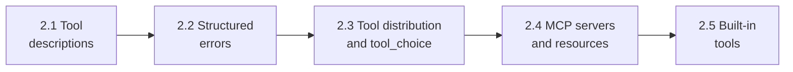
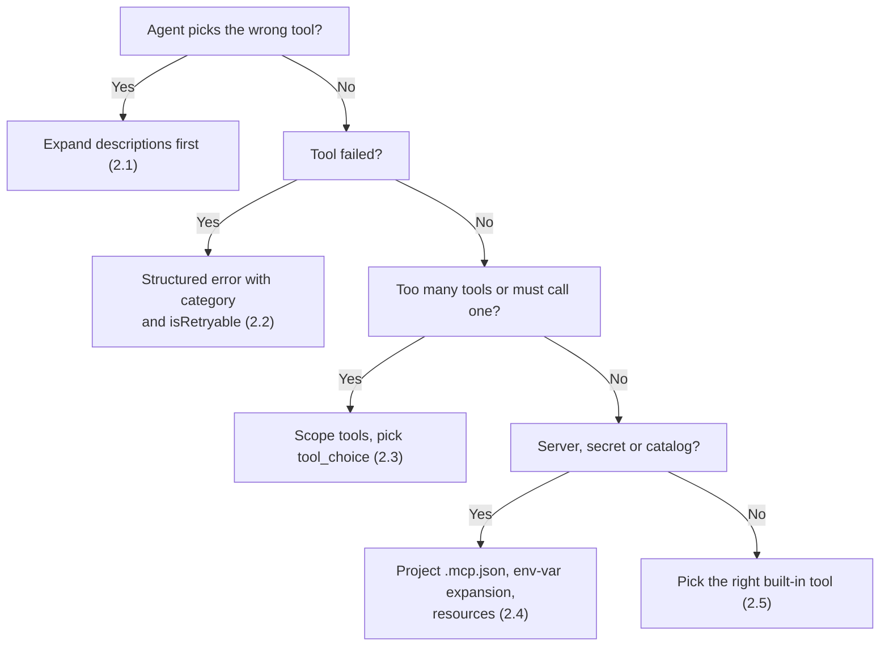

# Domain 2: Tool Design & MCP Integration (18% of the Exam)

Domain 2 is **18%** of the **Claude Certified Architect – Foundations (CCAR-F)** exam. Exam weights: D1 27%, **D2 18%**, D3 20%, D4 20%, D5 15%. Format: 60 multiple-choice questions, 4 of 6 scenarios, pass at 720/1000.

> 📖 Deeper notes, diagrams and anti-patterns: [KEY_CONCEPTS.md](KEY_CONCEPTS.md).

---

## 🗺️ Study Order

Why this order: good tool descriptions (2.1) come first. Then how tools fail (2.2). Then how many tools each agent gets and when it must call one (2.3). Then where tools come from (2.4). Last, the built-in tools you already have (2.5).

---

## 📋 Task Statements at a Glance

| TS | Study guide | What it tests | Key trap |
|---|---|---|---|
| **2.1** Tool interfaces | [README](ts_2_1_tool_interface_design/README.md) · [Notebook](ts_2_1_tool_interface_design/ts_2_1_tool_interface_design.ipynb) · [Code](ts_2_1_tool_interface_design/main.py) | Descriptions are the main selection mechanism: formats, examples, edge cases, boundaries | Reaching for few-shot, a routing layer or tool merging before fixing descriptions |
| **2.2** MCP structured errors | [README](ts_2_2_mcp_structured_errors/README.md) · [Notebook](ts_2_2_mcp_structured_errors/ts_2_2_mcp_structured_errors.ipynb) · [Code](ts_2_2_mcp_structured_errors/main.py) | `isError`, `errorCategory`, `isRetryable`, message. Local recovery. Empty result vs failure | "Operation failed", or flagging zero results as an error |
| **2.3** Distribution and `tool_choice` | [README](ts_2_3_tool_distribution_and_choice/README.md) · [Notebook](ts_2_3_tool_distribution_and_choice/ts_2_3_tool_distribution_and_choice.ipynb) · [Code](ts_2_3_tool_distribution_and_choice/main.py) | 4–5 scoped tools per role, `load_document`, scoped `verify_fact`, `auto` / `any` / forced | Forced or `any` with extended thinking (HTTP 400) |
| **2.4** MCP integration | [README](ts_2_4_mcp_server_integration/README.md) · [Notebook](ts_2_4_mcp_server_integration/ts_2_4_mcp_server_integration.ipynb) · [Code](ts_2_4_mcp_server_integration/main.py) | `.mcp.json` vs `~/.claude.json`, `${ENV_VAR}`, resources, community servers | Committing secrets, or hiding Grep instead of improving the MCP description |
| **2.5** Built-in tools | [README](ts_2_5_builtin_tools_usage/README.md) · [Notebook](ts_2_5_builtin_tools_usage/ts_2_5_builtin_tools_usage.ipynb) · [Code](ts_2_5_builtin_tools_usage/main.py) | Grep vs Glob, Read/Write vs Edit, Edit fallback, incremental exploration | Retrying the same failed `Edit` |

---

## 🎯 Memory Hooks

- **2.1**: The description is the router.
- **2.2**: Name the failure, say if it can be retried, never call empty an error.
- **2.3**: Small toolbox per role. `any` = any tool, forced = that tool, thinking = `auto` only.
- **2.4**: Team in `.mcp.json`, me in `~/.claude.json`, secrets in `${VARS}`.
- **2.5**: Grep = inside, Glob = names, Edit = unique only, else Read then Write.

---

## 🔗 Cross-Links

- Domain 1 (loops, hooks, prerequisite gates): [domain1](../domain1/README.md). 2.2 errors feed the loop in TS 1.1, and 2.3 forced `tool_choice` supports TS 1.4 gates.
- Domain 3 (Claude Code config): [domain3](../domain3/README.md). 2.4 `.mcp.json` sits beside `CLAUDE.md` and rules.
- Domain 5 (context, escalation, error propagation): [domain5](../domain5/README.md). 2.2 propagation connects to TS 5.3.
- Scenarios: [Scenario 1 Customer Support](../scenarios/scenario_1_customer_support/), [Scenario 3 Research](../scenarios/scenario_3_multi_agent_research/), [Scenario 4 Developer Productivity](../scenarios/scenario_4_developer_productivity/).

---

## ⚡ Domain 2 Golden Rules

1. **Descriptions route** (2.1). Include purpose, input formats, examples, edge cases, boundaries.
2. **Split vague tools** (2.1): `analyze_document` → `extract_data_points`, `summarize_content`, `verify_claim_against_source`.
3. **Structured errors** (2.2): `isError`, `errorCategory`, `isRetryable`, `message`.
4. **Empty is not an error** (2.2): `isError: false`, `count: 0`.
5. **Subagents recover locally** (2.2) and propagate only unresolved errors with attempts and partial results.
6. **4–5 tools per role** (2.3). Replace `fetch_url` with `load_document`. Scoped `verify_fact` for synthesis.
7. **`tool_choice`** (2.3): `auto` may return text, `any` must call a tool, forced calls that tool. Thinking allows only `auto` or `none`.
8. **Config and secrets** (2.4): `.mcp.json` shared, `~/.claude.json` personal, `${ENV_VAR}` for secrets.
9. **Resources** (2.4) for catalogs. Rich MCP descriptions beat built-in Grep.
10. **Edit fallback** (2.5): longer unique anchor, or Read + Write.

---

## 🧭 Quick Decision Flow

---

## 🛠️ Running the Code

All Domain 2 modules run offline. Tests: `wsl -d Ubuntu-26.04 bash -c "cd /mnt/c/Repos/Claude_cert && ~/.local/bin/uv run pytest tests -q"`. Scripts that call the Claude API are run by hand only. See [EXECUTION_POLICY.md](../EXECUTION_POLICY.md).
