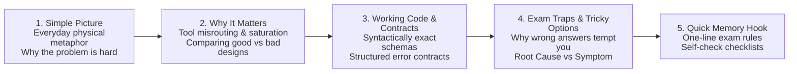
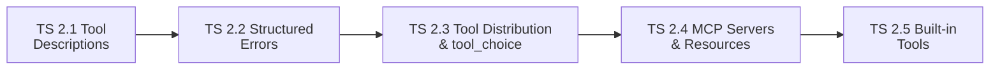
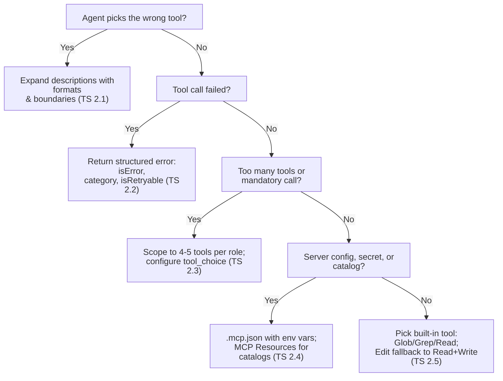

# Domain 2: Tool Design & MCP Integration (18% of the Exam)

Domain 2 accounts for **18%** of the **Claude Certified Architect – Foundations (CCAR-F)** exam (~11 of 60 questions). Across the five domains, weights are distributed as: **D1 27%** · **D2 18%** · **D3 20%** · **D4 20%** · **D5 15%**.

While Domain 1 covers how Claude loops and orchestrates subagents, Domain 2 governs the contract boundary where Claude interfaces with external tools, APIs, and the Model Context Protocol (MCP).

> 📖 Master Deep Dive: [KEY_CONCEPTS.md](KEY_CONCEPTS.md) contains deep architectural notes, JSON schemas, error taxonomies, and fallback protocols.
> 
> ⚡ Quick Cram: [CHEATSHEET.md](CHEATSHEET.md) (question stems to answers, look-alike pairs, exact values, elimination filters).

---

## 🧠 How to Master Domain 2 (5 Clear Steps)

Every task statement in Domain 2 follows 5 clear steps:

> **1. Simple Picture (Mental Model)** → **2. Architectural Why** → **3. Working Code / Schema** → **4. Exam Traps & Wrong Answers** → **5. Memory Hook**



---

## 🏛️ Everyday Metaphors: Foundational Mental Models

| Task Statement | Topic | Everyday Physical Metaphor | Why Naive Approaches Fail | Correct Architectural Pattern |
| :--- | :--- | :--- | :--- | :--- |
| **TS 2.1** | **Tool Interfaces** | **Kitchen Drawer Labels** | A drawer labeled "kitchen stuff" gets mixed utensils; a label "dinner forks, NOT knives" prevents misrouting. | **Rich Tool Descriptions**: Explicit formats, example queries, edge cases, and boundary statements ([TS 2.1](ts_2_1_tool_interface_design/README.md)). |
| **TS 2.2** | **MCP Structured Errors** | **Emergency Room Triage Tag** | Shouting "Patient sick!" gives doctors zero signal; triage tags indicate if condition is minor, critical, or contagious. | **Structured Error Contract**: `isError: true`, category (`transient`, `validation`, `business`), and `isRetryable` ([TS 2.2](ts_2_2_mcp_structured_errors/README.md)). |
| **TS 2.3** | **Tool Distribution & Choice** | **Specialist's Toolbelt** | A carpenter carrying 18 heavy tools drops items and moves slowly; carrying 4-5 focused tools ensures precision. | **Least Privilege**: 4–5 scoped tools per role; configure `tool_choice` (`auto`, `any`, forced) deliberately ([TS 2.3](ts_2_3_tool_distribution_and_choice/README.md)). |
| **TS 2.4** | **MCP Server Integration** | **Library Card Catalog vs Opening Every Book** | Walking every library aisle to see what books exist wastes hours; checking the card catalog takes 10 seconds. | **MCP Resources**: Read-only static URIs (`catalog://orders/schema`) providing zero-turn context ([TS 2.4](ts_2_4_mcp_server_integration/README.md)). |
| **TS 2.5** | **Built-in Tools Selection** | **Map, Magnifying Glass, and Scalpel** | Scalpel (`Edit`) without a map (`Glob`) cuts blind; reading 300 files upfront floods the operating table. | **Progressive Discovery**: `Glob` (paths) → `Grep` (symbols) → `Read`; surgical `Edit` with fallback ([TS 2.5](ts_2_5_builtin_tools_usage/README.md)). |

---

## 🗺️ Study Order

Follow this sequential path. Each step builds on the interface guarantees of the previous step:



**Why this study order**:
1. First, establish how Claude picks tools by reading their descriptions and boundaries (TS 2.1).
2. Next, define what happens when tools fail using structured error contracts (TS 2.2).
3. Then, protect the model's attention budget by giving each agent 4–5 scoped tools and setting `tool_choice` (TS 2.3).
4. After that, configure MCP server scopes (`.mcp.json`) and expose zero-turn schemas via MCP Resources (TS 2.4).
5. Finally, master Claude Code's built-in exploration tools (`Glob`, `Grep`, `Read`, `Edit`) and the Edit Fallback Protocol (TS 2.5).

---

## 📋 Task Statements at a Glance

| TS | Study Guide | Core Architectural Focus | Key Exam Trap to Avoid |
|---|---|---|---|
| **TS 2.1** | [README](ts_2_1_tool_interface_design/README.md) · [Notebook](ts_2_1_tool_interface_design/ts_2_1_tool_interface_design.ipynb) · [Code](ts_2_1_tool_interface_design/main.py) | Descriptions are the primary routing mechanism: input formats, examples, edge cases, boundaries. | Reaching for few-shot examples, an external ML routing classifier, or tool merging before fixing descriptions. |
| **TS 2.2** | [README](ts_2_2_mcp_structured_errors/README.md) · [Notebook](ts_2_2_mcp_structured_errors/ts_2_2_mcp_structured_errors.ipynb) · [Code](ts_2_2_mcp_structured_errors/main.py) | `isError` boolean, error taxonomy (`transient`, `validation`, `business`, `permission`), `isRetryable`. | Returning `"Operation failed"`, or flagging zero matching records as an error instead of a valid empty set. |
| **TS 2.3** | [README](ts_2_3_tool_distribution_and_choice/README.md) · [Notebook](ts_2_3_tool_distribution_and_choice/ts_2_3_tool_distribution_and_choice.ipynb) · [Code](ts_2_3_tool_distribution_and_choice/main.py) | Least privilege (4–5 tools per agent), constrained tools (`load_document`), `tool_choice` modes. | Forcing named tools or passing `tool_choice: "any"` when Extended Thinking is active (triggers HTTP 400). |
| **TS 2.4** | [README](ts_2_4_mcp_server_integration/README.md) · [Notebook](ts_2_4_mcp_server_integration/ts_2_4_mcp_server_integration.ipynb) · [Code](ts_2_4_mcp_server_integration/main.py) | Project `.mcp.json` vs user `~/.claude.json`, `${ENV_VAR}` expansion, MCP Resources for static schemas. | Committing secret API keys to Git, or hiding Grep instead of improving the MCP tool description. |
| **TS 2.5** | [README](ts_2_5_builtin_tools_usage/README.md) · [Notebook](ts_2_5_builtin_tools_usage/ts_2_5_builtin_tools_usage.ipynb) · [Code](ts_2_5_builtin_tools_usage/main.py) | `Grep` vs `Glob`, chunked `Read`, surgical `Edit`, 3-stage Edit Fallback Protocol (`Read + Write`). | Retrying the same failed `Edit` repeatedly without expanding anchor lines or falling back to full rewrite. |

---

## 🎯 Memory Hooks

- **TS 2.1**: *The description is the router. Fix the label before you build a classifier.*
- **TS 2.2**: *Name the failure, signal retryability, and never call an empty search result an error.*
- **TS 2.3**: *4 to 5 tools per specialist. Extended thinking requires `tool_choice: "auto"` or `"none"`.*
- **TS 2.4**: *Team in `.mcp.json`, personal in `~/.claude.json`, secrets in `${ENV_VAR}`, catalogs in Resources.*
- **TS 2.5**: *Grep searches content, Glob searches names, Edit requires unique anchor, else Read then Write.*

---

## 🔗 Cross-Domain Connections

- **Domain 1**: TS 2.2 structured error payloads feed the client-side loop in TS 1.1; TS 2.3 forced `tool_choice` powers TS 1.4 state gates.
- **Domain 3**: TS 2.4 project `.mcp.json` sits alongside `.claude/rules/*.md` and `CLAUDE.md`.
- **Domain 5**: TS 2.2 subagent error propagation maps directly to TS 5.3 coverage manifests.
- **Production Scenarios**: [Scenario 1 (Customer Support)](../scenarios/scenario_1_customer_support/), [Scenario 3 (Research)](../scenarios/scenario_3_multi_agent_research/), and [Scenario 4 (Developer Productivity)](../scenarios/scenario_4_developer_productivity/).

---

## ⚡ Domain 2 Golden Architectural Rules

1. **Descriptions Route the Call (TS 2.1)**:  
   Claude selects tools primarily based on their descriptions. A production description includes: core purpose, expected input formats with examples, edge cases, and explicit negative boundaries ("Do NOT use for X; use Y"). When two tools get confused, expand the descriptions first.
2. **Decompose Vague Monolithic Tools (TS 2.1)**:  
   Replace generic tools like `analyze_document` with single-responsibility alternatives: `extract_data_points`, `summarize_content`, and `verify_claim_against_source`. Each tool gets an unambiguous contract.
3. **Structured Error Responses (TS 2.2)**:  
   Tools must communicate failure with `isError: true`, a specific category (`transient`, `validation`, `business`, `permission`), and an `isRetryable: bool` flag. Generic strings like `"Operation failed"` give the agent zero actionable recovery signal.
4. **Valid Empty Set vs Access Failure (TS 2.2)**:  
   A query returning 0 records is a valid success: `isError: false, count: 0`. Flagging empty results as errors triggers useless retry loops and misleading user apologies.
5. **Subagents Recover Locally, Then Propagate (TS 2.2)**:  
   Subagents retry transient network timeouts locally up to their retry budget. If unrecoverable, return structured error context (`attemptedQuery`, `failureType`, `partialResults`) to the coordinator.
6. **Limit Toolbox to 4–5 Scoped Tools (TS 2.3)**:  
   Over-provisioning 15+ tools degrades selection reliability and burns thousands of tokens per turn. Give each agent only the tools its role requires. Replace generic `fetch_url` with domain-whitelisted `load_document`.
7. **Configure `tool_choice` Deliberately (TS 2.3)**:  
   `"auto"` allows text or tools. `"any"` forces at least one tool call. Forced `{"type": "tool", "name": ...}` enforces a specific tool. **Extended Thinking Constraint**: When `thinking` is active, use only `"auto"` or `"none"`; passing `"any"` or a forced tool triggers HTTP 400.
8. **Secure `.mcp.json` Configuration (TS 2.4)**:  
   `.mcp.json` is project-scoped and committed to version control. Expand secrets via `${ENV_VAR}`. Never hardcode credentials in JSON files.
9. **Expose Catalogs via MCP Resources (TS 2.4)**:  
   Expose database schemas, issue lists, and API specifications as read-only MCP Resources (`catalog://schema/orders`). This eliminates exploratory round-trips.
10. **The 3-Stage Edit Fallback Protocol (TS 2.5)**:  
    `Edit` requires unique anchor text. On collision, expand the unique context lines; if it fails again, fallback to `Read` followed by `Write` of the complete file.

---

## 🧭 Quick Decision Flow



---

## 🛠️ Offline Verification & Test Commands

All Domain 2 modules execute 100% offline using deterministic mocks:

```bash
# Run all Domain 2 offline unit tests:
uv run pytest tests/test_domain2_enhancements.py -q
```

---

## 🧭 Navigation & Study Links
- ⬅️ **Previous Domain**: [Domain 1: Agentic Architecture & Orchestration](../domain1/README.md)
- 📋 **Exam Blueprint**: [5-Domain Blueprint Matrix](../EXAM_BLUEPRINT.md)
- ⚡ **Exam Refresher**: [Core Architectural Rules & Cheatsheet](../EXAM_REFRESHER.md)
- ➡️ **Next Domain**: [Domain 3: Claude Code Configuration & Workflows](../domain3/README.md)
- ➡️ **Next Domain**: [Domain 3: Claude Code & Developer Workflows](../domain3/README.md)
- 🎯 **Scenario Practice**: [Master Scenario Practice](../scenarios/MASTER_SCENARIO_PRACTICE.md)
