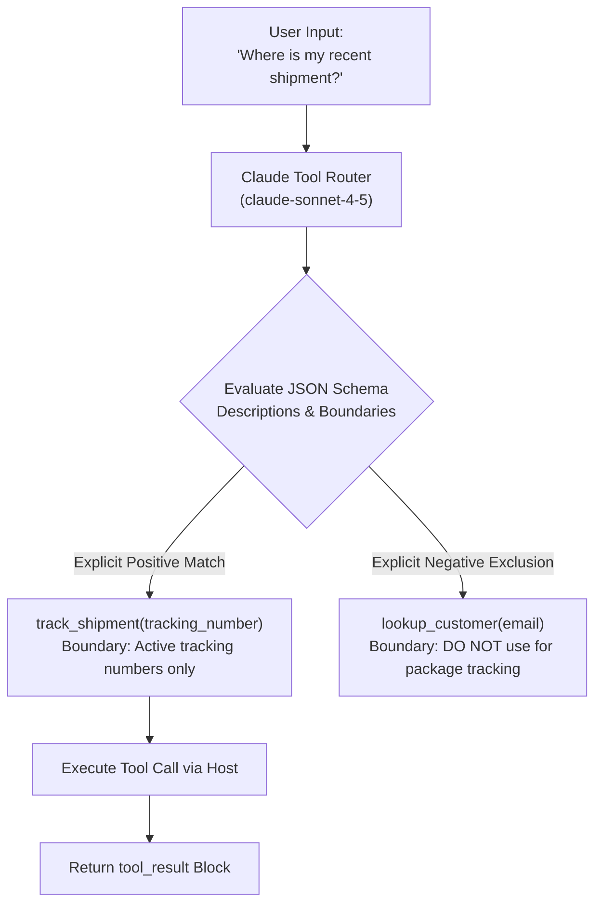

# Task Statement 2.1: Design Effective Tool Interfaces with Clear Descriptions and Boundaries

## 📌 Executive Overview: Goal, Scope & Exam Importance

### Certification Domain & Weight
- **Domain**: Domain 2: Tool Design & MCP Integration
- **Domain Weight**: 20% of total CCAR-F exam score
- **Scenario Alignment**: Scenario 1 (Customer Support) & Scenario 4 (Developer Productivity)

### The Core Goal
To master the art of authoring production-grade tool interfaces using JSON Schema. An architect must understand how Claude uses tool descriptions as a **semantic router**, how to establish explicit **negative boundaries ("When NOT to use")**, specify rigorous parameter constraints, and configure `tool_choice` for deterministic sequencing.

### Why This Matters in Production
In an enterprise agent with 10+ available tools, tools inevitably share overlapping conceptual territory (e.g. `get_customer_profile`, `lookup_order_history`, `track_shipment`). If descriptions are brief or vague (e.g., `"Gets order details"`), Claude experiences frequent **tool collisions**—calling the wrong API, passing malformed arguments, or getting trapped in trial-and-error loops that burn latency and tokens. 
In production, tool descriptions are not documentation for humans; they are routing instructions for the model. Precise boundary definitions eliminate misrouting and guarantee schema-valid calls on the first attempt.

### Exam Importance
Task Statement 2.1 is tested through scenario questions where two tools look similar and Claude is calling the wrong one. You must recognize that the solution is to add **negative guidance and parameter constraints** to the tool schema, or use **`tool_choice`** to enforce sequence, rather than bloating the system prompt.

---

## 📖 Deep Narrative: Why We Do What We Do

### 1. The Problem: Tool Collision and Parameter Ambiguity
Consider an agent with two tools:
```json
// Tool A
{"name": "lookup_account", "description": "Looks up customer details."}
// Tool B
{"name": "get_order", "description": "Fetches order information for a user."}
```
When a user asks: *"Where is the package for my recent purchase? My email is alice@example.com"*, which tool does Claude call?
- Claude might call `get_order`, but pass the email address into an argument named `order_id`.
- Or Claude calls `lookup_account`, but the account payload does not contain tracking numbers.
- **Root Cause**: The tools lack operational boundaries and input validation rules.

### 2. The Architectural Solution: Tool Descriptions as Semantic Routers
Production tool definitions follow three structural rules:
1. **Explicit Positive Guidance**: Describe exactly what data the tool returns and under what conditions to invoke it.
2. **Explicit Negative Boundaries ("When NOT to use")**:
   ```json
   {
     "name": "lookup_customer",
     "description": "Retrieves verified customer profile using registered email address. Do NOT use this tool for package tracking or order status; use 'track_shipment' instead.",
     "input_schema": {
       "type": "object",
       "properties": {
         "email": {
           "type": "string",
           "format": "email",
           "description": "Customer primary email address, e.g. user@example.com"
         }
       },
       "required": ["email"]
     }
   }
   ```
3. **Rigorous Parameter Constraints**:
   - Use `pattern` (regex) for identifiers: `pattern: "^ORD-[0-9]{4}-[A-Z]{2}$"`
   - Use `enum` for categorical options: `enum: ["STANDARD", "EXPRESS", "OVERNIGHT"]`
   - Use `minimum` / `maximum` for numerical thresholds.
4. **Deterministic Sequencing via `tool_choice`**:
   If policy dictates that authentication *must* occur on turn 1 before any other tool can be invoked, do not hope the model chooses it. Force it:
   ```python
   tool_choice = {"type": "tool", "name": "lookup_customer"}
   ```

---

## 🔑 Key Technical Terminology Explained

- **Semantic Router**: The process by which Claude evaluates semantic embeddings and intent from tool JSON descriptions to select the most appropriate tool.
- **Negative Boundary Guidance**: Explicit instructions in a tool description specifying what the tool should *not* be used for, pointing directly to the alternative tool.
- **Tool Collision**: A failure mode where two or more tools have overlapping semantic descriptions, causing Claude to alternate unpredictably or select the wrong tool.
- **Parameter Schema Constraints**: JSON Schema validation primitives (`pattern`, `enum`, `minimum`, `items`, `required`) that restrict input arguments to valid formats.
- **`tool_choice` Forced Selection**: An API configuration parameter forcing Claude to invoke a specific named tool (`{"type": "tool", "name": "..."}`) or any tool (`"any"`), bypassing autonomous choice (`"auto"`).

---

## 🏗️ Architecture: Tool Disambiguation & Routing Flow



---

## ⚠️ Critical Exam Distinctions & Distractor Teardown

| Tool Interface Element | Correct Implementation | Exam Trap to Reject | Why the Trap Fails |
|---|---|---|---|
| **Resolving Overlapping Tools** | Add explicit **negative boundaries** in tool descriptions: *"Do NOT call for X; use tool Y instead."* | **TRAP**: Adding a 2-page explanation in the system prompt while leaving tool descriptions ambiguous. | Claude prioritizes the tool's JSON schema description when deciding tool applicability; system prompts easily get overlooked. |
| **Input Validation** | Define strict JSON Schema constraints (`pattern: "^[A-Z]{3}-\\d{4}$"`, `enum: [...]`). | **TRAP**: Defining all parameters as open-ended `{"type": "string"}` with no formatting constraints. | Claude may pass values with missing prefixes or invalid delimiters, causing downstream runtime errors. |
| **Mandatory Execution Order** | Use forced tool choice: `tool_choice: {"type": "tool", "name": "auth"}` on turn 1. | **TRAP**: Leaving `tool_choice: "auto"` and asking Claude in the prompt to *"please authenticate first"*. | Model adherence is probabilistic; complex user prompts can distract Claude into executing other tools first. |

---

## 💡 Architectural Decision Matrix: Rules of Thumb

| Tool Requirement | Recommended Implementation | Rationale |
|---|---|---|
| **Prevent tool misrouting?** | Add negative boundaries to JSON description | Clarifies exact boundaries at the exact point of tool selection. |
| **Guarantee exact format (e.g. UUID, email)?** | Use `pattern` or `format` in schema | Model aligns argument generation with regex constraints natively. |
| **Force authentication on Turn 1?** | `tool_choice: {"type": "tool", "name": "..."}` | 100% deterministic enforcement; Claude cannot output text or other tools. |

---

## 🧠 Claude 4.5 Extended Thinking & Parameter Standards

- **Tool Selection Reasoning**: With Extended Thinking enabled, Claude evaluates candidate tool definitions against negative boundaries during its reasoning phase, explaining why it selected Tool A over Tool B before emitting the `tool_use` block.
- **Sampling Rules**: Omit `temperature` whenever thinking is active.
- **Tool Choice + Thinking**: When `tool_choice` is forced to a specific tool, Extended Thinking remains active to optimize parameter construction.

---

## 🛠️ Hands-on Workbook Guide: Following the Code Step-by-Step

When exploring [`ts_2_1_tool_interface_design.ipynb`](ts_2_1_tool_interface_design.ipynb):
1. **Step 1: Setup & Tool Definitions**: Inspects ambiguous vs. production-grade tool schemas with negative boundaries.
2. **Step 2: Simulating Ambiguous Routing**: Demonstrates how vague descriptions lead to misrouted queries.
3. **Step 3: Boundary-Guided Disambiguation**: Shows Claude successfully selecting `track_shipment` due to explicit exclusions in `lookup_customer`.
4. **Step 4: Forced Sequencing via `tool_choice`**: Demonstrates forcing authentication on turn 1.
5. **Step 5: Verification Assertions**: Verifies that parameter schemas and negative boundaries eliminate routing errors.
