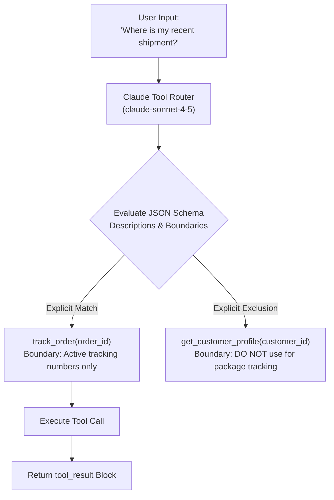

# Task Statement 2.1: Design Effective Tool Interfaces with Clear Descriptions and Boundaries

## 🎯 Exam Objective
Understand how Claude uses JSON Schema tool descriptions as an semantic router, how to define explicit operational boundaries and negative guidance ("When NOT to use"), and configure `tool_choice` for deterministic sequencing.

---

## 🏗️ Architecture: Tool Disambiguation & Routing Flow

---

## ⚠️ Critical Exam Distinctions & Anti-Patterns

| Tool Design Element | Best Practice Implementation | Exam Trap to Reject |
|---|---|---|
| **Negative Guidance** | Explicitly state what the tool should **not** be used for (e.g. "Do NOT call this tool for tracking numbers; use `track_order` instead"). | **TRAP**: Relying on vague names alone (e.g. `lookup_info`) without negative boundaries, causing frequent tool collision and misrouting. |
| **Parameter Constraints** | Specify concrete formats, regex, enums, and required flags in JSON Schema properties (e.g. `pattern: "^ORD-[0-9]{5}$"`). | **TRAP**: Passing open-ended `string` fields without constraints or validation rules. |
| **Deterministic Sequencing** | Use forced tool choice `tool_choice: {"type": "tool", "name": "verify_identity"}` on turn 1 to enforce sequence. | **TRAP**: Hoping the model chooses verification first via prompt instructions while keeping `tool_choice: "auto"`. |

---

## 💡 Architectural Decision Matrix

| Tool Configuration | Behavior | Best Use Case |
|---|---|---|
| `tool_choice: "auto"` | Model decides between tool call or text | General conversational agents and final resolution turns. |
| `tool_choice: "any"` | Model must invoke at least one tool | Exploration passes where text-only output is not permitted. |
| `tool_choice: {"type": "tool", "name": "..."}` | Model is strictly forced to run this specific tool | Turn 1 authentication, compliance gating, or mandatory telemetry capture. |

---

## 🛠️ Production Code Reference
- Interactive Workbook: [`ts_2_1_tool_interface_design.ipynb`](ts_2_1_tool_interface_design.ipynb)
- Runnable Script: [`main.py`](main.py)
- Offline Verification: Run via `uv run pytest tests/test_domain2_full.py` in WSL.
