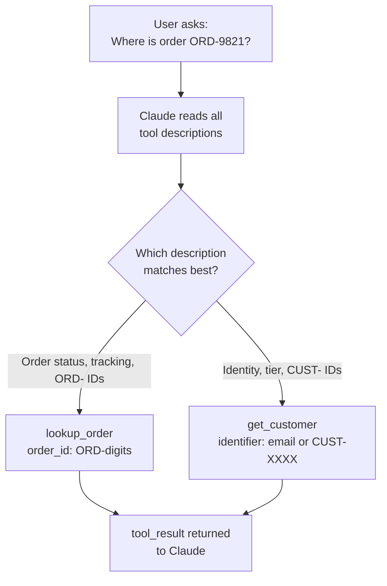

# Task Statement 2.1: Design Effective Tool Interfaces with Clear Descriptions and Boundaries

## In One Minute

- **What**: Claude picks a tool by reading its **name, description and input schema**. Nothing else.
- **Why it matters**: Two tools with thin or overlapping descriptions get confused. The agent calls the wrong one.
- **The fix**: Write rich descriptions: purpose, input formats, example queries, edge cases, and boundaries ("do NOT use for X; use Y").
- **Also**: Rename or split vague tools by purpose. Keyword-heavy system prompts can override good descriptions.
- **Exam answer in one line**: When the agent misroutes between similar tools, **expand the tool descriptions first**.

---

## 📌 Overview

- **Domain**: Domain 2: Tool Design & MCP Integration (**18%** of the exam)
- **Scenario alignment**: Scenario 1 (Customer Support)
- **What the exam tests**: A support agent calls `get_customer` when it should call `lookup_order`. You must pick the cheapest correct first step.
- **Study order**: 2.1 (this file) → [2.2](../ts_2_2_mcp_structured_errors/README.md) → [2.3](../ts_2_3_tool_distribution_and_choice/README.md) → [2.4](../ts_2_4_mcp_server_integration/README.md) → [2.5](../ts_2_5_builtin_tools_usage/README.md). Back to the [Domain 2 map](../README.md).

---

## 📖 Concepts Explained

### 1. The simple idea
A tool is a menu item. Claude reads the menu and orders one. If two items have almost the same text, Claude guesses.

### 2. Why it matters
Tool descriptions are routing instructions for the model. They are not documentation for people. Short descriptions such as `"Retrieves order details"` and `"Retrieves customer details"` look the same to the model. The result is wrong calls, bad arguments and wasted turns.

### 3. How a good description works
A strong description has five parts:
1. **Purpose**: what data it returns, in one or two sentences.
2. **Input formats**: what the argument looks like (`ORD-` plus digits, an email, a `CUST-XXXX` ID).
3. **Example queries**: two or three real user requests that should trigger it.
4. **Edge cases**: what happens on no match, partial match, bad format.
5. **Boundaries**: what it must NOT be used for, and which tool to use instead.

### 4. Rename and split vague tools
Two tools called `analyze_content` and `analyze_document` overlap. The model cannot tell them apart. Split by **purpose** and rename:

| Before | After | One job |
|---|---|---|
| `analyze_document` | `extract_data_points` | Pull fields out of one document |
| `analyze_document` | `summarize_content` | Write a short summary |
| `analyze_document` | `verify_claim_against_source` | Check a claim against the text |

### 5. System prompts can override descriptions
If the system prompt says "always check the account first", the model may keep calling `get_customer` for every question. Keyword-style wording in a system prompt competes with the tool descriptions. Review the prompt for words that push toward one tool.

### 6. Where `tool_choice` fits
Use `tool_choice` to force a mandatory step (see [2.3](../ts_2_3_tool_distribution_and_choice/README.md)). It is **not** the first fix for misrouting. Better descriptions come first.

---

## 🔑 Key Terms

- **Tool description**: The text that tells Claude when and how to use a tool. The primary selection mechanism.
- **Boundary statement**: A line such as "Do NOT use for tracking; use `lookup_order`".
- **Overlapping descriptions**: Two tools that read almost the same. A cause of misrouting.
- **Input format**: The exact shape of an argument, for example `ORD-9821`.
- **Split / rename**: Replace one vague tool by several single-purpose tools with clear names.

---

## 🏗️ Architecture

---

## 🧪 Worked Example (Customer Support)

**Problem**: The agent gets "Where is my package? Order ORD-9821". It calls `get_customer`.

1. **Look at the tools.** Both have one-line descriptions: "Retrieves customer details" and "Retrieves order details".
2. **Find the cause.** Nothing says which one handles tracking. The model guesses.
3. **Rewrite `lookup_order`.** Add purpose (status, carrier, return eligibility), input format (`ORD-` plus digits), examples ("Where is order ORD-9821?"), edge case (`found=false` if unknown), and a boundary ("not for profile lookups; use `get_customer`").
4. **Rewrite `get_customer`.** Add the mirror boundary: "Do NOT use for order tracking; use `lookup_order`".
5. **Retest.** The same request now routes to `lookup_order`.

The code in [main.py](main.py) has both tools, `audit_tool()` to flag thin descriptions and `description_overlap()` to measure how similar two descriptions are.

---

## ⚠️ Exam Traps and Correct Patterns

| Situation | Correct pattern | Trap | Why the trap fails |
|---|---|---|---|
| Agent picks `get_customer` instead of `lookup_order`, descriptions are minimal | **Expand the descriptions** with formats, examples, boundaries | Add few-shot examples to the prompt | Heavier, and does not fix the unclear tool text |
| Same situation | Expand the descriptions | Build a routing layer (keywords or classifier) | Brittle extra code. Fix the cause, not the symptom |
| Same situation | Expand the descriptions | Merge the tools into one | Makes the tool bigger and more ambiguous |
| `analyze_content` vs `analyze_document` overlap | Split and rename by purpose | Keep both and add a prompt rule | The prompt competes with the tool text |
| Agent over-uses one tool | Check the system prompt for keyword wording | Only tune the descriptions | The prompt can still override them |

---

## ❌ Common Mistakes

- Writing one-line descriptions like "Gets order details".
- Describing what the tool does but not what it must **not** do.
- Leaving argument formats out, so the model sends an email as an order ID.
- Keeping two tools with the same purpose under different names.
- Jumping to a routing layer or few-shot examples before fixing the descriptions.

---

## 💡 Quick Decision Rules

| If you see... | Do this |
|---|---|
| Wrong tool picked between similar tools | Expand descriptions (purpose, formats, examples, boundaries) |
| Two tools that overlap | Rename or split by purpose |
| One tool over-used despite good descriptions | Look for keyword wording in the system prompt |
| A mandatory first step | `tool_choice` forced (without thinking), see 2.3 |

---

## 🧠 Claude 4.5 Notes

- Use `claude-sonnet-4-5` for routing and reasoning, `claude-haiku-4-5` for workers.
- With extended thinking on: `budget_tokens` ≥ 1024 and below `max_tokens`. **Omit `temperature`** (HTTP 400). Leave `top_k` and `top_p` unset.
- With thinking on, `tool_choice` may only be `auto` or `none`. A forced tool or `any` returns HTTP 400. Force a tool on a request **without** thinking. This is the manual extended-thinking rule (Claude 4.5 models); adaptive thinking on newer models can accept forced tool use, except on some models.
- In tool loops, return thinking blocks and their signature unchanged.
- Loops stop on `stop_reason`, not on text. The iteration limit is only a **safety cap**.

---

## 🛠️ Hands-on Workbook Guide

Open [`ts_2_1_tool_interface_design.ipynb`](ts_2_1_tool_interface_design.ipynb). It runs offline.
1. **Load** the tools and the vague pair from [main.py](main.py).
2. **Audit** thin descriptions with `audit_tool()`.
3. **Measure** overlap with `description_overlap()`.
4. **Compare** the vague pair with the split tools.
5. **Dispatch** a request to `lookup_order` and check the result.

Run live API examples by hand only. See [EXECUTION_POLICY.md](../../EXECUTION_POLICY.md).

---

## 📝 Exam-Style Practice Questions

**Q1.** A support agent has `get_customer` ("Retrieves customer details") and `lookup_order` ("Retrieves order details"). It often calls `get_customer` for order questions. What is the best first step?
- A. Add few-shot examples of correct tool use to the system prompt.
- B. Expand each tool description with formats, example queries and boundaries.
- C. Add a keyword-based routing layer before the model.
- D. Merge both tools into one `get_info` tool.

**Q2.** A research agent has `analyze_content` and `analyze_document`. Both descriptions say "analyzes text". It alternates between them. What is the best fix?
- A. Rename and split by purpose: `extract_data_points`, `summarize_content`, `verify_claim_against_source`.
- B. Add a system prompt rule "prefer analyze_document".
- C. Set `tool_choice` to force `analyze_document` on every turn.
- D. Lower the temperature.

**Q3.** Tool descriptions are detailed, but the agent still calls `get_customer` first on every request. The system prompt says "Always check the customer account before doing anything". What is the most likely cause?
- A. The model cannot read long descriptions.
- B. `lookup_order` needs more parameters.
- C. The tool schemas are missing `additionalProperties`.
- D. The keyword-style system prompt instruction is overriding the tool descriptions.

### Answers

**Q1 → B.** Descriptions are the primary selection mechanism.
- A: Few-shot adds prompt weight and leaves the unclear tool text as is.
- C: A routing layer is brittle extra code for a cause that a description fix removes.
- D: Merging makes one larger, more ambiguous tool.

**Q2 → A.** Single-purpose names remove the overlap.
- B: A prompt rule competes with the tool text and hides the real problem.
- C: Forcing one tool means the other can never be used.
- D: Temperature does not change which description matches.

**Q3 → D.** Prompt wording can override descriptions. Remove or soften the keyword instruction.
- A: Long, detailed descriptions are the recommended practice.
- B: Parameters do not decide which tool is chosen first.
- C: `additionalProperties` affects validation, not selection.

---

## ✅ Self-Check Checklist

- [ ] I can name the five parts of a strong tool description.
- [ ] I can explain why overlapping descriptions cause misrouting.
- [ ] I know the first fix for misrouting: expand descriptions (not few-shot, routing layer or merging).
- [ ] I can split `analyze_document` into three single-purpose tools.
- [ ] I know a keyword-sensitive system prompt can override descriptions.

**Memory hook**: *"The description is the router. Fix the label before you fix the system."*
