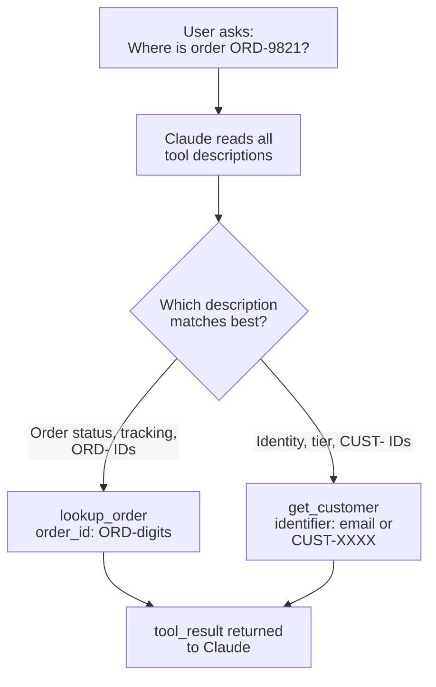

# Task Statement 2.1: Design Effective Tool Interfaces with Clear Descriptions and Boundaries

> Scenario alignment: Scenario 1 (Customer Support)

## In One Minute

- **What**: Claude picks a tool by reading its **name, description and input schema**. Nothing else.
- **Why it matters**: Two tools with thin or overlapping descriptions get confused. The agent calls the wrong one.
- **The fix**: Write rich descriptions: purpose, input formats, example queries, edge cases, and boundaries ("do NOT use for X; use Y").
- **Also**: Rename or split vague tools by purpose. Keyword-heavy system prompts can override good descriptions.
- **Exam answer in one line**: When the agent misroutes between similar tools, **expand the tool descriptions first**.

---

## 🧒 Explain Like I'm 13

**The picture:** Labels on kitchen drawers. A drawer labelled "stuff" gets the wrong things. A drawer labelled "forks and spoons, for eating, NOT knives" gets used correctly. Claude picks tools by **reading the labels** (descriptions), so fix the labels first.

**In plain steps:**
1. For each tool write what it returns, what input looks like (with an example), when to use it, and when **not** to.
2. If two tools do the same thing, rename or split them by purpose.
3. If a tool is still over-used, look for the system prompt saying "always use X".

**Tiny example:** "Retrieves customer information" vs "Retrieves order details" gets mixed up. "Customer PROFILE by CUST-id or email. Not for order status, use lookup_order" does not.

---

## 📖 Concepts Explained

### 1. Why it matters
Tool descriptions are routing instructions for the model. They are not documentation for people. Short descriptions such as `"Retrieves order details"` and `"Retrieves customer details"` look the same to the model. The result is wrong calls, bad arguments and wasted turns.

### 2. How a good description works
A strong description has five parts:
1. **Purpose**: what data it returns, in one or two sentences.
2. **Input formats**: what the argument looks like (`ORD-` plus digits, an email, a `CUST-XXXX` ID).
3. **Example queries**: two or three real user requests that should trigger it.
4. **Edge cases**: what happens on no match, partial match, bad format.
5. **Boundaries**: what it must NOT be used for, and which tool to use instead.

### 3. Rename and split vague tools
Two tools called `analyze_content` and `analyze_document` overlap. The model cannot tell them apart. Split by **purpose** and rename:

| Before | After | One job |
|---|---|---|
| `analyze_document` | `extract_data_points` | Pull fields out of one document |
| `analyze_document` | `summarize_content` | Write a short summary |
| `analyze_document` | `verify_claim_against_source` | Check a claim against the text |

### 4. System prompts can override descriptions
If the system prompt says "always check the account first", the model may keep calling `get_customer` for every question. Keyword-style wording in a system prompt competes with the tool descriptions. Review the prompt for words that push toward one tool.

### 5. Where `tool_choice` fits
Use `tool_choice` to force a mandatory step (see [2.3](../ts_2_3_tool_distribution_and_choice/README.md)). It is **not** the first fix for misrouting. Better descriptions come first.

---

## 🔑 Key Terms

- **Tool description**: The text that tells Claude when and how to use a tool. The primary selection mechanism.
- **Boundary statement**: A line such as "Do NOT use for tracking; use `lookup_order`".
- **Overlapping descriptions**: Two tools that read almost the same. A cause of misrouting.
- **Input format**: The exact shape of an argument, for example `ORD-9821`.
- **Split / rename**: Replace one vague tool by several single-purpose tools with clear names.

---

## 🏗️ Architecture



---

## 🧪 Worked Example (Customer Support)

**Problem**: The agent gets "Where is my package? Order ORD-9821". It calls `get_customer`.

1. **Look at the tools.** Both have one-line descriptions: "Retrieves customer details" and "Retrieves order details".
2. **Find the cause.** Nothing says which one handles tracking. The model guesses.
3. **Rewrite `lookup_order`.** Add purpose (status, carrier, return eligibility), input format (`ORD-` plus digits), examples ("Where is order ORD-9821?"), edge case (`found=false` if unknown), and a boundary ("not for profile lookups; use `get_customer`").
4. **Rewrite `get_customer`.** Add the mirror boundary: "Do NOT use for order tracking; use `lookup_order`".
5. **Retest.** The same request now routes to `lookup_order`.

The code in [main.py](main.py) has both tools, `audit_tool()` to flag thin descriptions and `description_overlap()` to measure how similar two descriptions are.

---

## ⚠️ Exam Traps and Correct Patterns

### Trap 1: Wrong tool picked because descriptions are thin

**Exam scenario**: The agent calls `get_customer` when the user asks "where is order #12345?". The two descriptions are "Retrieves customer information" and "Retrieves order details".

**Tempting answers**: (A) add few-shot examples to the prompt, (B) build a keyword or classifier routing layer, (C) merge both into one `lookup` tool.

**Why they tempt**: each treats the symptom (a wrong pick) with something concrete.

**Root cause**: the tool description is the **primary signal** the model uses to select a tool. Two vague descriptions give it nothing to separate them.

| Fix | Verdict |
|---|---|
| Few-shot in the prompt | Heavier, adds tokens on every request, leaves the unclear tool text in place |
| Routing layer | Extra brittle code that must be maintained next to the real cause |
| Merge into one tool | Bigger, more ambiguous schema. Selection gets harder, not easier |
| **Rewrite the descriptions** | Fixes the cause directly |

```json
// ANTI-PATTERN
{"name": "get_customer", "description": "Retrieves customer information"}

// PATTERN
{
  "name": "get_customer",
  "description": "Look up a customer PROFILE (name, email, tier, verified status) by customer ID (CUST-12345) or email. Use this to verify identity. Does NOT return orders: use lookup_order for order status, shipping, or items. Not for order numbers.",
  "input_schema": {"type": "object", "properties": {
    "customer_id": {"type": "string", "description": "Format CUST-12345"}}}
}
```

A good description states: what it returns, accepted input formats with an example, when to use it, and when **not** to use it (naming the sibling tool).

### Trap 2: Overlapping tools kept alive with a prompt rule

**Exam scenario**: `analyze_content` and `analyze_document` both "analyse text". The model alternates between them.

- Anti-pattern: keep both and add "use analyze_document for PDFs" to the system prompt. The prompt now competes with the tool text, and the two disagree over time.
- Pattern: remove the overlap. Rename or split by **purpose** (`extract_invoice_fields`, `summarize_web_page`), or drop one. A tool name should tell the model what it is for.

### Trap 3: The system prompt quietly overrides good descriptions

**Exam scenario**: Descriptions were fixed, but the agent still over-uses `search_web`. The system prompt contains "Always search before answering".

Keyword-style prompt wording like that acts as a strong rule and wins against tool descriptions. After rewriting descriptions, also grep the system prompt for "always", "never", and tool names. Tune descriptions **and** remove conflicting wording.

### Trap 4: No argument formats

```text
User: "Look up the order for jane@acme.com"
Tool arg description: "id: the identifier"
Model sends order_id="jane@acme.com"  -> validation error
```

Fix with explicit formats and examples in each parameter description (`order_id: ORD-2026-0001; not an email`).

---

## 🛠️ Hands-on Workbook Guide

Open [`ts_2_1_tool_interface_design.ipynb`](ts_2_1_tool_interface_design.ipynb). It runs offline.
1. **Load** the tools and the vague pair from [main.py](main.py).
2. **Audit** thin descriptions with `audit_tool()`.
3. **Measure** overlap with `description_overlap()`.
4. **Compare** the vague pair with the split tools.
5. **Dispatch** a request to `lookup_order` and check the result.

Run live API examples by hand only. See [EXECUTION_POLICY.md](../../EXECUTION_POLICY.md).

---

## 📝 Exam-Style Practice Questions

**Q1.** A support agent has `get_customer` ("Retrieves customer details") and `lookup_order` ("Retrieves order details"). It often calls `get_customer` for order questions. What is the best first step?
- A. Add few-shot examples of correct tool use to the system prompt.
- B. Expand each tool description with formats, example queries and boundaries.
- C. Add a keyword-based routing layer before the model.
- D. Merge both tools into one `get_info` tool.

**Q2.** A research agent has `analyze_content` and `analyze_document`. Both descriptions say "analyzes text". It alternates between them. What is the best fix?
- A. Rename and split by purpose: `extract_data_points`, `summarize_content`, `verify_claim_against_source`.
- B. Add a system prompt rule "prefer analyze_document".
- C. Set `tool_choice` to force `analyze_document` on every turn.
- D. Lower the temperature.

**Q3.** Tool descriptions are detailed, but the agent still calls `get_customer` first on every request. The system prompt says "Always check the customer account before doing anything". What is the most likely cause?
- A. The model cannot read long descriptions.
- B. `lookup_order` needs more parameters.
- C. The tool schemas are missing `additionalProperties`.
- D. The keyword-style system prompt instruction is overriding the tool descriptions.

### Answers

**Q1 → B.** Descriptions are the primary selection mechanism.
- A: Few-shot adds prompt weight and leaves the unclear tool text as is.
- C: A routing layer is brittle extra code for a cause that a description fix removes.
- D: Merging makes one larger, more ambiguous tool.

**Q2 → A.** Single-purpose names remove the overlap.
- B: A prompt rule competes with the tool text and hides the real problem.
- C: Forcing one tool means the other can never be used.
- D: Temperature does not change which description matches.

**Q3 → D.** Prompt wording can override descriptions. Remove or soften the keyword instruction.
- A: Long, detailed descriptions are the recommended practice.
- B: Parameters do not decide which tool is chosen first.
- C: `additionalProperties` affects validation, not selection.

---

## ✅ Self-Check Checklist

- [ ] I can name the five parts of a strong tool description.
- [ ] I can explain why overlapping descriptions cause misrouting.
- [ ] I know the first fix for misrouting: expand descriptions (not few-shot, routing layer or merging).
- [ ] I can split `analyze_document` into three single-purpose tools.
- [ ] I know a keyword-sensitive system prompt can override descriptions.

**Memory hook**: *"The description is the router. Fix the label before you fix the system."*
