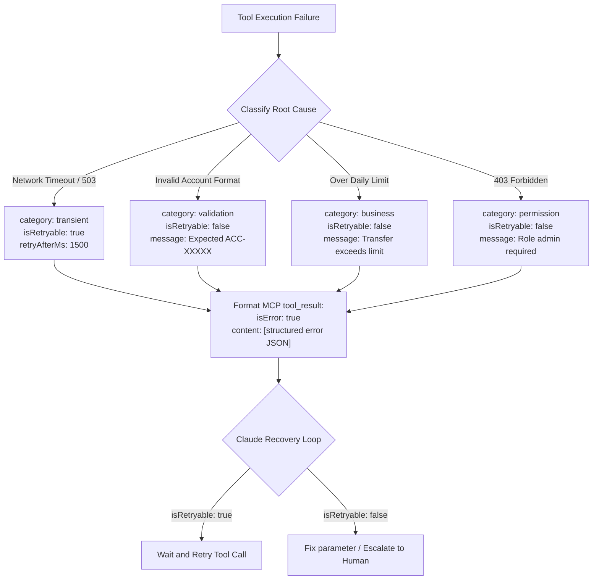

# Task Statement 2.2: Implement Structured Error Responses for MCP Tools

## 🎯 Exam Objective
Understand the Model Context Protocol (MCP) error contract, the `isError: true` flag, structured error taxonomy (`transient`, `validation`, `business`, `permission`), retryability signals, and the distinction between empty queries and execution failures.

---

## 🏗️ Architecture: MCP Structured Error Decision Flow

---

## ⚠️ Critical Exam Distinctions & Anti-Patterns

| Error Handling Pattern | Correct MCP Standard | Exam Trap to Reject |
|---|---|---|
| **Error Signaling Protocol** | Set `isError: true` on the `tool_result` and pass structured JSON detailing the failure reason. | **TRAP**: Throwing unhandled exceptions or returning HTTP 500 stack traces directly into the LLM context. |
| **Error Categorization** | Provide clear machine-readable taxonomy (`category: "transient" \| "validation" \| "business" \| "permission"`). | **TRAP**: Returning uniform generic text errors like `"Error: Operation failed"` which leaves Claude blind to whether a retry could succeed. |
| **Empty Results vs Failures** | Return successful `tool_result` with empty array `[]` when a search legitimately matches zero records. | **TRAP**: Setting `isError: true` when a database query finds 0 records, causing Claude to hallucinate system failure. |
| **Retry Coordination** | Explicitly include `isRetryable: boolean` to guide Claude's retry logic. | **TRAP**: Letting Claude blindly loop on permanent validation errors until iteration limits trigger. |

---

## 💡 Architectural Decision Matrix

| Failure Type | Category | `isRetryable` | Recommended Agent Action |
|---|---|---|---|
| **Downstream DB Timeout** | `transient` | `true` | Back off exponentially and re-execute. |
| **Invalid Regex Format** | `validation` | `false` | Re-format input parameters and retry with corrected payload. |
| **Insufficient Account Balance** | `business` | `false` | Halt transaction and explain policy limitation to customer. |
| **Missing Scope Token** | `permission` | `false` | Escalate to human supervisor; do not retry. |

---

## 🛠️ Production Code Reference
- Interactive Workbook: [`ts_2_2_mcp_structured_errors.ipynb`](ts_2_2_mcp_structured_errors.ipynb)
- Runnable Script: [`main.py`](main.py)
- Offline Verification: Run via `uv run pytest tests/test_domain2_full.py` in WSL.
