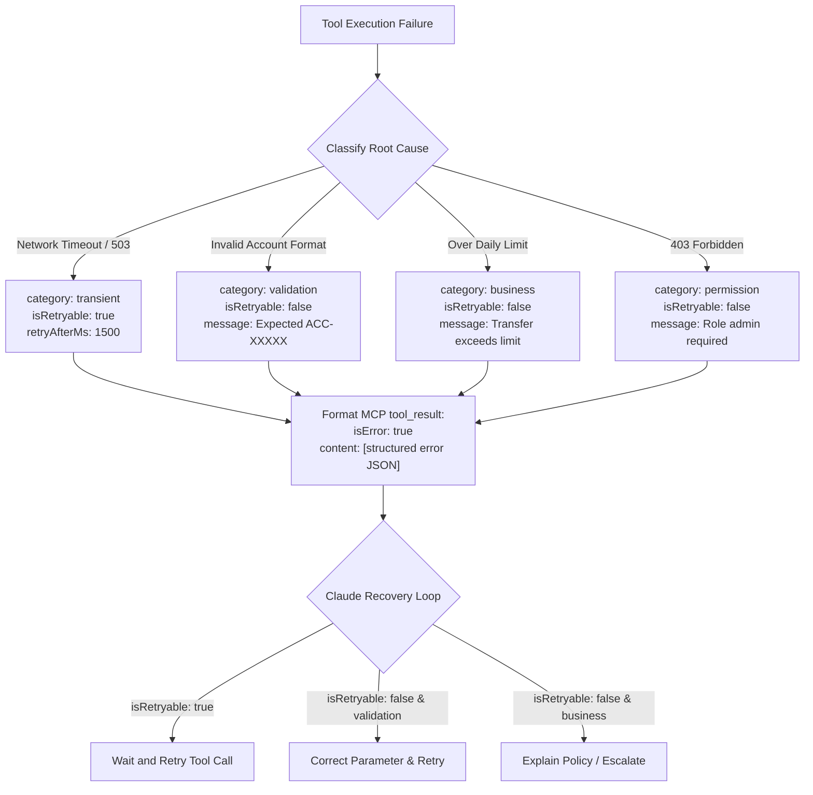

# Task Statement 2.2: Implement Structured Error Responses for MCP Tools

## 📌 Executive Overview: Goal, Scope & Exam Importance

### Certification Domain & Weight
- **Domain**: Domain 2: Tool Design & MCP Integration
- **Domain Weight**: 20% of total CCAR-F exam score
- **Scenario Alignment**: Scenario 1 (Customer Support) & Scenario 4 (Developer Productivity)

### The Core Goal
To design and implement robust, structured error responses for Model Context Protocol (MCP) tools. An architect must master the **`isError: true`** protocol flag, classify failures into a machine-readable **error taxonomy (`transient`, `validation`, `business`, `permission`)**, supply explicit **retryability signals (`isRetryable`)**, and distinguish **valid empty search results** from true execution failures.

### Why This Matters in Production
When an external tool fails in production (e.g. database timeout, invalid account number, insufficient funds), returning a generic error string like `"Error: Operation failed"` or dumping an unhandled 50-line Python stack trace leaves Claude blind. The model cannot determine:
1. Is this a temporary network glitch that will resolve in 1 second?
2. Did I format the parameter incorrectly?
3. Is this a hard business policy violation that must be escalated to a human?
Without structured error metadata, agents either enter **infinite retry loops** on permanent validation errors or **give up prematurely** on recoverable transient network drops.

### Exam Importance
Task Statement 2.2 is heavily tested through failure recovery scenarios. The exam will test whether you understand how MCP signals errors via `isError: true`, how Claude uses `isRetryable` to choose between backoff retries and parameter corrections, and why treating zero-record database queries as errors is a critical anti-pattern.

---

## 📖 Deep Narrative: Why We Do What We Do

### 1. The Problem: The Generic Error Blindspot
Consider an agent calling `transfer_funds(from_acc="A", to_acc="B", amount=500.0)`.
- **Case 1 (Network Hiccup)**: The backend payment gateway times out.
  - *Naive Return*: `"Error: Failed"`.
  - *Claude's Reaction*: Claude assumes the transfer failed permanently and tells the customer: *"I am unable to transfer funds."* (SLA breached!).
- **Case 2 (Permanent Policy Breach)**: The customer has only \$100 in their account.
  - *Naive Return*: `"Error: Failed"`.
  - *Claude's Reaction*: Claude thinks it was a glitch, retries the exact same call 10 times, exhausts iteration limits, and crashes.
- **Case 3 (Valid Empty Search)**: A customer searches for orders placed in 2019. The database returns 0 rows.
  - *Naive Return*: `{"isError": True, "error": "No orders found"}`.
  - *Claude's Reaction*: Claude tells the customer: *"Our order database is experiencing technical downtime."* (Hallucination!).

### 2. The Architectural Solution: MCP Structured Error Taxonomy
In production, every MCP tool failure adheres to the **Standard Error Contract**:
```json
{
  "type": "tool_result",
  "tool_use_id": "toolu_01AbC...",
  "isError": true,
  "content": [
    {
      "type": "text",
      "text": "{\n  \"error_code\": \"ERR_TIMEOUT\",\n  \"category\": \"transient\",\n  \"isRetryable\": true,\n  \"retryAfterMs\": 1500,\n  \"message\": \"Payment gateway timed out. Safe to retry with same idempotency key.\"\n}"
    }
  ]
}
```

### 3. The 4 Production Error Categories
1. **`transient` (`isRetryable: true`)**:
   - Timeouts, rate limits (HTTP 429), temporary connection drops.
   - Claude's Action: Pauses with exponential backoff and re-invokes the tool.
2. **`validation` (`isRetryable: false`)**:
   - Parameter regex mismatch, missing required subfield, invalid date format.
   - Claude's Action: Re-formats the input arguments and calls the tool again with corrected parameters.
3. **`business` (`isRetryable: false`)**:
   - Policy limit exceeded, insufficient balance, account suspended.
   - Claude's Action: Halts execution immediately and explains the policy limitation cleanly to the user.
4. **`permission` (`isRetryable: false`)**:
   - Insufficient role privileges, missing auth token.
   - Claude's Action: Reroutes to human supervisor or informs user of permission boundary.

### 4. The Empty Result Rule
A database query that executes successfully and returns **zero matching rows** is a **SUCCESSFUL OPERATION**, not an error!
- Return: `isError: false` with `content: "[]"` or `content: "{\"matches\": 0, \"records\": []}"`.
- Never set `isError: true` on valid empty search results.

---

## 🔑 Key Technical Terminology Explained

- **`isError` Flag**: A boolean property on an Anthropic / MCP `tool_result` message indicating whether the execution encountered a failure.
- **Error Taxonomy**: A standardized set of categorical failure types (`transient`, `validation`, `business`, `permission`) that provide semantic clarity to the LLM.
- **`isRetryable` Signal**: An explicit boolean guiding Claude's decision to re-execute the identical tool call versus taking an alternative action.
- **Valid Empty Result**: A successful query execution that returned zero records; must never be reported as an error.
- **Exponential Backoff**: Increasing wait duration between subsequent retries (e.g. 1s $\rightarrow$ 2s $\rightarrow$ 4s) to avoid overwhelming recovering services.

---

## 🏗️ Architecture: MCP Structured Error Decision Flow



---

## ⚠️ Critical Exam Distinctions & Distractor Teardown

| Error Handling Pattern | Correct MCP Standard | Exam Trap to Reject | Why the Trap Fails |
|---|---|---|---|
| **Error Signaling Protocol** | Set `isError: true` on the `tool_result` and provide structured JSON error metadata. | **TRAP**: Throwing unhandled Python exceptions or passing raw HTTP 500 HTML error pages. | Unhandled exceptions crash the host application; raw HTML dumps pollute context with unparseable markup. |
| **Error Granularity** | Provide machine-readable categories (`category: "transient" \| "validation" \| "business"`). | **TRAP**: Returning uniform generic text strings: *"Error: Operation failed"*. | Claude cannot determine whether retrying will succeed or fail, leading to either infinite loops or premature surrender. |
| **Empty Search Results** | Return `isError: false` with empty list `[]` when a valid query finds 0 matches. | **TRAP**: Setting `isError: true` when a database query finds zero records. | Claude assumes the database is broken or offline and hallucinates system outages to the user. |
| **Retry Guidance** | Provide explicit `isRetryable: boolean` in the error JSON payload. | **TRAP**: Letting Claude guess retryability based on system prompt rules. | Model guesses unpredictably; explicit flags provide deterministic recovery behavior. |

---

## 💡 Architectural Decision Matrix: Rules of Thumb

| Failure Scenario | Category | `isRetryable` | Recommended Action |
|---|---|---|---|
| **API 504 Gateway Timeout** | `transient` | `true` | Back off exponentially and re-execute. |
| **Malformed Date String** | `validation` | `false` | Inspect format requirement, fix argument, re-execute. |
| **Credit Card Limit Exceeded** | `business` | `false` | Halt immediately, explain policy to customer. |
| **Token Expired / Forbidden** | `permission` | `false` | Route to human supervisor or request re-authentication. |
| **0 Matches for Filter** | None (Success) | N/A | Return empty array `[]` with `isError: false`. |

---

## 🧠 Claude 4.5 Extended Thinking & Parameter Standards

- **Error Recovery Reasoning**: When Claude receives `isError: true` with a structured payload, Extended Thinking allows the model to dissect the error category during its reasoning phase and formulate an intelligent recovery plan before emitting its next action.
- **Sampling Rules**: Omit `temperature` whenever thinking is active.
- **Thinking Continuity**: When handling error retries, assistant thinking blocks from previous failed turns must be preserved with their cryptographic signatures.

---

## 🛠️ Hands-on Workbook Guide: Following the Code Step-by-Step

When exploring [`ts_2_2_mcp_structured_errors.ipynb`](ts_2_2_mcp_structured_errors.ipynb):
1. **Step 1: Setup & Error Contract Classes**: Defines structured error schemas conforming to MCP standards.
2. **Step 2: Simulating Transient Failures**: Demonstrates handling network timeouts with `isRetryable: true` and backoff.
3. **Step 3: Simulating Validation & Business Failures**: Demonstrates how Claude corrects invalid regex arguments and halts on business limits.
4. **Step 4: The Zero-Record Search Demonstration**: Verifies that empty query results are treated as clean successes (`isError: false`).
5. **Step 5: Verification Assertions**: Verifies that 100% of errors are categorized and zero unhandled exceptions escape to the user.
