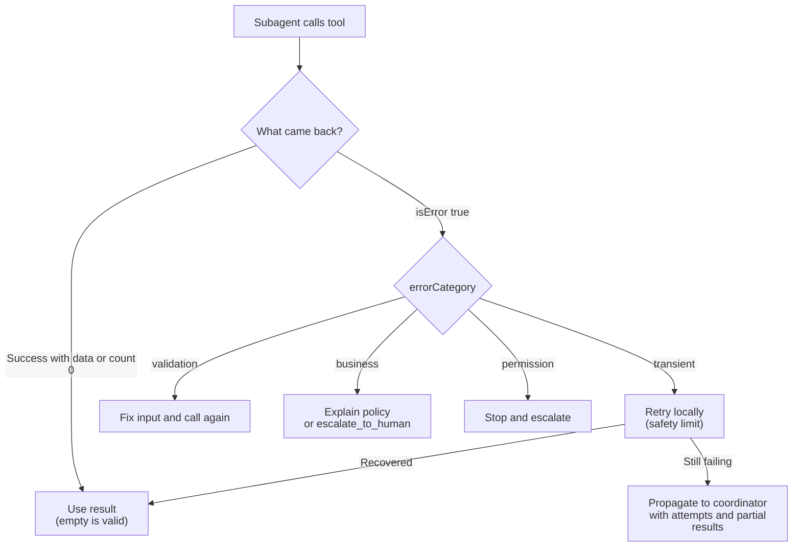

# Task Statement 2.2: Implement Structured Error Responses for MCP Tools

> Scenario alignment: Scenario 1 (Customer Support), also Scenario 3 (error propagation in research)

## In One Minute

- **What**: When a tool fails, return a **structured error**, not just "Operation failed".
- **Fields**: `isError: true`, `errorCategory` (`transient`, `validation`, `business`, `permission`), `isRetryable`, and a clear `message`.
- **Why**: The category tells the agent what to do next: retry, fix the input, explain the policy, or stop.
- **Two key rules**: A query that works but finds nothing is a **valid empty result** (`isError: false`). A subagent fixes transient errors itself and passes up only what it could not fix, with partial results.
- **Exam answer in one line**: Structured errors with category and retryability beat generic errors every time.

---

## 🧒 Explain Like I'm 13

**The picture:** A car dashboard. One light saying "PROBLEM" is useless. Real dashboards say *low fuel* (refill), *door open* (close it), *engine hot* (stop). Tool errors need the same: **what kind** of problem, **can I try again**, and **what do I tell the customer**.

**In plain steps:**
1. Return `isError: true` with a category: `transient` (try again), `validation` (fix the input), `business` (a rule says no), `permission` (not allowed).
2. Add `isRetryable` and a human message.
3. If the search simply found nothing, that is **not** an error: `isError: false`, `count: 0`.

**Tiny example:** An empty fridge is not a broken fridge. "No orders in January" is a good answer, not a failure.

---

## 📖 Concepts Explained

### 1. Why it matters
A uniform `"Operation failed"` hides the cause. The agent cannot tell a timeout from a policy block. It may retry something that can never work, or give up on something that would work on retry.

### 2. How it works: the four categories

| `errorCategory` | Typical cause | `isRetryable` | What the agent does |
|---|---|---|---|
| `transient` | Timeout, outage, rate limit | `true` | Retry the same call, with a limit |
| `validation` | Bad format, missing field | `false` | Fix the input, then call again |
| `business` | Rule such as refund over \$500 | `false` | Do not retry. Explain kindly or escalate |
| `permission` | Caller not allowed | `false` | Do not retry. Stop or escalate |

Every error carries a **human-readable message** that the agent can pass on. For business rules, write it in customer-friendly words.

```json
{
  "isError": true,
  "errorCategory": "business",
  "isRetryable": false,
  "message": "Refund amount $750.00 exceeds automated policy threshold of $500.00. Must be routed to a human supervisor for approval.",
  "details": {"max_allowed_automated": 500.0, "requested_amount": 750.0}
}
```

### 3. Access failure vs valid empty result
- **Access failure**: the tool could not reach or read the data. This is an error.
- **Valid empty result**: the tool searched fine and found nothing. This is **not** an error. Return `isError: false` with `count: 0` or `stock_count: 0`.

If you flag "no orders found" as an error, the agent retries a healthy system and may tell the customer the wrong thing.

### 4. Recovery in multi-agent systems
- A **subagent recovers locally** from transient errors (retry with a small limit).
- It **propagates only unresolved errors** to the coordinator.
- The propagated error includes **what was attempted** and any **partial results**. The coordinator can then decide with full facts.

---

## 🧪 Worked Example

### ❌ Invalid Example (Anti-Pattern / What Breaks)
*(Anti-Pattern: Generic String Errors & Treating Empty as Error)*
```json
// BROKEN 1: Returning vague plain-text error string
{
  "isError": true,
  "content": [{"type": "text", "text": "Error: Operation failed."}]
}
// Why it fails: Claude cannot distinguish if this was a network timeout (transient),
// an invalid parameter (validation), or a policy block (business). It loops retrying un-retryable actions!

// BROKEN 2: Treating zero search matches as a system failure
{
  "isError": true,
  "content": [{"type": "text", "text": "Error: 0 orders found for customer."}]
}
// Why it fails: Zero records found is a VALID factual answer (VALID_EMPTY). Treating it as an error
// causes subagents to retry queries against healthy databases and report false outages!
```

### ✅ Valid Example (Production Pattern)
*(Production Pattern: Structured Error Taxonomy & Valid Empty Result)*
```json
// CORRECT 1: Structured Business Rule Error (Non-retryable)
{
  "isError": true,
  "content": [{
    "type": "text",
    "text": "Refund of $750.00 exceeds automated tier limit of $500.00. Supervisor escalation required."
  }],
  "errorCategory": "business",
  "isRetryable": false,
  "details": {
    "requested_amount": 750.0,
    "max_allowed_automated": 500.0,
    "policy_rule": "FIN_RULE_44"
  }
}
// Result: Claude sees isRetryable=false and errorCategory="business" -> escalates immediately without looping!

// CORRECT 2: Valid Empty Search Result (isError: false)
{
  "isError": false,
  "content": [{"type": "text", "text": "{\"count\": 0, \"orders\": []}"}],
  "query": "customer_id=CUST-101",
  "result_status": "VALID_EMPTY"
}
```

**Walkthrough:**
1. Customer requests a \$750 refund. The agent calls `process_refund`.
2. Tool checks policy: automated limit is \$500.
3. Tool returns structured error with `errorCategory: "business"` and `isRetryable: false`.
4. Agent reads category: does **not** retry; invokes `escalate_to_human` with case facts.
5. Customer receives clear explanation: *"This amount exceeds automated limits and has been transferred to a supervisor."*
2. The subagent retries twice. The second retry works. The coordinator never sees an error.

And one more: the customer has no orders in January. `lookup_order` returns `isError: false`, `count: 0`. The agent says "You have no orders in January."

Code: `create_mcp_error()`, `validate_error_payload()`, `recovery_action()` and `recover_locally()` in [main.py](main.py).

---

## 🔑 Key Terms

- **`isError`**: A boolean flag on a Model Context Protocol tool result indicating whether the tool invocation encountered an execution failure or returned an error payload.
- **`errorCategory`**: A machine-readable taxonomy classifying the failure as `transient`, `validation`, `business`, or `permission` so Claude knows whether to retry, fix arguments, or escalate.
- **`isRetryable`**: A boolean property signaling whether repeating the exact same tool call could reasonably succeed without code or parameter modifications (`false` for business rule violations).
- **Valid empty result**: A successful query execution that accurately returns zero records (such as an empty search list), which must return `isError: false` rather than throwing an error.
- **Local recovery**: The subagent design pattern of attempting bounded retries for transient errors internally before escalating to the parent coordinator.
- **Partial results**: Meaningful data retrieved before an error occurred that is passed alongside failure metadata to help the coordinator make informed recovery decisions.

---

## 🏗️ Architecture



---

## ⚠️ Exam Traps and Correct Patterns

### Trap 1: One generic error for every failure

**Exam scenario**: Every failure returns `"Operation failed"`. The agent retries a rule violation three times and tells the user "a temporary issue occurred".

The agent needs three things to choose a recovery step: **what kind** of failure, **whether retrying can help**, and **what to tell the customer**.

```json
{
  "isError": true,
  "content": [{"type": "text", "text": "{\"errorCategory\": \"business\", \"isRetryable\": false, \"message\": \"Refunds over $500 need supervisor approval.\", \"customerMessage\": \"I need a supervisor to approve this refund.\"}"}]
}
```

| Category | Example | `isRetryable` | Agent action |
|---|---|---|---|
| `transient` | Timeout, 503 | true | Retry with backoff |
| `validation` | Bad order id format | false (until the input is fixed) | Correct the argument, call again |
| `business` | Over refund limit | false | Explain or escalate. Never retry |
| `permission` | Not authorised | false | Stop. Do not retry |

### Trap 2: Marking a business rule as retryable

A policy block does not change between attempts. If it is marked `transient` or `isRetryable: true`, the agent loops on a rule that will never pass, burning turns and confusing the customer. Retryable means "the same call may succeed later".

### Trap 3: Treating "no results" as an error

```json
// ANTI-PATTERN: valid empty result reported as a failure
{"isError": true, "content": [{"type": "text", "text": "Not found"}]}

// PATTERN: the query worked, the answer is zero
{"isError": false, "content": [{"type": "text", "text": "{\"count\": 0, \"orders\": []}"}]}
```

With the anti-pattern the agent retries and may tell the customer something broke. With the pattern it says "you have no orders in January". Opposite also matters: if the search **could not run**, that is an error. Never return an empty list for it, or the failure looks like evidence of absence.

### Trap 4: Where recovery happens

| Situation | Right | Wrong |
|---|---|---|
| Subagent gets a timeout | Retry locally two times | Escalate to the coordinator at once. Floods it with transient noise |
| Retries exhausted | Propagate: category, what was attempted, partial results, alternatives | Propagate only "failed". The coordinator loses the facts it needs to decide |

MCP uses camelCase `isError`. The Anthropic Messages API `tool_result` block uses snake_case `is_error`. Mixing them is silently ignored by some adapters.

---

## 📝 Exam-Style Practice Questions

**Q1.** A refund tool returns `{"isError": true, "message": "Operation failed"}` when a \$900 refund exceeds the limit. The agent retries three times. What change fixes this?
- A. Raise the retry limit so one retry succeeds.
- B. Return `errorCategory: "business"`, `isRetryable: false` and a clear policy message.
- C. Remove `isError` so the agent treats it as text.
- D. Return an HTTP 500 status string.

**Q2.** A customer asks for orders from January. The database is healthy and has none. Which result is correct?
- A. `isError: false`, `count: 0`, `orders: []`.
- B. `isError: true`, "No orders found".
- C. `isError: true`, `errorCategory: "transient"`.
- D. Throw an exception so the host handles it.

**Q3.** A search subagent's call times out twice. The third attempt fails too. It has 4 partial results from earlier calls. What should it return to the coordinator?
- A. Nothing, so the coordinator is not confused.
- B. A generic "search failed" message.
- C. The error with category, what was attempted, and the 4 partial results.
- D. Silently retry forever until it works.

### Answers

**Q1 → B.** The category and `isRetryable: false` stop the retries and give the agent a message to use.
- A: Retrying a policy rule never succeeds.
- C: The flag is how failures are marked. Removing it hides the failure.
- D: A raw status string has no category or retry guidance.

**Q2 → A.** The query worked. Zero matches is ground truth.
- B: It treats a valid empty result as a failure and triggers retries.
- C: Nothing transient happened.
- D: Exceptions skip the structured contract.

**Q3 → C.** Propagate unresolved errors with context and partial results.
- A: The coordinator loses the failure and the 4 results.
- B: A generic message gives no basis for a recovery decision.
- D: Unlimited retries burn tokens. Use a bounded local retry.

---

## ✅ Self-Check Checklist

- [ ] I can list the four categories and their `isRetryable` values.
- [ ] I know the fields: `isError`, `errorCategory`, `isRetryable`, `message`.
- [ ] I can explain why "Operation failed" is an anti-pattern.
- [ ] I can tell an access failure from a valid empty result.
- [ ] I know subagents retry transient errors locally and propagate only unresolved ones with partial results.

**Memory hook**: *"Name the failure, say if it can be retried, and never call an empty answer an error."*

---

## 🛠️ Hands-on Workbook Guide

Open [`ts_2_2_mcp_structured_errors.ipynb`](ts_2_2_mcp_structured_errors.ipynb). It runs offline.
1. **Create** transient, validation, business and permission errors.
2. **Validate** them with `validate_error_payload()`. A generic "Operation failed" is rejected.
3. **Check** that a zero-stock SKU is a valid empty result.
4. **Recover** a flaky call with `recover_locally()` and see an unresolved error carry its attempts.
5. **Assert** the schema fields on every error.

---

## 🧭 Navigation & Study Links
- ⬅️ **Previous Topic**: [TS 2.1: Tool Interface Design](../ts_2_1_tool_interface_design/README.md)
- 📋 **Domain Overview**: [Domain 2: Tool Design & Model Context Protocol (MCP)](../README.md)
- ➡️ **Next Topic**: [TS 2.3: Tool Distribution & Selection Strategies](../ts_2_3_tool_distribution_and_choice/README.md)
- 🎯 **Scenario Practice**: [Master Scenario Practice](../../scenarios/MASTER_SCENARIO_PRACTICE.md)
