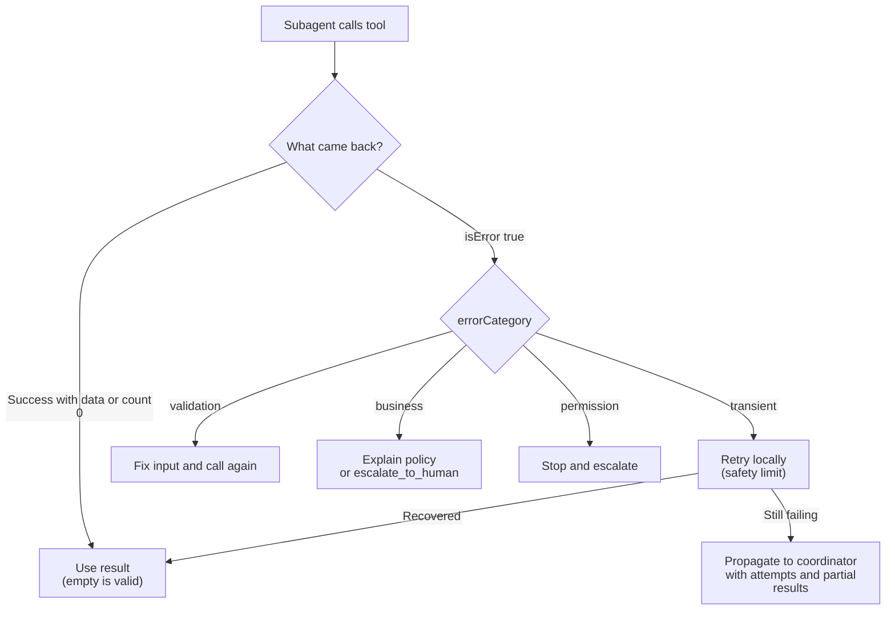

# Task Statement 2.2: Implement Structured Error Responses for MCP Tools

## In One Minute

- **What**: When a tool fails, return a **structured error**, not just "Operation failed".
- **Fields**: `isError: true`, `errorCategory` (`transient`, `validation`, `business`, `permission`), `isRetryable`, and a clear `message`.
- **Why**: The category tells the agent what to do next: retry, fix the input, explain the policy, or stop.
- **Two key rules**: A query that works but finds nothing is a **valid empty result** (`isError: false`). A subagent fixes transient errors itself and passes up only what it could not fix, with partial results.
- **Exam answer in one line**: Structured errors with category and retryability beat generic errors every time.

---

## 📌 Overview

- **Domain**: Domain 2: Tool Design & MCP Integration (**18%** of the exam)
- **Scenario alignment**: Scenario 1 (Customer Support), also Scenario 3 (error propagation in research)
- **What the exam tests**: Choosing the right error design. Telling an access failure from an empty result.
- **Study order**: [2.1](../ts_2_1_tool_interface_design/README.md) → 2.2 (this file) → [2.3](../ts_2_3_tool_distribution_and_choice/README.md). Back to the [Domain 2 map](../README.md).

---

## 📖 Concepts Explained

### 1. The simple idea
A good error is a note to the agent. It says what went wrong and what to do about it.

### 2. Why it matters
A uniform `"Operation failed"` hides the cause. The agent cannot tell a timeout from a policy block. It may retry something that can never work, or give up on something that would work on retry.

### 3. How it works: the four categories

| `errorCategory` | Typical cause | `isRetryable` | What the agent does |
|---|---|---|---|
| `transient` | Timeout, outage, rate limit | `true` | Retry the same call, with a limit |
| `validation` | Bad format, missing field | `false` | Fix the input, then call again |
| `business` | Rule such as refund over $500 | `false` | Do not retry. Explain kindly or escalate |
| `permission` | Caller not allowed | `false` | Do not retry. Stop or escalate |

Every error carries a **human-readable message** that the agent can pass on. For business rules, write it in customer-friendly words.

```json
{
  "isError": true,
  "errorCategory": "business",
  "isRetryable": false,
  "message": "Refund amount $750.00 exceeds automated policy threshold of $500.00. Must be routed to a human supervisor for approval.",
  "details": {"max_allowed_automated": 500.0, "requested_amount": 750.0}
}
```

### 4. Access failure vs valid empty result
- **Access failure**: the tool could not reach or read the data. This is an error.
- **Valid empty result**: the tool searched fine and found nothing. This is **not** an error. Return `isError: false` with `count: 0` or `stock_count: 0`.

If you flag "no orders found" as an error, the agent retries a healthy system and may tell the customer the wrong thing.

### 5. Recovery in multi-agent systems
- A **subagent recovers locally** from transient errors (retry with a small limit).
- It **propagates only unresolved errors** to the coordinator.
- The propagated error includes **what was attempted** and any **partial results**. The coordinator can then decide with full facts.

---

## 🔑 Key Terms

- **`isError`**: Flag on a tool result that marks a failure.
- **`errorCategory`**: One of `transient`, `validation`, `business`, `permission`.
- **`isRetryable`**: `true` only when retrying the same call can succeed. Business-rule errors use `false`.
- **Valid empty result**: Successful query with zero matches.
- **Local recovery**: Handling a transient error inside the subagent before reporting.
- **Partial results**: Data collected before the failure, passed up with the error.

---

## 🏗️ Architecture



---

## 🧪 Worked Example (Customer Support)

A customer asks for a $750 refund. The agent calls `process_refund`.

1. The tool checks the rule: automated limit is $500.
2. It returns `isError: true`, `errorCategory: "business"`, `isRetryable: false`, and a clear message.
3. The agent reads the category. It does **not** retry.
4. The agent calls `escalate_to_human` with the order ID, amount and reason.
5. It tells the customer: "This amount needs a supervisor's approval. I have passed your case on."

Now a different case: `lookup_order` times out.
1. Result: `errorCategory: "transient"`, `isRetryable: true`.
2. The subagent retries twice. The second retry works. The coordinator never sees an error.

And one more: the customer has no orders in January. `lookup_order` returns `isError: false`, `count: 0`. The agent says "You have no orders in January."

Code: `create_mcp_error()`, `validate_error_payload()`, `recovery_action()` and `recover_locally()` in [main.py](main.py).

---

## ⚠️ Exam Traps and Correct Patterns

| Situation | Correct pattern | Trap | Why the trap fails |
|---|---|---|---|
| Tool fails for any reason | Structured error with category, `isRetryable`, message | Return "Operation failed" | The agent cannot choose a recovery step |
| Refund above the limit | `business`, `isRetryable: false`, customer-friendly message | Mark it `transient` or retryable | The agent retries a rule that never changes |
| Search finds nothing | `isError: false`, `count: 0` | `isError: true`, "Not found" | Triggers pointless retries and false alarms |
| Subagent hits a timeout | Retry locally, propagate only if unresolved | Send every error to the coordinator | Floods the coordinator and wastes turns |
| Subagent gives up | Send error with attempts and partial results | Send only "failed" | The coordinator loses facts it needs |

---

## ❌ Common Mistakes

- Using one generic error for every failure.
- Treating zero results as an error.
- Marking policy blocks as retryable.
- Writing messages for developers only, not for the agent or customer.
- Hiding partial results when a multi-step job fails halfway.

---

## 💡 Quick Decision Rules

| If you see... | Do this |
|---|---|
| Timeout, outage | `transient`, `isRetryable: true`, retry locally |
| Bad input format | `validation`, `isRetryable: false`, fix input |
| Policy limit | `business`, `isRetryable: false`, explain or escalate |
| Not allowed | `permission`, `isRetryable: false`, stop |
| Zero matches, healthy query | Valid empty result, `isError: false` |

---

## 🧠 Claude 4.5 Notes

- `claude-sonnet-4-5` for the coordinator that reads errors, `claude-haiku-4-5` for subagents.
- With extended thinking: `budget_tokens` ≥ 1024 and below `max_tokens`. **Omit `temperature`**. Leave `top_k` and `top_p` unset. `tool_choice` may be only `auto` or `none`.
- Return thinking blocks and signatures unchanged in tool loops.
- The loop reacts to `stop_reason` (`tool_use`, `end_turn`, `max_tokens`, `pause_turn`, `refusal`). The iteration limit is a **safety cap**.
- In the Messages API a failed `tool_result` can set `is_error: true`. [main.py](main.py) sets it and also puts the structured JSON in `content`.

---

## 🛠️ Hands-on Workbook Guide

Open [`ts_2_2_mcp_structured_errors.ipynb`](ts_2_2_mcp_structured_errors.ipynb). It runs offline.
1. **Create** transient, validation, business and permission errors.
2. **Validate** them with `validate_error_payload()`. A generic "Operation failed" is rejected.
3. **Check** that a zero-stock SKU is a valid empty result.
4. **Recover** a flaky call with `recover_locally()` and see an unresolved error carry its attempts.
5. **Assert** the schema fields on every error.

---

## 📝 Exam-Style Practice Questions

**Q1.** A refund tool returns `{"isError": true, "message": "Operation failed"}` when a $900 refund exceeds the limit. The agent retries three times. What change fixes this?
- A. Raise the retry limit so one retry succeeds.
- B. Return `errorCategory: "business"`, `isRetryable: false` and a clear policy message.
- C. Remove `isError` so the agent treats it as text.
- D. Return an HTTP 500 status string.

**Q2.** A customer asks for orders from January. The database is healthy and has none. Which result is correct?
- A. `isError: false`, `count: 0`, `orders: []`.
- B. `isError: true`, "No orders found".
- C. `isError: true`, `errorCategory: "transient"`.
- D. Throw an exception so the host handles it.

**Q3.** A search subagent's call times out twice. The third attempt fails too. It has 4 partial results from earlier calls. What should it return to the coordinator?
- A. Nothing, so the coordinator is not confused.
- B. A generic "search failed" message.
- C. The error with category, what was attempted, and the 4 partial results.
- D. Silently retry forever until it works.

### Answers

**Q1 → B.** The category and `isRetryable: false` stop the retries and give the agent a message to use.
- A: Retrying a policy rule never succeeds.
- C: The flag is how failures are marked. Removing it hides the failure.
- D: A raw status string has no category or retry guidance.

**Q2 → A.** The query worked. Zero matches is ground truth.
- B: It treats a valid empty result as a failure and triggers retries.
- C: Nothing transient happened.
- D: Exceptions skip the structured contract.

**Q3 → C.** Propagate unresolved errors with context and partial results.
- A: The coordinator loses the failure and the 4 results.
- B: A generic message gives no basis for a recovery decision.
- D: Unlimited retries burn tokens. Use a bounded local retry.

---

## ✅ Self-Check Checklist

- [ ] I can list the four categories and their `isRetryable` values.
- [ ] I know the fields: `isError`, `errorCategory`, `isRetryable`, `message`.
- [ ] I can explain why "Operation failed" is an anti-pattern.
- [ ] I can tell an access failure from a valid empty result.
- [ ] I know subagents retry transient errors locally and propagate only unresolved ones with partial results.

**Memory hook**: *"Name the failure, say if it can be retried, and never call an empty answer an error."*
