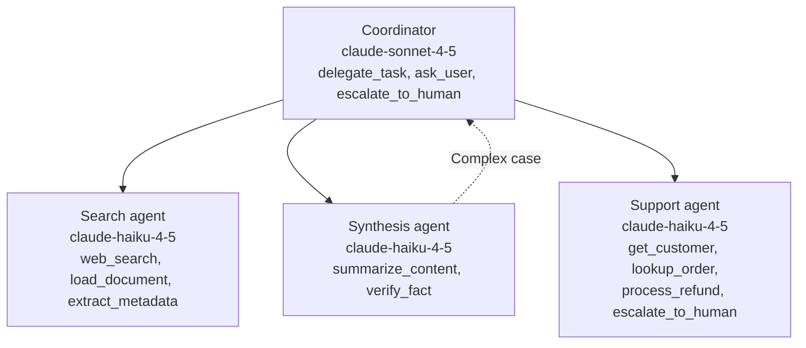

# Task Statement 2.3: Distribute Tools Across Agents and Configure Tool Choice

## In One Minute

- **What**: Give each agent only the few tools its role needs, and control **when** it must call a tool with `tool_choice`.
- **Why**: An agent with 18 tools picks worse than one with 4 or 5. Fewer tools also means fewer unsafe calls.
- **How**: Scope tools per role. Replace broad tools (`fetch_url`) with constrained ones (`load_document`). Give a synthesis agent a small scoped tool (`verify_fact`).
- **`tool_choice`**: `auto` (may return text), `any` (must call some tool), forced `{"type": "tool", "name": ...}` (must call that tool).
- **Thinking rule**: With extended thinking, only `auto` or `none` work. `any` or a forced tool is **HTTP 400**.
- **Exam answer in one line**: Scope tools to the role, and use a forced `tool_choice` (no thinking) for a mandatory first step.

---

## 📌 Overview

- **Domain**: Domain 2: Tool Design & MCP Integration (**18%** of the exam)
- **Scenario alignment**: Scenario 4 (Developer Productivity), also Scenario 3 (research synthesis)
- **What the exam tests**: Spotting tool overload, choosing the right `tool_choice`, and designing the cross-role `verify_fact` pattern.
- **Study order**: [2.2](../ts_2_2_mcp_structured_errors/README.md) → 2.3 (this file) → [2.4](../ts_2_4_mcp_server_integration/README.md). Back to the [Domain 2 map](../README.md).

---

## 📖 Concepts Explained

### 1. The simple idea
Give a worker a small toolbox that fits the job. Do not hand over the whole warehouse.

### 2. Why it matters
- More tools means more choices and more wrong picks. Going from 4–5 tools to 18 hurts accuracy.
- Every tool definition costs input tokens on every turn.
- A broad tool can do harm. An open `fetch_url` can reach any site.

### 3. How it works

**Scope tools per role**

| Role | Tools (4–5 max) |
|---|---|
| Support agent | `get_customer`, `lookup_order`, `process_refund`, `escalate_to_human` |
| Search agent | `web_search`, `load_document`, `extract_metadata` |
| Synthesis agent | `summarize_content`, `verify_fact` |
| Coordinator | `delegate_task`, `ask_user`, `escalate_to_human` |

**Constrain broad tools.** Replace `fetch_url` with `load_document`. It accepts only allowed hosts over https.

**Scoped cross-role tool.** The synthesis agent often needs to check one fact. Sending every check back through the coordinator is slow. Give it `verify_fact`: a narrow, read-only check. Complex cases (deep research, many sources) still go through the coordinator.

**`tool_choice` modes**

| Value | Behavior | Use when |
|---|---|---|
| `{"type": "auto"}` | Claude may call a tool or answer in text | Normal conversation, final answers |
| `{"type": "any"}` | Claude **must call some tool**. It cannot reply with chat text only | A step where text-only is not acceptable |
| `{"type": "tool", "name": "extract_metadata"}` | Claude must call **that** tool | A mandatory first step |
| `{"type": "none"}` | Claude may not call tools | Final text-only answer |

**Forced first step, then free choice.** Turn 1: force `extract_metadata`. Next turns: switch to `auto` so Claude can continue.

---

## 🔑 Key Terms

- **Least privilege**: Each agent gets only the tools its job needs.
- **Tool overload**: Too many tools, causing wrong or slow selection.
- **Constrained tool**: A narrow replacement for a broad one (`load_document` for `fetch_url`).
- **Scoped cross-role tool**: A small tool given to another role for a frequent need (`verify_fact`).
- **Forced tool choice**: `{"type": "tool", "name": ...}`.

---

## 🏗️ Architecture

---

## 🧪 Worked Example (Research Scenario)

**Problem**: A synthesis agent has 18 tools, including `web_search` and `fetch_url`. It keeps picking the wrong one and sometimes browses the open web.

1. **Count the tools.** 18 is far above the 4–5 target.
2. **Cut to role.** Synthesis keeps `summarize_content` and `verify_fact`. Search tools move to the search agent.
3. **Replace `fetch_url`.** The search agent gets `load_document`, which only allows listed hosts.
4. **Add `verify_fact`.** The synthesis agent can check one claim in one call. Hard cases go to the coordinator.
5. **Force the first step.** The search agent must always run `extract_metadata` first. Turn 1 uses `{"type": "tool", "name": "extract_metadata"}`. Later turns use `auto`. This request has **no** `thinking`.

Code: `ROLE_TOOLSETS`, `check_tool_budget()`, `load_document()`, `verify_fact()`, `tool_choice_for_turn()` and `validate_request_params()` in [main.py](main.py).

---

## ⚠️ Exam Traps and Correct Patterns

| Situation | Correct pattern | Trap | Why the trap fails |
|---|---|---|---|
| Synthesis agent needs fact checks often | Scoped `verify_fact` on the synthesis agent, complex cases via coordinator | Give it the full web search suite | Breaks scope and adds tool overload |
| Same need | Scoped `verify_fact` | Batch all checks into one blocking pass at the end | Adds delay and does not fix the round-trips |
| Agent has 18 tools and misselects | Split by role (4–5 each) | Add more prompt text | Does not reduce the choice set |
| Open `fetch_url` risk | Constrained `load_document` | Trust the prompt to behave | The tool can still reach anything |
| Must run a tool first | Forced `tool_choice` on turn 1 (no thinking) | `auto` and "please call it first" | Not guaranteed |
| Extended thinking plus forced tool | Do not combine. Use `auto` with thinking | `any` or forced with thinking | HTTP 400 |

---

## ❌ Common Mistakes

- Giving every agent every tool "just in case".
- Using `any` when you need one specific tool.
- Thinking `any` and forced work with extended thinking. They do not (HTTP 400).
- Forgetting to switch back to `auto` after the forced first step.
- Using `auto` and expecting a tool call. `auto` may return plain text.

---

## 💡 Quick Decision Rules

| If you see... | Do this |
|---|---|
| Many tools, bad selection | Scope per role, 4–5 tools |
| Broad generic tool | Replace with a constrained one |
| Frequent small cross-role need | Scoped tool, complex cases to coordinator |
| Must call a tool, any one | `any` (no thinking) |
| Must call a specific tool first | Forced named tool (no thinking), then `auto` |
| Thinking enabled | `auto` or `none` only |

---

## 🧠 Claude 4.5 Notes

- `claude-sonnet-4-5` coordinators, `claude-haiku-4-5` workers (constants in [main.py](main.py)).
- Extended thinking: `budget_tokens` ≥ 1024 and below `max_tokens`. **Omit `temperature`** (HTTP 400). Leave `top_k` and `top_p` unset.
- With extended thinking (the mode on Claude 4.5 models): `tool_choice` is only `auto` or `none`. `any` or forced returns HTTP 400. Force a tool on a request without `thinking`. Adaptive thinking on newer models can accept forced tool use, except on some models.
- When a tool loop continues with thinking, return the thinking blocks and signature unchanged.

---

## 🛠️ Hands-on Workbook Guide

Open [`ts_2_3_tool_distribution_and_choice.ipynb`](ts_2_3_tool_distribution_and_choice.ipynb). It runs offline.
1. **Count** tools in the 18-tool monolith vs scoped roles.
2. **Test** `load_document()` with allowed and blocked URLs.
3. **Build** `tool_choice` values for auto, any, none and forced.
4. **Validate** request params. See the thinking plus forced combination rejected.
5. **Assert** every role stays within 5 tools.

---

## 📝 Exam-Style Practice Questions

**Q1.** A synthesis agent must verify simple facts often. Each check goes through the coordinator and adds latency. A few checks are complex. What is the best design?
- A. Give the synthesis agent the full web search tool suite.
- B. Give it a scoped `verify_fact` tool. Route complex cases through the coordinator.
- C. Batch all verifications into one pass after synthesis finishes.
- D. Merge the synthesis and search agents into one agent with all tools.

**Q2.** A document pipeline must always run `extract_metadata` before anything else. Extended thinking is **off**. Which `tool_choice` on the first request is correct?
- A. `{"type": "auto"}` with a prompt reminder.
- B. `{"type": "any"}`.
- C. `{"type": "tool", "name": "extract_metadata"}`, then `auto` for later turns.
- D. `{"type": "none"}`.

**Q3.** A team enables extended thinking and sets `tool_choice` to `{"type": "any"}` so the model always calls a tool. The request fails. Why, and what is the fix?
- A. With thinking, only `auto` or `none` are allowed. Use `auto` with thinking, or drop thinking for the forced request.
- B. `any` is unsupported on Claude 4.5. Use `temperature: 0`.
- C. `budget_tokens` is too large. Lower it to 100.
- D. Thinking requires `top_k` to be set.

### Answers

**Q1 → B.** A narrow tool handles the common case. The coordinator keeps the complex ones.
- A: A full search suite breaks the role scope and causes tool overload.
- C: A final blocking pass adds delay and does not help the workflow in between.
- D: One agent with all tools is the overload anti-pattern.

**Q2 → C.** Forcing the named tool guarantees it. Then `auto` lets the loop continue.
- A: Prompt reminders are not guaranteed.
- B: `any` lets Claude pick a different tool.
- D: `none` forbids all tool calls.

**Q3 → A.** `any` and forced tools return HTTP 400 with thinking.
- B: `any` is supported. Temperature is the wrong lever and is rejected with thinking.
- C: `budget_tokens` must be at least 1024. 100 would also fail.
- D: `top_k` is unrelated to the failure. Leave it unset.

---

## ✅ Self-Check Checklist

- [ ] I can say why 4–5 tools beats 18.
- [ ] I can explain `load_document` vs `fetch_url`.
- [ ] I can describe the scoped `verify_fact` pattern and when the coordinator is still used.
- [ ] I can state what `auto`, `any` and forced do. `any` guarantees a tool call, not chat text.
- [ ] I know thinking allows only `auto` or `none`.

**Memory hook**: *"Small toolbox per role. `any` means any tool, forced means that tool, thinking means auto."*
