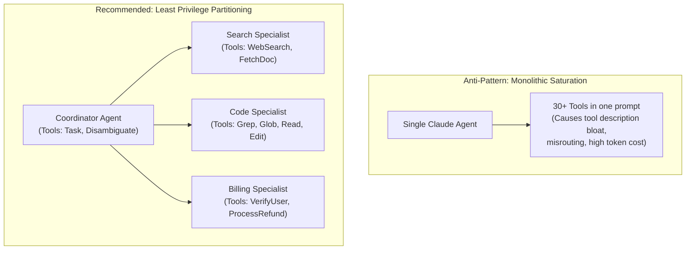

# Task Statement 2.3: Distribute Tools Appropriately and Configure Tool Choice

## 🎯 Exam Objective
Understand how to partition tool sets across specialized agents using the **Principle of Least Privilege**, prevent tool description saturation, and configure `tool_choice` modes (`auto`, `any`, specific tool) to control execution flow.

---

## 🏗️ Architecture: Tool Partitioning vs Monolithic Saturation

---

## ⚠️ Critical Exam Distinctions & Anti-Patterns

| Design Aspect | Recommended Architecture | Exam Trap to Reject |
|---|---|---|
| **Tool Suite Sizing** | Limit each agent to a compact, high-cohesion set (typically **3 to 6 tools**). | **TRAP**: Dumping every MCP tool from all servers into a single agent's context (Tool Saturation). |
| **Tool Choice Mode** | Use `tool_choice: {"type": "tool", "name": "..."}` when a specific prerequisite must execute first. | **TRAP**: Relying on prompt instructions to guarantee execution order while leaving `tool_choice: "auto"`. |
| **Tool Specialization** | Delegate complex tasks to subagents equipped only with the tools required for that subtask. | **TRAP**: Giving read-only research agents access to mutating database or payment tools. |

---

## 💡 Architectural Decision Matrix

| Tool Choice Setting | Behavior | When to Use on Exam |
|---|---|---|
| **`auto`** | Claude decides whether to call zero, one, or multiple tools, or generate text. | Default interactive mode; conversational turns and final synthesis. |
| **`any`** | Claude is forced to call *at least one* tool from its available suite, but picks which tool. | Pure exploratory steps where text-only responses are prohibited. |
| **`{"type": "tool", "name": "x"}`** | Claude is forced to call tool `x` specifically. | Authentication checks, security gating, mandatory telemetry. |

---

## 🛠️ Production Code Reference
- Interactive Workbook: [`ts_2_3_tool_distribution_and_choice.ipynb`](ts_2_3_tool_distribution_and_choice.ipynb)
- Runnable Script: [`main.py`](main.py)
- Offline Verification: Run via `uv run pytest tests/test_domain2_full.py` in WSL.
